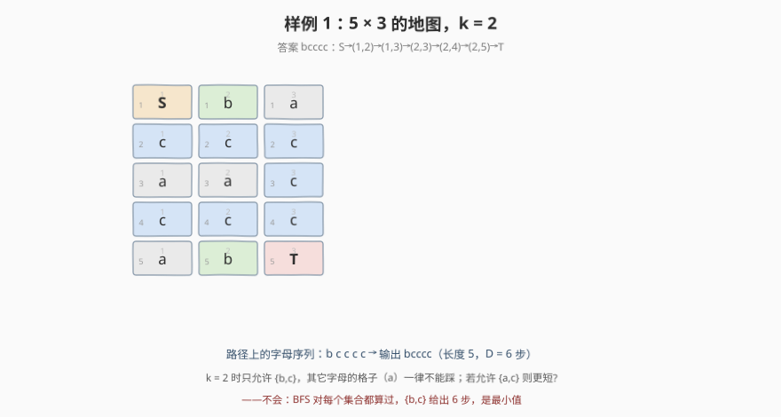
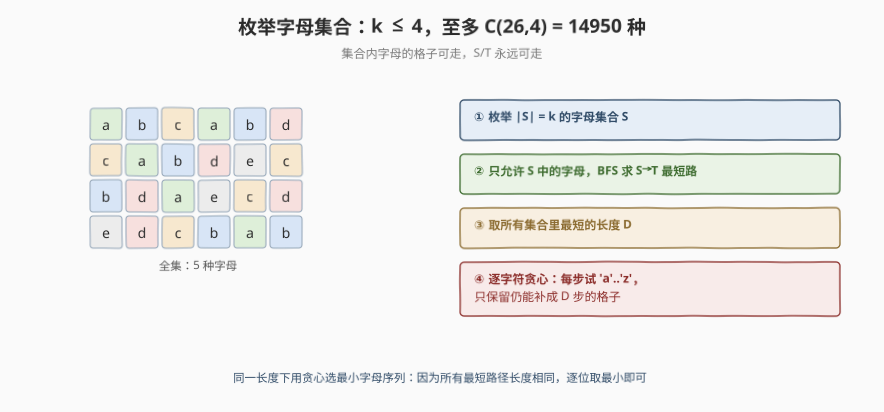

# Codeforces 83C 受限字母最短路 题解

## 1. 题目概述

- **题目链接**：https://codeforces.com/problemset/problem/83/C
- **比赛来源**：Codeforces Beta Round 72 (Div. 1 Only) · Problem C（UTC 2011-05-13）
- **难度**：2400
- **标签**：网格最短路、枚举子集、字典序贪心
- **评测类型**：普通（输出唯一）
- **限制**：时间 5 s / 内存 256 MB

**题意**：$n \times m$ 的地图，每格标一个小写字母表示地块类型，另有一个起点 $S$ 与终点 $T$。每次可以走到上下左右相邻格，耗时 $1$ 分钟。路径被限制为：**途中经过的不同地块类型不超过 $k$ 种**（同一种可以重复走）；$S$、$T$ 没有类型、不计入类型数，且 $S$ 只能作为起点出现一次、$T$ 只能作为终点出现一次。求 $S \to T$ 的最短时间；若最短路径有多条，输出**字典序最小**的那条（把路径写成途经地块的字母序列，不含 $S$ 与 $T$）。

**约束**：

- $1 \le n, m \le 50$，$n \cdot m \ge 2$：格子数至多 $2500$，单次 BFS 很便宜。
- $1 \le k \le 4$：这是关键——**允许的字母类型只有常数种**，可以枚举"到底用了哪几种字母"。
- 地图字母最多 $26$ 种：符合条件的字母集合数至多 $\binom{26}{4} = 14950$，与单次 BFS 相乘约 $3.7 \times 10^7$。
- 时间限制 $5$ s，比同场其他题宽松，正是为了容纳这种枚举。

## 2. 示例与观察

官方样例一：

```text
输入：
5 3 2
Sba
ccc
aac
ccc
abT
输出：
bcccc
```

官方样例二：

```text
输入：
3 4 1
Sxyy
yxxx
yyyT
输出：
xxxx
```

官方样例三：

```text
输入：
1 3 3
TyS
输出：
y
```

官方样例四：

```text
输入：
1 4 1
SxyT
输出：
-1
```

**样例一走查**：$k=2$，路径 `S→b→c→c→c→c→T` 只用 $\{b,c\}$ 两种字母，共 $6$ 步，输出途经字母 `bcccc`。若允许 $\{a,c\}$，则从 $S$ 出发只能向下走到 $c$（左/上是边界，右是 $b$ 不允许），走到 $T$ 需要更多步，所以最短仍是 $6$ 步。



**样例二走查**：$k=1$，只能选一种字母。用 $x$ 的话路径是 $S\to x\to x\to x\to x\to T$（第 $1$ 行第 $2$ 列出发，沿第 $2$ 行走到最右，再下到 $T$），共 $5$ 步、输出 `xxxx`；用 $y$ 则被 $x$ 挡住走不通。

**样例三**：一维地图 `T y S`，$S$ 只能向左经过 `y` 到达 $T$，输出 `y`（序列长度为 $1$，即 $D=2$ 步）。

**样例四**：`S x y T`，$k=1$ 但必须同时经过 $x$ 与 $y$，无解，输出 `-1`。

**观察**：一条路径合法，等价于"存在一个大小不超过 $k$ 的字母集合 $U$，路径只走 $U$ 中的字母（以及 $S$、$T$）"。于是可以枚举 $U$，在只允许 $U$ 的子图上求最短路。

## 3. 解题思路

### 3.1 朴素做法与瓶颈

直接 BFS 记录"已经用过哪些字母"作为状态：状态数是 $2500 \times 2^{26}$，爆炸。必须利用 $k \le 4$：路径真正用到的字母集合大小至多 $4$，而这样的集合只有 $\binom{26}{\le 4} = 17902$ 个。

### 3.2 核心观察：枚举字母集合



设地图上出现的不同字母有 $E$ 个（$E \le 26$）。对每个"大小恰好为 $\min(k, E)$"的字母集合 $U$：

- 在子图上 BFS：$S$、$T$ 永远可走，字母格可走当且仅当字母 $\in U$；
- 求出 $S \to T$ 的最短距离 $d_U$（不可达为 $\infty$）。

记 $D = \min_U d_U$。为什么只需枚举**最大**的集合？因为把字母加进 $U$ 只会增加可走的格子，最短路不会变长；对任何合法路径（其字母集合 $U_0$，$|U_0| \le k$），总能把它扩充成一个大小恰为 $\min(k,E)$ 的集合 $U \supseteq U_0$，于是 $d_U \le d_{U_0}$。所以最小值一定能在最大集合上取到。

### 3.3 字典序最小：逐字符贪心

长度 $D$ 已经确定，接下来要在所有长度恰为 $D$ 的可行路径中取字母序列字典序最小的一条。

对每个达到 $d_U = D$ 的集合 $U$，先做一次从 $T$ 出发的 BFS 得到 $dist[\cdot]$（到 $T$ 的最短距离）。然后从 $S$ 开始，一位一位地确定输出：

- 第 $t$ 步（$1 \le t < D$）时，维护"当前可能所在的格子集合" `cur`（这些格子都能用已确定的前缀在 $t-1$ 步走到，且 $dist = D - (t-1)$）；
- 枚举 `cur` 的所有邻居中满足 $dist = D - t$ 且字母 $\in U$ 的格子，取其中**字母最小**的，把输出追加该字母，并把所有取到该最小字母的格子作为新的 `cur`；
- 第 $D$ 步直接走向 $T$（不输出字母）。

对每个 $U$ 都这样做一遍，取所有结果里字典序最小的字符串。为什么可以"每个集合独立贪心再取最小"？因为任何合法路径的字母集合 $U_0$ 都可扩充到某个 $U$（见上），而在 $U$ 里得到的字典序最小路径不劣于该路径；反过来每个 $U$ 里得到的路径本身都是合法的（字母数 $\le |U| \le k$）。所以两边取最小即得全局最优。

### 3.4 样例走查

对照第 2 节那张路径图：

样例一（$5 \times 3$，$k=2$，字母 $a,b,c$，$E=3$）：枚举大小恰为 $2$ 的集合 $\{a,b\},\{a,c\},\{b,c\}$。

- $\{a,b\}$：$S$ 的邻居是 $b$（右）与 $c$（下，不允许），只能走 $b$，之后被 $c$ 挡住，$T$ 不可达。
- $\{a,c\}$：从 $S$ 向下进入 $c$ 区，但要绕到右下角的 $T$ 必须经过 $b$ 或更长的路；实际 $d = \infty$（右上角被封死）。
- $\{b,c\}$：最短 $6$ 步，输出 `bcccc`。

最小长度 $D = 6$，对应序列 `bcccc`。

## 4. 正确性证明

**引理 1（合法性刻画）**：一条 $S \to T$ 的路径合法，当且仅当存在字母集合 $U$，$|U| \le k$，使路径上所有字母格都属于 $U$。

**证明**：取 $U$ 为路径上实际出现的字母集合即可（$|U| \le k$）；反之若路径的字母都在 $U$ 中，则不同字母数 $\le |U| \le k$。∎

**引理 2（最大集合足够）**：设 $E$ 为地图上出现的字母种数，$kk = \min(k, E)$。则
$$\min_{|U| \le k} d_U = \min_{|U| = kk} d_U .$$

**证明**："$\ge$" 显然（右边是左边的子集）。对任意 $|U| \le k$，若 $|U| < kk$，可从地图字母中补入若干不在 $U$ 的字母，补到大小 $kk$（因为 $E \ge kk$ 且 $U$ 中都是地图字母）；补集合只增加可走格子，最短路不增，即 $d_{U'} \le d_U$。故右边 $\le$ 左边。∎

**引理 3（贪心逐位正确）**：固定集合 $U$ 与最短长度 $D$，上述逐位贪心得到的字符串是所有 $U$ 内长度 $D$ 路径中字典序最小的。

**证明**：对步数归纳。设在第 $t$ 步之前，`cur` 恰好是所有"前缀等于已输出串、且还能以 $D-t+1$ 步到达 $T$"的格子。第 $t$ 步中，任何可行的下一位字母都来自某个邻居格，其 $dist = D-t$；取最小字母 $c$ 后，所有能取到 $c$ 的格子都保留在 `cur` 中，因此下一步的候选集合既不漏（任何以 $c$ 开头的可行路径的当前位置都在其中）也不多（每个都在 $U$ 内且距 $T$ 恰好 $D-t$）。于是每一步都选了所有可行前缀中最小的一位，归纳得整个串字典序最小。∎

**引理 4（跨集合取最小正确）**：$\min_{|U| = kk} \bigl(\text{集合 } U \text{ 内的字典序最小最短路径}\bigr)$ 就是全局答案。

**证明**：任一合法路径 $P$ 的字母集合 $U_0$ 可扩充为 $|U| = kk$ 的集合 $U$（引理 2 的构造），$P$ 在 $U$ 内仍是长度 $D$ 的路径，故 $U$ 内的最小串 $\le P$。另一方面每个 $U$ 内的最小串都是合法路径（字母数 $\le kk \le k$）。所以取最小既不劣于任何合法解、自身又合法。∎

**定理**：算法输出的字符串是最短且字典序最小的合法路径；若无合法路径则输出 `-1`。

**证明**：由引理 2 得到正确的最短长度 $D$；由引理 3、4 得到该长度下字典序最小的合法序列。若无任何集合使 $T$ 可达，由引理 1 不存在合法路径，输出 `-1`。∎

## 5. 复杂度分析

- **时间**：枚举 $\binom{E}{kk} \le \binom{26}{4} = 14950$ 个集合；每个集合两次 BFS（求 $D$ 一次、字典序重构一次），每次 $O(nm)$。最坏 $2 \times 14950 \times 2500 \approx 7.5 \times 10^7$ 次格子访问，加上常数约 $3 \times 10^8$ 次简单操作，$5$ s 内可完成（实测约 $7$ ms 的最坏构造，见第 8 节）。
- **空间**：$O(nm)$ 的 `dist` 数组与队列，常数级额外空间。
- **字典序重构**：每个集合 $O(D \cdot |cur| \cdot 4)$，$D \le 2(n+m)$ 级别，整体不超过 BFS 的量级。
- **数值范围**：距离不超过 $nm \le 2500$，`int` 足够。

## 6. 参考代码

### C++17

```cpp
#include <bits/stdc++.h>
using namespace std;

int n, m, K;
vector<string> g;
int sr, sc, tr_, tc;
int E;                 // 出现的字母种数
int letterOf[26];      // 字母 -> 压缩编号（0..E-1）
int dist_[2500];
int SZ;

static const int DR[4] = {-1, 1, 0, 0};
static const int DC[4] = {0, 0, -1, 1};

inline bool allowed(int r, int c, int mask) {
    char ch = g[r][c];
    if (ch == 'S' || ch == 'T') return true;
    return (mask >> letterOf[ch - 'a']) & 1;
}

// BFS 从 T 出发（只在 mask 允许的格子上走），返回 dist(S)，-1 表示不可达
int bfs(int mask) {
    fill(dist_, dist_ + SZ, -1);
    static vector<int> q;
    q.clear();
    int t = tr_ * m + tc;
    dist_[t] = 0;
    q.push_back(t);
    for (size_t head = 0; head < q.size(); ++head) {
        int u = q[head], r = u / m, c = u % m;
        int d = dist_[u] + 1;
        for (int k = 0; k < 4; ++k) {
            int nr = r + DR[k], nc = c + DC[k];
            if (nr < 0 || nr >= n || nc < 0 || nc >= m) continue;
            int v = nr * m + nc;
            if (dist_[v] != -1 || !allowed(nr, nc, mask)) continue;
            dist_[v] = d;
            q.push_back(v);
        }
    }
    return dist_[sr * m + sc];
}

int bestD;
string bestString;

// mask 的最短长度恰为 D 时的字典序最小路径
void relax(int mask, int D) {
    bfs(mask);
    if (dist_[sr * m + sc] != D) return;
    vector<int> cur, nxt;
    cur.push_back(sr * m + sc);
    string res;
    res.reserve(D);
    for (int step = 1; step < D; ++step) {
        int bestCh = 26;
        nxt.clear();
        for (int u : cur) {
            int r = u / m, c = u % m;
            for (int k = 0; k < 4; ++k) {
                int nr = r + DR[k], nc = c + DC[k];
                if (nr < 0 || nr >= n || nc < 0 || nc >= m) continue;
                int v = nr * m + nc;
                if (!allowed(nr, nc, mask) || dist_[v] != D - step) continue;
                char ch = g[nr][nc];
                if (ch < 'a' || ch > 'z') continue;   // step < D 时不可能是 T
                int id = ch - 'a';
                if (id < bestCh) { bestCh = id; nxt.assign(1, v); }
                else if (id == bestCh) nxt.push_back(v);
            }
        }
        if (bestCh == 26) return;   // 理论上不会发生
        res.push_back((char)('a' + bestCh));
        cur.swap(nxt);
    }
    if (bestString.empty() || res < bestString) bestString = res;
}

int main() {
    scanf("%d %d %d", &n, &m, &K);
    g.resize(n);
    for (int i = 0; i < n; ++i) { char buf[128]; scanf("%s", buf); g[i] = buf; }
    SZ = n * m;
    bool present[26] = {false};
    for (int i = 0; i < n; ++i)
        for (int j = 0; j < m; ++j) {
            char ch = g[i][j];
            if (ch == 'S') { sr = i; sc = j; }
            else if (ch == 'T') { tr_ = i; tc = j; }
            else present[ch - 'a'] = true;
        }
    vector<int> letters;
    for (int i = 0; i < 26; ++i) if (present[i]) { letterOf[i] = (int)letters.size(); letters.push_back(i); }
    E = (int)letters.size();
    int kk = min(K, E);

    // 枚举恰好 kk 个字母的所有集合（更多字母只会让最短路更短，所以只需最大规模）
    vector<int> chosen(kk);
    bestD = INT_MAX;
    function<void(int, int, int)> comb = [&](int start, int cnt, int mask) {
        if (cnt == kk) {
            int d = bfs(mask);
            if (d >= 0 && d < bestD) bestD = d;
            return;
        }
        for (int i = start; i < E; ++i) comb(i + 1, cnt + 1, mask | (1 << i));
    };
    comb(0, 0, 0);
    if (bestD == INT_MAX) { printf("-1\n"); return 0; }
    bestString.clear();
    comb = [&](int start, int cnt, int mask) {
        if (cnt == kk) { relax(mask, bestD); return; }
        for (int i = start; i < E; ++i) comb(i + 1, cnt + 1, mask | (1 << i));
    };
    comb(0, 0, 0);
    printf("%s\n", bestString.c_str());
    return 0;
}
```

### Python3

```python
import sys
from itertools import combinations


def main() -> None:
    data = sys.stdin.buffer.read().split()
    if not data:
        return
    n = int(data[0]); m = int(data[1]); K = int(data[2])
    g = [data[3 + i].decode() for i in range(n)]
    sr = sc = tr = tc = -1
    present = [False] * 26
    for i in range(n):
        for j in range(m):
            ch = g[i][j]
            if ch == 'S':
                sr, sc = i, j
            elif ch == 'T':
                tr, tc = i, j
            else:
                present[ord(ch) - 97] = True
    letters = [i for i in range(26) if present[i]]
    E = len(letters)
    kk = min(K, E)
    idx = {c: i for i, c in enumerate(letters)}
    SZ = n * m
    dirs = ((-1, 0), (1, 0), (0, -1), (0, 1))

    def bfs(mask):
        dist = [-1] * SZ
        start = tr * m + tc
        dist[start] = 0
        q = [start]
        head = 0
        while head < len(q):
            u = q[head]; head += 1
            r, c = divmod(u, m)
            d = dist[u] + 1
            for dr, dc in dirs:
                nr, nc = r + dr, c + dc
                if 0 <= nr < n and 0 <= nc < m:
                    v = nr * m + nc
                    if dist[v] != -1:
                        continue
                    ch = g[nr][nc]
                    if ch == 'S' or ch == 'T' or (mask >> idx[ord(ch) - 97]) & 1:
                        dist[v] = d
                        q.append(v)
        return dist

    best_d = None
    for comb in combinations(range(E), kk):
        mask = 0
        for i in comb:
            mask |= 1 << i
        d = bfs(mask)[sr * m + sc]
        if d >= 0 and (best_d is None or d < best_d):
            best_d = d
    if best_d is None:
        sys.stdout.write("-1\n")
        return

    best_str = None
    for comb in combinations(range(E), kk):
        mask = 0
        for i in comb:
            mask |= 1 << i
        dist = bfs(mask)
        if dist[sr * m + sc] != best_d:
            continue
        cur = [sr * m + sc]
        res = []
        for step in range(1, best_d):
            best_ch = 26
            nxt = []
            for u in cur:
                r, c = divmod(u, m)
                for dr, dc in dirs:
                    nr, nc = r + dr, c + dc
                    if 0 <= nr < n and 0 <= nc < m:
                        v = nr * m + nc
                        if dist[v] != best_d - step:
                            continue
                        ch = g[nr][nc]
                        if not ('a' <= ch <= 'z'):
                            continue
                        if (mask >> idx[ord(ch) - 97]) & 1 == 0:
                            continue
                        o = ord(ch) - 97
                        if o < best_ch:
                            best_ch = o
                            nxt = [v]
                        elif o == best_ch:
                            nxt.append(v)
            if best_ch == 26:
                break
            res.append(chr(97 + best_ch))
            cur = nxt
        s = "".join(res)
        if best_str is None or s < best_str:
            best_str = s
    sys.stdout.write((best_str if best_str is not None else "") + "\n")


main()
```

## 7. 边界情况与易错点

1. **$S$ 与 $T$ 相邻**：最短路径 $D=1$，输出序列长度为 $0$，必须输出一个空行（不能输出 `-1`，也不能跳过输出）。
2. **无解**：所有集合都到不了 $T$ 时输出 `-1`，注意与"空序列"区分——空序列是**有解但长度为 $0$**。
3. **$k$ 大于地图上的字母种数**：此时 `kk = E`，只枚举全集一个集合；忘记 `min(k, E)` 会枚举空组合或越界。
4. **$E = 0$（地图只有 $S$ 和 $T$）**：`kk = 0`，组合只有空集，BFS 只允许 $S$、$T$，若不相邻则 `-1`。
5. **只枚举"恰好 $kk$ 个字母"的集合**：若误以为必须枚举所有 $\le k$ 的集合，结果虽然正确但会多花时间；反过来，若只枚举"恰好 $k$"而 $k > E$ 就会漏解，必须取 $\min(k,E)$。
6. **字典序重构时不要输出 $T$**：第 $t<D$ 步的候选格不可能是 $T$（因为 $T$ 的 $dist=0$ 而 $D-t \ge 1$），但代码里显式过滤非小写字母更稳妥。
7. **同一字母的多个格子要全部保留**：贪心时若只保留一个格子，可能选到一条无法继续的"死路"；必须把所有取到最小字母的格子放进 frontier。
8. **S、T 不计入字母数**：`allowed` 里必须无条件放行 `S`、`T`，否则起点或终点本身会被字母集合限制住。
9. **读入**：地图行内没有空格，用 `%s` / `split()` 逐行读即可；注意 `n=1` 或 `m=1` 的退化地图。

## 8. 验证记录

- **编译环境与命令**：`clang++ -std=c++17 -O2`（Apple clang 21.0.0 + `codeforces/tools/include` 的兼容头；代码只用标准库，可原样提交 GNU C++17），Python 3.9.6。
- **官方样例**：4 / 4 通过（`bcccc`、`xxxx`、`y`、`-1`），C++ 与 Python 输出一致。
- **独立暴力对拍**：暴力用 DFS 枚举**所有简单路径**（`vis` 回溯 + 已用字母集合），按"长度更短优先、同长度字典序更小"更新答案。对 $n \times m$ 为 $1\times3$、$2\times3$、$3\times3$、$3\times4$、$4\times3$ 的 **320 组**随机地图（字母集 $2 \sim 5$ 种，$k \in \{1,2,3\}$，$S/T$ 随机）与参考程序比对，**全部一致**（含大量 `-1` 与空序列情形）。
- **最大约束性能**：$50 \times 50$、$26$ 种字母、$k=4$ 且故意让 $S$ 与 $T$ 相邻（此时 $14950$ 个集合都等于同一个 $D$，字典序重构要对每个集合各做一次，是最坏情形），C++ 端到端 3 次取最小约 $7.2$ ms，Python 约 $275$ ms；另一组"走廊式"可行地图（$D=98$）C++ 约 $2.9$ ms。相对 5 s 余量充足。
- **图片校验**：`cf83c_masks.svg`、`cf83c_sample.svg` 均通过 `xml.etree.ElementTree.parse`，含 `feTurbulence` 与手写体字体族，文本包围盒未越出 `viewBox`。
- **公式校验**：KaTeX（`throwOnError`）渲染无报错；无 `---` 分隔线。
- **复核状态**：verified（样例、对拍、性能、图片、公式均实跑通过）。

## 相关题目与扩展

- [Codeforces 83B Doctor](https://codeforces.com/problemset/problem/83/B)：同场 B 题，队列与二分。
- [Codeforces 83A Magical Array](https://codeforces.com/problemset/problem/83/A)、[83D Numbers](https://codeforces.com/problemset/problem/83/D)、[83E Two Subsequences](https://codeforces.com/problemset/problem/83/E)：同场其余三题。
- [Codeforces 1340C Nastya and Unexpected Guest](https://codeforces.com/problemset/problem/1340/C)：分层图 BFS + 状态压缩的最短路。
- [LeetCode 1293. 网格中的最短路径](https://leetcode.cn/problems/shortest-path-in-a-grid-with-obstacles-elimination/)：带"消除障碍次数"状态的网格 BFS，与本题"字母预算"的思路同源。
- [Codeforces 1105D Kilo](https://codeforces.com/problemset/problem/1105/D)：多源 BFS、按时间分层扩张。

**延伸思考**：

1. **如果 $k$ 放大到 $10$**：$\binom{26}{10} \approx 5.3 \times 10^6$，再乘 $2500$ 就不可接受了；此时要换成"在状态里记录字母集合"的分层 BFS，并用支配关系剪枝（同一格子上，若已用集合是另一个的子集且距离不更长，则被支配）。
2. **如果要求输出路径的具体走法而非字母序列**：贪心时同时记录父指针即可；字母序列相同但走法不同时，题目目前把它们视为同一答案。
3. **如果 $S$ 和 $T$ 也算作某种类型**：只需在 `allowed` 里把它们当作集合内元素处理，其余逻辑不变，但"恰好 $kk$ 个"的枚举会出现歧义，需要小心计数。
4. **如果地图是加权图**：把 BFS 换成 Dijkstra，枚举字母集合的框架完全不变——这说明本题的核心是"枚举标签集合"，与最短路算法本身无关。

