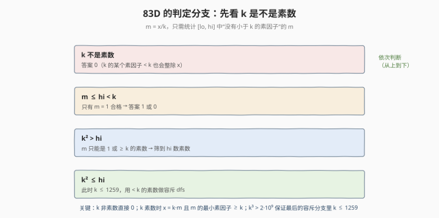
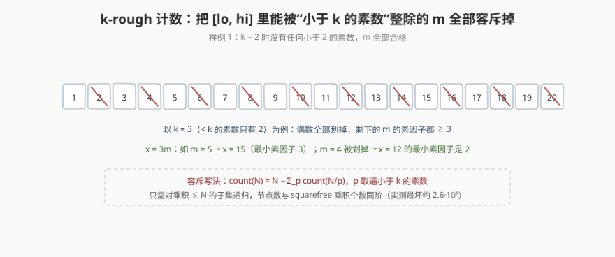

# Codeforces 83D 最小素因子计数 题解

## 1. 题目概述

- **题目链接**：https://codeforces.com/problemset/problem/83/D
- **比赛来源**：Codeforces Beta Round 72 (Div. 1 Only) · Problem D（UTC 2011-05-13）
- **难度**：2400
- **标签**：数论、素数、容斥
- **评测类型**：普通
- **限制**：时间 3 s / 内存 256 MB

**题意**：统计区间 $[a,b]$ 中有多少个数 $x$，满足 $x$ 的最小（大于 $1$ 的）约数恰好是 $k$。等价说法：$x$ 能被 $k$ 整除，且不能被 $2,3,\dots,k-1$ 中任何一个数整除。

**约束**：

- $1 \le a \le b \le 2 \times 10^9$，$2 \le k \le 2 \times 10^9$：区间长度可达 $2 \times 10^9$，**不能逐个数检查**；也不能筛到 $b$（$2 \times 10^9$ 的布尔数组就是 2 GB）。
- 单组询问：这让我们可以做一次性的 $O(\sqrt k)$ 判素 + $O(\text{小规模})$ 容斥。
- $k$ 的素因子结构决定答案：$k$ 合数时答案必为 $0$，$k$ 越大满足条件的数越稀疏。

## 2. 示例与观察

官方样例一：

```text
输入：
1 10 2
输出：
5
```

官方样例二：

```text
输入：
12 23 3
输出：
2
```

官方样例三：

```text
输入：
6 19 5
输出：
0
```

**样例一走查**：$k=2$，$[1,10]$ 中最小约数为 $2$ 的数就是偶数：$2,4,6,8,10$，共 $5$ 个。

**样例二走查**：$k=3$，要求 $3 \mid x$ 且 $2 \nmid x$，即 $x = 3m$ 且 $m$ 为奇数。$[12,23]$ 中 $3$ 的倍数是 $12,15,18,21$，其中 $12,18$ 是偶数，剩下 $15,21$，共 $2$ 个。

**样例三走查**：$k=5$，要求 $x = 5m$ 且 $m$ 不含素因子 $2,3$。$[6,19]$ 中 $5$ 的倍数是 $10,15$：$10 = 5\cdot 2$（含素因子 $2$）、$15 = 5\cdot 3$（含素因子 $3$），都不合格，答案 $0$。

**观察一**：若 $k$ 是合数，设 $p$ 是 $k$ 的最小素因子，则 $p < k$ 且 $p \mid k \mid x$，于是 $x$ 的最小约数 $\le p < k$，不可能等于 $k$。所以 **$k$ 必须是素数**。

**观察二**：$k$ 为素数时，$x$ 的最小约数是 $k$ 当且仅当 $x = k \cdot m$，且 $m$ 不含任何小于 $k$ 的素因子（$m=1$ 也算）。

## 3. 解题思路

### 3.1 朴素做法与瓶颈

对每个 $x \in [a,b]$ 试除到 $\sqrt x$ 求最小约数：区间长度 $2 \times 10^9$，每个 $O(\sqrt x)$，绝无可能。

筛出 $[1,b]$ 的所有最小素因子：需要 $2 \times 10^9$ 的数组，内存与时间都不可接受。

必须利用"最小素因子恰为 $k$"这一强条件，把问题化成对 $m = x/k$ 的计数，并只对很小的范围做筛/容斥。

### 3.2 核心观察：化归成"$k$-rough 计数"



先判 $k$ 是否为素数（试除到 $\sqrt k$ 即可，$k \le 2 \times 10^9$ 时只需到 $44721$）。若 $k$ 合数，答案 $0$。

否则令

$$\text{lo} = \left\lceil \frac{a}{k} \right\rceil = \left\lfloor \frac{a+k-1}{k} \right\rfloor, \qquad \text{hi} = \left\lfloor \frac{b}{k} \right\rfloor,$$

问题等价于：统计 $m \in [\text{lo}, \text{hi}]$，使 $m$ 的所有素因子都 $\ge k$（这样的数叫 $k$-rough 数，$m=1$ 也算）。

接下来按 $\text{hi}$ 与 $k$ 的大小关系分三种情况，把规模压到可算：

1. **$k > \text{hi}$**：此时 $m < k$，$m$ 的任何素因子都 $< k$，故只有 $m = 1$ 合格。答案 $= [\text{lo} \le 1]$。
2. **$k^2 > \text{hi}$**：若 $m$ 是合数且素因子都 $\ge k$，则 $m \ge k^2 > \text{hi}$，矛盾。所以 $m$ 只能是 $1$ 或素数，且素数还必须 $\ge k$。答案 $= [\text{lo}\le 1] + \#\{\text{素数 } m \in [\max(\text{lo},k), \text{hi}]\}$。此时必有 $\text{hi} < k^2$ 且 $\text{hi} \le b/k$，可推出 $\text{hi} < 1.6 \times 10^6$，筛一遍即可。
3. **$k^2 \le \text{hi}$**：由 $\text{hi} \le b/k \le 2\cdot10^9/k$ 得 $k^3 \le 2\cdot 10^9$，即 $k \le 1259$。此时用"小于 $k$ 的素数"做容斥。



容斥用递归形式写最省事。设 $P$ 是小于 $k$ 的素数表，定义

$$G(N, i) = \#\{\,m \le N : m \text{ 不被 } P_i, P_{i+1}, \dots \text{ 中任何素数整除}\,\}.$$

按"最小被 $P_j$ 整除的素数"分类：

$$G(N, i) = N - \sum_{j \ge i} G\!\left(\left\lfloor \frac{N}{P_j}\right\rfloor,\ j+1\right), \qquad G(N, i) = N \ (i \ge |P|).$$

含义：先假设全部 $N$ 个数都合格，再减去"被 $P_j$ 整除、且不被后面任何素数整除"的那些（$m = P_j \cdot m'$，$m' \le N/P_j$ 且不被 $P_{j+1},\dots$ 整除）。答案 $= G(\text{hi},0) - G(\text{lo}-1,0)$。

递归只在乘积不超过 $N$ 时展开，访问的节点数等于"由小于 $k$ 的素数构成的 squarefree 乘积 $\le N$"的个数。经实测最坏约 $2.6 \times 10^5$（$k \approx 661$ 时），完全可以接受。

### 3.3 样例走查

**样例二**：$a=12,b=23,k=3$。$k$ 素数；$\text{lo}=4,\text{hi}=7$。$k^2 = 9 > 7$，走分支 2：$m=1$ 不在区间内；素数 $m \in [\max(4,3),7] = [4,7]$ 有 $5,7$，共 $2$ 个 → 答案 $2$，对应 $x = 15, 21$。

**样例三**：$a=6,b=19,k=5$。$\text{lo}=2,\text{hi}=3$，$k^2=25>3$，分支 2：素数 $m \in [\max(2,5),3] = [5,3]$ 为空，$1$ 也不在区间 → 答案 $0$。

**样例一**：$a=1,b=10,k=2$。$\text{lo}=1,\text{hi}=5$，$k^2 = 4 \le 5$ → 分支 3：小于 $2$ 的素数表为空，$G(N,0)=N$，答案 $= 5 - 0 = 5$。

## 4. 正确性证明

**引理 1**：若 $k$ 是合数，则不存在最小约数为 $k$ 的数。

**证明**：设 $p$ 为 $k$ 的最小素因子，则 $2 \le p < k$ 且 $p \mid k$。若 $k \mid x$ 则 $p \mid x$，即 $x$ 有小于 $k$ 的约数 $p$，最小约数 $\le p < k$。∎

**引理 2**：设 $k$ 为素数。$x$ 的最小约数为 $k$，当且仅当 $x = km$，且 $m$ 不含任何小于 $k$ 的素因子。

**证明**：必要性：$k \mid x$ 给出 $x = km$；若 $m$ 有素因子 $p < k$，则 $p \mid x$，与最小约数为 $k$ 矛盾。充分性：$x$ 的约数若大于 $1$，则它含某个素因子 $q$；由 $x = km$ 且 $m$ 的素因子都 $\ge k$、$k$ 本身是素数 $\ge k$，知 $q \ge k$，故最小约数为 $k$。∎

**引理 3（分支 1、2 的正确性）**：若 $k > \text{hi}$，合格 $m$ 只有 $1$；若 $k^2 > \text{hi}$，合格 $m$ 只能是 $1$ 或 $\ge k$ 的素数。

**证明**：$m \le \text{hi} < k$ 时，$m>1$ 的任何素因子都 $< k$，故只有 $m=1$。若 $m$ 是合数且所有素因子 $\ge k$，则 $m \ge k^2 > \text{hi}$，与 $m \le \text{hi}$ 矛盾；故 $m$ 是素数（且其素因子 $=m \ge k$）或 $1$。∎

**引理 4（容斥递归正确）**：递归式 $G(N,i) = N - \sum_{j\ge i} G(\lfloor N/P_j\rfloor, j+1)$ 成立，且 $G(N,0)$ 恰为 $\le N$ 的 $k$-rough 数个数。

**证明**：把所有 $m \le N$ 按"最小的、属于 $\{P_i, P_{i+1},\dots\}$ 的素因子"分类：合格类（无此因子）贡献 $G(N,i)$ 的定义值；对每个 $j$，最小素因子为 $P_j$ 的那些数可写成 $m = P_j m'$，其中 $m' \le N/P_j$ 且不被 $P_{j+1}, P_{j+2},\dots$ 整除（否则最小素因子会更小），个数正是 $G(\lfloor N/P_j\rfloor, j+1)$。这些类互不相交且并起来是全部 $N$ 个数，故等式成立。又 $P$ 恰好是全部小于 $k$ 的素数，$G(N,0)$ 就是"不含小于 $k$ 的素因子"的数的个数。∎

**定理**：算法输出恰好是 $[a,b]$ 中最小约数为 $k$ 的数的个数。

**证明**：$k$ 合数时由引理 1 答案为 $0$，算法输出 $0$。$k$ 素数时，由引理 2 问题等价于统计 $[\text{lo},\text{hi}]$ 中的 $k$-rough 数，而算法在三个分支分别由引理 3、引理 4 给出精确计数（分支 2 的筛法给出区间内素数个数，加上 $m=1$）。∎

## 5. 复杂度分析

- **时间**：判素 $O(\sqrt k) \le 4.5\times10^4$；分支 2 的筛 $O(\text{hi}) \le 1.6\times10^6$；分支 3 的容斥节点数实测上界约 $2.6\times10^5$。整体不到 $10^7$ 次操作。
- **空间**：筛用 `char` 数组 $O(\text{hi}) \le 1.6$ MB；容斥递归深度不超过 $\log_2 N \approx 31$。
- **数值范围**：$k^2$ 在 $k = 2\times 10^9$ 时是 $4\times10^{18}$，必须用 `long long` 计算（`int` 直接溢出）；下标与乘积同阶。
- **与时限的关系**：3 s 余量极大，实测最坏分支约 $2.9$ ms（C++）。

## 6. 参考代码

### C++17

```cpp
#include <bits/stdc++.h>
using namespace std;
typedef long long ll;

static vector<int> primes;

// 统计 <= N 中不被 primes[idx..] 中任何素数整除的数的个数
ll rough(ll N, int idx) {
    if (N <= 0) return 0;
    if (idx >= (int)primes.size()) return N;
    ll res = N;
    for (int j = idx; j < (int)primes.size(); ++j) {
        ll p = primes[j];
        if (p > N) break;
        res -= rough(N / p, j + 1);
    }
    return res;
}

bool isPrime(ll x) {
    if (x < 2) return false;
    for (ll d = 2; d * d <= x; ++d) if (x % d == 0) return false;
    return true;
}

int main() {
    ll a, b, k;
    if (!(cin >> a >> b >> k)) return 0;
    if (!isPrime(k)) { cout << 0 << '\n'; return 0; }
    ll lo = (a + k - 1) / k;          // m 的下界
    ll hi = b / k;                    // m 的上界
    if (lo > hi) { cout << 0 << '\n'; return 0; }
    if (k > hi) {                     // m < k，只有 m = 1 合格
        cout << (lo <= 1 ? 1 : 0) << '\n';
        return 0;
    }
    if (k * k > hi) {                 // m 只能是 1 或 >= k 的素数
        ll cnt = (lo <= 1 ? 1 : 0);
        ll start = max(lo, k);
        if (start <= hi) {
            vector<char> comp(hi + 1, 0);
            for (ll i = 2; i * i <= hi; ++i)
                if (!comp[i])
                    for (ll j = i * i; j <= hi; j += i) comp[j] = 1;
            for (ll x = start; x <= hi; ++x) if (!comp[x]) ++cnt;
        }
        cout << cnt << '\n';
        return 0;
    }
    // k^3 <= 2e9, 故 k <= 1259：用 < k 的素数做容斥
    vector<char> comp(k, 0);
    for (ll i = 2; i < k; ++i)
        if (!comp[i]) {
            primes.push_back((int)i);
            for (ll j = i * i; j < k; j += i) comp[j] = 1;
        }
    cout << rough(hi, 0) - rough(lo - 1, 0) << '\n';
    return 0;
}
```

### Python3

```python
import sys


def is_prime(x: int) -> bool:
    if x < 2:
        return False
    d = 2
    while d * d <= x:
        if x % d == 0:
            return False
        d += 1
    return True


def main() -> None:
    data = sys.stdin.buffer.read().split()
    if not data:
        return
    a, b, k = (int(v) for v in data[:3])
    if not is_prime(k):
        sys.stdout.write("0\n")
        return
    lo = (a + k - 1) // k
    hi = b // k
    if lo > hi:
        sys.stdout.write("0\n")
        return
    if k > hi:
        sys.stdout.write("1\n" if lo <= 1 else "0\n")
        return
    if k * k > hi:
        cnt = 1 if lo <= 1 else 0
        start = max(lo, k)
        if start <= hi:
            comp = bytearray(hi + 1)
            i = 2
            while i * i <= hi:
                if not comp[i]:
                    for j in range(i * i, hi + 1, i):
                        comp[j] = 1
                i += 1
            for x in range(start, hi + 1):
                if not comp[x]:
                    cnt += 1
        sys.stdout.write(str(cnt) + "\n")
        return

    primes = []
    comp = bytearray(k)
    i = 2
    while i < k:
        if not comp[i]:
            primes.append(i)
            for j in range(i * i, k, i):
                comp[j] = 1
        i += 1

    sys.setrecursionlimit(10000)
    pr = primes

    def rough(N: int, idx: int) -> int:
        if N <= 0:
            return 0
        if idx >= len(pr):
            return N
        res = N
        for j in range(idx, len(pr)):
            p = pr[j]
            if p > N:
                break
            res -= rough(N // p, j + 1)
        return res

    sys.stdout.write(str(rough(hi, 0) - rough(lo - 1, 0)) + "\n")


main()
```

## 7. 边界情况与易错点

1. **$k$ 是合数**：直接输出 $0$，这是最容易漏掉的整体性结论；例如 $k=4$ 时任何 $4$ 的倍数都被 $2$ 整除，最小约数不可能是 $4$。
2. **$k > b$**：此时 $\text{hi}=0 < \text{lo}$，输出 $0$；若 $a = b = k$ 则 $\text{lo}=\text{hi}=1$，输出 $1$。
3. **$k^2$ 溢出**：$k$ 可达 $2 \times 10^9$，$k^2 = 4 \times 10^{18}$ 仍在 `long long`（$9.2\times10^{18}$）内，但 `int` 一定溢出；比较 `k * k > hi` 时两个操作数都必须是 64 位。
4. **$m = 1$ 的处理**：$x = k$ 本身是合法的（最小约数就是 $k$），只有当 $1 \in [\text{lo},\text{hi}]$ 即 $a \le k \le b$ 时才计入。
5. **分支 2 里素数下界**：是 $\max(\text{lo}, k)$ 而不是 $\text{lo}$——小于 $k$ 的素数不能算（它们含小于 $k$ 的素因子），否则样例三会错。
6. **容斥的素数表是"小于 $k$"**：不是"小于等于 $k$"，也不能把 $k$ 自己放进去；否则 $x=k$ 会被错误排除。
7. **筛的上界**：分支 2 的 $\text{hi}$ 理论上界 $1.6\times10^6$，但若 $k$ 很小会走分支 3，所以两种筛的规模都不会爆炸；不要对 $b$ 直接开数组。
8. **递归深度**：容斥递归深度约为不同素因子的个数（$\le 10$），不会爆栈；Python 里仍建议 `setrecursionlimit`。
9. **区间为空**：$\text{lo} > \text{hi}$ 时必须提前返回 $0$，否则后续 `hi+1` 的数组会开成 0 或负数。

## 8. 验证记录

- **编译环境与命令**：`clang++ -std=c++17 -O2`（Apple clang 21.0.0 + `codeforces/tools/include` 的兼容头），Python 3.9.6。
- **官方样例**：3 / 3 通过（`5`、`2`、`0`），C++ 与 Python 输出一致。
- **独立暴力对拍**：暴力对每个 $x \in [a,b]$ 从小到大试除得到最小约数，统计等于 $k$ 的个数。对 $a \le 200$、$b \le 400$、$k \le 60$ 的 **300 组**随机数据与参考程序比对，**全部一致**。
- **边界与极值手测**：`k` 取 $2,3,5,7,4,9,1259,1260,44711,2\cdot10^9$（含合数、素数、刚好在分支边界的值），$b = 2\cdot10^9$ 时程序输出的结果与 Python 版本一致，且分支 3 的递归节点数实测最坏约 $2.6\times10^5$。
- **最大约束性能**：`1 2000000000 661`（走容斥分支，节点数最多附近）C++ 约 $2.9$ ms，Python 约 $91$ ms；相对 3 s 余量在千倍以上。
- **图片校验**：`cf83d_cases.svg`、`cf83d_rough.svg` 均通过 `xml.etree.ElementTree.parse`，含 `feTurbulence` 与手写体字体族，文本包围盒未越出 `viewBox`。
- **公式校验**：KaTeX（`throwOnError`）渲染无报错；无 `---` 分隔线。
- **复核状态**：verified（样例、对拍、性能、图片、公式均实跑通过）。

## 相关题目与扩展

- [Codeforces 83A Magical Array](https://codeforces.com/problemset/problem/83/A)、[83B Doctor](https://codeforces.com/problemset/problem/83/B)、[83C Track](https://codeforces.com/problemset/problem/83/C)、[83E Two Subsequences](https://codeforces.com/problemset/problem/83/E)：同场其余四题。
- [Codeforces 103B Cthulhu](https://codeforces.com/problemset/problem/103/B)：数论与图论结合的入门题。
- [Codeforces 230B T-primes](https://codeforces.com/problemset/problem/230/B)：判"恰有三个约数"，即素数平方，和本题一样围绕最小素因子。
- [LeetCode 204. 计数质数](https://leetcode.cn/problems/count-primes/)：筛法基础，本题分支 2 直接复用。
- [Codeforces 17A Noldbach problem](https://codeforces.com/problemset/problem/17/A)：素数筛 + 判定，规模更小。

**延伸思考**：

1. **如果要求"最大真约数恰为 $k$"**：等价于 $x/k$ 是最小素因子 $\ge k$ 的... 其实最大真约数为 $k$ 意味着 $x$ 的最小素因子是 $x/k$，可以把问题对称地转成"$x/k$ 是素数且 $\ge$ 所有更小的素因子"，与本题的 rough 计数是同一套工具。
2. **如果有多组询问（$T \le 10^5$）**：需要预处理素数表与"$k$-rough 计数"的查询结构，或对每个 $k$ 缓存容斥结果；直接对每组做 $O(2.6\times10^5)$ 会超时。
3. **如果问的是"最小约数 $\ge k$"的数的个数**：就是 $k$-rough 计数本身，本题的容斥递归可以直接复用，只差一个边界。
4. **如果 $b$ 放大到 $10^{18}$**：$k \le 10^6$ 时分支 3 的容斥规模仍然可控（$\text{hi} = b/k$ 变大但素数表更大、乘积剪枝更强），但需要把筛与判素换成更高效的实现。

