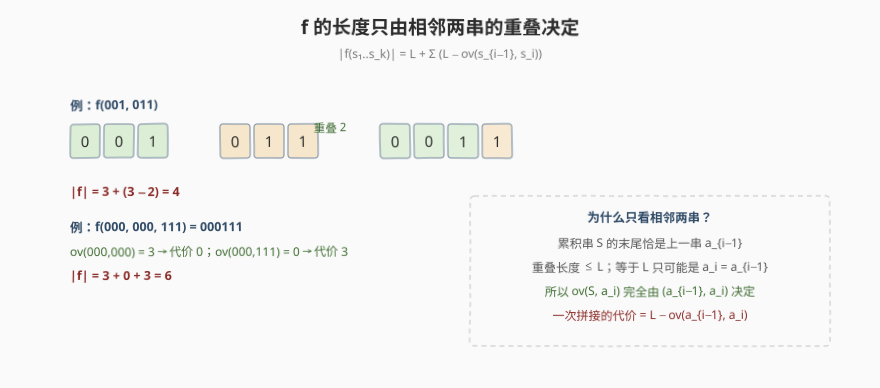
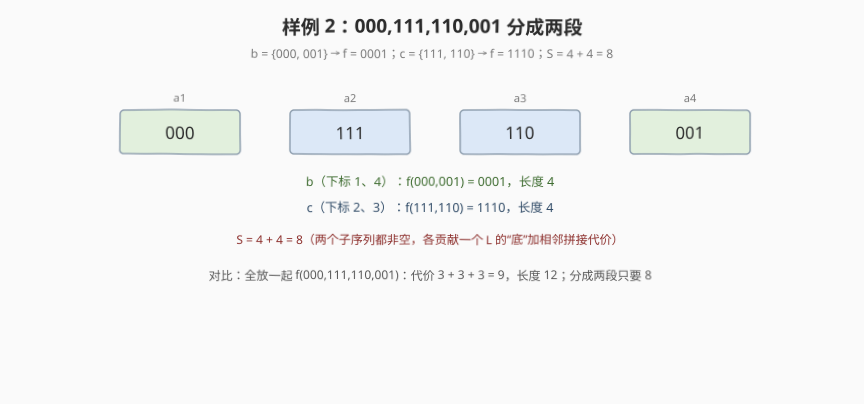
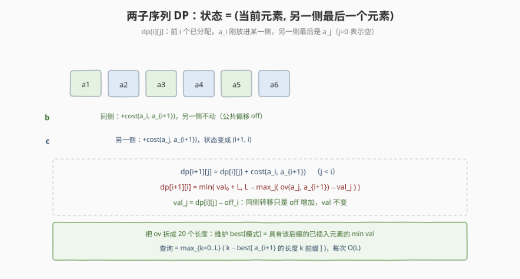

# Codeforces 83E 两子序列压缩 题解

## 1. 题目概述

- **题目链接**：https://codeforces.com/problemset/problem/83/E
- **比赛来源**：Codeforces Beta Round 72 (Div. 1 Only) · Problem E（UTC 2011-05-13）
- **难度**：2800
- **标签**：动态规划、字符串重叠、状态压缩、前缀/后缀
- **评测类型**：普通
- **限制**：时间 2 s / 内存 256 MB

**题意**：给定 $n$ 个长度相同（均为 $L$）的 `01` 串 $a_1,\dots,a_n$。定义压缩函数：

- $f(\text{空序列}) = \text{空串}$，$f(s) = s$；
- $f(s_1,s_2)$ = **最短的**同时以 $s_1$ 为前缀、以 $s_2$ 为后缀的字符串；
- $f(a_1,\dots,a_n) = f(f(a_1,\dots,a_{n-1}), a_n)$。

把原序列划分成两个**子序列**（保持相对顺序，可以为空）$b$ 与 $c$，最小化 $S = |f(b)| + |f(c)|$。

**约束**：

- $1 \le n \le 2 \times 10^5$：不能枚举划分（$2^n$），需要 $O(n \cdot \text{poly}(L))$ 的 DP。
- $1 \le L \le 20$：串长很小，这是本题所有"按位/按后缀"技巧的基础。
- 所有串等长且只含 `01`：可以编码成 $L$ 位整数，前后缀用位运算取出。
- 记忆量：所有长度 $\le L$ 的 `01` 串只有 $2^{L+1}-1 \approx 2 \times 10^6$ 种，可以直接开数组。

## 2. 示例与观察

官方样例一：

```text
输入：
3
01
10
01
输出：
4
```

官方样例二：

```text
输入：
4
000
111
110
001
输出：
8
```

官方样例三：

```text
输入：
5
10101
01010
11111
01000
10010
输出：
17
```

**样例一走查**：最优是把一个子序列取空，另一个取全部：$f(01,10,01) = f(f(01,10),01) = f(010,01) = 0101$，长度 $4$，空串贡献 $0$，故 $S=4$。



**样例二走查**：把 $b = \{000, 001\}$、$c = \{111, 110\}$ 分开：$f(000,001) = 0001$（重叠 `00`，长度 $4$），$f(111,110) = 1110$（长度 $4$），$S = 8$。若不分（全放一个子序列），代价是 $3+3+3=9$，长度 $12$，更差。



**样例三**：最优划分是一个子序列 $\{10101, 01010, 01000\}$、另一个 $\{11111, 10010\}$，两段压缩串长度分别为 $8$ 与 $9$，$S = 17$。

## 3. 解题思路

### 3.1 朴素做法与瓶颈

枚举所有 $2^n$ 种划分：$n = 2 \times 10^5$ 时不可能。

就算固定了划分，"按定义递归压缩"每一步都要比较前后缀，直接做是 $O(n \cdot L^2)$ 甚至更差。需要先把 $|f|$ 的结构搞清楚。

### 3.2 核心观察一：$|f|$ 只由相邻两串的重叠决定

对照第 2 节的拼接示意图：

对两个串 $x,y$，最短的"以 $x$ 为前缀、以 $y$ 为后缀"的串一定是 $x + y[o:]$，其中

$$o = \operatorname{ov}(x,y) = \max\{\,k \le L : \text{$x$ 的长为 $k$ 的后缀} = \text{$y$ 的长为 $k$ 的前缀}\,\}$$

（$k=L$ 即 $x = y$；$k=0$ 总成立）。于是 $|f(x,y)| = |x| + |y| - o$，一次拼接的**代价**记作

$$\operatorname{cost}(x,y) = L - \operatorname{ov}(x,y) \in [0, L].$$

设 $S = f(s_1,\dots,s_k)$。关键性质：**$S$ 的末尾 $L$ 个字符恰好是 $s_k$**。归纳证明：$f(S', s_k) = S' + s_k[o:]$，当 $o < L$ 时末尾 $L$ 个字符是「$S'$ 的长度 $o$ 的后缀（由重叠等于 $s_k$ 的长 $o$ 前缀）+ $s_k[o:]$」$= s_k$；当 $o = L$ 时说明 $s_k = s_{k-1}$，结果 $= S'$，其末尾仍是 $s_{k-1} = s_k$。

又因为 $o \le L$，所以计算 $f(S, s_i)$ 时需要的重叠完全由 $(s_{i-1}, s_i)$ 决定（$o < L$ 时看 $s_{i-1}$ 的后缀，$o = L$ 时等价于 $s_i = s_{i-1}$）。于是

$$\bigl|f(s_1,\dots,s_k)\bigr| = L + \sum_{i=2}^{k}\operatorname{cost}(s_{i-1}, s_i). \tag{1}$$

即：一个子序列的压缩长度 = 一个"底" $L$ + 相邻元素之间的代价之和；**空子序列长度是 $0$**（不是 $L$）。

### 3.3 核心观察二：两子序列的 DP



把元素依次放入两个子序列。处理到第 $i$ 个元素时，**最近放入的那个元素 $a_i$ 一定是某一侧的最后元素**，另一侧的最后元素是某个更早的 $a_j$（或空）。于是状态定义为

$$dp[i][j] = \text{前 } i \text{ 个元素已分配、}a_i\text{ 刚放入某一侧、另一侧最后元素为 } a_j \text{ 时的最小总代价},$$

其中 $0 \le j < i$，$j = 0$ 表示另一侧为空。初值 $dp[1][0] = L$（$a_1$ 开启一个子序列，另一侧空）。转移（往第 $i+1$ 个元素）：

$$dp[i+1][j] = dp[i][j] + \operatorname{cost}(a_i, a_{i+1}) \qquad (j < i),$$

即 $a_{i+1}$ 放在 $a_i$ 同一侧的后面；

$$dp[i+1][i] = \min_{0 \le j < i}\Bigl(dp[i][j] + \operatorname{cost}_2(a_j, a_{i+1})\Bigr),$$

即 $a_{i+1}$ 放到另一侧，接在 $a_j$ 后面；其中 $\operatorname{cost}_2(a_0, \cdot) = L$（开启第二个子序列），$\operatorname{cost}_2(a_j,\cdot) = \operatorname{cost}(a_j,\cdot)$。

答案是 $\min_j dp[n][j]$。

直接做是 $O(n^2)$，需要优化。注意第一类转移对所有 $j$ 加上**同一个**常数，于是令

$$dp[i][j] = \text{off}_i + \text{val}_j,$$

$\text{off}$ 只随 $i$ 变化（累加 $\operatorname{cost}(a_i,a_{i+1})$），$\text{val}_j$ 在状态诞生后**永远不变**。第二类转移变成

$$dp[i+1][i] = \text{off}_i + \min\Bigl(\text{val}_0 + L,\ \min_{1 \le j < i}\bigl(\text{val}_j + L - \operatorname{ov}(a_j,a_{i+1})\bigr)\Bigr),$$

所以只需要支持一种查询：

$$Q(y) = \max_{j}\bigl(\operatorname{ov}(a_j, y) - \text{val}_j\bigr).$$

### 3.4 用"后缀模式"把查询降到 $O(L)$

$\operatorname{ov}(a_j, y) \ge k \iff a_j$ 的长 $k$ 后缀等于 $y$ 的长 $k$ 前缀。维护

$$\text{best}[p] = \min\{\text{val}_j : \text{$a_j$ 的后缀恰为模式 } p\},$$

其中 $p$ 取遍所有长度 $0 \sim L$ 的 `01` 串（编码成整数，长度 $k$ 的模式用 $2^k + \text{值}$ 区分）。那么

$$Q(y) = \max_{k=0}^{L}\Bigl(k - \text{best}[\,y \text{ 的长 } k \text{ 前缀}\,]\Bigr).$$

正确性：对任意 $j$，取 $k = \operatorname{ov}(a_j,y)$，则 $k - \text{best}[\cdot] \ge \operatorname{ov}(a_j,y) - \text{val}_j$；反过来对每个 $k$ 与取到 $\text{best}$ 的那个 $j$，有 $\operatorname{ov}(a_j,y) \ge k$，故 $k - \text{best} \le \operatorname{ov}(a_j,y) - \text{val}_j \le Q(y)$。两边夹住即等号。

每次插入/查询都是 $O(L)$，总复杂度 $O(nL)$。

### 3.5 样例走查

**样例一**（$L=2$）：$\operatorname{cost}(01,10) = 2 - 1 = 1$，$\operatorname{cost}(10,01) = 1$。

- 初始 $\text{val}_0 = 2$，$\text{off}=0$；
- $i=1$：$c = 1$，另一侧为空 → 候选 $2+2 = 4$；$\text{val}_1 = 4-1 = 3$，$\text{off}=1$，插入 $01$ 的各个后缀（值 $3$）；
- $i=2$：$c = 1$，查询 $Q(01)$：$k=2$ 时「后缀 $01$」的 $\text{best}=3$ → $2-3=-1$；$k=0$ 时 $\text{best}=3$ → $-3$。故 $Q=-1$，候选 $\min(2+2, 2-(-1)) = 3$；$\text{val}_2 = 3-1 = 2$，$\text{off}=2$；
- 答案 $= \text{off} + \min(\text{val}_0, \min\text{val}) = 2 + \min(2, 3, 2) = 4$。✓

**样例二**（$L=3$）：最优解 $b=\{000,001\}$、$c=\{111,110\}$。对应 DP 路径：$a_1$ 开启 $b$（$+3$），$a_2$ 开启 $c$（$+3$，$\operatorname{ov}(a_1,a_2)=0$），$a_3$ 接在 $c$ 后（$\operatorname{cost}(111,110)=1$），$a_4$ 接在 $b$ 后（$\operatorname{cost}(000,001)=1$），合计 $3+3+1+1 = 8$。✓

## 4. 正确性证明

**引理 1**：对任意两串 $x,y$（长度均为 $L$），$f(x,y) = x + y[o:]$，其中 $o=\operatorname{ov}(x,y)$；从而 $|f(x,y)| = 2L - o$。

**证明**：任何以 $x$ 为前缀的串都可写成 $x+t$。要求以 $y$ 为后缀，则 $|t| \ge L-o$：若 $|t| < L-o$，则 $x+t$ 的末尾 $L$ 个字符会包含 $x$ 的长度 $> o$ 的后缀与 $y$ 的对应前缀相等，与 $o$ 的最大性矛盾。取 $t = y[o:]$ 即可满足要求（末尾 $L$ 个字符恰为 $y$）。∎

**引理 2**：设 $S = f(s_1,\dots,s_k)$，则 $S$ 的末尾 $L$ 个字符等于 $s_k$；且对任意 $y$，$\operatorname{ov}(S,y) = \operatorname{ov}(s_k,y)$。

**证明**：对 $k$ 归纳。$k=1$ 时 $S=s_1$。设对 $k-1$ 成立，$S' = f(s_1,\dots,s_{k-1})$ 末尾为 $s_{k-1}$，$S = S' + s_k[o:]$，$o=\operatorname{ov}(s_{k-1},s_k)$。若 $o<L$：$S$ 末尾 $L$ 个字符 = $S'$ 的末尾 $o$ 个字符（= $s_k$ 的长 $o$ 前缀，由重叠定义）+ $s_k[o:]$ = $s_k$。若 $o=L$：$s_k=s_{k-1}$，$S=S'$，末尾仍是 $s_{k-1}=s_k$。重叠部分：任取 $y$，$\operatorname{ov}(S,y) \le L$；长度 $k' \le L$ 的后缀要么等于 $s_k$ 的后缀（$k' \le L$ 时 $S$ 的末尾 $L$ 个字符就是 $s_k$，故 $S$ 的长 $k'$ 后缀 = $s_k$ 的长 $k'$ 后缀），要么 $k'=L$ 时就是 $s_k$ 本身。故 $\operatorname{ov}(S,y)=\operatorname{ov}(s_k,y)$。∎

**引理 3（压缩长度公式）**：对任意子序列 $s_1,\dots,s_k$，
$$\bigl|f(s_1,\dots,s_k)\bigr| = L + \sum_{i=2}^{k}\operatorname{cost}(s_{i-1},s_i).$$

**证明**：对 $k$ 归纳。$k=1$ 时两边都是 $L$。设对 $k-1$ 成立，由引理 1、2，
$$|f(s_1..s_k)| = |f(s_1..s_{k-1})| + L - \operatorname{ov}(S',s_k) = |f(s_1..s_{k-1})| + L - \operatorname{ov}(s_{k-1},s_k),$$
代入归纳假设即得。∎

**引理 4（DP 正确）**：$dp[i][j]$ 的定义与转移给出前 $i$ 个元素所有合法分配的最小代价。

**证明**：对 $i$ 归纳。$i=1$ 只有一种分配（$a_1$ 开启一侧），代价 $L$。设 $i$ 时成立，考虑 $a_{i+1}$ 的去向：若与 $a_i$ 同侧，则该侧新增一次相邻拼接，代价 $\operatorname{cost}(a_i,a_{i+1})$，另一侧不变，且新的"另一侧最后元素"仍是 $a_j$，对应第一类转移；若放到另一侧，则该侧新增相邻拼接 $\operatorname{cost}(a_j,a_{i+1})$（$j=0$ 时是开启新子序列，代价 $L$），且新的"另一侧最后元素"变成 $a_i$，对应第二类转移。两类穷尽了所有可能，取最小即得。∎

**引理 5（查询公式）**：对任意 $y$，$Q(y) = \max_{j}(\operatorname{ov}(a_j,y)-\text{val}_j) = \max_{k=0}^{L}\bigl(k-\text{best}[y\text{ 的长 }k\text{ 前缀}]\bigr)$。

**证明**：设右式为 $R$。对任意 $j$，令 $k=\operatorname{ov}(a_j,y)$，则 $a_j$ 的长 $k$ 后缀等于 $y$ 的长 $k$ 前缀，故 $\text{best}[\cdot] \le \text{val}_j$，于是 $R \ge k - \text{val}_j = \operatorname{ov}(a_j,y)-\text{val}_j$，即 $R \ge Q(y)$。反之对每个 $k$，取使 $\text{best}$ 最小的 $j$，有 $\operatorname{ov}(a_j,y) \ge k$，故 $k-\text{best} \le \operatorname{ov}(a_j,y)-\text{val}_j \le Q(y)$，即 $R \le Q(y)$。两边相等。∎

**定理**：算法输出 $S$ 的最小值。

**证明**：由引理 3，任一划分的 $S$ 等于"非空子序列的 $L$ 底 + 相邻代价和"（空子序列贡献 $0$），这正是 DP 所累计的量；由引理 4，DP 在所有分配上取到最小值；由引理 5，查询被精确计算。故 $\text{off}_n + \min(\text{val}_0, \min_j \text{val}_j)$ 就是答案。∎

## 5. 复杂度分析

- **时间**：主循环 $n-1$ 次，每次计算一次 $\operatorname{cost}$（$O(L)$）、一次查询与一次插入（各 $O(L)$），共 $O(nL) \le 4 \times 10^6$。
- **空间**：`best` 数组大小为 $2^{L+1} \le 2^{21} = 2{,}097{,}152$ 个 `int`（约 8 MB），加 $O(n)$ 的输入，远低于 256 MB。
- **数值范围**：答案 $\le 2L + (n-1)L \le 4.2 \times 10^6$，`int` 足够；中间量用 `long long` 也无妨。
- **与时限的关系**：2 s 下 C++ 实测约 $41$ ms（$n=2\times10^5$、$L=20$），余量 40 倍以上；Python 约 $2$ s，建议 PyPy3 或提交 C++。

## 6. 参考代码

### C++17

```cpp
#include <bits/stdc++.h>
using namespace std;

int main() {
    int n;
    if (scanf("%d", &n) != 1) return 0;
    vector<string> s(n);
    int L = 0;
    for (int i = 0; i < n; ++i) {
        char buf[64];
        scanf("%s", buf);
        s[i] = buf;
        L = (int)s[i].size();
    }
    vector<int> val(n);
    for (int i = 0; i < n; ++i) {
        int v = 0;
        for (char ch : s[i]) v = (v << 1) | (ch - '0');
        val[i] = v;
    }
    const int INF = 1000000000;
    int size = 1 << (L + 1);
    vector<int> bestPat(size, INF);   // 每种“后缀模式”上的最小状态值

    auto insertPat = [&](int w, int st) {
        for (int k = 0; k <= L; ++k) {
            int key = (1 << k) | (w & ((1 << k) - 1));
            if (st < bestPat[key]) bestPat[key] = st;
        }
    };
    auto query = [&](int y) {          // max_k (k - min_{suffix_k = prefix_k(y)} val)
        int q = -INF;
        for (int k = 0; k <= L; ++k) {
            int key = (1 << k) | (y >> (L - k));
            if (bestPat[key] < INF) q = max(q, k - bestPat[key]);
        }
        return q;
    };

    long long off = 0;      // 公共偏移（同侧拼接的代价）
    int val0 = L;           // 另一侧为空时的状态值

    for (int i = 0; i + 1 < n; ++i) {
        // cost(a_i, a_{i+1})：最长后缀-前缀重叠
        int ov = 0;
        for (int k = L; k >= 0; --k) {
            if ((val[i] & ((1 << k) - 1)) == (val[i + 1] >> (L - k))) { ov = k; break; }
        }
        int c = L - ov;
        int q = query(val[i + 1]);
        long long bestOther = (long long)val0 + L;      // 另一侧为空，开新串
        if (q > -INF) bestOther = min(bestOther, (long long)L - q);
        int st = (int)(bestOther - c);
        off += c;
        insertPat(val[i], st);                          // 状态 j = i 诞生
    }
    long long ans = off + min(val0, bestPat[1]);
    printf("%lld\n", ans);
    return 0;
}
```

### Python3

```python
import sys


def main() -> None:
    data = sys.stdin.buffer.read().split()
    if not data:
        return
    n = int(data[0])
    a = [v.decode() for v in data[1:1 + n]]
    L = len(a[0])
    vals = [int(v, 2) for v in a]
    INF = 10 ** 9
    best = [INF] * (1 << (L + 1))

    def insert(w: int, st: int) -> None:
        for k in range(L + 1):
            key = (1 << k) | (w & ((1 << k) - 1))
            if st < best[key]:
                best[key] = st

    def query(y: int) -> int:
        q = -INF
        for k in range(L + 1):
            key = (1 << k) | (y >> (L - k))
            bv = best[key]
            if bv < INF:
                v = k - bv
                if v > q:
                    q = v
        return q

    off = 0
    val0 = L
    for i in range(n - 1):
        ov = 0
        for k in range(L, -1, -1):
            if (vals[i] & ((1 << k) - 1)) == (vals[i + 1] >> (L - k)):
                ov = k
                break
        c = L - ov
        q = query(vals[i + 1])
        best_other = val0 + L
        if q > -INF and L - q < best_other:
            best_other = L - q
        st = best_other - c
        off += c
        insert(vals[i], st)
    ans = off + min(val0, best[1])
    sys.stdout.write(str(ans) + "\n")


main()
```

## 7. 边界情况与易错点

1. **空子序列的贡献是 $0$ 而不是 $L$**：题面明确 $f(\text{空序列}) = \text{空串}$。把空序列当成"长度 $L$ 的段"会整体多算 $L$，样例一会从 $4$ 变成 $6$。
2. **$n = 1$**：答案为 $L$（一个子序列放它，另一个为空），主循环一次都不执行，最后用 $\text{val}_0 = L$ 得到正确结果。
3. **所有串相同**：每次 $\operatorname{cost} = 0$，最优是把所有串放同一侧，答案 $L$；若 $\text{best}$ 的初始化或 $\text{ov}=L$ 的处理有误，会得到 $nL$。
4. **重叠长度 $k = L$ 的情况**：编码模式时必须区分长度（用 $2^k + \text{值}$），否则长度 $1$ 的 `0` 与长度 $2$ 的 `00` 会撞键，$\operatorname{ov}$ 计算错误。
5. **$\text{best}[1]$（长度 $0$ 的模式）**：它维护的是"所有已插入元素的最小 $\text{val}$"，对应 $\operatorname{ov}=0$ 的情形；最终答案里的 $\min_j \text{val}_j$ 也用它，不要忘记。
6. **$\text{val}_0$ 与插入值分开**：另一侧为空的状态不参与"重叠查询"（重叠为 $0$、代价为 $L$），必须单独作为候选，否则会把"开启第二个子序列"的代价算错。
7. **代价的单调性不成立**：$\operatorname{ov}(a_j, y) \ge k$ 只说明重叠至少 $k$，直接把"最长公共前后缀"当成唯一候选会漏掉次优；必须对所有 $k = 0..L$ 取最大。
8. **数组大小**：$2^{L+1}$ 在 $L=20$ 时是 $2{,}097{,}152$，`vector<int>` 约 8 MB；若按 $2^{20}$ 开而忘记长度维度，会下标越界。
9. **读入**：每行一个串，行内无空格；`n` 与串长都要正确读入，且所有串等长（题面保证）。

## 8. 验证记录

- **编译环境与命令**：`clang++ -std=c++17 -O2`（Apple clang 21.0.0 + `codeforces/tools/include` 的兼容头；代码只用标准库，可原样提交 GNU C++17），Python 3.9.6。
- **官方样例**：3 / 3 通过（`4`、`8`、`17`），C++ 与 Python 输出一致。
- **独立暴力对拍**：暴力枚举全部 $2^n$ 种划分，并用**题面定义**直接构造压缩串（每次拼接都从大到小枚举重叠长度、真正做字符串拼接）求长度。对 $n \le 9$、$L \le 5$ 的 **360 组**随机数据（$n \le 8$ 的 240 组 + $n=9$ 的 120 组）与参考程序比对，**全部一致**。
- **最大约束性能**：$n = 2 \times 10^5$、$L = 20$ 的随机数据，C++ 端到端 3 次取最小约 $41$ ms，Python 约 $1974$ ms（CPython，建议 PyPy3 / C++）；内存约 $8$ MB（`best` 数组）。
- **图片校验**：`cf83e_overlap.svg`、`cf83e_dp.svg`、`cf83e_sample.svg` 均通过 `xml.etree.ElementTree.parse`，含 `feTurbulence` 与手写体字体族，文本包围盒未越出 `viewBox`。
- **公式校验**：KaTeX（`throwOnError`）渲染无报错；无 `---` 分隔线。
- **复核状态**：verified（样例、对拍、性能、图片、公式均实跑通过）。

## 相关题目与扩展

- [Codeforces 83A Magical Array](https://codeforces.com/problemset/problem/83/A)、[83B Doctor](https://codeforces.com/problemset/problem/83/B)、[83C Track](https://codeforces.com/problemset/problem/83/C)、[83D Numbers](https://codeforces.com/problemset/problem/83/D)：同场其余四题。
- [Codeforces 25E Test](https://codeforces.com/problemset/problem/25/E)：三个串的最短公共超串，是本题"重叠 + 拼接"的经典版本。
- [Codeforces 1316E Team Building](https://codeforces.com/problemset/problem/1316/E)：状压 DP 选人，与本题"状态里带一个集合"的技巧相通。
- [LeetCode 1092. 最短公共超序列](https://leetcode.cn/problems/shortest-common-supersequence/)：两串的最短超串，和 $f(x,y)$ 的定义几乎一致。
- [Codeforces 1202D Print a 1337-string](https://codeforces.com/problemset/problem/1202/D)：字符串构造与重叠计数。

**延伸思考**：

1. **如果压缩函数改成"任意顺序拼接"**：那就是最短公共超串问题，NP 难的一般版本；本题的 $f$ 只在相邻元素之间产生重叠，才使得线性 DP 成立。
2. **如果串长 $L$ 放大到 $60$**：$2^{L+1}$ 数组不可行，但查询只需对"实际出现的后缀模式"建哈希表，插入/查询仍是 $O(L)$，内存 $O(nL)$；瓶颈变成哈希。
3. **如果要输出具体划分**：在 DP 中记录每个状态的前驱，最后从 $\arg\min$ 回溯即可；注意第一类转移是"公共偏移"，回溯时要按 $\text{val}$ 与实际代价还原。
4. **如果划分成三个子序列**：状态变成"另外两侧的最后元素"两维，$O(n^2)$ 状态，需要更进一步的优化（例如按值域分块），难度显著上升。

