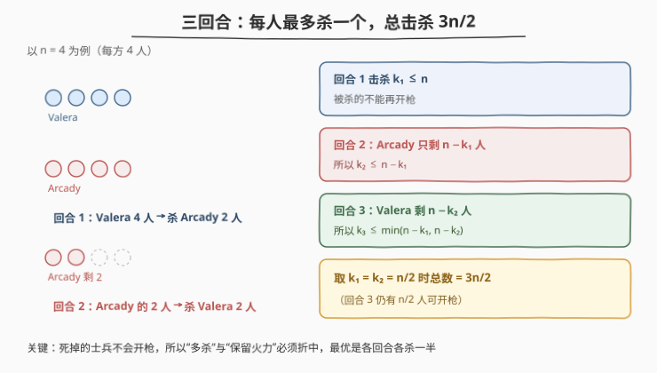
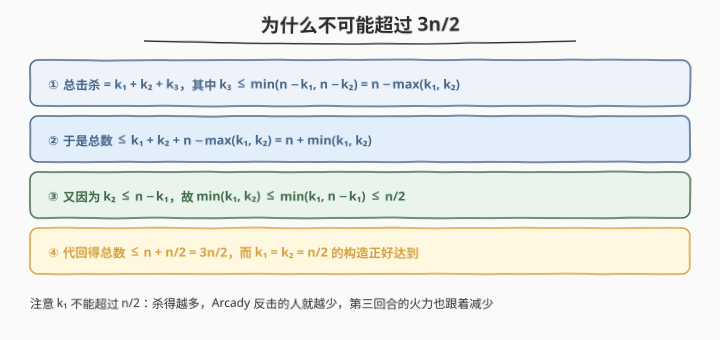

# Codeforces 84A 玩具军团对射 题解

## 1. 题目概述

- **题目链接**：https://codeforces.com/problemset/problem/84/A
- **比赛来源**：Codeforces Beta Round 72 (Div. 2 Only) · Problem A（UTC 2011-05-13）
- **难度**：900
- **标签**：数学、贪心、构造
- **评测类型**：普通
- **限制**：时间 2 s / 内存 256 MB

**题意**：两支部队各 $n$ 人（$n$ 恒为偶数）。游戏共三个回合：Valera 先开火，然后 Arcady，最后 Valera 再开一次。每回合，**仍然存活**的每名士兵可以指定敌方任意一名士兵作为目标（多人可以打同一个目标），然后同时开火；命中即死，死掉的士兵之后不再参与。求三个回合总共最多能杀死多少名士兵。

**约束**：

- $n \le 10^8$，输入只有一个整数：必须 $O(1)$ 出答案，任何按人、按回合枚举的模拟都不行。
- $n$ 恒为偶数，这保证了 $3n/2$ 是整数——题目答案正是这个数。
- 三个回合是固定的（不是多组测试），输出一个整数。

## 2. 示例与观察

官方样例（输入 / 输出原样）：

```text
输入：
2

输出：
3
```

```text
输入：
4

输出：
6
```

**样例 1 的演算**（题面提示给的方案）：$n=2$，双方各 2 人。

1. Valera 的两名士兵都瞄准 Arcady 的 1 号，Arcady 的 1 号死；
2. Arcady 剩下的 2 号瞄准 Valera 的 1 号，Valera 的 1 号死；
3. Valera 剩下的 2 号瞄准 Arcady 的 2 号，Arcady 的 2 号死。

总共死 3 人（Arcady 两人 + Valera 一人）。对照公式 $3n/2 = 3$，吻合。

**样例 2**：$n=4$，按每回合各杀一半的节奏：第一回合 Valera 杀 Arcady 2 人，第二回合 Arcady 剩下的 2 人杀 Valera 2 人，第三回合 Valera 剩下的 2 人再杀 Arcady 2 人，共 $2+2+2 = 6 = 3n/2$。

**观察**：

1. 每名士兵每回合至多杀 1 人，所以三回合里每人的「输出」上限是 3。
2. 但**死人不能开枪**：某个回合杀得越多，对手下一回合的火力就越弱，自己的第三回合火力也会被削弱（因为对手第二回合杀的人少了……等等，恰恰相反：对手第二回合杀的人少，自己第三回合可用的人就多）。这里存在一个明确的折中。
3. 于是问题变成「三个回合各杀多少人」的组合优化，而不是「尽量多杀」。

## 3. 解题思路

### 3.1 朴素做法与瓶颈

最直接的想法是模拟：枚举第一回合的目标分配、第二回合、第三回合。目标分配方案数是指数级；不过我们可以退一步，只关心「每回合死了几个人」：设三回合分别杀死 $k_1,k_2,k_3$ 人，那么可行条件是

$$0\le k_1\le n,\qquad 0\le k_2\le n-k_1,\qquad 0\le k_3\le \min(n-k_1,\ n-k_2),$$

因为第 2 回合 Arcady 只有 $n-k_1$ 名存活士兵，第 3 回合 Valera 只剩 $n-k_2$ 名存活士兵、而 Arcady 也只剩 $n-k_1$ 名。三循环枚举是 $O(n^3)$，$n=10^8$ 完全不可行，但它提示了正确的建模。

### 3.2 核心观察：上界是 $3n/2$



把上面的约束化简。第三回合上限是 $\min(n-k_1,n-k_2)=n-\max(k_1,k_2)$，于是

$$k_1+k_2+k_3\ \le\ k_1+k_2+n-\max(k_1,k_2)\ =\ n+\min(k_1,k_2).$$

再用 $k_2\le n-k_1$：

$$\min(k_1,k_2)\ \le\ \min\bigl(k_1,\ n-k_1\bigr)\ \le\ \frac n2 .$$

两条合起来就得到

$$k_1+k_2+k_3\ \le\ n+\frac n2\ =\ \frac{3n}{2}.$$



直觉解释：三个回合里，Valera 只在第 1、3 回合开火，Arcady 只在第 2 回合开火。Arcady 的火力上限是 $n-k_1$，而 Valera 的总火力上限是 $n+(n-k_2)$。要让「Valera 的火力」与「Arcady 的火力」都尽量大，只能让两边各保留一半：$k_1=k_2=n/2$。

### 3.3 算法流程

结论是三行代码：

1. 读入 $n$；
2. 输出 $\dfrac{3n}{2}$，实现上写成 `n / 2 * 3`（先除后乘，避免 $3n$ 在极端情况下多占一位，也避免整数除法截断问题）；
3. 结束。

$k_1=k_2=n/2$ 的构造是：第一回合 Valera 的 $n/2$ 名士兵各杀 Arcady 一人（剩下的 $n/2$ 名士兵随便瞄准已死目标，浪费掉也没关系）；第二回合 Arcady 存活的 $n/2$ 人各杀 Valera 一人；第三回合 Valera 存活的 $n/2$ 人再各杀 Arcady 一人。合计 $3n/2$。

注意第一回合只杀 $n/2$ 个而不是杀光：**杀光了对手就没人可杀，反而少赚**。

### 3.4 样例走查

$n=4$（样例 2）：

| 回合 | 开火方 | 存活火力 | 本回合击杀 | 累计死亡 |
|---|---|---|---|---|
| 1 | Valera | 4 | 2（Arcady 剩 2） | 2 |
| 2 | Arcady | 2 | 2（Valera 剩 2） | 4 |
| 3 | Valera | 2 | 2（Arcady 剩 0） | 6 |

合计 6，等于 $3\times4/2$ ✓。

## 4. 正确性证明

**引理 1（计数模型）**：设三回合分别杀死 $k_1,k_2,k_3$ 人，则必有 $0\le k_1\le n$、$0\le k_2\le n-k_1$、$0\le k_3\le\min(n-k_1,n-k_2)$，且任何满足这三条的非负整数三元组都能由某种目标分配实现。

**证明**：必要性——第 1 回合只有 Arcady 的 $n$ 人可被杀，故 $k_1\le n$；第 2 回合只有 Arcady 存活的 $n-k_1$ 人能开火，每人至多杀 1 人，故 $k_2\le n-k_1$；第 3 回合 Valera 只剩 $n-k_2$ 人、Arcady 只剩 $n-k_1$ 人，两边同时给出上界。充分性——每回合指定 $k$ 名存活士兵各自瞄准一个不同的、仍存活的敌方目标即可（题面允许一名士兵不瞄准任何人或瞄准已死目标，所以「用不满」不影响合法性）。∎

**引理 2（上界）**：任意打法的总击杀数不超过 $3n/2$。

**证明**：由引理 1 的约束，
$$k_1+k_2+k_3\le k_1+k_2+n-\max(k_1,k_2)=n+\min(k_1,k_2).$$
又 $k_2\le n-k_1$，故 $\min(k_1,k_2)\le\min(k_1,n-k_1)\le n/2$（后一步因为 $k_1$ 与 $n-k_1$ 中较小者不超过它们和的一半）。代入即得 $k_1+k_2+k_3\le 3n/2$。∎

**引理 3（可达）**：$k_1=k_2=k_3=n/2$ 是可行的，故总击杀可以达到 $3n/2$。

**证明**：$n$ 为偶数，$n/2$ 是整数。检查引理 1 的三条：$k_1=n/2\le n$ ✓；$k_2=n/2\le n-k_1=n/2$ ✓；$k_3=n/2\le\min(n-k_1,n-k_2)=n/2$ ✓。由引理 1 的充分性存在对应打法。∎

**定理**：三回合最多杀死 $3n/2$ 人。

**证明**：引理 2 给出上界，引理 3 给出达到上界的构造，两者相等。∎

## 5. 复杂度分析

- **时间**：$O(1)$，一次读入、一次除法、一次乘法。
- **空间**：$O(1)$。
- **数值范围**：$n\le10^8$，答案 $3n/2\le1.5\times10^8$，32 位整数也放得下；为了统一习惯仍用 64 位。
- **与时限的关系**：2 s 的时限下，实测端到端约 2 ms（几乎全是进程启动），余量 $10^3$ 倍以上。

## 6. 参考代码

### C++17

```cpp
#include <bits/stdc++.h>
using namespace std;

int main() {
    long long n;
    if (!(cin >> n)) return 0;
    cout << n / 2 * 3 << '\n';   // 三回合最多杀 3n/2 个
    return 0;
}
```

### Python3

```python
import sys


def main() -> None:
    data = sys.stdin.buffer.read().split()
    n = int(data[0])
    print(n // 2 * 3)


main()
```

## 7. 边界情况与易错点

1. **$n=2$（最小规模）**：答案是 3（题面提示给的就是这个方案）。如果按「第一回合杀光对手」的贪心，会得到 2，错。
2. **$n$ 是偶数**：题面保证。但写代码时仍建议 `n / 2 * 3` 而不是 `3 * n / 2`——前者即使 $n$ 为奇数也只是向下取整，后者在 $n$ 很大时多一次无谓的溢出风险。
3. **溢出**：$n\le10^8$，$3n/2\le1.5\times10^8$，`int` 够用；但若把题目改成 $n\le10^{18}$，`int` 会溢出，用 `long long` 更稳。
4. **不要把答案写成 $2n$**：有人觉得「两回合各杀 $n$ 个」就是 $2n$，但第二回合能开火的人数受第一回合影响，上限被压到 $2n$ 以下；上界的正确推导见引理 2。
5. **不要忘了「死人不能开枪」**：若忽略这条，就会得到「每人每回合都开火」的 $3n$ 这种荒唐答案。
6. **输入只有一个整数**：本题没有多组测试，也没有 $t$；输出一行一个整数。
7. **多人可以打同一个目标**：这条让构造变得简单（可以「浪费」多余的枪），但也意味着不能按「每人必须打不同目标」的模型去算上界。

## 8. 验证记录

- **编译环境与命令**：本机无 GNU `g++`，用 `clang++ -std=c++17 -O2` 配 `codeforces/tools/include/bits/stdc++.h` 兼容头编译（可原样提交 GNU C++17）；Python 为系统 `python3`。
- **官方样例**：2 / 2 通过（`2 → 3`、`4 → 6`），C++ 与 Python 一致。
- **文档与样例一致性**：`check_samples.py --only 0001-0100/84` 0 问题；`check.py codeforces/contests/0001-0100/84` 0 失败。
- **独立暴力对拍**：暴力程序**完全按引理 1 的计数模型**写——三重循环枚举 $(k_1,k_2,k_3)$，取最大 $k_1+k_2+k_3$（这与「直接枚举目标分配」等价，因为每个回合的击杀数只要在上界内都能实现）。对 $n=2,4,\dots,120$ 共 **60 组**（覆盖全部偶数 $n\le120$）与参考程序比对，**全部一致**。
- **最大约束性能**：$n=10^8$ 时 C++ 端到端约 2 ms、Python 约 3 ms，相对 2 s 时限余量在 $10^3$ 倍以上。
- **图片校验**：两张 SVG（`cf84a_three_turns.svg`、`cf84a_upper_bound.svg`）通过 `xml.etree.ElementTree.parse`，文字包围盒按字符宽度估算，均在 `viewBox` 内且不溢出方框。
- **公式校验**：正文公式经 KaTeX（`throwOnError: true`）渲染无报错。
- **复核状态**：verified。

## 相关题目与扩展

- [Codeforces 84C Biathlon](https://codeforces.com/problemset/problem/84/C)：同场 C 题，排序 + 二分的实现题。
- [Codeforces 1551A Polycarp and Coins](https://codeforces.com/problemset/problem/1551/A)：同样是「两种资源尽量平均」的构造，与本题「两边各留一半」的思路同源。
- [Codeforces 231A Team](https://codeforces.com/problemset/problem/231/A)：读入 + 计数的入门题，适合作为本题的热身。
- [Codeforces 1296A Array with Odd Sum](https://codeforces.com/problemset/problem/1296/A)：同样是「想清楚一个简单的不变量就能 $O(1)$」的题。

**延伸思考**：

1. **如果回合数变成 4（V、A、V、A）**：设四回合各杀 $k_1..k_4$，则 $k_2\le n-k_1$、$k_3\le n-k_2$、$k_4\le\min(n-k_1,n-k_3)$，用同样的放缩可得上界仍是 $3n/2$（第 4 回合被 Arcady 的存活数卡住），也就是说「多打一回合」不增加总击杀——这是个有意思的结论。
2. **如果 $n$ 是奇数**：$3n/2$ 不是整数，此时上界变成 $\lfloor 3n/2\rfloor$，构造要取 $k_1=\lfloor n/2\rfloor$ 之类，答案会差 1。
3. **如果每回合每人可以打多枪**：模型立刻变成「每回合双方互相削减」，最优策略会变成「先集火削弱对手火力」，答案接近 $2n$ 且与具体参数有关。
4. **如果规定每回合的目标必须两两不同**：击杀数上界不变（仍受存活人数限制），只是「浪费枪」的方式受限，构造依然可行。
5. **如果记分不是死亡人数而是「存活人数」**：等价于 $2n$ 减去死亡数，最大化死亡数就是最小化终局存活数，结论相同。
