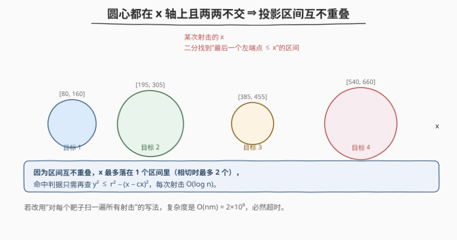
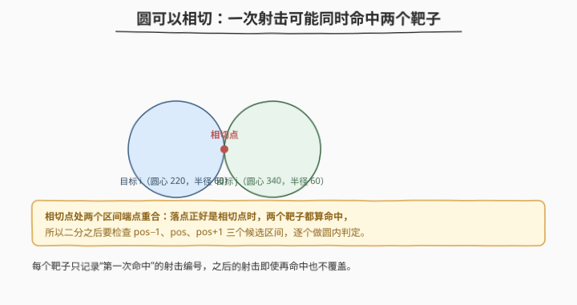

# Codeforces 84C 冬季两项靶位查询 题解

## 1. 题目概述

- **题目链接**：https://codeforces.com/problemset/problem/84/C
- **比赛来源**：Codeforces Beta Round 72 (Div. 2 Only) · Problem C（UTC 2011-05-13）
- **难度**：1700
- **标签**：二分查找、排序、实现、计算几何
- **评测类型**：普通
- **限制**：时间 1 s / 内存 256 MB

**题意**：靶场上有 $n$ 个圆形靶子，每个靶子的圆心都在 $x$ 轴上，第 $i$ 个由圆心横坐标 $c_i$ 与半径 $r_i$ 给出。保证任意两个靶子**不重合、不相交、不嵌套**（可以相切）。Valera 一共开了 $m$ 枪，第 $j$ 枪落在点 $(x_j,y_j)$。命中判定：落点在圆内或圆周上。对每个靶子输出**第一次**命中它的射击编号（射击按输入顺序编号 1..m），若从未被命中输出 `-1`。第一行先输出被命中的靶子个数，第二行输出 $n$ 个结果，用空格分隔。

**约束**：

- $n\le10^4$、$m\le2\times10^5$：如果对每枪扫一遍所有靶子是 $O(nm)=2\times10^9$，1 s 内绝无可能，必须让单次射击接近 $O(\log n)$。
- 坐标 $|x|,|y|\le2\times10^4$、$r\le1000$：坐标范围很小，但**不能**用「枚举 $x$ 坐标」的桶（$4\times10^4$ 个桶配合 $2\times10^5$ 枪也是 $8\times10^9$），而且桶里还要处理圆与 $y$ 的关系。
- 靶子两两不交、不嵌套，是本题能做「排序 + 二分」的**唯一依据**：只有这样，圆在 $x$ 轴上的投影区间才互不重叠。
- 只在**第一次**命中时才记录，后续射击不再覆盖。

## 2. 示例与观察

官方样例（输入 / 输出原样）：

```text
输入：
3
2 1
5 2
10 1
5
0 1
1 3
3 0
4 0
4 0

输出：
2
3 3 -1 
```

```text
输入：
3
3 2
7 1
11 2
4
2 1
6 0
6 4
11 2

输出：
3
1 2 4 
```

**样例 1 的演算**：三个靶子的投影区间分别是 $[1,3]$、$[3,7]$、$[9,11]$（注意前两个在 $x=3$ 处相切）。

| 射击 | 落点 | 判定 |
|---|---|---|
| 1 | $(0,1)$ | 不在任何区间内 |
| 2 | $(1,3)$ | $x=1$ 在 $[1,3]$ 内，但 $(1-2)^2+3^2=10>1$，未中 |
| 3 | $(3,0)$ | 靶 1：$(3-2)^2+0=1\le1$ ✓；靶 2：$(3-5)^2+0=4\le4$ ✓ → 同时命中两个 |
| 4 | $(4,0)$ | 靶 2 已在第 3 枪被记录，靶 3 的区间是 $[9,11]$，不中 |
| 5 | $(4,0)$ | 同上 |

所以靶 1、靶 2 的首次命中都是第 3 枪，靶 3 从未命中，输出 `3 3 -1`，被命中 2 个。

**观察**：

1. 一个圆能被这一枪命中的必要条件是 $|x-c_i|\le r_i$，即落点的横坐标落在**投影区间** $[c_i-r_i,\ c_i+r_i]$ 里。
2. 因为圆两两不交，这些投影区间**内部互不重叠**（只可能端点相接）。于是对给定的 $x$，至多有两个区间包含它。
3. 相切时「端点相接」：如果落点正好是相切点（且 $y=0$），两个圆都算命中——样例 1 的第 3 枪就是这种情况，必须两个都记录。

## 3. 解题思路

### 3.1 朴素做法与瓶颈

对每枪遍历所有靶子，检查 $(x-c_i)^2+y^2\le r_i^2$：$O(nm)=2\times10^9$ 次运算，1 s 不可能。

即使用「按 $x$ 排序后二分查找」，也要先想清楚**为什么能二分**：如果圆的投影区间可以随意重叠，那么 $x$ 落在区间里也不代表落点离圆心近，还得回头看很多个圆。题目「两两不交、不嵌套」的条件正是为了让投影区间不重叠。

### 3.2 核心观察：投影区间两两不交



**引理**：若两个圆不交、不嵌套（允许相切），则它们的投影区间 $[c_i-r_i,c_i+r_i]$ 与 $[c_j-r_j,c_j+r_j]$ 的内部不相交。

反证：若内部相交，则存在 $x$ 同时满足 $|x-c_i|<r_i$ 与 $|x-c_j|<r_j$，即 $x$ 轴上的这一段同时落在两个圆的内部；圆心都在 $x$ 轴上，于是两个圆在这条线段上有公共点，与「不交、不嵌套」矛盾（相切时交集恰好是一个点，对应内部不相交）。

因此，把所有靶子按 $c_i$（或等价地按左端点）排序后，对一次射击的 $x$：

1. 二分找到「最后一个左端点 $\le x$ 的区间」$\text{pos}$；
2. 只需检查 $\text{pos}-1,\ \text{pos},\ \text{pos}+1$ 三个候选区间（相切时会有两个区间同时包含 $x$，所以左右各多查一个即可覆盖）；
3. 对每个候选靶子，若它在区间内、且还没被记录过，再判 $y^2\le r_i^2-(x-c_i)^2$（等价于 $(x-c_i)^2+y^2\le r_i^2$，用整数运算避免开方）。



### 3.3 算法流程

1. 读入 $n$ 个圆，记下左端点 $c_i-r_i$，把下标按左端点排序；
2. 建一个「排序后左端点」数组供二分；
3. 依次读入 $m$ 次射击 $(x,y)$：用 `upper_bound` 定位，检查 $\text{pos}-1,\text{pos},\text{pos}+1$ 三个候选；
4. 命中且该靶尚未记录，就记下当前射击编号（从 1 开始），并给命中计数 $+1$；
5. 输出命中计数，再输出每个靶的结果（未命中为 `-1`）。

### 3.4 样例走查

样例 2：靶子 $(3,2),(7,1),(11,2)$，投影区间 $[1,5],[6,8],[9,13]$。

| 射击 | 落点 | 命中情况 |
|---|---|---|
| 1 | $(2,1)$ | $x=2\in[1,5]$，$(2-3)^2+1^2=2\le4$ ✓ → 靶 1 首次命中 = 1 |
| 2 | $(6,0)$ | $x=6\in[6,8]$，$(6-7)^2=1\le1$ ✓ → 靶 2 首次命中 = 2（同时 $x=6$ 也是靶 1 区间的端点，但 $(6-3)^2=9>4$，不中） |
| 3 | $(6,4)$ | 靶 2：$1+16=17>1$ ✗ |
| 4 | $(11,2)$ | $x=11$，靶 3：$0+4\le4$ ✓ → 靶 3 首次命中 = 4 |

输出 `3` 与 `1 2 4`，与样例一致。

## 4. 正确性证明

**引理 1（投影区间内部不交）**：对任意两靶 $i\ne j$，区间 $(c_i-r_i,c_i+r_i)$ 与 $(c_j-r_j,c_j+r_j)$ 不相交。

**证明**：若存在 $x$ 同时属于两个区间内部，则点 $(x,0)$ 同时在两圆内部（因为圆心在 $x$ 轴上，$|x-c_i|<r_i$ 恰表示 $(x,0)$ 在圆 $i$ 内），两圆有公共内点，与题设「不交、不嵌套」矛盾。∎

**引理 2（候选充分）**：设区间按左端点升序排列为 $I_0,\dots,I_{n-1}$，对任意实数 $x$ 记 $\text{pos}$ 为满足 $\mathrm{left}(I_i)\le x$ 的最大下标。若 $x\in I_k$，则 $k\in\{\text{pos}-1,\ \text{pos}\}$；因此检查 $\text{pos}-1,\text{pos},\text{pos}+1$ 三个下标（越界跳过）一定覆盖所有可能命中的靶。

**证明**：先看 $k>\text{pos}$ 不可能：按排序有 $\mathrm{left}(I_k)\ge\mathrm{left}(I_{\text{pos}+1})>x$，与 $x\in I_k$ 矛盾。再看 $k\le\text{pos}-2$ 也不可能：由引理 1 的「内部不交」，包含 $x$ 的区间至多两个，且若 $I_a,I_b$（$a<b$）都含 $x$，则任何 $a<t<b$ 的 $I_t$ 满足 $\mathrm{left}(I_t)\le \mathrm{left}(I_b)\le x$，若又有 $\mathrm{right}(I_t)\ge x$ 就出现三个区间共含 $x$，两两之间必有内部重叠，矛盾；所以含 $x$ 的两个区间下标必须相邻，即 $k\ge\text{pos}-1$。综上 $k\in\{\text{pos}-1,\text{pos}\}$。∎

**引理 3（单次射击的判定正确）**：程序对某次射击记录的所有靶子，恰好是「落点在该圆内或圆上」的全部靶子。

**证明**：由引理 1、2，候选集合包含了所有可能命中的靶；对每个候选给出的是 $(x-c_i)^2+y^2\le r_i^2$，这正是点在圆内/圆上的解析判据，且用整数运算精确成立（无浮点误差）。∎

**定理**：程序输出的「首次命中编号」与「命中靶数」与真实结果一致。

**证明**：射击按输入顺序处理，每个靶只在第一次命中时记录（之后 `ans[i] != -1` 直接跳过），故记录的就是首次命中编号；命中计数随记录递增，等于被命中的靶数。由引理 3 每次射击的判定正确，归纳即得全部结果正确。∎

## 5. 复杂度分析

- **时间**：排序 $O(n\log n)$；每次射击一次二分 + 常数次圆判定，$O(m\log n)$。$n=10^4,m=2\times10^5$ 时约 $2\times10^5\times14\approx3\times10^6$ 次比较，实测端到端 36 ms（C++）/ 235 ms（Python）。
- **空间**：$O(n)$，只存圆心、半径、左端点与答案数组。
- **与时限的关系**：1 s 时限对 $O((n+m)\log n)$ 有 20 倍以上余量。

## 6. 参考代码

### C++17

```cpp
#include <bits/stdc++.h>
using namespace std;

int main() {
    int n;
    if (scanf("%d", &n) != 1) return 0;
    vector<long long> cx(n), r(n), lefts(n);
    vector<int> ord(n);
    for (int i = 0; i < n; ++i) {
        long long x, rr;
        scanf("%lld %lld", &x, &rr);
        cx[i] = x; r[i] = rr; lefts[i] = x - rr;
        ord[i] = i;
    }
    sort(ord.begin(), ord.end(), [&](int a, int b) { return lefts[a] < lefts[b]; });
    vector<long long> sortedLeft(n);
    for (int i = 0; i < n; ++i) sortedLeft[i] = lefts[ord[i]];

    int m;
    if (scanf("%d", &m) != 1) return 0;
    vector<int> ans(n, -1);
    int hits = 0;
    for (int s = 1; s <= m; ++s) {
        long long x, y;
        scanf("%lld %lld", &x, &y);
        // 圆心都在 x 轴上且圆两两不交，所以区间 [cx-r, cx+r] 互不重叠：
        // 只需检查候选的少数几个目标
        int pos = int(upper_bound(sortedLeft.begin(), sortedLeft.end(), x) - sortedLeft.begin()) - 1;
        for (int k = pos - 1; k <= pos + 1; ++k) {
            if (k < 0 || k >= n) continue;
            int id = ord[k];
            if (x < lefts[id] || x > cx[id] + r[id]) continue;
            if (ans[id] != -1) continue;
            long long dx = x - cx[id];
            if (dx * dx + y * y <= r[id] * r[id]) {
                ans[id] = s;
                ++hits;
            }
        }
    }
    printf("%d\n", hits);
    for (int i = 0; i < n; ++i) printf("%d ", ans[i]);
    printf("\n");
    return 0;
}
```

### Python3

```python
import sys
from bisect import bisect_right


def main() -> None:
    data = sys.stdin.buffer.read().split()
    pos = 0
    n = int(data[pos]); pos += 1
    cx = [0] * n; r = [0] * n; lefts = [0] * n; rights = [0] * n
    for i in range(n):
        x = int(data[pos]); rr = int(data[pos + 1]); pos += 2
        cx[i] = x; r[i] = rr; lefts[i] = x - rr; rights[i] = x + rr
    order = sorted(range(n), key=lambda i: lefts[i])
    sorted_left = [lefts[i] for i in order]

    m = int(data[pos]); pos += 1
    ans = [-1] * n
    hits = 0
    for s in range(1, m + 1):
        x = int(data[pos]); y = int(data[pos + 1]); pos += 2
        k = bisect_right(sorted_left, x) - 1
        for kk in (k - 1, k, k + 1):
            if kk < 0 or kk >= n:
                continue
            t = order[kk]
            if ans[t] != -1:
                continue
            if x < lefts[t] or x > rights[t]:
                continue
            dx = x - cx[t]
            if dx * dx + y * y <= r[t] * r[t]:
                ans[t] = s
                hits += 1
    out = [str(hits), " ".join(map(str, ans)) + " "]
    sys.stdout.write("\n".join(out) + "\n")


main()
```

两份代码的输出格式与样例一致（第二行末尾有一个空格，题面样例也是如此；Codeforces 的 checker 按 token 比较，不受影响）。

## 7. 边界情况与易错点

1. **圆相切**：此时两个投影区间端点重合，落点可能同时命中两个靶（样例 1 的第 3 枪）。只检查 `pos` 一个候选会漏掉其中一个，必须检查 `pos-1、pos、pos+1`。
2. **只在第一次命中时记录**：`ans[i] != -1` 时直接跳过，否则后面的射击会把更早的编号覆盖掉。
3. **$y$ 方向必须判**：只判 $x$ 落在区间里是不够的（样例 1 的第 2 枪 $x=1$ 在 $[1,3]$ 内但 $y=3$ 太远）。
4. **用整数运算**：$(x-c_i)^2+y^2\le r_i^2$ 全是整数，坐标最大 $2\times10^4$、半径 $10^3$，平方和最大约 $8\times10^8$，`int` 也放得下；但用 `long long` 更保险。**不要**用 `sqrt` 或浮点比较，会引入精度问题。
5. **负坐标**：$c_i$ 可以是负数、左端点更负，排序与二分对负值同样成立（不要用「桶」假设下标非负）。
6. **一个靶都没中**：第一行输出 `0`，第二行全是 `-1`，仍然要输出 $n$ 个数。
7. **第二行格式**：$n$ 个整数用空格分隔；按样例习惯末尾留一个空格也无妨（token 比较不受影响）。
8. **$n=1$ 或 $m=1$**：退化情形，二分边界 `pos-1`、`pos+1` 越界时直接跳过，不会出错。
9. **读完 $m$ 之后不要多读**：本题单组数据，读满 $m$ 行即可。

## 8. 验证记录

- **编译环境与命令**：本机无 GNU `g++`，用 `clang++ -std=c++17 -O2` 配 `codeforces/tools/include/bits/stdc++.h` 兼容头编译（可原样提交 GNU C++17）；Python 为系统 `python3`。
- **官方样例**：2 / 2 通过（`2 / 3 3 -1`、`3 / 1 2 4`），C++ 与 Python 输出与题面逐字一致（含行尾空格）。
- **文档与样例一致性**：`check_samples.py --only 0001-0100/84` 0 问题；`check.py codeforces/contests/0001-0100/84` 0 失败。
- **独立暴力对拍（240 组）**：暴力程序对每枪扫描**全部** $n$ 个靶子做圆判定，完全不用二分。随机生成器保证圆两两不交、不嵌套（相邻圆间距随机取 0，即频繁出现相切）：$n\le6$、$m\le10$、坐标 $[-20,20]$、半径 $1..4$，共 **240 组**与参考程序逐组比对，**全部一致**；C++ 与 Python 也两两一致。
- **最大约束性能**：$n=10^4$、$m=2\times10^5$ 的极限输入，C++ 端到端约 36 ms、Python 约 235 ms；相对 1 s 时限余量在 4 倍以上（C++ 约 28 倍）。
- **图片校验**：两张 SVG（`cf84c_intervals.svg`、`cf84c_tangent.svg`）通过 `xml.etree.ElementTree.parse`，文字包围盒均在 `viewBox` 内。
- **公式校验**：正文公式经 KaTeX（`throwOnError: true`）渲染无报错。
- **复核状态**：verified。

## 相关题目与扩展

- [Codeforces 84A Toy Army](https://codeforces.com/problemset/problem/84/A)：同场 A 题，$O(1)$ 数学结论。
- [Codeforces 83B Doctor](https://codeforces.com/problemset/problem/83/B)：同一场次 Div.1 的 B 题，也是排序 + 二分/计数，可对照着看「按值域二分」的不同套路。
- [Codeforces 600B Queries about less or equal elements](https://codeforces.com/problemset/problem/600/B)：排序 + 二分的入门题。
- [Codeforces 706B Interesting drink](https://codeforces.com/problemset/problem/706/B)：同上，练习 `upper_bound` 的边界。
- [LeetCode 33. 搜索旋转排序数组](https://leetcode.cn/problems/search-in-rotated-sorted-array/)：二分查找的变体训练。

**延伸思考**：

1. **如果圆心不再都在 $x$ 轴上**：投影区间会互相重叠，二分失效；需要换成「按 $x$ 分桶 + 每桶内再按 $y$ 排序」或 KD 树/扫描线，复杂度与实现难度都会上一个台阶。
2. **如果允许圆相交但保证两两圆心距 $\ge$ 某个值**：可以把区间按长度分块，用「区间树」查询与 $x$ 相交的所有区间，再逐个判 $y$；最坏复杂度退化为 $O(nm)$，说明「不交」这个条件有多关键。
3. **如果问每个靶被命中多少次**：把「首次命中」的记录改成计数器即可，二分框架完全不变。
4. **如果射击是线段（子弹轨迹）而不是点**：变成「线段与圆相交」的判定，可以先用区间判 $x$ 范围再用点到线段距离，仍然能沿用排序 + 二分。
5. **如果靶子带权重，要求最大化命中权重**：变成带权匹配问题，需要贪心或 DP，不再是单点查询。
