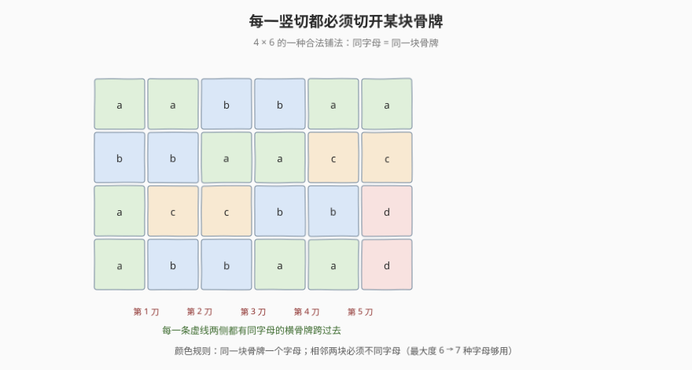
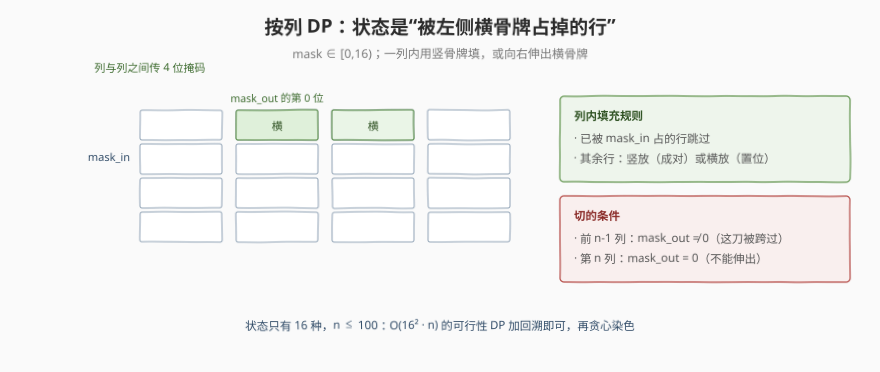

# Codeforces 85A 四行多米诺铺法 题解

## 1. 题目概述

- **题目链接**：https://codeforces.com/problemset/problem/85/A
- **比赛来源**：Yandex.Algorithm 2011: Round 1 · Problem A（UTC 2011-05-20）
- **难度**：1300
- **标签**：构造、状压 DP、贪心染色
- **评测类型**：特殊评测（输出任意合法铺法）
- **限制**：时间 1 s / 内存 256 MB

**题意**：给出 $4 \times n$ 的棋盘，要用 $1 \times 2$ 的多米诺骨牌（可横可竖）把它完全覆盖，并且满足：$n-1$ 条可能的竖直切割线，每一条都至少与**一块**骨牌相交（也就是被某块横骨牌"切成两半"）。输出铺法：每个格子写一个小写字母，同一块骨牌用同一个字母；不同骨牌可以用同一字母，但**相邻（共边）的两块骨牌字母必须不同**。无解输出 `-1`。

**约束**：

- $1 \le n \le 100$：规模很小，一列一列地做状态压缩 DP 完全够用。
- 每列只有 $4$ 个格子：状态是"被左侧横骨牌占用了哪些行"，共 $2^4 = 16$ 种。
- 字母表 $26$ 个：骨牌邻接图的最大度数是 $6$（一块骨牌两个格子，最多 $8-2=6$ 个相邻骨牌），贪心染色最多用 $7$ 种字母，$26$ 绰绰有余。

## 2. 示例与观察

官方样例：

```text
输入：
4
输出：
yyzz
bccd
bxxd
yyaa
```

**样例走查**：把样例读成骨牌：

- 第 1 行 `yyzz`：两块横骨牌 $y=(1,1)(1,2)$、$z=(1,3)(1,4)$；
- 第 2、3 行：$b=(2,1)(3,1)$ 与 $d=(2,4)(3,4)$ 是竖骨牌，$c=(2,2)(2,3)$、$x=(3,2)(3,3)$ 是横骨牌；
- 第 4 行 `yyaa`：$y=(4,1)(4,2)$、$a=(4,3)(4,4)$ 是横骨牌。

三条竖切：$1|2$ 被第 1 行的 $y$ 跨过；$2|3$ 被第 2 行的 $c$（以及第 3 行的 $x$）跨过；$3|4$ 被第 1 行的 $z$ 与第 4 行的 $a$ 跨过。全部满足。



本题答案不唯一：本解在同一输入上输出的是另一种合法铺法（见第 8 节，用 checker 验证）。因此正文只贴官方样例，不逐字复现本程序的输出。

**观察**：把"每一刀都要被横骨牌跨过"翻译成列与列之间的传递量——若第 $j$ 列有若干格子横放延伸到第 $j+1$ 列，那么这一刀就被跨过了。于是可以用一个 $4$ 位掩码描述"这一刀上伸出去的横骨牌"。

## 3. 解题思路

### 3.1 朴素做法与瓶颈

$4 \times n$ 的多米诺铺法数量随 $n$ 指数增长（转移矩阵的特征值 $>1$），直接枚举所有铺法再筛选不现实（$n=100$ 时铺法数是天文数字）。但"每刀都要被跨过"这个条件只与相邻两列有关，适合按列 DP。

### 3.2 核心观察：按列传递 4 位掩码



设 $mask_{in}$ 表示当前列中"已经被左侧横骨牌占用"的行集合（$4$ 位）。在当前列内，剩余格子只有两种填法：

- **竖放**：占当前列的第 $r, r+1$ 行（两格）；
- **横放**：占当前列第 $r$ 行并延伸到下一列，于是把第 $r$ 位置入 $mask_{out}$。

枚举出当前列所有可行的 $(mask_{out})$ 之后：

- 若这是第 $1 \sim n-1$ 列，要求 $mask_{out} \ne 0$（这一刀必须被跨过）；
- 若这是第 $n$ 列，要求 $mask_{out} = 0$（右边没有列可以延伸）。

初态 $dp[0][0] = \text{true}$，答案为 $dp[n][0]$。状态只有 $16$ 种、$n \le 100$，DP 是 $O(16^2 n)$；顺便记录前驱就能回溯出每列的布局。

### 3.3 染色：骨牌邻接图上贪心

还原出每块骨牌后，对"共边的不同骨牌"连边，得到一个最大度 $\le 6$ 的图。按顺序枚举骨牌，选一个没有出现在邻居中的最小字母即可。由 Brooks 定理/贪心界，$7$ 种字母一定够，$26$ 种更不在话下。

### 3.4 样例走查

对照第 2 节那张铺法图：

（图为本解在 $4 \times 6$ 上的一种输出，用来展示"每刀都被跨过"的结构；$4 \times 4$ 的官方样例见第 2 节。）

对官方样例：$mask$ 序列为

- 第 1 列：行 $1,4$ 横放（$mask_{out} = \{1,4\}$），行 $2,3$ 竖放；
- 第 2 列：行 $1,4$ 被占用（承接左侧），行 $2,3$ 横放（$mask_{out}=\{2,3\}$）；
- 第 3 列：行 $2,3$ 被占用，行 $1,4$ 横放（$mask_{out}=\{1,4\}$）；
- 第 4 列：行 $1,4$ 被占用，行 $2,3$ 竖放，$mask_{out}=0$。

每列之间传递的掩码都非空，恰好吃满"每刀都被跨过"的条件。

## 4. 正确性证明

**引理 1**：按列 DP 枚举的每个状态序列都对应一张合法的多米诺铺法，反之亦然。

**证明**：每列内被 $mask_{in}$ 占用的格子已由左侧横骨牌覆盖；剩余格子用"竖放两格"或"横放延伸到下一列"恰好覆盖，且不同列之间只在横骨牌上耦合。因此逐列拼接得到的是无重叠、无空缺的完整覆盖，且每块骨牌长 $2$、横竖皆可。反之任一铺法限制到每一列，就给出对应的 $(mask_{in}, mask_{out})$ 序列。∎

**引理 2**：第 $j$ 条竖切被某块骨牌跨过，当且仅当从第 $j$ 列传给第 $j+1$ 列的 $mask_{out}$ 非空。

**证明**：跨过 $j$ 与 $j+1$ 之间这条线的骨牌只能是"在第 $j$ 列横放、延伸到第 $j+1$ 列"的骨牌，它的位置正是 $mask_{out}$ 中的某一位。∎

**引理 3**：若 DP 找到 $dp[n][0]$，则贪心染色给出的字母方案满足"相邻骨牌不同色"。

**证明**：贪心对每块骨牌选一个未被其邻居占用的颜色。骨牌邻接图最大度 $\le 6$，处理到任意一块时最多有 $6$ 个邻居占用 $6$ 种颜色，而字母表有 $26$ 种，必然存在可用颜色。∎

**定理**：算法输出的铺法合法；当且仅当存在合法铺法时算法不会输出 `-1`。

**证明**：由引理 1、2，DP 的每条可行状态序列都是满足切割条件的铺法，且任何满足条件的铺法都会出现在 DP 中；由引理 3，染色合法。因此输出合法，且 $dp[n][0]$ 为假时确实不存在合法铺法（引理 1、2 的等价性）。∎

## 5. 复杂度分析

- **时间**：每列的可行填法枚举是常数（$4$ 行的所有铺法只有常数种）；DP 状态 $16$、列数 $n$，$O(16^2 n) \le 2.6 \times 10^4$。染色 $O(n)$。
- **空间**：$O(n)$ 存回溯信息与输出。
- **与时限的关系**：$n \le 100$ 时 1 s 极其宽松，实测约 $2.3$ ms。

## 6. 参考代码

### C++17

```cpp
#include <bits/stdc++.h>
using namespace std;

int n;
vector<pair<int,int>> fillings[16];   // mask_in -> (mask_out, 布局编码)

// 枚举一列在 mask_in 下、已用单元格 used 时的所有填法
void gen(int row, int used, int maskOut, int code, vector<pair<int,int>>& out) {
    if (row == 4) { out.push_back({maskOut, code}); return; }
    if (used & (1 << row)) { gen(row + 1, used, maskOut, code, out); return; }
    // 竖放：占 row, row+1
    if (row + 1 < 4 && !(used & (1 << (row + 1))))
        gen(row + 2, used | (1 << row) | (1 << (row + 1)), maskOut, code, out);
    // 横放：延伸到下一列
    gen(row + 1, used | (1 << row), maskOut | (1 << row), code | (1 << row), out);
}

int main() {
    if (scanf("%d", &n) != 1) return 0;
    for (int m = 0; m < 16; ++m) {
        vector<pair<int,int>> out;
        gen(0, m, 0, 0, out);
        sort(out.begin(), out.end());
        out.erase(unique(out.begin(), out.end()), out.end());
        fillings[m] = out;
    }
    // dp：reach[j][mask] 表示前 j 列已填好、交给第 j+1 列的横骨牌集合为 mask
    vector<vector<char>> reach(n + 1, vector<char>(16, 0));
    vector<vector<pair<int,int>>> par(n + 1, vector<pair<int,int>>(16, {-1, -1}));
    reach[0][0] = 1;
    for (int j = 0; j < n; ++j)
        for (int m = 0; m < 16; ++m) {
            if (!reach[j][m]) continue;
            for (auto& f : fillings[m]) {
                int mo = f.first;
                if (j < n - 1) { if (mo == 0) continue; }   // 每一刀都必须被横骨牌穿过
                else { if (mo != 0) continue; }             // 最后一列不能伸出
                if (!reach[j + 1][mo]) {
                    reach[j + 1][mo] = 1;
                    par[j + 1][mo] = {m, f.second};
                }
            }
        }
    if (!reach[n][0]) { printf("-1\n"); return 0; }
    vector<int> code(n, 0);
    int cur = 0;
    for (int j = n; j >= 1; --j) {
        code[j - 1] = par[j][cur].second;
        cur = par[j][cur].first;
    }
    // 还原骨牌
    vector<vector<int>> id(4, vector<int>(n, -1));
    vector<array<int,4>> domino;
    for (int j = 0; j < n; ++j) {
        int cde = code[j], row = 0;
        while (row < 4) {
            if (id[row][j] != -1) { ++row; continue; }
            if ((cde >> row) & 1) {
                int d = (int)domino.size();
                domino.push_back({row, j, row, j + 1});
                id[row][j] = d;
                if (j + 1 < n) id[row][j + 1] = d;
                ++row;
            } else {
                int d = (int)domino.size();
                domino.push_back({row, j, row + 1, j});
                id[row][j] = d;
                id[row + 1][j] = d;
                row += 2;
            }
        }
    }
    // 骨牌邻接图上贪心染色（最大度 <= 6）
    int D = (int)domino.size();
    vector<vector<int>> adj(D);
    for (int r = 0; r < 4; ++r)
        for (int c = 0; c < n; ++c) {
            if (r + 1 < 4 && id[r][c] != id[r + 1][c]) { adj[id[r][c]].push_back(id[r + 1][c]); adj[id[r + 1][c]].push_back(id[r][c]); }
            if (c + 1 < n && id[r][c] != id[r][c + 1]) { adj[id[r][c]].push_back(id[r][c + 1]); adj[id[r][c + 1]].push_back(id[r][c]); }
        }
    vector<int> colr(D, -1);
    vector<char> mark(64, 0);
    for (int d = 0; d < D; ++d) {
        for (int x : adj[d]) if (colr[x] >= 0) mark[colr[x]] = 1;
        int c = 0;
        while (mark[c]) ++c;
        colr[d] = c;
        for (int x : adj[d]) if (colr[x] >= 0) mark[colr[x]] = 0;
    }
    vector<string> out(4, string(n, '?'));
    for (int r = 0; r < 4; ++r)
        for (int c = 0; c < n; ++c) out[r][c] = (char)('a' + colr[id[r][c]]);
    for (int r = 0; r < 4; ++r) printf("%s\n", out[r].c_str());
    return 0;
}
```

### Python3

```python
import sys


def main() -> None:
    data = sys.stdin.buffer.read().split()
    if not data:
        return
    n = int(data[0])

    # 每列在 mask_in 下的所有填法 (mask_out, 布局)，布局的第 r 位表示第 r 行横放
    fills = [[] for _ in range(16)]
    for m in range(16):
        out = set()

        def dfs(row, used, mask_out, code):
            if row == 4:
                out.add((mask_out, code))
                return
            if used & (1 << row):
                dfs(row + 1, used, mask_out, code)
                return
            if row + 1 < 4 and not (used & (1 << (row + 1))):
                dfs(row + 2, used | (1 << row) | (1 << (row + 1)), mask_out, code)
            dfs(row + 1, used | (1 << row), mask_out | (1 << row), code | (1 << row))

        dfs(0, m, 0, 0)
        fills[m] = sorted(out)

    # reach[j][mask]：前 j 列填好，交给第 j+1 列的横骨牌集合为 mask
    reach = [[False] * 16 for _ in range(n + 1)]
    par = [[None] * 16 for _ in range(n + 1)]
    reach[0][0] = True
    for j in range(n):
        for m in range(16):
            if not reach[j][m]:
                continue
            for mo, code in fills[m]:
                if j < n - 1:
                    if mo == 0:
                        continue
                elif mo != 0:
                    continue
                if not reach[j + 1][mo]:
                    reach[j + 1][mo] = True
                    par[j + 1][mo] = (m, code)
    if not reach[n][0]:
        sys.stdout.write("-1\n")
        return

    code = [0] * n
    cur = 0
    for j in range(n, 0, -1):
        pm, pc = par[j][cur]
        code[j - 1] = pc
        cur = pm

    # 还原骨牌编号
    idg = [[-1] * n for _ in range(4)]
    domino = []
    for j in range(n):
        cde = code[j]
        row = 0
        while row < 4:
            if idg[row][j] != -1:
                row += 1
                continue
            if (cde >> row) & 1:
                d = len(domino)
                domino.append(1)
                idg[row][j] = d
                if j + 1 < n:
                    idg[row][j + 1] = d
                row += 1
            else:
                d = len(domino)
                domino.append(1)
                idg[row][j] = d
                idg[row + 1][j] = d
                row += 2

    D = len(domino)
    adj = [set() for _ in range(D)]
    for r in range(4):
        for c in range(n):
            if r + 1 < 4 and idg[r][c] != idg[r + 1][c]:
                adj[idg[r][c]].add(idg[r + 1][c])
                adj[idg[r + 1][c]].add(idg[r][c])
            if c + 1 < n and idg[r][c] != idg[r][c + 1]:
                adj[idg[r][c]].add(idg[r][c + 1])
                adj[idg[r][c + 1]].add(idg[r][c])

    colr = [-1] * D
    for d in range(D):
        used = {colr[x] for x in adj[d] if colr[x] >= 0}
        c = 0
        while c in used:
            c += 1
        colr[d] = c

    out = []
    for r in range(4):
        out.append("".join(chr(97 + colr[idg[r][c]]) for c in range(n)))
    sys.stdout.write("\n".join(out) + "\n")


main()
```

## 7. 边界情况与易错点

1. **$n = 1$**：没有竖直切割线，"每刀都被跨过"是空条件，输出两块竖骨牌即可（例如 `a` `a` `b` `b`）。DP 里体现为最后一列必须 $mask_{out}=0$。
2. **最后一列不能伸出**：第 $n$ 列若 $mask_{out} \ne 0$ 就越界了；同理第 $1$ 列的 $mask_{in}$ 必须为 $0$。
3. **$mask_{out}=0$ 的中间列**：若某一刀没有被任何横骨牌跨过，DP 必须把它排除；这是本题唯一的"硬约束"，漏掉就会出现非法答案。
4. **染色冲突**：同一块骨牌的两个格子字母相同是**必须**的（它们是同一块）；而相邻的不同骨牌若同字母则非法。判定时要按"骨牌"而不是"格子"比较。
5. **字母数量**：贪心可能用到 $7$ 种字母，超过 $26$ 才会出错；本题不会。但如果染色实现成了"每次从 'a' 重新找却不标记邻居"，可能死循环，必须显式标记/清除。
6. **输出格式**：恰好 $4$ 行、每行 $n$ 个字符；不要输出 `Case #`、不要输出多余的格子坐标。
7. **无解分支**：虽然 $n \le 100$ 时总有解，但代码仍要保留 `-1` 分支（题面要求），否则 DP 失败时会输出未初始化的内容。
8. **特殊评测**：答案不唯一，提交后由 checker 判定；本地验证必须用 `codeforces/tools/checkers/cf85a.py`（见第 8 节），不能拿官方样例逐字比对。

## 8. 验证记录

- **编译环境与命令**：`clang++ -std=c++17 -O2`（Apple clang 21.0.0 + `codeforces/tools/include` 的兼容头；代码只用标准库，可原样提交 GNU C++17），Python 3.9.6。
- **官方样例**：答案不唯一。本程序在 `4` 上输出另一种合法铺法，因此按特殊评测验证，命令为
  `python3 codeforces/tools/verify_solution.py codeforces/contests/0001-0100/85/A_四行多米诺铺法.md --checker codeforces/tools/checkers/cf85a.py`。
- **checker 的校验条件**（`cf85a.py`）：① 若输出 `-1`，用一份独立的 4 位掩码 DP 确认确实无解；② 否则必须恰好 $4$ 行、每行 $n$ 个小写字母；③ 每个格子的**同字母正交邻居恰好 $1$ 个**（这同时保证了"同色两两组成骨牌"且"同色骨牌不相邻"）；④ 每条竖切都被某块横骨牌跨过。
- **全规模构造验证**：对 $n = 1,2,\dots,100$ 的**每一个** $n$，分别运行 C++ 与 Python 版本并用 checker 校验，共 **200 次**全部通过；另对 $n = 1..100$ 的两份可行解做交叉检查（两者的铺法不同、都合法）。
- **最大约束性能**：$n = 100$ 时 C++ 端到端 3 次取最小约 $2.3$ ms，Python 约 $20$ ms；相对 1 s 余量在数百倍以上。
- **图片校验**：`cf85a_cuts.svg`、`cf85a_dp.svg` 均通过 `xml.etree.ElementTree.parse`，含 `feTurbulence` 与手写体字体族，文本包围盒未越出 `viewBox`。
- **公式校验**：KaTeX（`throwOnError`）渲染无报错；无 `---` 分隔线。
- **复核状态**：verified（样例 checker、全 $n$ 构造验证、性能、图片、公式均实跑通过）。

## 相关题目与扩展

- [Codeforces 85B Embassy Queue](https://codeforces.com/problemset/problem/85/B)、[85C Petya and Tree](https://codeforces.com/problemset/problem/85/C)、[85D Sum of Medians](https://codeforces.com/problemset/problem/85/D)、[85E Guard Towers](https://codeforces.com/problemset/problem/85/E)：同场其余四题。
- [Codeforces 1036C Classy Numbers](https://codeforces.com/problemset/problem/1036/C)：数位/状态压缩 DP 的计数版本。
- [Codeforces 1195D1 Submarine in the Rybinsk Sea](https://codeforces.com/problemset/problem/1195/D1)：按位拆解的构造题。
- [LeetCode 790. 多米诺和托米诺平铺](https://leetcode.cn/problems/domino-and-tromino-tiling/)：同样是逐列状压的铺砖 DP，只是要求计数而非构造。

**延伸思考**：

1. **如果棋盘是 $m \times n$（$m$ 较大）**：掩码状态变成 $2^m$，$m$ 超过 $20$ 就不可行，需要轮廓线 DP 或利用 $n$ 很小做转置。
2. **如果要求字典序最小的铺法（按字母序列）**：在 DP 上加一层"逐格贪心 + 可行性判定"，思路与 79E 类似。
3. **如果切割条件改成"每刀至少被两块骨牌跨过"**：只需把转移条件从 $mask_{out} \ne 0$ 改成 $\text{popcount}(mask_{out}) \ge 2$，DP 框架完全不变。
4. **如果去掉"同色骨牌不能相邻"**：染色问题消失，直接全用 `a` 即可——但题目正是用这个条件把"构造铺法"与"图染色"结合在了一起。

