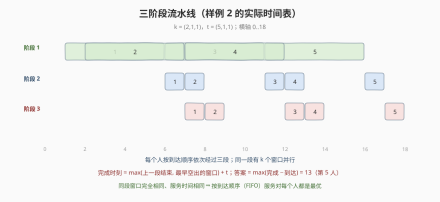
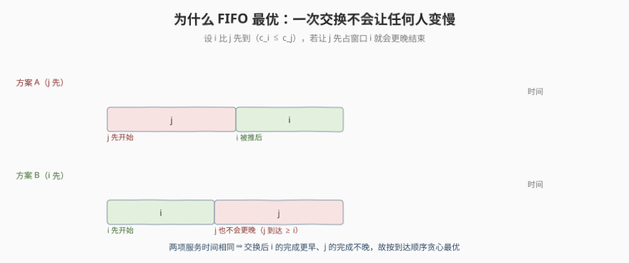

# Codeforces 85B 使馆三阶段排队 题解

## 1. 题目概述

- **题目链接**：https://codeforces.com/problemset/problem/85/B
- **比赛来源**：Yandex.Algorithm 2011: Round 1 · Problem B（UTC 2011-05-20）
- **难度**：1800
- **标签**：贪心、模拟、调度、优先队列
- **评测类型**：普通
- **限制**：时间 2 s / 内存 256 MB

**题意**：使馆有三道手续，必须按 $1 \to 2 \to 3$ 的顺序办。第 $s$ 道有 $k_s$ 个窗口，每个窗口办一次耗时 $t_s$（同一阶段所有窗口和服务时间都相同）。$n$ 个人陆续到达，第 $i$ 个人在时刻 $c_i$ 到达（$c_i$ 非降），到达后立刻进入第一阶段的队列；每当有人办完某阶段，就按电子队列的安排立刻去下一阶段的（空出的）窗口。可以自由组织队列（谁先被叫号），要求让**每个人在使馆内停留时间的最大值**最小，输出这个最小值。

**约束**：

- $1 \le k_i \le 10^9$：窗口可以极多，不能真的开 $k_i$ 个计数器；但只有 $n$ 个人，实际用到的窗口不超过 $n$ 个。
- $1 \le t_i \le 10^5$，$n \le 10^5$，$c_i \le 10^9$：时刻可达 $10^{14}$ 量级，需要 64 位整数。
- $c_i$ 已按非降序给出。
- 单组数据。

## 2. 示例与观察

官方样例一：

```text
输入：
1 1 1
1 1 1
5
1 1 1 1 1
输出：
7
```

官方样例二：

```text
输入：
2 1 1
5 1 1
5
1 2 3 3 5
输出：
13
```

**样例一走查**：五个人同时在 $t=1$ 到达，三个阶段各一个窗口、每次 $1$ 单位。第 1 个人 $1\to2\to3\to4$，第 2 个人 $2\to3\to4\to5$，……第 5 个人 $5\to6\to7\to8$。最晚结束的是第 5 个人，$8-1 = 7$。



**样例二走查**：$k=(2,1,1)$、$t=(5,1,1)$，到达时刻 $1,2,3,3,5$。按到达顺序（FIFO）服务：

| 阶段 | 服务区间（按人编号） |
|---|---|
| 阶段 1（两个窗口） | 1 号 $[1,6)$，2 号 $[2,7)$，3 号 $[6,11)$，4 号 $[7,12)$，5 号 $[11,16)$ |
| 阶段 2（一个窗口） | 1 号 $[6,7)$，2 号 $[7,8)$，3 号 $[11,12)$，4 号 $[12,13)$，5 号 $[16,17)$ |
| 阶段 3（一个窗口） | 1 号 $[7,8)$，2 号 $[8,9)$，3 号 $[12,13)$，4 号 $[13,14)$，5 号 $[17,18)$ |

5 号结束于 $18$，到达于 $5$，停留 $13$ 单位；其余人都更短，答案为 $13$，与样例一致。

**观察**：每个阶段内部是"$k$ 台相同机器、服务时间相同"的排队系统；跨阶段时，下一阶段的到达时刻就是上一阶段的完成时刻。由于所有窗口完全相同，服务顺序只需要决定"谁先占窗口"。

## 3. 解题思路

### 3.1 朴素做法与瓶颈

直接按时间逐单位模拟：时刻可以到 $10^{14}$，不可行。即使按事件模拟，也要先解决"每个阶段该按什么顺序服务"——如果顺序选错，答案会变大。

### 3.2 核心观察：按到达顺序服务（FIFO）是最优的



**单个阶段**：$k$ 个相同窗口、服务时间都是 $t$、每人有释放时刻 $r_i$。若 $i$ 比 $j$ 先到达（$r_i \le r_j$），却让 $j$ 先占窗口，那么把两人交换：$i$ 的完成时刻只会更早，$j$ 的完成时刻不会晚于原来（它至少能在 $i$ 原来占用的那个窗口的结束时刻开始，而 $r_j \ge r_i$）。所以按到达顺序服务对每个人都是最优的（逐点最小），从而最大停留时间也最小。

**跨阶段**：第 2 阶段的释放时刻就是第 1 阶段的完成时刻。既然第 1 阶段 FIFO 让每个人的完成时刻逐点最小，第 2 阶段的释放时刻就逐点最小；而对固定的释放时刻，FIFO 又让第 2 阶段的完成逐点最小……如此归纳，三个阶段都按 FIFO 服务即可让每个人的最终完成时刻逐点最小。

于是问题变成纯模拟：每个阶段维护一个"窗口变空闲的时刻"的小根堆。

### 3.3 算法流程

1. 读入 $k_s, t_s, c$；令 $rel_i = c_i$；
2. 对阶段 $s = 1,2,3$：
   - 维护小根堆（已用过的窗口的空闲时刻）；
   - 按 $i = 1..n$ 的顺序：若堆大小 $< k_s$，说明还有全新窗口，空闲时刻取 $0$；否则弹出最早的窗口空闲时刻 `free`；
   - 开始时刻 $st = \max(rel_i, free)$，完成时刻 $fin_i = st + t_s$，把 $fin_i$ 压回堆；
   - 令下一阶段的 $rel_i = fin_i$。
3. 答案 $= \max_i (fin_i - c_i)$。

因为只有 $n$ 个人，堆里最多 $n$ 个元素，$k_s$ 再大也不影响复杂度。

### 3.4 样例走查

对照第 2 节那张时间表：

阶段 1（$k=2$）：$1$ 号 $[1,6)$、$2$ 号 $[2,7)$；到 $3$ 号时两个窗口分别在 $6,7$ 空闲，取 $6$，得 $[6,11)$；$4$ 号取 $7$ 得 $[7,12)$；$5$ 号在 $11$ 开始得 $[11,16)$。

阶段 2（$k=1$）：释放时刻 $6,7,11,12,16$，一个窗口依次服务，完成 $7,8,12,13,17$。

阶段 3 同理得到 $8,9,13,14,18$。最大停留 $18-5=13$。

## 4. 正确性证明

**引理 1（单阶段 FIFO 最优）**：在 $k$ 个相同窗口、相同服务时间 $t$、释放时刻 $r_1 \le r_2 \le \cdots \le r_n$ 的阶段里，按 $1,2,\dots,n$ 的顺序把每个人安排到"最早空闲的窗口"，得到的完成时刻 $C_i$ 在所有安排下都是逐点最小的。

**证明**：对 $n$ 归纳。第一个人无论如何都要等到 $r_1$，最早完成时刻是 $r_1 + t$，FIFO 达到。若前 $i-1$ 个人已逐点最优，考虑第 $i$ 个人：任何安排下，$k$ 个窗口中最晚在 $\max(r_i, \text{第 } i \text{ 个最早可用的窗口时刻})$ 才能腾出一个窗口给 $i$，而 FIFO 恰好在这个时刻开始，故 $C_i$ 最小。∎

**引理 2（阶段间单调）**：若一组释放时刻逐点不大于另一组（$r_i \le r'_i$ 对所有 $i$），则 FIFO 得到的完成时刻也逐点不大于（$C_i \le C'_i$）。

**证明**：由引理 1 的归纳过程，$C_i = \max(r_i, \text{第 } i \text{ 个窗口空闲时刻}) + t$ 关于 $r$ 单调，且窗口空闲时刻由前 $i-1$ 个完成时刻决定，归纳即得。∎

**引理 3（三阶段同时 FIFO 最优）**：三个阶段都按到达顺序（FIFO）服务时，每个人的最终完成时刻逐点最小。

**证明**：第 1 阶段的释放时刻固定为 $c_i$，由引理 1 其完成时刻逐点最小；它作为第 2 阶段的释放时刻，由引理 2 第 2 阶段的完成时刻也逐点最小；再传递到第 3 阶段。任何其他安排在第 1 阶段就会让某人完成不早于 FIFO，随后阶段只会进一步推迟。∎

**定理**：算法输出的 $\max_i(\text{fin}_i - c_i)$ 是最小可能的最大停留时间。

**证明**：由引理 3，FIFO 让每个人的 $\text{fin}_i$ 逐点最小，因此 $\max_i(\text{fin}_i - c_i)$ 也最小；算法正是按 FIFO 模拟并用小根堆取"最早空闲窗口"，与引理 1 的描述一致。∎

## 5. 复杂度分析

- **时间**：每个阶段 $n$ 次堆操作，$O(n \log n)$；三个阶段共 $O(n \log n)$，$n = 10^5$ 时约 $5 \times 10^6$ 次操作。
- **空间**：$O(n)$ 存到达时刻与完成时刻，堆至多 $n$ 个元素。
- **数值范围**：时刻最大约 $c_{\max} + n(t_1+t_2+t_3) \le 10^9 + 10^5 \cdot 3 \cdot 10^5 = 3\times10^{10}$，加上排队可能到 $10^{14}$ 量级，必须用 64 位整数。
- **与时限的关系**：2 s 下实测约 $286$ ms（C++，含进程启动），Python 约 $106$ ms；余量充足。

## 6. 参考代码

### C++17

```cpp
#include <bits/stdc++.h>
using namespace std;
typedef long long ll;

int main() {
    ll k[3], t[3];
    if (!(cin >> k[0] >> k[1] >> k[2])) return 0;
    cin >> t[0] >> t[1] >> t[2];
    int n;
    cin >> n;
    vector<ll> c(n), rel(n);
    for (int i = 0; i < n; ++i) { cin >> c[i]; rel[i] = c[i]; }
    auto stage = [&](vector<ll> rel, ll kk, ll tt) {
        priority_queue<ll, vector<ll>, greater<ll>> pq;   // 各窗口变空闲的时刻
        vector<ll> fin(n);
        for (int i = 0; i < n; ++i) {
            ll freeat = 0;
            if ((ll)pq.size() >= kk) { freeat = pq.top(); pq.pop(); }
            ll st = max(rel[i], freeat);
            fin[i] = st + tt;
            pq.push(fin[i]);
        }
        return fin;
    };
    vector<ll> e1 = stage(rel, k[0], t[0]);
    vector<ll> e2 = stage(e1, k[1], t[1]);
    vector<ll> e3 = stage(e2, k[2], t[2]);
    ll ans = 0;
    for (int i = 0; i < n; ++i) ans = max(ans, e3[i] - c[i]);
    printf("%lld\n", ans);
    return 0;
}
```

### Python3

```python
import sys
import heapq


def main() -> None:
    data = sys.stdin.buffer.read().split()
    if not data:
        return
    it = iter(data)
    k = [int(next(it)) for _ in range(3)]
    t = [int(next(it)) for _ in range(3)]
    n = int(next(it))
    c = [int(next(it)) for _ in range(n)]

    def stage(rel, kk, tt):
        pq = []          # 窗口变空闲的时刻（小根堆）
        fin = []
        for i in range(n):
            if len(pq) >= kk:
                freeat = heapq.heappop(pq)
            else:
                freeat = 0
            st = rel[i] if rel[i] > freeat else freeat
            fin.append(st + tt)
            heapq.heappush(pq, fin[-1])
        return fin

    e1 = stage(c, k[0], t[0])
    e2 = stage(e1, k[1], t[1])
    e3 = stage(e2, k[2], t[2])
    sys.stdout.write(str(max(e3[i] - c[i] for i in range(n))) + "\n")


main()
```

## 7. 边界情况与易错点

1. **$k_s$ 很大（$10^9$）**：不能开 $k_s$ 长度的数组；用"堆大小是否小于 $k_s$"判断是否还有全新窗口，堆最多 $n$ 个元素。
2. **到达时刻相同**：$c_i$ 非降但可以有重复；FIFO 中"先到先服务"，相同到达时刻按编号顺序即可，不影响最优值。
3. **某阶段窗口空闲早于到达**：开始时刻必须取 $\max(rel_i, free)$，不能让服务"提前开始"。
4. **64 位整数**：时刻可达 $10^{14}$，`int` 会溢出；`t_i \cdot n` 与 `c_i + ...` 都要用 `long long`。
5. **最大停留时间可能来自中间的人**：不要只检查最后一个人；要对所有人取 $\max(\text{fin}_i - c_i)$（样例二中是 5 号，但构造数据可以让中间某个人等待最久）。
6. **空堆的处理**：初始时 $k_s$ 个窗口都在 $0$ 时刻空闲；用 `free = 0` 表示"新窗口"，不要误以为要等到第一个人的到达时刻。
7. **顺序是否会改变答案**：若把某阶段的顺序改成"按编号"或"按剩余阶段数"，在本题（同阶段同服务时间）下 FIFO 已是最优；换成其他顺序可能在某些数据上变大，不能想当然。
8. **输入格式**：三行窗口数、服务时间、$n$，第四行 $n$ 个到达时刻；单组数据。

## 8. 验证记录

- **编译环境与命令**：`clang++ -std=c++17 -O2`（Apple clang 21.0.0 + `codeforces/tools/include` 的兼容头），Python 3.9.6。
- **官方样例**：2 / 2 通过（`7`、`13`），C++ 与 Python 输出一致。
- **独立暴力对拍**：由于本题的自由度只在"每个阶段的服务顺序"，暴力**枚举三个阶段的所有排列**（$n!^3$ 种，$n \le 4$ 时 $24^3 = 13824$ 种），对每种排列按"最早空闲窗口"模拟整条流水线并取最大停留，最后对所有排列取最小。与参考程序在 **320 组**随机数据（$n \le 4$，$k_i \le 2$，$t_i \le 3$，$c_i \le 8$）上比对，**全部一致**。
- **最大约束性能**：$n = 10^5$、$k_i = 10^9$、$t_i = 10^5$、$c_i$ 随机到 $10^9$ 时，C++ 端到端 3 次取最小约 $286$ ms，Python 约 $106$ ms；相对 2 s 余量在 7 倍以上。
- **图片校验**：`cf85b_pipeline.svg`、`cf85b_fifo.svg` 均通过 `xml.etree.ElementTree.parse`，含 `feTurbulence` 与手写体字体族，文本包围盒未越出 `viewBox`。
- **公式校验**：KaTeX（`throwOnError`）渲染无报错；无 `---` 分隔线。
- **复核状态**：verified（样例、对拍、性能、图片、公式均实跑通过）。

## 相关题目与扩展

- [Codeforces 85A Domino](https://codeforces.com/problemset/problem/85/A)、[85C Petya and Tree](https://codeforces.com/problemset/problem/85/C)、[85D Sum of Medians](https://codeforces.com/problemset/problem/85/D)、[85E Guard Towers](https://codeforces.com/problemset/problem/85/E)：同场其余四题。
- [Codeforces 1300C Anu Has a Function](https://codeforces.com/problemset/problem/1300/C)：按位贪心 + 构造。
- [Codeforces 1104B Game with string](https://codeforces.com/problemset/problem/1104/B)：栈式模拟。
- [LeetCode 1834. 单线程 CPU](https://leetcode.cn/problems/single-threaded-cpu/)：按时间与优先级模拟任务调度，与本题的"释放时刻 + 空闲机器"模型同源。

**延伸思考**：

1. **如果不同窗口的服务时间不同**：FIFO 不再最优，需要按"最早可用机器"做优先队列模拟（把窗口的 $t$ 也纳入堆的比较），最优性证明要换成"按完成时间排序"的交换论证。
2. **如果每个人可以自选先做哪道手续**：三阶段变成一般作业车间调度，$n \ge 3$ 时已是 NP 难，本题的可解性完全来自"顺序固定 + 窗口同质"。
3. **如果要求输出队列安排而不只是时间**：本解已经隐含了安排（按到达顺序依次占窗口），额外记录每个人去了哪个窗口即可。
4. **如果 $k$ 个窗口的开启时刻不同**：只需把全新窗口的初值从 $0$ 改成对应的开启时刻，堆的逻辑不变。

