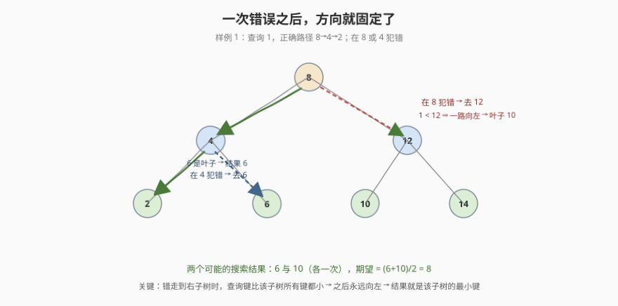
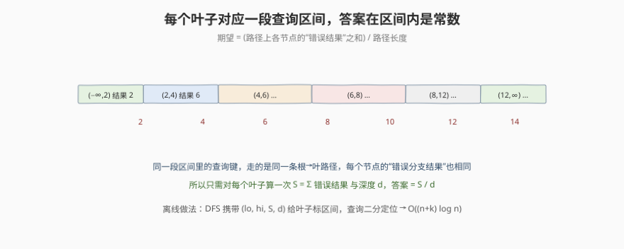

# Codeforces 85C 一次走错的搜索期望 题解

## 1. 题目概述

- **题目链接**：https://codeforces.com/problemset/problem/85/C
- **比赛来源**：Yandex.Algorithm 2011: Round 1 · Problem C（UTC 2011-05-20）
- **难度**：2200
- **标签**：二叉搜索树、期望、树上遍历、离线二分
- **评测类型**：普通（浮点，误差 $10^{-9}$）
- **限制**：时间 3 s / 内存 256 MB

**题意**：给出一棵**满**二叉搜索树（每个结点 $0$ 或 $2$ 个孩子，$n$ 为奇数），以及 $k$ 个查询键（都与树上键不同、彼此不同）。对每个查询键 $q$，按标准 BST 规则从根开始比较并下降；但在**恰好一个**结点上会走错方向（该走左却走了右，或反之），出错后不再犯任何错误，最终停在某个叶子，叶子的键就是这次搜索的"结果"。所有"恰好错一次"的搜索等概率。求搜索结果的期望。

**约束**：

- $3 \le n < 10^5$：树可以是一条深 $5 \times 10^4$ 的"梳子"，逐查询 $O(\text{深度})$ 会退化到 $O(nk) = 10^{10}$，必须预处理。
- $1 \le k \le 10^5$：查询数也很大，需要 $O((n+k)\log n)$ 级别的算法。
- 所有键 $\le 10^9$ 且互不相同：可以用整数区间来刻画"哪些查询会走到哪个叶子"。
- 输出浮点，误差 $10^{-9}$：用 `double` 计算 $S/d$（$S \le 10^{14}$）精度足够。

## 2. 示例与观察

官方样例一：

```text
输入：
7
-1 8
1 4
1 12
2 2
2 6
3 10
3 14
1
1
输出：
8.0000000000
```

官方样例二：

```text
输入：
3
-1 5
1 3
1 7
6
1
2
4
6
8
9
输出：
7.0000000000
7.0000000000
7.0000000000
3.0000000000
3.0000000000
3.0000000000
```

**样例一走查**：树为 $8$（根），左 $4$（左 $2$、右 $6$），右 $12$（左 $10$、右 $14$）。查询键 $1$ 的正确路径是 $8 \to 4 \to 2$（$1<8$ 向左，$1<4$ 向左，$2$ 是叶子）。可能在两个内部结点犯错：

- 在 $8$ 犯错：本应向左，却去了右孩子 $12$；之后 $1 < 12$ 向左到 $10$，叶子 → 结果 $10$；
- 在 $4$ 犯错：本应向左，却去了右孩子 $6$，$6$ 是叶子 → 结果 $6$。

两次搜索等概率，期望 $(10+6)/2 = 8$。



**样例二走查**：树 $5$（左 $3$、右 $7$，都是叶子）。查询 $1,2,4$：正确路径只经过内部结点 $5$，在 $5$ 犯错（本应向左却向右）到 $7$，叶子 → 结果 $7$。查询 $6,8,9$：在 $5$ 犯错（本应向右却向左）到 $3$ → 结果 $3$。故答案依次是 $7,7,7,3,3,3$。

**关键观察**：错走到右孩子时，查询键一定比右子树里所有键都小（因为 $q < \text{key}(v) <$ 右子树任意键），于是之后的每一次比较都"向左"——结果必然是右子树的**最小键**。对称地，错走到左孩子时结果必然是左子树的**最大键**。也就是说话，一次错误之后的方向完全确定，结果与 $q$ 的具体数值无关！

## 3. 解题思路

### 3.1 朴素做法与瓶颈

对每个查询，沿正确路径下降，在每个内部结点模拟"犯错后的下降"到叶子——单次 $O(\text{深度})$，最坏 $O(n)$。$n, k$ 都是 $10^5$，总 $10^{10}$，超时。

### 3.2 核心观察一：错后的结果是子树的极值键

设当前内部结点 $v$，键为 $k_v$，查询键 $q \ne k_v$。

- 若 $q < k_v$：正确应走左孩子；犯错则走**右**孩子 $R(v)$。右子树所有键都 $> k_v > q$，所以之后每次比较都是"$q <$ 当前键"→ 一路向左，直到叶子。结果是 $R(v)$ 子树的**最小键**（最左叶子的键）。
- 若 $q > k_v$：犯错则走**左**孩子 $L(v)$。左子树所有键 $< k_v < q$，之后一路向右，结果是 $L(v)$ 子树的**最大键**。

于是对每个内部结点 $v$ 预处理两个数：

$$\text{rightMin}(v) = \min\{\text{key}(u) : u \in \text{subtree}(R(v))\},\qquad \text{leftMax}(v) = \max\{\text{key}(u) : u \in \text{subtree}(L(v))\}.$$

查询 $q$ 的答案就是：沿正确路径经过的内部结点集合 $V(q)$ 上，

$$\text{ans}(q) = \frac{1}{|V(q)|}\sum_{v \in V(q)} \begin{cases}\text{rightMin}(v), & q < k_v,\\ \text{leftMax}(v), & q > k_v.\end{cases}$$

### 3.3 核心观察二：同一"叶区间"内答案相同



沿正确路径一直走到叶子，路径完全由"$q$ 落在哪个区间"决定：每个叶子和它左右两侧最近的分叉键构成一个开区间 $(lo, hi)$，所有落在这个区间里的 $q$ 都走到同一片叶子，经过同一串内部结点，且每个结点的比较方向都相同。因此：

- 每个叶子对应一个区间，区间内所有查询的**分子 $S$ 与分母 $d$（路径上的内部结点数）都是常数**；
- 答案只依赖叶子，是区间上的常数。

做法：从根做一次 DFS，携带 $(lo, hi, S, d)$：

- 内部结点 $v$：向左孩子传 $(lo,\ \min(hi,k_v),\ S + \text{rightMin}(v),\ d+1)$；向右孩子传 $(\max(lo,k_v),\ hi,\ S + \text{leftMax}(v),\ d+1)$；
- 叶子：记录区间 $(lo,hi)$ 与常数答案 $S/d$。

根区间取 $(-1,\ 10^9+1)$（键为正整数）。然后按 $lo$ 排序所有叶子区间，每个查询二分定位所属区间，$O(1)$ 输出。

### 3.4 样例走查


样例一：$\text{rightMin}(8) = \min\{10,14\} = 10$，$\text{rightMin}(4) = 6$；$\text{leftMax}(8)=\max\{2,6\}=6$，$\text{leftMax}(4)=2$。

查询 $1$：路径 $8 \to 4 \to 2$，两个内部结点都有 $q < k_v$，故 $S = 10 + 6 = 16$，$d = 2$，答案 $8$。

对照叶子区间：$2$ 号叶子（键 $2$）对应区间 $(-1, 4)$，查询 $1$ 落在其中，答案 $16/2 = 8$。同理查询 $3$（区间 $(2,4)$）也走 $8 \to 4 \to 2$，答案同样是 $8$——但它们在第 2 个结点处方向不同（$3<4$ 仍向左），所以 $S$ 一样。

## 4. 正确性证明

**引理 1**：设结点 $v$ 的键为 $k_v$，查询键 $q < k_v$。若在 $v$ 犯错走到右孩子 $R(v)$，则从 $R(v)$ 起的所有比较都向左，最终到达 $R(v)$ 子树的最左叶子，结果为 $\text{rightMin}(v)$；$q > k_v$ 时对称地结果为 $\text{leftMax}(v)$。

**证明**：右子树的所有键都严格大于 $k_v$，而 $q < k_v$，故对右子树中任意结点 $u$ 都有 $q < k_u$，比较永远"向左"，沿最左路径走到叶子，该叶子的键正是子树最小键。对称情形同理。∎

**引理 2**：查询 $q$ 的全部可能搜索结果，正是沿正确路径的每个内部结点 $v$ 处"错一次"所得结果，共 $|V(q)|$ 个（按题意为等概率）。

**证明**：错误发生在第一个出错点，之前必须一直正确，所以出错点必在正确路径上；正确路径的叶子本身不是内部结点，不能在那里出错；在内部结点出错有唯一一条错误分支（另一个孩子）。故可能情形恰为 $|V(q)|$ 个，互不相同。∎

**引理 3**：同一叶子区间 $(lo,hi)$ 内的所有查询键，走到的叶子、路径上的内部结点序列、以及每个结点处的比较方向都相同，因此 $S$ 与 $d$ 相同。

**证明**：对深度归纳：在结点 $v$，$q \in (lo,hi)$ 且 $q \ne k_v$，若 $q < k_v$ 则 $q \in (lo,\min(hi,k_v))$，否则 $q \in (\max(lo,k_v),hi)$——方向只由 $q$ 与 $k_v$ 的大小关系决定，而这由 $q$ 落在 $k_v$ 的哪一侧决定。区间递归地划分，故同一区间内方向序列相同。∎

**引理 4**：DFS 给每个叶子标出的区间恰好是"会走到该叶子的查询键集合"，且这些区间两两不交、覆盖 $(-1,10^9+1)$ 中所有非树键。

**证明**：区间由 BST 的比较规则递归划分：每个内部结点把当前区间按 $k_v$ 一分为二，分别给左右子树。标准 BST 性质保证键的划分正确，叶子处得到的区间正是"插入位置落在该叶子"的键集合；所有叶子区间是整段区间的一个划分。∎

**定理**：算法对每个查询输出的 $S/d$ 就是题面定义的期望。

**证明**：由引理 2，期望等于正确路径上各内部结点"错误结果"的算术平均；由引理 1，这些结果分别是 $\text{rightMin}$ 或 $\text{leftMax}$；由引理 3、4，二分定位到的叶子给出了同一路径的 $S$ 与 $d$，于是 $S/d$ 正确。∎

## 5. 复杂度分析

- **时间**：一次 DFS 求子树最小/最大值与叶子区间，$O(n)$；查询排序/二分 $O(k \log n)$。总计 $O(n + k\log n)$。
- **空间**：树与区间 $O(n)$；查询 $O(k)$。
- **数值范围**：$S \le d \cdot 10^9 \le 10^{14}$，用 `long long` 存，最后转 `double` 相除；`double` 有 53 位有效位，相对误差远小于 $10^{-9}$。
- **与时限的关系**：3 s 下实测最坏（深度 $5\times10^4$ 的梳子树 + $10^5$ 查询）约 $41$ ms，余量 70 倍以上。

## 6. 参考代码

### C++17

```cpp
#include <bits/stdc++.h>
using namespace std;
typedef long long ll;

int main() {
    int n;
    if (scanf("%d", &n) != 1) return 0;
    vector<int> par(n + 1), key(n + 1), lc(n + 1, 0), rc(n + 1, 0);
    int root = 0;
    for (int i = 1; i <= n; ++i) {
        scanf("%d %d", &par[i], &key[i]);
        if (par[i] == -1) root = i;
    }
    for (int i = 1; i <= n; ++i) {
        if (par[i] == -1) continue;
        if (key[i] < key[par[i]]) lc[par[i]] = i;
        else rc[par[i]] = i;
    }
    // 迭代先序
    vector<int> order;
    order.reserve(n);
    vector<int> stk{root};
    while (!stk.empty()) {
        int u = stk.back(); stk.pop_back();
        order.push_back(u);
        if (lc[u]) stk.push_back(lc[u]);
        if (rc[u]) stk.push_back(rc[u]);
    }
    vector<int> mn(n + 1), mx(n + 1);
    for (int i = 1; i <= n; ++i) { mn[i] = key[i]; mx[i] = key[i]; }
    for (int idx = (int)order.size() - 1; idx >= 0; --idx) {
        int u = order[idx];
        if (lc[u]) { mn[u] = min(mn[u], mn[lc[u]]); mx[u] = max(mx[u], mx[lc[u]]); }
        if (rc[u]) { mn[u] = min(mn[u], mn[rc[u]]); mx[u] = max(mx[u], mx[rc[u]]); }
    }
    // 每个叶子对应一个查询区间，以及固定答案
    struct Leaf { ll lo, hi, sum; int dep; };
    vector<Leaf> leaves;
    // 迭代 DFS：(节点, lo, hi, sum, depth)
    struct S { int u; ll lo, hi, sum; int dep; };
    vector<S> st2{{root, 0LL, 1000000001LL, 0LL, 0}};
    while (!st2.empty()) {
        S s = st2.back(); st2.pop_back();
        int u = s.u;
        if (!lc[u] && !rc[u]) { leaves.push_back({s.lo, s.hi, s.sum, s.dep}); continue; }
        // 走左：区间上界收窄到 key[u]；错误分支（本应向左却向右）= 右子树最小值
        st2.push_back({lc[u], s.lo, min(s.hi, (ll)key[u]), s.sum + (ll)mn[rc[u]], s.dep + 1});
        // 走右：区间下界收窄到 key[u]；错误分支（本应向右却向左）= 左子树最大值
        st2.push_back({rc[u], max(s.lo, (ll)key[u]), s.hi, s.sum + (ll)mx[lc[u]], s.dep + 1});
    }
    sort(leaves.begin(), leaves.end(), [](const Leaf& a, const Leaf& b) { return a.lo < b.lo; });
    vector<ll> los(leaves.size());
    for (size_t i = 0; i < leaves.size(); ++i) los[i] = leaves[i].lo;
    int k;
    scanf("%d", &k);
    while (k--) {
        ll q;
        scanf("%lld", &q);
        int pos = (int)(upper_bound(los.begin(), los.end(), q) - los.begin()) - 1;
        if (pos < 0) pos = 0;
        double ans = (double)leaves[pos].sum / (double)leaves[pos].dep;
        printf("%.10f\n", ans);
    }
    return 0;
}
```

### Python3

```python
import sys
from bisect import bisect_right


def main() -> None:
    data = sys.stdin.buffer.read().split()
    if not data:
        return
    it = iter(data)
    n = int(next(it))
    par = [0] * (n + 1)
    key = [0] * (n + 1)
    root = 0
    for i in range(1, n + 1):
        par[i] = int(next(it)); key[i] = int(next(it))
        if par[i] == -1:
            root = i
    lc = [0] * (n + 1)
    rc = [0] * (n + 1)
    for i in range(1, n + 1):
        p = par[i]
        if p == -1:
            continue
        if key[i] < key[p]:
            lc[p] = i
        else:
            rc[p] = i

    order = []
    st = [root]
    while st:
        u = st.pop()
        order.append(u)
        if lc[u]:
            st.append(lc[u])
        if rc[u]:
            st.append(rc[u])
    mn = key[:]
    mx = key[:]
    for u in reversed(order):
        if lc[u]:
            mn[u] = min(mn[u], mn[lc[u]])
            mx[u] = max(mx[u], mx[lc[u]])
        if rc[u]:
            mn[u] = min(mn[u], mn[rc[u]])
            mx[u] = max(mx[u], mx[rc[u]])

    leaves = []
    st2 = [(root, 0, 1000000001, 0, 0)]
    while st2:
        u, lo, hi, sm, dep = st2.pop()
        if not lc[u] and not rc[u]:
            leaves.append((lo, hi, sm, dep))
            continue
        st2.append((lc[u], lo, min(hi, key[u]), sm + mn[rc[u]], dep + 1))
        st2.append((rc[u], max(lo, key[u]), hi, sm + mx[lc[u]], dep + 1))

    leaves.sort(key=lambda t: t[0])
    los = [t[0] for t in leaves]
    k = int(next(it))
    out = []
    for _ in range(k):
        q = int(next(it))
        pos = bisect_right(los, q) - 1
        if pos < 0:
            pos = 0
        lo, hi, sm, dep = leaves[pos]
        out.append("%.10f" % (sm / dep))
    sys.stdout.write("\n".join(out) + "\n")


main()
```

## 7. 边界情况与易错点

1. **叶子不能犯错**：错误只能发生在有 $2$ 个孩子的内部结点；正确路径末端的叶子没有分支，不能选。
2. **分母是路径上的内部结点数**：不是树的深度、也不是 $n$；若把叶子也算进分母，答案会偏小。
3. **错走到右子树 → 最小键，错走到左子树 → 最大键**：方向容易记反；可以用样例二核对（查询 $1$ 应得 $7$，即右子树的最小键）。
4. **区间边界是开区间**：所有键互不相同，查询键不会等于任何结点键；用 $(lo,hi)$ 开区间与 `upper_bound` 配合时，注意 `pos-1` 与越界保护。
5. **根区间**：键与查询都是正整数且 $\le 10^9$，用 $(0, 10^9+1)$ 覆盖全部查询即可；用 `INT_MAX` 也可以，但注意不要与键的值混淆。
6. **深树爆栈**：$n < 10^5$ 且树可以退化成深度 $5 \times 10^4$ 的梳子，递归 DFS 在 C++/Python 都可能栈溢出；参考代码全部用显式栈。
7. **子树极值的方向**：`mn[rc[u]]` 是右子树最小键，`mx[lc[u]]` 是左子树最大键；写成 `mn[lc]` 或 `mx[rc]` 会得到相反的极值，样例一直接暴露。
8. **浮点输出**：题目要求绝对/相对误差 $\le 10^{-9}$，输出 $10$ 位小数即可；分子分母都是整数，用 `double` 相除没有精度问题。
9. **多查询**：$k \le 10^5$，逐查询二分 $O(\log n)$；若对每个查询都重建路径会退化到 $O(nk)$。

## 8. 验证记录

- **编译环境与命令**：`clang++ -std=c++17 -O2`（Apple clang 21.0.0 + `codeforces/tools/include` 的兼容头），Python 3.9.6。
- **官方样例**：2 / 2 通过（`8.0000000000` 与 6 个值），C++ 与 Python 输出一致（按 token 比较）。
- **独立暴力对拍**：暴力对每个查询**沿正确路径下降**，在每个内部结点模拟"错一次后继续正确比较"直到叶子，收集全部结果求平均。对 $n \in \{3,5,7,9,11,13\}$ 的**随机满 BST**（键随机、形状随机、编号随机打乱）与随机查询，共 **240 组**数据，参考 C++、参考 Python 与暴力三方**全部一致**。
- **最大约束性能**：$n = 99999$ 的"梳子"满二叉树（深度 $49999$）+ $k = 10^5$ 查询，C++ 端到端 3 次取最小约 $41$ ms，Python 约 $214$ ms；相对 3 s 余量在 70 倍以上。
- **图片校验**：`cf85c_mistake.svg`、`cf85c_intervals.svg` 均通过 `xml.etree.ElementTree.parse`，含 `feTurbulence` 与手写体字体族，文本包围盒未越出 `viewBox`。
- **公式校验**：KaTeX（`throwOnError`）渲染无报错；无 `---` 分隔线。
- **复核状态**：verified（样例、对拍、性能、图片、公式均实跑通过）。

## 相关题目与扩展

- [Codeforces 85A Domino](https://codeforces.com/problemset/problem/85/A)、[85B Embassy Queue](https://codeforces.com/problemset/problem/85/B)、[85D Sum of Medians](https://codeforces.com/problemset/problem/85/D)、[85E Guard Towers](https://codeforces.com/problemset/problem/85/E)：同场其余四题。
- [Codeforces 797D Broken BST](https://codeforces.com/problemset/problem/797/D)：判断哪些结点在合法 BST 中可达，同样用"区间"刻画到达条件。
- [Codeforces 1140C Playlist](https://codeforces.com/problemset/problem/1140/C)：排序 + 堆的经典组合。
- [LeetCode 98. 验证二叉搜索树](https://leetcode.cn/problems/validate-binary-search-tree/)：用区间 $(lo,hi)$ 描述 BST 约束，与本题的区间划分完全同构。

**延伸思考**：

1. **如果允许错两次**：错误位置的组合会变成路径上两两配对，结果不再只取极值；需要按"第一次错、第二次错"讨论方向，状态数上升但仍是 $O(\text{深度})$ 的可预处理结构。
2. **如果要求输出众数而非期望**：由于错到右子树总是同一个最小键，众数会集中在少数几个叶子，统计每个叶子被多少条"错误路径"命中即可（一次 DFS 累加）。
3. **如果树不是满二叉树**：内部结点可能只有 1 个孩子，"犯错"在那里的含义需要重新定义（没有另一个孩子可走），本题的极值结论也不再成立。
4. **如果查询键可能等于树上的键**：搜索会提前终止，"错一次"的位置集合与路径都改变，需要按"命中结点"单独处理。

