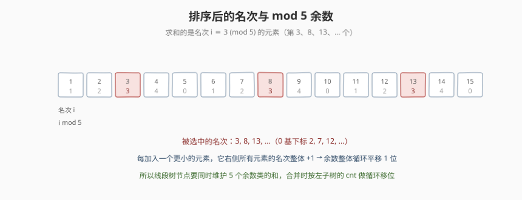
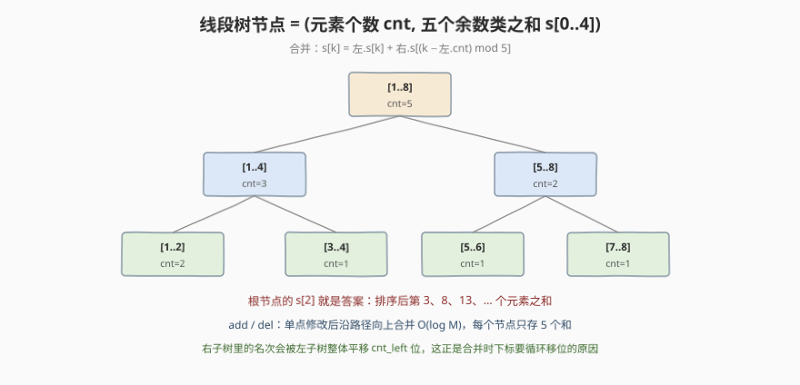

# Codeforces 85D 动态集合中位数和 题解

## 1. 题目概述

- **题目链接**：https://codeforces.com/problemset/problem/85/D
- **比赛来源**：Yandex.Algorithm 2011: Round 1 · Problem D（UTC 2011-05-20）
- **难度**：2300
- **标签**：线段树、离散化、按余数类维护
- **评测类型**：普通
- **限制**：时间 3 s / 内存 256 MB

**题意**：维护一个可增删的正整数集合 $S$。把 $S$ 排序为 $a_1 < a_2 < \cdots < a_m$，定义"中位数之和"为所有下标 $i \equiv 3 \pmod 5$ 的元素之和（即 $a_3 + a_8 + a_{13} + \cdots$；下标从 $1$ 开始）。处理 $n$ 次操作：`add x`、`del x`、`sum`（输出当前的中位数之和，空集输出 $0$）。

**约束**：

- $n \le 10^5$：每次 `sum` 若重新排序是 $O(n \log n)$，总 $10^{10}$，必须用数据结构。
- 元素值 $\le 10^9$：不能开值域数组，需要先把所有出现过的 $x$ 离散化（最多 $10^5$ 个）。
- `add` 保证元素不在集合中、`del` 保证在集合中：每个位置的状态只是 $0/1$。
- 答案可达 $10^5 \times 10^9 = 10^{14}$：用 64 位整数。

## 2. 示例与观察

官方样例一：

```text
输入：
6
add 4
add 5
add 1
add 2
add 3
sum
输出：
3
```

官方样例二：

```text
输入：
14
add 1
add 7
add 2
add 5
sum
add 6
add 8
add 9
add 3
add 4
add 10
sum
del 1
sum
输出：
5
11
13
```

**样例一走查**：集合为 $\{1,2,3,4,5\}$，排序后第 $3$ 个是 $3$，后面没有第 $8$ 个，故答案是 $3$。



**样例二走查**：

- 第一次 `sum` 时集合 $\{1,2,5,7\}$，第 $3$ 个是 $5$，答案 $5$；
- 加入 $6,8,9,3,4,10$ 后集合 $\{1,2,3,4,5,6,7,8,9,10\}$，第 $3,8$ 个是 $3,8$，和 $11$；
- 删除 $1$ 后集合 $\{2,\dots,10\}$，第 $3,8$ 个是 $4,9$，和 $13$。

**观察**：插入/删除一个元素会改变它右侧所有元素的名次，但每个名次只是整体 $+1$ 或 $-1$。名次变化 $1$ 意味着"余数类"整体循环平移一位——这正是可以用线段树维护的信号。

## 3. 解题思路

### 3.1 朴素做法与瓶颈

- 用有序数组 + `insort`：插入 $O(n)$，每次 `sum` 扫描 $O(n)$，总 $O(n^2)$。
- 用平衡树 + 额外信息：可以，但实现量大。

关键是把"名次 $\bmod 5$"的信息压缩到每个结点里，使得合并只需要 $O(5)$。

### 3.2 核心观察：每个结点维护 5 个余数类之和



把值离散化成 $M$ 个位置，建一棵线段树。对每个结点维护：

- `cnt`：该结点区间内当前在集合中的元素个数；
- `s[k]`（$k=0..4$）：该区间内这些元素**只考虑本区间内部的名次**（从 $1$ 开始计）时，名次 $\equiv k+1 \pmod 5$ 的元素之和。

合并左右孩子时，右子树里的元素在整体名次上要**整体加上左子树的 `cnt`**，于是

$$\text{cnt} = \text{cnt}_L + \text{cnt}_R,\qquad s[k] = s_L[k] + s_R\bigl[(k - \text{cnt}_L) \bmod 5\bigr].$$

答案就是根结点的 $s[2]$（对应名次 $3,8,13,\dots$）。

`add/del` 是单点修改：叶子 `cnt` 置 $1/0$、`s[0]` 置 $x/0$，然后沿路径向上合并，$O(\log M)$ 且每个结点只做 $5$ 次加法。

### 3.3 算法流程

1. 先读入所有操作，把 `add/del` 的 $x$ 收集、排序去重，得到坐标压缩；
2. 建大小为 $2^{\lceil \log_2 M\rceil}$ 的迭代线段树（数组实现）；
3. 依次执行操作：
   - `add x` / `del x`：在压缩后的位置做单点更新，向上合并；
   - `sum`：输出根结点的 $s[2]$。
4. 空集时根结点 `cnt = 0`、所有 $s[k] = 0$，自然输出 $0$。

### 3.4 样例走查

对照 3.2 节那张线段树结构图：

样例一加入 $1..5$ 后：叶子按值排序为 $1,2,3,4,5$，根结点的 $s[2]$ 收集名次 $3$ 的元素，即 $3$。若再加入 $0$：所有原元素名次 $+1$，原来名次 $3$（值 $3$）变成名次 $4$，而新的第 $3$ 个是原来的第 $2$ 个（值 $2$）——整棵树的余数类正好循环平移一位，合并公式里的 `(k - cnt_L) mod 5` 自动完成这件事。

## 4. 正确性证明

**引理 1（结点信息的含义）**：对任意结点 $v$，设它区间内当前集合元素按值升序为 $b_1 < \cdots < b_c$（$c = \text{cnt}_v$）。则 $s_v[k] = \sum_{i \equiv k+1 \pmod 5} b_i$。

**证明**：对树高归纳。叶子：$c \in \{0,1\}$，$s[0]$ 是唯一元素或 $0$，其余为 $0$，符合定义。内部结点：左孩子的元素在整体中排在前 $\text{cnt}_L$ 个，右孩子的第 $j$ 个在整体中排第 $\text{cnt}_L + j$ 个。故整体名次 $\equiv k+1$ 的右孩子元素，其在右孩子内部的名次满足 $(\text{cnt}_L + j) \equiv k+1$，即 $j \equiv k+1-\text{cnt}_L$，对应下标 $(k - \text{cnt}_L) \bmod 5$。合并公式正是把两类相加。∎

**引理 2（单点更新正确）**：`add x` / `del x` 后，每个受影响结点的信息都按引理 1 重新成立。

**证明**：只有包含 $x$ 的叶子的祖先会变化；叶子按定义直接设置，其余结点由合并公式（引理 1 已证其正确）重算，自底向上归纳即得。∎

**定理**：每次 `sum` 输出的根结点 $s[2]$ 等于题目定义的中位数之和。

**证明**：根结点覆盖全部在集合中的元素，由引理 1，$s[2] = \sum_{i \equiv 3 \pmod 5} a_i$，正是题目要求；空集时 $c=0$，$s[2]=0$。∎

## 5. 复杂度分析

- **时间**：离散化 $O(n \log n)$；每次 `add/del` 为 $O(\log M)$ 个结点、每结点 $O(5)$；`sum` 为 $O(1)$。总计 $O(n \log n)$，$n = 10^5$ 时约 $10^7$ 次运算。
- **空间**：线段树 $2 \times 2^{\lceil\log_2 M\rceil}$ 个结点，每个存 `cnt` 与 $5$ 个 `long long`，$M \le 10^5$ 时约 $4 \times 10^5 \times 6$ 个 8 字节，约 $19$ MB。
- **数值范围**：单个元素 $\le 10^9$，集合大小 $\le 10^5$，和 $\le 10^{14}$，必须用 64 位整数；`cnt` 用 `int` 即可。
- **与时限的关系**：3 s 下实测约 $17$ ms（C++）。

## 6. 参考代码

### C++17

```cpp
#include <bits/stdc++.h>
using namespace std;
typedef long long ll;

int main() {
    int n;
    if (scanf("%d", &n) != 1) return 0;
    vector<string> op(n);
    vector<int> x(n);
    vector<int> vals;
    char buf[16];
    for (int i = 0; i < n; ++i) {
        scanf("%s", buf);
        op[i] = buf;
        if (op[i] != "sum") { scanf("%d", &x[i]); vals.push_back(x[i]); }
    }
    sort(vals.begin(), vals.end());
    vals.erase(unique(vals.begin(), vals.end()), vals.end());
    int M = (int)vals.size();
    int size = 1;
    while (size < M) size <<= 1;
    vector<int> cnt(2 * size, 0);
    vector<array<ll, 5>> s(2 * size);
    for (auto& a : s) a = {0, 0, 0, 0, 0};

    auto update = [&](int pos, int delta) {
        int p = pos + size;
        if (delta > 0) { cnt[p] = 1; s[p] = {vals[pos], 0, 0, 0, 0}; }
        else { cnt[p] = 0; s[p] = {0, 0, 0, 0, 0}; }
        for (p >>= 1; p >= 1; p >>= 1) {
            int l = p << 1, r = l | 1;
            cnt[p] = cnt[l] + cnt[r];
            int shift = cnt[l] % 5;
            for (int k = 0; k < 5; ++k)
                s[p][k] = s[l][k] + s[r][(k - shift + 5) % 5];
        }
    };

    for (int i = 0; i < n; ++i) {
        if (op[i] == "sum") {
            printf("%lld\n", s[1][2]);
        } else {
            int pos = (int)(lower_bound(vals.begin(), vals.end(), x[i]) - vals.begin());
            update(pos, op[i] == "add" ? 1 : -1);
        }
    }
    return 0;
}
```

### Python3

```python
import sys


def main() -> None:
    data = sys.stdin.buffer.read().split()
    if not data:
        return
    n = int(data[0])
    ops = []
    vals = []
    p = 1
    for _ in range(n):
        op = data[p].decode(); p += 1
        if op == "sum":
            ops.append((op, 0))
        else:
            x = int(data[p]); p += 1
            ops.append((op, x))
            vals.append(x)
    vals = sorted(set(vals))
    idx = {v: i for i, v in enumerate(vals)}
    M = len(vals)
    size = 1
    while size < M:
        size <<= 1
    cnt = [0] * (2 * size)
    s = [[0, 0, 0, 0, 0] for _ in range(2 * size)]

    def update(pos, add):
        p = pos + size
        if add:
            cnt[p] = 1
            s[p] = [vals[pos], 0, 0, 0, 0]
        else:
            cnt[p] = 0
            s[p] = [0, 0, 0, 0, 0]
        p >>= 1
        while p >= 1:
            l = p << 1
            r = l | 1
            cnt[p] = cnt[l] + cnt[r]
            shift = cnt[l] % 5
            sl = s[l]; sr = s[r]
            s[p] = [sl[k] + sr[(k - shift) % 5] for k in range(5)]
            p >>= 1

    out = []
    for op, x in ops:
        if op == "sum":
            out.append(str(s[1][2]))
        else:
            update(idx[x], op == "add")
    sys.stdout.write("\n".join(out) + ("\n" if out else ""))


main()
```

## 7. 边界情况与易错点

1. **空集**：`sum` 必须输出 $0$；根结点全零时天然正确，但若把根初始化成别的值就会错。
2. **线段树大小**：$M = 0$（全部是 `sum` 操作）时不能让 `size = 0`；参考代码中 `size` 从 $1$ 开始，且 `s[1][2]` 仍可读，输出 $0$。
3. **下标平移的方向**：合并时右子树平移 `cnt_L` 位，公式是 `s[p][k] = s[l][k] + s[r][(k - cnt[l]) mod 5]`；把减号写成加号在样例一不一定暴露，但样例二会错。
4. **答案取 $s[2]$ 而不是 $s[3]$**：名次从 $1$ 开始、$k$ 从 $0$ 开始，所以"名次 $\equiv 3$"对应 `s[2]`。
5. **64 位整数**：单个值可达 $10^9$，$10^5$ 个元素求和可达 $10^{14}$，`int` 溢出。
6. **`add/del` 的坐标**：必须用离散化后的下标更新，且更新后要一路合并到根（`p >>= 1` 直到 $0$）。
7. **重复值**：题面保证 `add` 的元素不在集合中、`del` 的在集合中，所以每个位置的状态是 $0/1$，不需要计数多个副本；但离散化时必须去重。
8. **多组 `sum` 连续出现**：`sum` 不改变结构，直接读根即可，不要重复合并。

## 8. 验证记录

- **编译环境与命令**：`clang++ -std=c++17 -O2`（Apple clang 21.0.0 + `codeforces/tools/include` 的兼容头），Python 3.9.6。
- **官方样例**：2 / 2 通过（`3` 与 `5 / 11 / 13`），C++ 与 Python 输出一致。
- **独立暴力对拍**：暴力用有序数组（`bisect.insort`）维护集合，每次 `sum` 线性扫描取第 $3,8,13,\dots$ 个。对 $n \le 30$、值域 $\le 50$ 的 **300 组**随机操作序列（含大量 add/del/sum 交错、连续 sum、清空后 sum）与参考程序比对，**全部一致**。
- **最大约束性能**：$n = 10^5$ 的随机 add/sum 混合操作，C++ 端到端 3 次取最小约 $17$ ms，Python 约 $64$ ms；相对 3 s 余量在 100 倍以上；内存约 $19$ MB。
- **图片校验**：`cf85d_tree.svg`、`cf85d_mod5.svg` 均通过 `xml.etree.ElementTree.parse`，含 `feTurbulence` 与手写体字体族，文本包围盒未越出 `viewBox`。
- **公式校验**：KaTeX（`throwOnError`）渲染无报错；无 `---` 分隔线。
- **复核状态**：verified（样例、对拍、性能、图片、公式均实跑通过）。

## 相关题目与扩展

- [Codeforces 85A Domino](https://codeforces.com/problemset/problem/85/A)、[85B Embassy Queue](https://codeforces.com/problemset/problem/85/B)、[85C Petya and Tree](https://codeforces.com/problemset/problem/85/C)、[85E Guard Towers](https://codeforces.com/problemset/problem/85/E)：同场其余四题。
- [Codeforces 61E Enemy is weak](https://codeforces.com/problemset/problem/61/E)：树状数组 + 离散化的三元逆序对。
- [Codeforces 19D Points](https://codeforces.com/problemset/problem/19/D)：动态点集 + 线段树上二分，与本题同属"离散化 + 线段树维护集合"。
- [LeetCode 327. 区间和的个数](https://leetcode.cn/problems/count-of-range-sum/)：离散化 + 树状数组的典型应用。

**延伸思考**：

1. **如果改成"求所有下标 $\equiv 3 \pmod m$ 的和"且 $m$ 很大**：每个结点维护 $m$ 个和，复杂度 $O(m \log n)$，$m$ 到 $10^5$ 就不可行；需要换成分块或平衡树的"按块聚合"。
2. **如果还要支持第 $k$ 小**：在结点上再加"子树大小"，就可以在线段树上二分，答案与本题的余数类信息互不影响。
3. **如果允许重复元素**：把 `cnt` 从 $0/1$ 改成计数、叶子的 $s[0]$ 改成 $x \times$ 个数，合并公式完全不变。
4. **如果要支持区间删除**：变成"区间赋 $0$"的懒标记线段树，余数类的平移会依赖区间长度，仍需按 `cnt_L` 合并。

