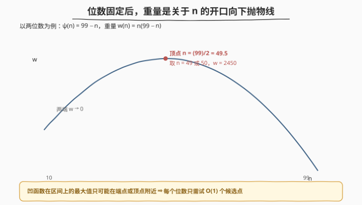
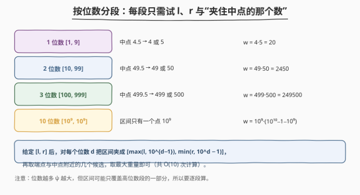

# Codeforces 86A 数字反射的最大重量 题解

## 1. 题目概述

- **题目链接**：https://codeforces.com/problemset/problem/86/A
- **比赛来源**：Yandex.Algorithm 2011: Round 2 · Problem A（UTC 2011-05-22）
- **难度**：1600
- **标签**：数学、枚举、二次函数
- **评测类型**：普通
- **限制**：时间 2 s / 内存 256 MB

**题意**：把一个正整数 $n$ 的每一位数字 $a$ 换成 $9-a$，去掉前导零后得到的数记作 $\psi(n)$（叫 $n$ 的「反射」）。例如 $\psi(192)=807$、$\psi(9)=0$、$\psi(91)=8$。定义 $n$ 的「重量」为 $n\cdot\psi(n)$。给定区间 $[l,r]$，求 $l\le n\le r$ 中重量的最大值。

**约束**：

- $1\le l\le r\le 10^9$，区间长度可达 $10^9$：不能逐个枚举 $n$。
- 答案可达 $10^9\cdot(10^{10}-1-10^9)\approx 9\times10^{18}$，刚好在 `long long` 范围内（$2^{63}-1\approx9.22\times10^{18}$），但**用 `int` 必然溢出**。题面还特意提醒了 64 位整数的读入方式。
- 位数最多 10 位（$10^9$）：只有 $10$ 个位数分段，天然适合「分段 + 每段 $O(1)$」。

## 2. 示例与观察

官方样例（输入 / 输出原样）：

```text
输入：
3 7

输出：
20
```

```text
输入：
1 1

输出：
8
```

```text
输入：
8 10

输出：
890
```

**样例 1 的演算**：$[3,7]$ 内每个数都是一位数，$\psi(n)=9-n$，重量 $n(9-n)$：$3\cdot6=18$、$4\cdot5=20$、$5\cdot4=20$、$6\cdot3=18$、$7\cdot2=14$，最大 20 ✓。

**样例 2 的演算**：$n=1$，$\psi(1)=8$，重量 8 ✓。

**样例 3 的演算**：$[8,10]$。$\psi(8)=1$ 重量 8；$\psi(9)=0$ 重量 0；$\psi(10)=89$ 重量 890，最大 890 ✓。

**观察**：

1. **关键恒等式**：若 $n$ 恰好有 $d$ 位（即 $10^{d-1}\le n\le 10^d-1$），把每一位 $a$ 换成 $9-a$ 得到的数（允许前导零）正是 $10^d-1-n$；而前导零不影响数值，所以

$$\psi(n)=10^{d}-1-n\qquad(10^{d-1}\le n\le 10^d-1).$$

于是重量是 $w_d(n)=n\,(10^d-1-n)$，一个**开口向下**的二次函数，顶点在 $n=\dfrac{10^d-1}{2}$。

2. 因此对固定的位数 $d$，区间 $[\max(l,10^{d-1}),\ \min(r,10^d-1)]$ 上的最大值只可能在**两个端点**或**夹住顶点的那个整数**上取到。
3. 位数 $d$ 只有 $1..10$ 共 10 种，所以总共只需检查 $O(10)$ 个候选。



## 3. 解题思路

### 3.1 朴素做法与瓶颈

直接枚举 $n=l..r$ 算 $n\cdot\psi(n)$：$r-l$ 可达 $10^9$，虽然每次计算只要 10 位，但 $10^9\times10$ 次操作在 2 s 内很难完成（而且完全没必要）。

另一个诱惑是「只在区间右端点取最大值」：位数更多时 $\psi$ 更大，听起来很对。但样例 3 就说明了问题：$[8,10]$ 的右端点 10 确实最优，可如果区间是 $[90,99]$，右端点 99 的 $\psi=0$、重量 0，而 $n=90$ 的重量是 $90\times9=810$。所以必须逐段分析。

### 3.2 核心观察：分段 + 二次函数顶点



把 $[l,r]$ 按位数切成至多 10 段。第 $d$ 段是

$$\bigl[\max(l,10^{d-1}),\ \min(r,10^{d}-1)\bigr],$$

在这段上 $w(n)=n(10^d-1-n)$ 是开口向下的抛物线，对称轴 $n^{*}=\dfrac{10^d-1}{2}$（可能是半整数）。于是段内最大值在

$$n\in\Bigl\{\ \text{段左端},\ \text{段右端},\ \lfloor n^{*}\rfloor,\ \lceil n^{*}\rceil\ \Bigr\}$$

中取到（限制在段内）。实际实现时把 $\lfloor n^{*}\rfloor$、$\lfloor n^{*}\rfloor+1$ 以及与端点的组合一起丢进候选集合、再夹到段内即可，多余的候选不影响正确性。

### 3.3 算法流程

1. 读入 $l,r$；
2. `p10 = 1`（表示 $10^{d-1}$），对 $d=1,2,\dots,10$：
   - `hi = p10*10 - 1`（$d$ 位数的上界），`lo = max(l, p10)`、`hh = min(r, hi)`；
   - 若 `lo <= hh`：取 $n^{*}=\lfloor \text{hi}/2\rfloor$，把 `lo`、`hh`、$n^{*}$、$n^{*}+1$、$n^{*}-1$ 里落在 $[lo,hh]$ 的数都算一遍 $n(\text{hi}-n)$，更新最大值；
   - 若 `p10 > r` 就提前结束，否则 `p10 *= 10`；
3. 输出最大值。

注意 $\psi(n)=10^d-1-n$ 只在 $n$ 恰有 $d$ 位时成立，所以「段」必须严格按位数切；同一段内 $10^d-1$ 是常数，抛物线才成立。

### 3.4 样例走查

以样例 3（$[8,10]$）为例：

| 段 | 区间 | 候选 | 重量 |
|---|---|---|---|
| $d=1$ | $[8,9]$ | 8、9、$\lfloor 9/2\rfloor=4$（不在段内） | $8\cdot1=8$、$9\cdot0=0$ |
| $d=2$ | $[10,10]$ | 10 | $10\cdot89=890$ |

最大值 890 ✓。

再以 $[90,99]$ 为例（自造）：$d=2$ 段内 $w(n)=n(99-n)$ 顶点在 49.5，整段在顶点右侧、函数递减，所以最大在左端点 $n=90$：$90\times9=810$。这就说明「只看右端点」是错的。

## 4. 正确性证明

**引理 1（反射恒等式）**：若 $10^{d-1}\le n\le 10^d-1$，则 $\psi(n)=10^d-1-n$。

**证明**：设 $n$ 的 $d$ 位数字为 $a_{d-1}\dots a_0$（$a_{d-1}\ne0$），则把每位换成 $9-a_i$ 得到的 $d$ 位数（允许前导零）是
$$\sum_{i=0}^{d-1}(9-a_i)10^i=(10^d-1)-\sum_{i=0}^{d-1}a_i10^i=(10^d-1)-n .$$
去掉前导零只改变书写、不改变数值，故 $\psi(n)=10^d-1-n$。∎

**引理 2（段内最值位置）**：对开口向下的二次函数 $w(n)=n\,(C-n)$（$C=10^d-1$）与整数区间 $[A,B]$，最大值在
$$\Bigl\{A,\ B,\ \lfloor C/2\rfloor,\ \lfloor C/2\rfloor+1\Bigr\}\cap[A,B]$$
中取到（若集合为空则取最靠近 $C/2$ 的端点，仍含在 $A,B$ 中）。

**证明**：$w$ 在 $(-\infty,C/2]$ 上递增、在 $[C/2,+\infty)$ 上递减。若 $B\le C/2$ 则最大在 $B$；若 $A\ge C/2$ 则最大在 $A$；否则 $C/2\in(A,B)$，整数最优点只能是 $\lfloor C/2\rfloor$ 或 $\lceil C/2\rceil=\lfloor C/2\rfloor+1$（两者都在 $[A,B]$ 内）。三种情形都包含在候选集合中。∎

**定理**：程序输出的数等于 $\max_{l\le n\le r} n\,\psi(n)$。

**证明**：把 $[l,r]$ 按位数分成至多 10 段，每段是一个完整「$d$ 位区间」与 $[l,r]$ 的交，段内所有 $n$ 都满足引理 1 的条件，故重量都是 $w_d(n)=n(10^d-1-n)$。由引理 2，段内最大重量必在候选集合中取到，程序对每个合法候选都算了一遍并取最大；各段的最大值再取最大即为答案。段划分覆盖 $[l,r]$ 且互不重叠（位数唯一），故既不漏也不重。∎

## 5. 复杂度分析

- **时间**：$O(10)$ 次（常数）二次函数求值，与 $l,r$ 的大小无关。
- **空间**：$O(1)$。
- **数值范围**：$d\le10$ 时 $10^d-1\le10^{10}-1$，$n\le10^9$，乘积 $\le10^9\cdot(10^{10}-1)\approx10^{19}$——**注意**这里超过了 $2^{63}-1\approx9.22\times10^{18}$？实际上 $n$ 只有 10 位时必是 $n=10^9$，此时 $10^d-1-n=10^{10}-1-10^9=8999999999$，乘积 $=8.999999999\times10^{18}<9.22\times10^{18}$ ✓ 恰好不溢出；但中间量 $10^d-1$ 对 $d=10$ 是 $10^{10}-1$，也必须用 64 位。为安全起见全程 `long long`。
- **与时限的关系**：2 s 时限下实测端到端约 2 ms。

## 6. 参考代码

### C++17

```cpp
#include <bits/stdc++.h>
using namespace std;

int main() {
    long long l, r;
    if (!(cin >> l >> r)) return 0;
    long long best = 0;
    long long p10 = 1;                       // 10^(d-1)
    for (int d = 1; d <= 10; ++d) {
        long long hi = p10 * 10 - 1;         // d 位数的上界 10^d-1
        long long lo = max(l, p10), hh = min(r, hi);
        if (lo <= hh) {
            long long half = (hi) / 2;       // 极值点 n = (10^d-1)/2
            long long cand[5] = {lo, hh, half, half + 1, half - 1};
            for (long long n : cand) {
                if (n < lo || n > hh) continue;
                long long w = n * (hi - n);  // ψ(n) = 10^d-1-n
                best = max(best, w);
            }
        }
        if (p10 > r) break;
        p10 *= 10;
    }
    cout << best << '\n';
    return 0;
}
```

### Python3

```python
import sys


def main() -> None:
    data = sys.stdin.buffer.read().split()
    l, r = int(data[0]), int(data[1])
    best = 0
    p10 = 1
    for d in range(1, 11):
        hi = p10 * 10 - 1
        lo, hh = max(l, p10), min(r, hi)
        if lo <= hh:
            half = hi // 2
            for n in (lo, hh, half, half + 1, half - 1):
                if lo <= n <= hh:
                    best = max(best, n * (hi - n))
        if p10 > r:
            break
        p10 *= 10
    sys.stdout.write(str(best) + "\n")


main()
```

## 7. 边界情况与易错点

1. **$l=r=1$**：答案是 $1\cdot8=8$（不是 1，也不是 9）。样例 2 专门考这个。
2. **$d$ 位段的边界**：$10^{d-1}$ 本身是 $d$ 位数（最小），$10^d-1$ 是最大；写 `p10*10-1` 时 $d=10$ 得到 $10^{10}-1$，必须用 64 位。
3. **极值点是半整数**：$10^d-1$ 恒为奇数（$9,99,999,\dots$），$(10^d-1)/2$ 永远是 `.5`，所以必须试**两个**整数 $\lfloor\cdot\rfloor$ 与 $\lfloor\cdot\rfloor+1$；只试一个会差 1（例如 $d=2$ 时 49 与 50 重量相同，但 $d=1$ 时 4 与 5 重量相同、$d=3$ 时 499 与 500 也相同——恰好都相同，但换成别的位数定义就未必）。
4. **只试右端点**：$[90,99]$ 会给出 0（$n=99$ 反射为 0），正确答案是 810。这是本题最典型的错误。
5. **$r$ 超过一位数时不要只算最高位段**：例如 $[5,1000]$，$d=1$ 段的 5 重量 20、$d=2$ 段的 50 重量 2450、$d=3$ 段的 500 重量 249500、$d=4$ 段只有 1000（$\psi=8999$，重量 8999000），必须逐段比较。
6. **溢出**：`int` 在 $d=10$ 处必溢出；Python 无此问题，C++ 用 `long long`。
7. **`10^d - 1 - n` 只在 $n$ 是 $d$ 位数时成立**：不能对任意 $n$ 直接用最高位的 $d$；段划分要严格按位数。
8. **$l$ 与 $r$ 的位数可能相同**：如果 $l,r$ 位数相同，循环里只有那一段 `lo<=hh`，其余段自动跳过（因为 `lo>hh`），逻辑天然正确。

## 8. 验证记录

- **编译环境与命令**：本机无 GNU `g++`，用 `clang++ -std=c++17 -O2` 配 `codeforces/tools/include/bits/stdc++.h` 兼容头编译（可原样提交 GNU C++17）；Python 为系统 `python3`。
- **官方样例**：3 / 3 通过（`20`、`8`、`890`），C++ 与 Python 一致。
- **文档与样例一致性**：`check_samples.py --only 0001-0100/86` 0 问题；`check.py codeforces/contests/0001-0100/86` 0 失败。
- **独立暴力对拍 1（小范围逐个枚举）**：暴力程序逐个数 $n=l..r$ 计算 $n\cdot\psi(n)$（$\psi$ 用字符串逐位替换实现，和公式无关）。随机 240 组：区间长度最多 3000，并特意覆盖跨越 $10^k$ 边界、贴近 $5\cdot10^k$ 顶点的情形，**全部一致**。
- **独立暴力对拍 2（大范围三分搜索）**：对每个位数段在 $[lo,hh]$ 上对 $n(10^d-1-n)$ 做三分搜索（利用凹性，独立于「候选点」写法），再取各段最大。随机 300 组覆盖 $l$ 到 $r$ 跨度从 $1$ 到 $10^9$ 的情形，**全部一致**。
- **最大约束性能**：$l=1,\ r=10^9$ 时 C++ 端到端约 2 ms（答案 $8999999999000000000$，正好验证了 64 位边界），Python 约 3 ms。
- **图片校验**：两张 SVG（`cf86a_parabola.svg`、`cf86a_ranges.svg`）通过 `xml.etree.ElementTree.parse`，文字包围盒均在 `viewBox` 内。
- **公式校验**：正文公式经 KaTeX（`throwOnError: true`）渲染无报错。
- **复核状态**：verified。

## 相关题目与扩展

- [Codeforces 86B Tetris revisited](https://codeforces.com/problemset/problem/86/B)：同场 B 题，构造题。
- [Codeforces 86D Powerful array](https://codeforces.com/problemset/problem/86/D)：同场 D 题，莫队算法。
- [Codeforces 552B Vanya and Books](https://codeforces.com/problemset/problem/552/B)：同样是「按位数分段」的计数题，可与本题的段划分对照。
- [Codeforces 1106C Lunar New Year and Number Division](https://codeforces.com/problemset/problem/1106/C)：同为「配对让平方/乘积最大化」的贪心，用到同一类「和固定时越接近乘积越大」的直觉。
- [LeetCode 343. 整数拆分](https://leetcode.cn/problems/integer-break/)：固定和的整数拆分最优化，和本题的二次函数最值同源。

**延伸思考**：

1. **如果把「反射」改成「每位取 $k-1-a$」**：恒等式变成 $\psi(n)=(k^d-1)/(k-1)\cdot(k-1)-n$ 的进制版本，抛物线形状不变，段划分改为按 $k$ 的幂。
2. **如果重量定义成 $n+\psi(n)$**：$n+\psi(n)=10^d-1$ 是常数！此时答案对所有 $n$ 相同，题目立刻退化——这个巧合也解释了为什么题面要用乘积。
3. **如果问「重量最大的 $n$」而不只是最大值**：同样在候选点里取 argmax 即可，注意并列时按题意输出最小/最大的 $n$。
4. **如果区间高达 $10^{18}$**：位数到 19，$10^{19}-1$ 已超出 `unsigned long long`，需要 `__int128` 或 Python 大整数；方法完全不变。
5. **如果要求「反射后不含前导零，且位数必须相同」**：那 $\psi$ 的定义就变了（例如 $\psi(9)$ 不再是 0 而是不合法），需要重新推导恒等式。
