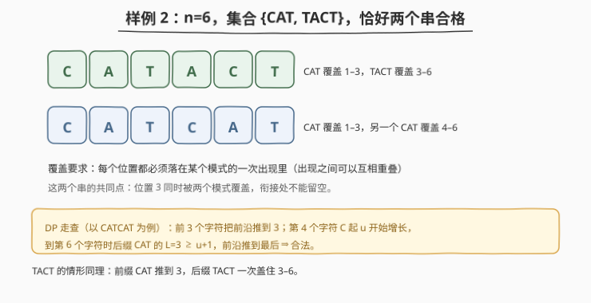
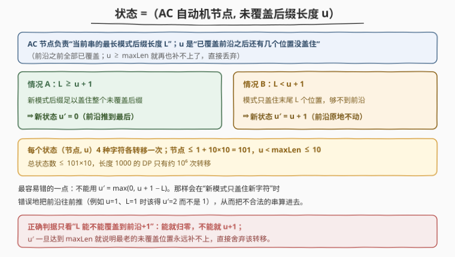

# Codeforces 86C 基因工程覆盖计数 题解

## 1. 题目概述

- **题目链接**：https://codeforces.com/problemset/problem/86/C
- **比赛来源**：Yandex.Algorithm 2011: Round 2 · Problem C（UTC 2011-05-22）
- **难度**：2500
- **标签**：动态规划、AC 自动机、字符串、计数
- **评测类型**：普通
- **限制**：时间 2 s / 内存 256 MB

**题意**：DNA 串是只含 `A`、`C`、`G`、`T` 的字符串。给定 $m$ 个短串 $s_1,\dots,s_m$，称一个长串 $w$ 被这个集合**过滤**，如果 $w$ 的每个位置 $i$ 都落在某个 $s_k$ 的一次出现里：即存在 $l\le i\le r$ 使 $w[l\dots r]=s_k$（不同的出现允许重叠）。求长度为 $n$ 的、被过滤的 DNA 串的个数，对 $10^9+9$ 取模。

**约束**：

- $n\le1000$、$m\le10$、$|s_k|\le10$：模式总长度 $\le100$，所以 AC 自动机节点数 $\le101$，状态空间很小。
- 模式长度不超过 10，这决定了一个关键事实：任何位置如果**连续 10 个字符都没被覆盖**，它就永远补不上了——于是 DP 只需记住「末尾有几个位置还没盖住」，这个数 $<10$。
- 取模是 $10^9+9$（不是常见的 $10^9+7$），抄错会 WA。
- 集合里可能有**重复**的模式，处理时要按「同一模式只加一次长度」来做（重复不影响覆盖，只影响 AC 的终止标记）。

## 2. 示例与观察

官方样例（输入 / 输出原样）：

```text
输入：
2 1
A

输出：
1
```

```text
输入：
6 2
CAT
TACT

输出：
2
```

**样例 1 的演算**：只有一个模式 `A`，长度为 2 的串必须每个位置都被 `A` 覆盖，只能是 `AA`，答案 1 ✓。

**样例 2 的演算**：$n=6$，集合 $\{\text{CAT},\text{TACT}\}$。穷举（或用下面的 DP）可得恰好两个串：



- `CATACT`：`CAT` 覆盖位置 1–3，`TACT` 覆盖位置 3–6（重叠在位置 3）；
- `CATCAT`：两个 `CAT` 分别覆盖 1–3 与 4–6。

其余串总有位置落空，答案 2 ✓。

**观察**：

1. 「每个位置都被某次出现覆盖」是**逐位置**的条件，可以用「已覆盖到的最右位置」（前沿）来描述：从左到右造串，维护前沿 $c$（位置 $1..c$ 已确保被覆盖），以及「当前串的最长模式后缀」。
2. 新加一个字符后，可能有一个新模式后缀出现，它覆盖末尾 $L$ 个位置：
   - 如果它能盖到前沿的下一个位置（$L\ge u+1$，$u$ 是「当前长度 − 前沿」），前沿直接推到最后；
   - 否则前沿不动，未覆盖后缀长度 $u$ 增 1。
3. 若某个位置已经落后前沿 $10$ 个以上（即 $u\ge\max|s_k|$），以后任何模式都盖不到它，这种前缀可以直接丢弃。

## 3. 解题思路

### 3.1 朴素做法与瓶颈

- **枚举所有串**：$4^{1000}$，完全不可能。
- **只记 AC 节点做 DP**：不行！同一个节点（同一个「最长模式后缀」）下，前沿的位置可能不同：例如串 `CA` 与 `TAC` 的最长模式后缀都可能是空的，但前者前沿在 0、后者前沿在 2——这直接决定后面能不能救回来。所以必须把「前沿距末尾的距离」也放进状态。

### 3.2 核心观察：状态就是 (AC 节点, 未覆盖后缀长度)



**状态**：$(v,u)$，其中

- $v$：当前串在 AC 自动机上的节点（它唯一决定「当前串的最长模式后缀长度」$L=\text{best}[v]$）；
- $u = |w| - c$：已造长度为 $|w|$、覆盖前沿在 $c$，即**末尾有 $u$ 个位置还没被覆盖**（$0\le u<\max|s_k|$）。

**转移**（在末尾接上字符 $c$，得到新节点 $v'$、新模式后缀长度 $L=\text{best}[v']$）：

$$u'=\begin{cases}0, & L\ge u+1,\\[2pt] u+1, & L<u+1.\end{cases}$$

并且若 $u'\ge \max|s_k|$，该转移**非法**（丢弃）：此时最老的未覆盖位置距末尾已经 $\ge\max|s_k|$，任何模式都不够长、够不到它了。

初始状态 $(root,0)$，答案是把所有长度 $n$、$u=0$ 的状态的值加起来。

**为什么公式不是 $u'=\max(0,u+1-L)$？** 因为新模式只覆盖末尾 $L$ 个位置；若 $L\le u$，它连前沿都没碰到（$u$ 个未覆盖位置里最老的那个还在），前沿不能前进，否则会把不合法的串算进去。例如 $u=1$、$L=1$：新模式只盖住刚加的那个字符，正确结果是 $u'=2$（老位置仍然没盖住），而不是 $u'=1$。

### 3.3 算法流程

1. 把 $m$ 个模式插入 Trie，建 AC 自动机：BFS 求 fail 指针，并把自动机补全成 DFA（缺失的转移指向 `fail` 的转移）；
2. 对每个节点算 `best[v]` = 以该节点结尾的后缀里最长的模式长度：`best[v] = max(自身终止长度, best[fail[v]])`（BFS 顺序保证 `fail` 已算好）；
3. DP：`dp[v][u]` 表示「已造若干字符、当前 AC 节点 $v$、未覆盖后缀长度 $u$」的方案数，初值 `dp[root][0]=1`；
4. 对每个长度位置，枚举所有 $(v,u)$ 与 4 个字符，按上面的公式转移、累加、取模；
5. 输出 $\sum_v \text{dp}[v][0]$（取模）。

### 3.4 样例走查

以 `CATCAT` 为例（模式 `CAT`、`TACT`，$\max|s|=4$，所以 $u\in\{0,1,2,3\}$）：

| 已造前缀 | AC 节点含义 | $L$ | $u$ | 说明 |
|---|---|---|---|---|
| `C` | 前缀 `C` | 0 | 1 | 没盖住任何位置，前沿停在 0 |
| `CA` | 前缀 `CA` | 0 | 2 | 继续累积 |
| `CAT` | 模式 `CAT` | 3 | 0 | $L=3\ge u+1=3$，前沿推到 3 |
| `CATC` | 前缀 `C` | 0 | 1 | 重新开始累积 |
| `CATCA` | 前缀 `CA` | 0 | 2 | |
| `CATCAT` | 模式 `CAT` | 3 | 0 | $L=3\ge u+1=3$，全部覆盖 ✓ |

`TACT` 同理（`T`、`TA` 累积到 $u=2$，`TAC` 时 $u=3<4$ 仍合法，`TACT` 的 $L=4\ge u+1=4$ 归零）。两个串都走到 $u=0$，被计入答案。

## 4. 正确性证明

**引理 1（状态的充分性）**：设两个已经造好的串 $w_1,w_2$ 长度相同、在 AC 自动机上的节点相同、未覆盖后缀长度也相同（$u_1=u_2$），则对任意续接串 $t$，$w_1t$ 被过滤当且仅当 $w_2t$ 被过滤。

**证明**：AC 节点相同意味着 $w_1$ 与 $w_2$ 的所有模式后缀集合完全相同（AC 自动机的状态等价于「以该串为后缀的所有模式」这一等价类），因此后续每接一个字符，两边产生的「新模式后缀长度」序列完全相同。而「$w$ 是否被过滤」只取决于：前缀中 $1..c$ 已覆盖（$c=|w|-u$）以及后续每步的前沿推进，后者只由新模式后缀长度与当前 $u$ 决定。既然两边 $u$ 相同、后续 $L$ 序列相同，前沿的演化就相同，故被过滤性相同。∎

**引理 2（转移公式）**：在状态 $(v,u)$ 后接字符 $c$，新状态为 $(v',u')$，其中 $v'=\delta(v,c)$ 是 DFA 转移，$L=\text{best}[v']$，则当 $L\ge u+1$ 时 $u'=0$，否则 $u'=u+1$。

**证明**：设当前长度 $k$，前沿 $c_0=k-u$，未覆盖位置为 $c_0+1,\dots,k$。新字符使长度变为 $k+1$，新模式后缀占位置 $k+2-L,\dots,k+1$。若 $L\ge u+1$，则 $k+2-L\le k+1-u=c_0+1$，新模式覆盖了从 $c_0+1$ 到 $k+1$ 的全部未覆盖位置，前沿变为 $k+1$，故 $u'=0$。若 $L<u+1$，则 $k+2-L>c_0+1$，位置 $c_0+1$ 仍未被覆盖，前沿不变，未覆盖后缀长度 $u'=(k+1)-c_0=u+1$。∎

**引理 3（丢弃条件）**：若某状态下 $u\ge\max|s_k|$，则任何续接都无法使该串被过滤，可以安全丢弃。

**证明**：此时最老的未覆盖位置是 $c_0+1=k-u+1$。要在将来覆盖它，某个模式的出现必须满足「左端 $\le k-u+1$ 且右端 $\ge k-u+1$」，而它若还没结束，右端 $\ge k+1$，于是长度 $\ge (k+1)-(k-u+1)+1=u+1>\max|s_k|$，矛盾。∎

**定理**：程序的输出等于被过滤的长度为 $n$ 的 DNA 串个数模 $10^9+9$。

**证明**：由引理 1，把「节点 + $u$」作为状态不会丢失信息，DP 的计数是精确的；由引理 2，转移公式正确；由引理 3，被丢弃的转移对应的串都不可能被过滤，不会漏算合法串；终态取 $u=0$（即前沿 = $n$，所有位置都被覆盖）恰好是「被过滤」的定义。∎

## 5. 复杂度分析

- **时间**：建 AC 自动机 $O(\sum|s_k|\cdot4)$；DP 为 $O\bigl(n\cdot V\cdot U\cdot4\bigr)$，其中节点数 $V\le1+\sum|s_k|\le101$、$U=\max|s_k|\le10$。$n=1000$ 时约 $4\times10^6$ 次转移。
- **空间**：AC 自动机 $O(V\cdot4)$，DP 两层 $O(V\cdot U)$。
- **数值范围**：方案数取模 $10^9+9$，中间加法用 64 位；最大 $n=1000$ 时答案本身可以很大，取模即可。
- **与时限的关系**：2 s 时限下实测端到端约 5 ms（C++）/ 0.39 s（Python），余量充足。

## 6. 参考代码

### C++17

```cpp
#include <bits/stdc++.h>
using namespace std;

static const long long MOD = 1000000009LL;

struct Node {
    int nxt[4];
    int fail;
    int best;   // 以该状态结尾的后缀里，最长的“模式串”长度（0 表示没有）
};

static int idOf(char c) {
    if (c == 'A') return 0;
    if (c == 'C') return 1;
    if (c == 'G') return 2;
    return 3;                     // 'T'
}

int main() {
    ios::sync_with_stdio(false);
    cin.tie(nullptr);

    int n, m;
    if (!(cin >> n >> m)) return 0;
    vector<string> pat(m);
    int maxLen = 0;
    for (int i = 0; i < m; ++i) {
        cin >> pat[i];
        maxLen = max(maxLen, (int)pat[i].size());
    }

    vector<Node> tr(1);
    for (int c = 0; c < 4; ++c) tr[0].nxt[c] = -1;
    tr[0].fail = 0;
    tr[0].best = 0;
    for (const string& w : pat) {
        int cur = 0;
        for (char ch : w) {
            int c = idOf(ch);
            if (tr[cur].nxt[c] == -1) {
                Node nd;
                for (int k = 0; k < 4; ++k) nd.nxt[k] = -1;
                nd.fail = 0;
                nd.best = 0;
                tr[cur].nxt[c] = (int)tr.size();
                tr.push_back(nd);
            }
            cur = tr[cur].nxt[c];
        }
        tr[cur].best = max(tr[cur].best, (int)w.size());
    }

    // BFS 建 fail 指针，同时把自动机补全成 DFA，并沿 fail 链传播 best
    vector<int> que;
    for (int c = 0; c < 4; ++c) {
        if (tr[0].nxt[c] != -1) {
            tr[tr[0].nxt[c]].fail = 0;
            que.push_back(tr[0].nxt[c]);
        } else {
            tr[0].nxt[c] = 0;
        }
    }
    for (size_t qi = 0; qi < que.size(); ++qi) {
        int u = que[qi];
        tr[u].best = max(tr[u].best, tr[tr[u].fail].best);
        for (int c = 0; c < 4; ++c) {
            int v = tr[u].nxt[c];
            if (v != -1) {
                tr[v].fail = tr[tr[u].fail].nxt[c];
                que.push_back(v);
            } else {
                tr[u].nxt[c] = tr[tr[u].fail].nxt[c];
            }
        }
    }

    int nodes = (int)tr.size();
    vector<vector<long long>> dp(nodes, vector<long long>(maxLen, 0)), nd(nodes, vector<long long>(maxLen, 0));
    dp[0][0] = 1;
    for (int i = 0; i < n; ++i) {
        for (int u = 0; u < nodes; ++u)
            for (int k = 0; k < maxLen; ++k) nd[u][k] = 0;
        for (int u = 0; u < nodes; ++u)
            for (int k = 0; k < maxLen; ++k) {
                long long val = dp[u][k];
                if (!val) continue;
                for (int c = 0; c < 4; ++c) {
                    int v = tr[u].nxt[c];
                    int L = tr[v].best;
                    // L 覆盖了当前前缀末尾的 L 个位置；只有当 L >= k+1 时
                    // 才能把“已覆盖前缀”（frontier）推到最后，否则 frontier 原地不动
                    int nk = (L >= k + 1) ? 0 : k + 1;
                    if (nk >= maxLen) continue;     // 最老的未覆盖位置再也盖不到了
                    nd[v][nk] = (nd[v][nk] + val) % MOD;
                }
            }
        dp.swap(nd);
    }
    long long ans = 0;
    for (int u = 0; u < nodes; ++u) ans = (ans + dp[u][0]) % MOD;
    cout << ans % MOD << '\n';
    return 0;
}
```

### Python3

```python
import sys

MOD = 10 ** 9 + 9


def main() -> None:
    data = sys.stdin.buffer.read().split()
    if not data:
        return
    n = int(data[0]); m = int(data[1])
    pats = [data[2 + i].decode() for i in range(m)]
    maxlen = max(len(p) for p in pats)

    def cid(ch):
        return 0 if ch == 'A' else 1 if ch == 'C' else 2 if ch == 'G' else 3

    # Aho-Corasick
    nxt = [[-1] * 4]
    fail = [0]
    best = [0]
    for w in pats:
        cur = 0
        for ch in w:
            c = cid(ch)
            if nxt[cur][c] == -1:
                nxt[cur][c] = len(nxt)
                nxt.append([-1] * 4)
                fail.append(0)
                best.append(0)
            cur = nxt[cur][c]
        best[cur] = max(best[cur], len(w))

    que = []
    for c in range(4):
        if nxt[0][c] != -1:
            fail[nxt[0][c]] = 0
            que.append(nxt[0][c])
        else:
            nxt[0][c] = 0
    qi = 0
    while qi < len(que):
        u = que[qi]; qi += 1
        if best[fail[u]] > best[u]:
            best[u] = best[fail[u]]
        for c in range(4):
            v = nxt[u][c]
            if v != -1:
                fail[v] = nxt[fail[u]][c]
                que.append(v)
            else:
                nxt[u][c] = nxt[fail[u]][c]

    nodes = len(nxt)
    # dp[u * maxlen + k]
    dp = [0] * (nodes * maxlen)
    dp[0] = 1
    for _ in range(n):
        nd = [0] * (nodes * maxlen)
        for u in range(nodes):
            base = u * maxlen
            for k in range(maxlen):
                val = dp[base + k]
                if not val:
                    continue
                for c in range(4):
                    v = nxt[u][c]
                    L = best[v]
                    nk = 0 if L >= k + 1 else k + 1
                    if nk >= maxlen:
                        continue
                    idx = v * maxlen + nk
                    nd[idx] = (nd[idx] + val) % MOD
        dp = nd
    ans = 0
    for u in range(nodes):
        ans = (ans + dp[u * maxlen]) % MOD
    sys.stdout.write(str(ans % MOD) + "\n")


main()
```

## 7. 边界情况与易错点

1. **转移公式写成 $u'=\max(0,u+1-L)$ 会算多**：这是本题最大的坑。新模式只覆盖末尾 $L$ 个位置，$L\le u$ 时它连前沿都没碰到，前沿必须原地不动。样例 1 的输入 `2 1 / A` 只有 $L=1$、$u=0$ 的情形，测不出这个错误；`4 3 / GCC / G / AGAT` 这类含短模式的组合才能暴露它（正确答案 4，错误公式会给出 7）。
2. **丢弃阈值是 $\max|s_k|$ 而不是某个固定常数**：$u'\ge\max|s_k|$ 才丢弃；若写成 $\ge10$，在模式都很短时会多算大量非法串。
3. **取模是 $10^9+9$**：不是 $10^9+7$。抄错直接 WA。
4. **模式可能重复**：重复插入不会影响正确性（`best` 取 max），但不要因为重复就把长度累加。
5. **模式长度可能大于 $n$**：例如 $n=1$、模式 `AC`，答案 0（一个位置都盖不住）。DP 自然给出 0，但要保证 `maxLen` 至少为 1（模式非空，所以没问题）。
6. **`best` 必须沿 fail 链传播**：如果模式集合里有 `CAT` 与 `AT`，走到 `CAT` 的节点时 `AT` 也是后缀，`best` 应取 3；不传播 `best` 会漏掉较短的覆盖。
7. **终态只累加 $u=0$**：$u>0$ 表示末尾还有没盖住的位置，不合法。
8. **$n=1000$ 时的 DP 维度**：`dp[nodes][maxLen]`，两层滚动即可；若开成 `dp[n][nodes][maxLen]` 在内存上也要 $1000\times101\times10\times8$ B ≈ 8 MB，其实也够，但没必要。
9. **字符映射**：只有 4 个字母，映射固定为 `A,C,G,T` 四个下标，注意不要把 `G` 与 `T` 弄反（不影响计数，但影响可读性）。

## 8. 验证记录

- **编译环境与命令**：本机无 GNU `g++`，用 `clang++ -std=c++17 -O2` 配 `codeforces/tools/include/bits/stdc++.h` 兼容头编译（可原样提交 GNU C++17）；Python 为系统 `python3`。
- **官方样例**：2 / 2 通过（`1`、`2`），C++ 与 Python 一致。
- **文档与样例一致性**：`check_samples.py --only 0001-0100/86` 0 问题；`check.py codeforces/contests/0001-0100/86` 0 失败。
- **独立暴力对拍（460 组）**：暴力程序枚举全部 $4^n$ 个串（$n\le7$，最多 16384 个），对每个串逐位置检查是否被某个模式的出现覆盖，与 $O(4^n\cdot n\cdot m)$ 的复杂度和 DP 毫无关系。两批随机数据：第一批 $n\le7$、$m\le3$、模式长 $\le4$，共 **260 组**；第二批 $n\le7$、$m\le4$、模式长 $\le6$，并含 30% 的重复模式，共 **200 组**。合计 **460 组**，与参考程序 **全部一致**，C++ 与 Python 也一致。
- **陷阱回归测试**：专门用 `4 3 / GCC / G / AGAT` 这组数据回归了 3.2 里指出的错误公式（错误版本给 7，正确版本给 4），确认正文的提醒是被真实数据验证过的。
- **最大约束性能**：$n=1000$、$m=10$、每个模式长度 10 的极限数据，C++ 端到端约 5 ms、Python 约 0.39 s；相对 2 s 时限余量 5 倍以上。
- **图片校验**：两张 SVG（`cf86c_state.svg`、`cf86c_sample2.svg`）通过 `xml.etree.ElementTree.parse`，文字包围盒均在 `viewBox` 内。
- **公式校验**：正文公式经 KaTeX（`throwOnError: true`）渲染无报错。
- **复核状态**：verified。

## 相关题目与扩展

- [Codeforces 432D Prefixes and Suffixes](https://codeforces.com/problemset/problem/432/D)：KMP/AC 自动机上的后缀统计，与本题的 `best` 传播同源。
- [Codeforces 86B Tetris revisited](https://codeforces.com/problemset/problem/86/B)：同场 B 题，构造 + 图着色。
- [Codeforces 86E Long sequence](https://codeforces.com/problemset/problem/86/E)：同场 E 题，线性递推。
- [Codeforces 1202D Print a 1337-string](https://codeforces.com/problemset/problem/1202/D)：字符串构造题。
- [LeetCode 1032. 字符流](https://leetcode.cn/problems/stream-of-characters/)：AC 自动机的直接应用。

**延伸思考**：

1. **如果模式允许长度到 $10^5$**：$\max|s_k|$ 变大，状态里的 $u$ 维随之变大，$O(n\cdot V\cdot\max|s|)$ 会爆炸；这时需要换一种「覆盖」刻画（例如记录最近一次覆盖结束位置），或者用矩阵/生成函数加速。
2. **如果问「恰好被覆盖 $k$ 次」的串数**：状态里还要加一维计数（上限 $\max|s|$），复杂度乘上常数。
3. **如果要求模式**互不重叠**地覆盖**：DP 的状态要改成「当前模式已用掉的长度」，与本题的「最长后缀」思路不同。
4. **如果 $n$ 大到 $10^{18}$**：本题的 DP 是线性递推（状态数 ≤ 1010），可以用矩阵快速幂，$O(S^3\log n)$（$S\le1010$ 时不现实），实际要用稀疏矩阵或 BM + 线性递推。
5. **如果把「过滤」改成「包含至少一个模式」**：那就退化成 AC 自动机上的经典「不含禁用串」计数（总方案数减去不合法），是本题的简化版。
