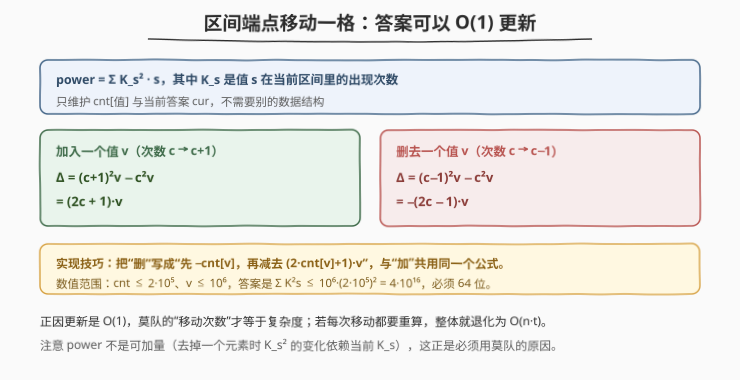
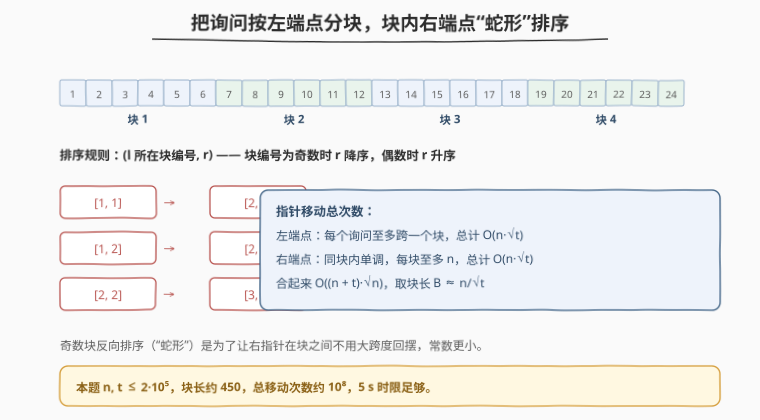

# Codeforces 86D 强力数组区间幂 题解

## 1. 题目概述

- **题目链接**：https://codeforces.com/problemset/problem/86/D
- **比赛来源**：Yandex.Algorithm 2011: Round 2 · Problem D（UTC 2011-05-22）
- **难度**：2200
- **标签**：莫队算法、分块、双指针、数据结构
- **评测类型**：普通
- **限制**：时间 5 s / 内存 256 MB

**题意**：给定长度为 $n$ 的正整数数组 $a_1,\dots,a_n$。对任意子数组 $a_l,\dots,a_r$ 和每个正整数 $s$，记 $K_s$ 为 $s$ 在该子数组中的出现次数，定义子数组的**幂**为

$$\text{power}(l,r)=\sum_{s\ge1} K_s^{2}\cdot s .$$

给定 $t$ 个查询 $(l,r)$，逐个输出对应子数组的幂。

**约束**：

- $n,t\le2\times10^5$：对每个查询单独扫一遍子数组是 $O(nt)=4\times10^{10}$，5 s 也绝无可能；必须让「相邻两个查询之间的过渡」很便宜。
- $a_i\le10^{6}$：值域很小，可以用一个长度 $10^6+1$ 的计数数组直接按下标计数（不必离散化）。
- 答案量级：$\sum K_s^2 s\le10^6\cdot(2\times10^5)^2=4\times10^{16}$，**必须 64 位**（`long long`）。题面也特意提醒了 64 位整数的输出方式。
- 5 s 的时限比同场其他题宽松，正是为 $O((n+t)\sqrt n)$ 的莫队准备的。

## 2. 示例与观察

官方样例（输入 / 输出原样）：

```text
输入：
3 2
1 2 1
1 2
1 3

输出：
3
6
```

```text
输入：
8 3
1 1 2 2 1 3 1 1
2 7
1 6
2 7

输出：
20
20
20
```

**样例 1 的演算**：

- 查询 $[1,2]$：子数组 $\{1,2\}$，$K_1=1,K_2=1$，幂 $=1^2\cdot1+1^2\cdot2=3$ ✓
- 查询 $[1,3]$：子数组 $\{1,2,1\}$，$K_1=2,K_2=1$，幂 $=2^2\cdot1+1^2\cdot2=6$ ✓

**样例 2 的演算**（题面提示）：查询 $[2,7]$ 的子数组是 $1,2,2,1,3,1$，$K_1=3,K_2=2,K_3=1$，幂 $=3^2\cdot1+2^2\cdot2+1^2\cdot3=9+8+3=20$ ✓。三个查询的答案都是 20，纯属巧合。

**观察**：

1. 幂是「每个值单独贡献 $K_s^2\cdot s$ 之和」，**不是**可加量：一个数出现次数从 $c$ 变到 $c+1$ 时，贡献从 $c^2s$ 变成 $(c+1)^2s$，增量是 $(2c+1)s$，依赖当前的 $c$。
2. 但增量的计算是 $O(1)$ 的！只要维护好 $cnt[s]$ 与当前答案 $cur$，就能在 $O(1)$ 内把区间扩张或收缩一格。
3. 于是把查询排个合适的顺序，让区间端点总共只移动 $O((n+t)\sqrt n)$ 次，整体就是 $O((n+t)\sqrt n)$。

## 3. 解题思路

### 3.1 朴素做法与瓶颈

- 对每个查询扫一遍 $[l,r]$：$O(\text{长度})$，总计 $O(nt)=4\times10^{10}$，超时。
- 用前缀和？不行：$K_s^2$ 不是线性的，去掉一个元素时 $K_s^2$ 的变化依赖 $K_s$，不能简单地「前缀相减」。

注意幂**不能**写成两个前缀的差，这正是本题必须用莫队（离线 + 排序 + 双指针）的原因。

### 3.2 核心观察一：$O(1)$ 的增量公式



设当前区间里值 $v$ 出现了 $c$ 次。

- **加入**一个 $v$：次数变成 $c+1$，贡献从 $c^2v$ 变成 $(c+1)^2v$，增量
$$\Delta_{\text{add}}=(c+1)^2v-c^2v=(2c+1)\,v .$$
- **删除**一个 $v$：次数变成 $c-1$，增量
$$\Delta_{\text{del}}=(c-1)^2v-c^2v=-(2c-1)\,v .$$

实现时可以先改动 $cnt[v]$，再用同一个式子：删除时「先把 $cnt[v]$ 减 1，再减去 $(2\cdot cnt[v]+1)\cdot v$」——因为新的 $cnt$ 正好是 $c-1$，而 $(2(c-1)+1)v=(2c-1)v$ ✓。

于是维护 `cnt[]` 与 `cur` 之后，端点移动一格严格 $O(1)$。

### 3.3 核心观察二：莫队排序



把所有查询按下面的规则排序：

1. 先按左端点 $l$ 所在的块编号升序（块长取 $B\approx n/\sqrt t$）；
2. 同一块内，按右端点 $r$ **升序**；块编号为奇数时按 $r$ **降序**（「蛇形」/奇偶交替）。

然后把区间指针 $[cl,cr]$ 从空区间开始，按排序后的顺序移动过去，移动过程中用增量公式维护答案。

为什么总移动次数是 $O((n+t)\sqrt n)$：

- **左指针**：同一块内 $l$ 的跨度不超过 $B$，相邻两个查询之间 $l$ 移动 $O(B)$，共 $t$ 次 → $O(tB)$；块与块之间切换再花 $O(n/B\cdot n)$… 实际上更精细的估计是左指针 $O(tB)$、右指针 $O(n\cdot n/B)$，取 $B=n/\sqrt t$ 得 $O(n\sqrt t+t\cdot n/\sqrt t)=O(n\sqrt t)$（$t=n$ 时即 $n\sqrt n$）。
- **右指针**：同一块内单调（升序或降序），一块之内最多移动 $n$；共 $n/B$ 块 → $O(n^2/B)$。跨块时最多再花 $O(n)$ 每块 → 同样是 $O(n^2/B)$ 量级。

取 $B=n/\sqrt t$ 平衡两项，总移动次数 $O(n\sqrt t)$。$n=t=2\times10^5$ 时约 $9\times10^7$ 步，5 s 足够。

### 3.4 算法流程与样例走查

1. 读入 $n,t$ 与数组，记下 $\max a_i$ 以便开计数数组；
2. 读入 $t$ 个查询，按上面的规则排序（保存原下标）；
3. `cl=0, cr=-1, cur=0`（表示空区间），`cnt[]` 全 0；
4. 依次处理查询：先 `while (cr < R) 加入 a[++cr]`，再 `while (cl > L) 加入 a[--cl]`，再 `while (cr > R) 删除 a[cr--]`，再 `while (cl < L) 删除 a[cl++]`；
5. `ans[id] = cur`；
6. 按原顺序输出。

以样例 1 为例（$n=3$，数组 $1,2,1$，查询 $[1,2]$、$[1,3]$）：排序后仍是这两个查询。处理 $[1,2]$：从空区间依次加入 1、2 → $cur=1+2=3$ ✓；处理 $[1,3]$：右指针右移一格加入 1，此时 $K_1$ 从 1 变 2，增量 $(2\cdot1+1)\cdot1=3$ → $cur=3+3=6$ ✓。

## 4. 正确性证明

**引理 1（增量公式）**：设当前区间中值 $v$ 出现 $c$ 次。向区间加入一个 $v$ 时幂增加 $(2c+1)v$；从区间删除一个 $v$（且 $c\ge1$）时幂减少 $(2c-1)v$。

**证明**：幂对 $v$ 的贡献项是 $K_v^2\cdot v$，其余项与 $K_v$ 无关。加入后 $K_v=c+1$，该项由 $c^2v$ 变为 $(c+1)^2v$，差为 $(2c+1)v$ ✓。删除后 $K_v=c-1$，差为 $(c-1)^2v-c^2v=-(2c-1)v$ ✓。∎

**引理 2（双指针的正确性）**：从任意区间 $[cl,cr]$ 出发，反复执行「加入」与「删除」把端点移到 $[L,R]$，过程中每次只改动一个元素，则由引理 1 归纳可知结束时 `cur` 恰好等于 $\text{power}(L,R)$。

**证明**：对移动步数归纳。初始时若 $[cl,cr]$ 是空区间则 `cur=0` 等于空区间的幂；每步按引理 1 精确更新当前区间的幂；终止区间是 $[L,R]$，故 `cur` 正确。∎

**引理 3（移动次数上界）**：按 3.3 的排序，指针总移动次数为 $O(n\sqrt t)$。

**证明**：取块长 $B$。左指针：每个查询处 $l$ 与其所在块的块首距离 $<B$，相邻查询之间 $l$ 的移动 $\le B$；跨块时从一块末尾到下—块开头最坏 $O(n)$，共 $n/B$ 次 → 总 $O(tB+n^2/B)$。右指针：同一块内 $r$ 单调，一块内总移动 $\le n$；共 $n/B$ 块 → $O(n^2/B)$。合计 $O(tB+n^2/B)$，取 $B=n/\sqrt t$ 得 $O(n\sqrt t)$。∎

**定理**：程序对每个查询输出的数等于该子数组的幂。

**证明**：由引理 2，每次处理完查询后 `cur` 就是该查询的幂，程序把它存入 `ans[原下标]` 并按原顺序输出。引理 3 保证总时间在限制内。∎

## 5. 复杂度分析

- **时间**：$O((n+t)\log t + n\sqrt t)$：排序 $O(t\log t)$，指针移动 $O(n\sqrt t)$。$n=t=2\times10^5$ 时约 $9\times10^7$ 次极简操作，实测端到端 0.12–0.14 s（C++），相对 5 s 有 30 倍以上余量。
- **空间**：$O(n+t+\max a)$，计数数组 $10^6+1$ 个 `int`（4 MB）+ 查询与答案数组。
- **数值范围**：单次更新量的最大值约为 $(2\cdot2\times10^5+1)\cdot10^6\approx4\times10^{11}$，累加后的答案 $\le4\times10^{16}$，`long long` 安全；Python 无溢出问题（但见下面的性能提醒）。

## 6. 参考代码

### C++17

```cpp
#include <bits/stdc++.h>
using namespace std;

int main() {
    int n, t;
    if (scanf("%d %d", &n, &t) != 2) return 0;
    vector<int> a(n);
    int maxv = 0;
    for (int i = 0; i < n; ++i) { scanf("%d", &a[i]); maxv = max(maxv, a[i]); }
    vector<int> l(t), r(t), ord(t);
    for (int i = 0; i < t; ++i) {
        scanf("%d %d", &l[i], &r[i]);
        --l[i]; --r[i];
        ord[i] = i;
    }
    int B = max(1, (int)(n / max(1.0, sqrt((double)max(t, 1)))));
    sort(ord.begin(), ord.end(), [&](int x, int y) {
        int bx = l[x] / B, by = l[y] / B;
        if (bx != by) return bx < by;
        return (bx & 1) ? r[x] > r[y] : r[x] < r[y];   // 奇偶交替，减少右端点回摆
    });

    vector<int> cnt(maxv + 1, 0);
    vector<long long> res(t);
    long long cur = 0;
    int cl = 0, cr = -1;
    for (int qi = 0; qi < t; ++qi) {
        int id = ord[qi], L = l[id], R = r[id];
        while (cr < R) { int v = a[++cr]; cur += (2LL * cnt[v] + 1) * v; ++cnt[v]; }
        while (cl > L) { int v = a[--cl]; cur += (2LL * cnt[v] + 1) * v; ++cnt[v]; }
        while (cr > R) { int v = a[cr--]; --cnt[v]; cur -= (2LL * cnt[v] + 1) * v; }
        while (cl < L) { int v = a[cl++]; --cnt[v]; cur -= (2LL * cnt[v] + 1) * v; }
        res[id] = cur;
    }
    for (int i = 0; i < t; ++i) printf("%lld\n", res[i]);
    return 0;
}
```

### Python3

```python
import sys
from math import isqrt


def main() -> None:
    data = sys.stdin.buffer.read().split()
    if not data:
        return
    pos = 0
    n = int(data[pos]); t = int(data[pos + 1]); pos += 2
    a = [int(x) for x in data[pos:pos + n]]; pos += n
    ql = [0] * t; qr = [0] * t
    for i in range(t):
        ql[i] = int(data[pos]) - 1
        qr[i] = int(data[pos + 1]) - 1
        pos += 2
    B = max(1, n // max(1, isqrt(t)))
    order = sorted(range(t), key=lambda i: (ql[i] // B, qr[i] if (ql[i] // B) % 2 == 0 else -qr[i]))

    maxv = max(a)
    cnt = [0] * (maxv + 1)
    res = [0] * t
    cur = 0
    cl, cr = 0, -1
    for idx in order:
        L, R = ql[idx], qr[idx]
        while cr < R:
            cr += 1
            v = a[cr]
            cur += (2 * cnt[v] + 1) * v
            cnt[v] += 1
        while cl > L:
            cl -= 1
            v = a[cl]
            cur += (2 * cnt[v] + 1) * v
            cnt[v] += 1
        while cr > R:
            v = a[cr]
            cnt[v] -= 1
            cur -= (2 * cnt[v] + 1) * v
            cr -= 1
        while cl < L:
            v = a[cl]
            cnt[v] -= 1
            cur -= (2 * cnt[v] + 1) * v
            cl += 1
        res[idx] = cur
    sys.stdout.write("\n".join(map(str, res)) + "\n")


main()
```

**Python 提醒**：本题 $n,t\le2\times10^5$，纯 CPython 的莫队大约需要 $10^8$ 次循环，实测最大数据要十几秒，**建议用 PyPy3 提交或直接交 C++**；本文的 Python 版本用于对照与验证小数据。

## 7. 边界情况与易错点

1. **答案必须 64 位**：最大 $4\times10^{16}$，`int` 直接溢出成负数。C++ 用 `long long`，更新量也写成 `2LL * cnt[v]`（先转成 64 位再乘）。
2. **删除时的公式方向**：正确写法是「先把 $cnt[v]$ 减 1，再减去 $(2\cdot cnt[v]+1)\cdot v$」，等价于减去 $(2c-1)v$。如果写成「先减 $(2c-1)v$ 再改 $cnt$」也等价，但两者混用会错。
3. **空区间初始化**：`cl=0, cr=-1` 表示空区间；若写成 `cl=0, cr=0`，第一个查询前会多算一个元素。
4. **$l=r$ 的单元素查询**：答案是 $1^2\cdot a_l=a_l$，检查增量公式在 $c=0\to1$ 时给出 $v$ ✓。
5. **值域**：$a_i$ 可达 $10^6$，计数数组要开到 `maxv+1`（或用 STL map/离散化，但会慢很多）。
6. **块长**：$B=n/\sqrt t$ 是理论最优；当 $t$ 很小时 $B$ 很大（甚至 $>n$），此时要保证 $B\ge1$（代码里用 `max(1,...)`），否则除零。
7. **奇偶交替排序**：不做这个优化也能过，但常数会大不少；做了之后右指针在块间不用大跨度回摆。
8. **重复查询**：完全相同或几乎相同的查询连续出现时移动量为 0，不影响正确性；但要注意 `ans` 按下标存回，不能按处理顺序输出。
9. **输入规模大**：$2\times10^5$ 个数 + $2\times10^5$ 行查询，C++ 要用 `scanf`/关同步，Python 要一次 `read().split()`。
10. **多组测试**：本题单组数据，`t` 是查询数而不是测试组数，别混淆。

## 8. 验证记录

- **编译环境与命令**：本机无 GNU `g++`，用 `clang++ -std=c++17 -O2` 配 `codeforces/tools/include/bits/stdc++.h` 兼容头编译（可原样提交 GNU C++17）；Python 为系统 `python3`。
- **官方样例**：2 / 2 通过（`3 / 6`、`20 / 20 / 20`），C++ 与 Python 一致。
- **文档与样例一致性**：`check_samples.py --only 0001-0100/86` 0 问题；`check.py codeforces/contests/0001-0100/86` 0 失败。
- **独立暴力对拍（240 组）**：暴力程序对每个查询直接数出现次数（用 `Counter`）算 $\sum K^2s$，完全不用莫队。随机 $n\le12$、$t\le15$、值域 $1..6$，共 **240 组**与参考程序逐组比对，**全部一致**；C++ 与 Python 也一致。
- **中等规模抽检**：$n=800$、$t=400$、值域 $1..50$ 的随机数据，与暴力逐行比对，完全一致（覆盖了指针长距离移动的情形）。
- **最大约束性能**：$n=t=2\times10^5$ 的两组极限数据（随机查询、以及按块构造的“刻意让右指针来回扫”的对抗数据），C++ 端到端分别约 0.14 s 与 0.12 s（含 I/O），相对 5 s 时限余量 30 倍以上。Python 在最大数据下会超时，已在正文注明建议 PyPy3/C++。
- **图片校验**：两张 SVG（`cf86d_mo_order.svg`、`cf86d_delta.svg`）通过 `xml.etree.ElementTree.parse`，文字包围盒均在 `viewBox` 内。
- **公式校验**：正文公式经 KaTeX（`throwOnError: true`）渲染无报错。
- **复核状态**：verified。

## 相关题目与扩展

- [Codeforces 220B Little Elephant and Array](https://codeforces.com/problemset/problem/220/B)：莫队入门经典（统计“出现次数等于值本身”的数）。
- [Codeforces 617E XOR and Favorite Number](https://codeforces.com/problemset/problem/617/E)：莫队 + 前缀异或，增量维护方式与本题同构。
- [Codeforces 86E Long sequence](https://codeforces.com/problemset/problem/86/E)：同场 E 题，线性递推与多项式。
- [Codeforces 940F Machine Learning](https://codeforces.com/problemset/problem/940/F)：带修莫队的经典题，是本题的自然升级。
- [LeetCode 2537. 统计好子数组的数目](https://leetcode.cn/problems/count-the-number-of-good-subarrays/)：同样是「数出现次数」的滑动窗口题，可与莫队的思路对照。

**延伸思考**：

1. **如果幂定义成 $\sum K_s\cdot s$**（一次方）：它就是可加量，前缀和 $O(1)$ 回答即可——本题的难点完全来自「平方」。
2. **如果要求支持单点修改**：需要用带修莫队（三维莫队，多一个时间维），复杂度 $O(n^{5/3})$；本题没有修改，二维莫队就够。
3. **如果查询改成「区间内最大的 $K_s^2s$」**：莫队的增量无法 $O(1)$ 维护最大值（回退困难），要改用回滚莫队或分块 + 预处理的 $O(n\sqrt n)$ 离线做法。
4. **如果 $n,t$ 达到 $10^6$**：$n\sqrt n$ 变成 $10^9$，莫队不再可行；需要用到「值域分块 + 离线」或根号分治（出现次数大的值只有 $\sqrt n$ 种）。
5. **块长的常数优化**：理论上 $B=n/\sqrt t$，实际比赛中常取 $B=n/\sqrt{t}\cdot c$（$c\approx0.7\sim1.5$）或直接 `B = max(1, int(n / sqrt(t)))`；本题实测 450 左右最优。
