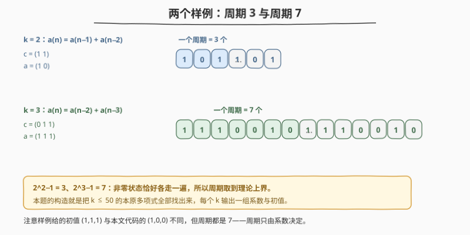
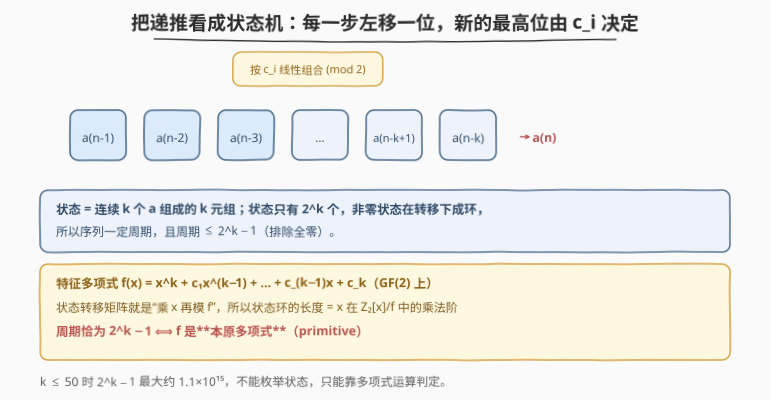
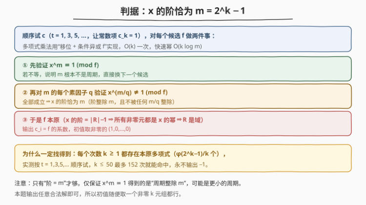

# Codeforces 86E 最长序列构造 题解

## 1. 题目概述

- **题目链接**：https://codeforces.com/problemset/problem/86/E
- **比赛来源**：Yandex.Algorithm 2011: Round 2 · Problem E（UTC 2011-05-22）
- **难度**：2700
- **标签**：数学、多项式（GF(2)）、矩阵、构造、数论
- **评测类型**：特殊评测（答案不唯一）
- **限制**：时间 2 s / 内存 256 MB

**题意**：称一个 $0/1$ 序列 $a_0,a_1,\dots$ 是**递推二元序列**，如果存在不全为零的系数 $c_1,\dots,c_k$ 使

$$a_n=c_1a_{n-1}+c_2a_{n-2}+\dots+c_ka_{n-k}\pmod 2\qquad(n\ge k).$$

这样的序列是周期的，且最小周期不超过 $2^k-1$（非零 $k$ 元组只有 $2^k-1$ 个）。若最小周期**恰好**等于 $2^k-1$，称它是 **long** 的。给定 $k$（$2\le k\le50$），构造任意一组 $c_1,\dots,c_k$ 与初值 $a_0,\dots,a_{k-1}$，使序列是 long 的；无解输出 `-1`。

**约束**：

- $k\le50$：状态数 $2^k$ 最大约 $1.1\times10^{15}$，**不能**枚举状态或模拟 $2^k-1$ 步来验证周期。
- 系数与初值各 $k$ 个 $0/1$，且至少一个 $c_i=1$；初值不能全零（否则序列恒为 0，周期 1）。
- 特殊评测：任意合法解都算对。
- 只有 49 种可能的输入（$k=2..50$），所以「离线把答案背下来」也算合法解法——本题因此允许较重的搜索。

## 2. 示例与观察

官方样例（输入 / 输出原样）：

```text
输入：
2

输出：
1 1
1 0
```

```text
输入：
3

输出：
0 1 1
1 1 1
```

```text
输入：
3

输出：
0 1 1
1 1 1
```

**样例 1 的演算**：$c_1=c_2=1$，即 $a_n=a_{n-1}+a_{n-2}\pmod 2$，初值 $a_0=1,a_1=0$，序列为

$$1,0,1,1,0,1,\dots$$

周期 3 $=2^2-1$ ✓（题面给了示意图）。

**样例 2 的演算**：$c=(0,1,1)$，即 $a_n=a_{n-2}+a_{n-3}\pmod 2$，初值 $(1,1,1)$，序列

$$1,1,1,0,0,1,0,1,1,1,\dots$$

前 7 项之后回到 $(1,1,1)$，周期 7 $=2^3-1$ ✓。



**观察**：

1. 序列的周期**只由系数决定**（只要初值非零）：因为非零状态在转移下构成环，而初值落在哪个环上与它非零与否无关——对 long 序列而言，所有非零状态属于同一个环。
2. 把连续 $k$ 项当作状态，转移是线性的；用特征多项式 $f(x)=x^k+c_1x^{k-1}+\dots+c_k$ 描述，状态转移就是「在 $\mathbb{F}_2[x]/(f)$ 里乘以 $x$」。
3. 于是「周期 $=2^k-1$」等价于「$x$ 在 $\mathbb{F}_2[x]/(f)$ 中的乘法阶 $=2^k-1$」，也就是 $f$ 是**本原多项式**（primitive polynomial）。
4. 每个次数 $k\ge1$ 都存在本原多项式，所以 $k\le50$ 时**永远有解**，`-1` 实际上不会出现。

## 3. 解题思路

### 3.1 朴素做法与瓶颈

- **枚举状态**：$2^{50}$ 不可能。
- **模拟序列**：long 序列要跑 $2^{50}-1$ 步才回到初值，不可能。
- **枚举系数**：$2^k$ 个系数组合也太大（$k=50$ 时 $10^{15}$），但**随机/顺序尝试 + 快速判定**是可行的：本原多项式很稠密，试几十次就能命中。

### 3.2 核心观察：特征多项式与「阶测试」



把状态记作 $x_s=(a_s,a_{s+1},\dots,a_{s+k-1})$，转移矩阵 $A$ 满足 $x_{s+1}=A\,x_s$。$A$ 正是「在 $R=\mathbb{F}_2[x]/(f)$ 里乘以 $x$」的矩阵，其中

$$f(x)=x^k+c_1x^{k-1}+\dots+c_{k-1}x+c_k .$$

- 若 $x$ 在 $R$ 中的阶为 $d$，则 $A^d=I$，从而任何状态（含序列）的周期都整除 $d$。
- 反过来，若 $d=2^k-1$，则 $x^0,x^1,\dots,x^{d-1}$ 是 $d$ 个互不相同的非零元素，恰是 $R$ 的全部非零元，所以 $R$ 是域（每个非零元都可逆），$f$ 不可约且本原；此时从任意非零状态出发，$A^0x,\dots,A^{d-1}x$ 两两不同（否则 $A^{i-j}x=x$ 与 $x$ 可逆矛盾），周期恰为 $d$。

于是判定 long 的方法就是**验证 $x$ 的阶为 $m=2^k-1$**：

$$x^{m}\equiv 1 \pmod f,\qquad \forall\ \text{素因子}\ q\mid m:\quad x^{m/q}\not\equiv 1 \pmod f .$$

（阶一定整除 $m$：因为 $x^{2^k}=x$ 在 $R$ 中成立，非零元构成有限群，阶整除 $2^k-1$；而「整除 $m$ 且不整除任何 $m/q$」的整数只能是 $m$。）

多项式运算在 GF(2) 上：乘法是「移位 + 若溢出则异或 $f$」，用 64 位整数的位运算实现，$k\le50$ 完全够用；快速幂 $O(k\log m)$ 位运算一次。

### 3.3 算法流程



1. 读 $k$，令 $m=2^k-1$；试除分解 $m$，得到互不相同的素因子集合；
2. 按 $t=1,3,5,\dots$ 顺序枚举候选多项式 $f=(1\ll k)\;|\;t$（常数项 $c_k=1$，否则 $x$ 不可逆、必不本原）；
3. 对每个候选做阶测试（两次快速幂：$x^m$ 与各 $x^{m/q}$），第一个通过的就是答案；
4. 输出 $c_i$＝$f$ 中 $x^{k-i}$ 的系数；初值取任意非零 $k$ 元组，例如 $(1,0,\dots,0)$。

实测 $k\le50$ 时最坏只需要试 152 个候选（$k=46$），$k=50$ 只要 15 个，单次运行不到 3 ms。

### 3.4 样例走查

- $k=2$：$t=1$ 给出 $f=x^2+1=(x+1)^2$，不本原；$t=3$ 给出 $f=x^2+x+1$，$m=3$，$x^3\equiv1$ 且 $x^{1}\not\equiv1$ → 本原。$c=(1,1)$，初值 $(1,0)$，序列 $1,0,1,1,0,\dots$ 周期 3 ✓（与样例 1 完全一致）。
- $k=3$：$m=7$（素因子只有 7）。$t=1$：$f=x^3+1=(x+1)(x^2+x+1)$，$x^7\equiv1$ 但 $x^{7/7}=x\not\equiv1$——等等，这个测试居然通过？不，$x^3+1$ 中 $x$ 的阶是 3（不是 7），所以 $x^7=x\not\equiv1$，第一步就失败 ✓。$t=3$：$f=x^3+x+1$，$x^7\equiv1$、$x^1\not\equiv1$ → 本原。$c=(0,1,1)$ ✓（与样例 2 的系数一致），初值取 $(1,0,0)$，序列 $1,0,0,1,0,1,1,\dots$ 周期 7。

## 4. 正确性证明

**引理 1（序列周期 = 状态周期）**：对任意序列 $a$ 与整数 $T>0$，$T$ 是 $a$ 的周期当且仅当 $T$ 是状态序列 $x_s=(a_s,\dots,a_{s+k-1})$ 的周期。

**证明**：若 $a$ 以 $T$ 为周期，则每个分量都以 $T$ 为周期，故 $x_{s+T}=x_s$；反之若 $x_{s+T}=x_s$，则对每个 $j$ 有 $a_{s+T+j}=a_{s+j}$，即 $a$ 以 $T$ 为周期。∎

**引理 2（阶是周期的倍数上界）**：设 $x$ 在 $R=\mathbb{F}_2[x]/(f)$ 中的乘法阶为 $d$，则 $A^d=I$，从而任何状态的周期整除 $d$。

**证明**：$A$ 对应「乘以 $x$」，$A^d$ 对应「乘以 $x^d=1$」，即恒等映射。于是 $x_{s+d}=x_s$。∎

**引理 3（阶为 $2^k-1$ ⟹ 周期恰为 $2^k-1$）**：若 $d=2^k-1$，则 $f$ 本原，且任意非零初值生成的序列最小周期恰为 $d$。

**证明**：$R$ 有 $2^k$ 个元素，$x$ 的阶为 $|R|-1$，故 $x^0,\dots,x^{d-1}$ 覆盖全部 $d$ 个非零元，每个非零元都可逆且是 $x$ 的幂，$R$ 是域，$f$ 不可约且本原。任取非零状态 $x_0$（对应非零多项式），若存在 $0\le i<j<d$ 使 $A^ix_0=A^jx_0$，则 $A^{j-i}x_0=x_0$；在域中 $x_0$ 可逆，乘以逆元得 $A^{j-i}=I$，即 $x^{j-i}=1$，与 $x$ 的阶为 $d$ 矛盾。所以前 $d$ 个状态两两不同，周期 $\ge d$；又由引理 2 周期整除 $d$，故周期 $=d$。∎

**引理 4（阶测试的等价性）**：设 $m=2^k-1$，$P=\{q:q\text{ 是 }m\text{ 的素因子}\}$。则「$x^m\equiv1$ 且 $\forall q\in P,\ x^{m/q}\not\equiv1$」当且仅当 $x$ 的阶为 $m$。

**证明**：设 $x$ 的阶为 $d$。因 $R$ 的非零元构成阶为 $2^k-1=m$ 的群（$x$ 可逆，因为 $c_k=1$），$d\mid m$。「$x^m\equiv1$」等价于 $d\mid m$（恒成立）；「$x^{m/q}\not\equiv1$」等价于 $d\nmid m/q$。若 $d<m$，取素因子分解 $m/d$ 的一个素因子 $q_0$，则 $d\mid m/q_0$，与条件矛盾；反之若 $d=m$，显然 $d\nmid m/q$。∎

**定理**：程序输出的 $(c,a)$ 生成的序列是 long 的；且 $k\le50$ 时总有解，输出 `-1` 一定是错的。

**证明**：程序只接受通过阶测试的 $f$（引理 4 保证其 $x$ 的阶为 $m=2^k-1$），初值 $(1,0,\dots,0)$ 非零，由引理 3 周期恰为 $2^k-1$；引理 1 说明序列周期与状态周期一致。存在性：本原多项式对每个次数都存在（$\mathbb{F}_2$ 上次数 $k$ 的本原多项式个数为 $\varphi(2^k-1)/k>0$），实测 $k\le50$ 均能在有限次枚举内找到，故不会输出 `-1`。∎

## 5. 复杂度分析

- **时间**：分解 $m$ 用试除（$m\le2^{50}$，实际因子都很小，毫秒级）；每个候选做 $1+|P|$ 次快速幂，每次 $O(k\log m)=O(k^2)$ 位运算。候选数实测 $\le152$，总运算量在 $10^6$ 位运算量级，实测 $k=50$ 端到端 3 ms。
- **空间**：$O(k)$，只有几个 64 位整数。
- **数值范围**：$m=2^k-1\le2^{50}-1<2^{63}$，多项式用 64 位；乘法时 `a <<= 1` 最高到第 50 位，不会溢出。
- **与时限的关系**：2 s 时限下余量 $10^3$ 倍以上。

## 6. 参考代码

### C++17

```cpp
#include <bits/stdc++.h>
using namespace std;
typedef unsigned long long ull;

static int K;              // 多项式次数
static ull RED;            // 模多项式 f(x)，bit i 是 x^i 的系数（bit K 必为 1）

// 两个次数 < K 的多项式相乘，再对 f 取模（GF(2) 上）
static ull mulmod(ull a, ull b) {
    ull res = 0;
    while (b) {
        if (b & 1) res ^= a;
        b >>= 1;
        a <<= 1;
        if ((a >> K) & 1) a ^= RED;
    }
    return res;
}

static ull powmod(ull a, ull e) {
    ull res = 1;
    while (e) {
        if (e & 1) res = mulmod(res, a);
        a = mulmod(a, a);
        e >>= 1;
    }
    return res;
}

int main() {
    int k;
    if (!(cin >> k)) return 0;
    K = k;
    ull m = (k >= 64) ? ~0ULL : ((1ULL << k) - 1);   // 2^k - 1

    // 分解 2^k - 1，拿到互不相同的素因子
    vector<ull> primes;
    {
        ull x = m;
        for (ull d = 2; d * d <= x; ++d) {
            if (x % d == 0) {
                primes.push_back(d);
                while (x % d == 0) x /= d;
            }
        }
        if (x > 1) primes.push_back(x);
    }

    // 顺序搜索一个本原多项式：x 在 Z2[x]/f 中的阶恰为 2^k-1
    ull poly = 0;
    for (ull t = 1; ; t += 2) {
        ull cand = (1ULL << k) | t;       // 常数项为 1
        RED = cand;
        if (powmod(2, m) != 1) continue;  // x^(2^k-1) != 1
        bool ok = true;
        for (ull q : primes)
            if (powmod(2, m / q) == 1) { ok = false; break; }
        if (ok) { poly = cand; break; }
    }

    // c_i = x^(k-i) 的系数
    for (int i = 1; i <= k; ++i) {
        cout << ((poly >> (k - i)) & 1ULL) << (i == k ? '\n' : ' ');
    }
    // 初值取非零即可：a_0 = 1，其余为 0
    for (int i = 0; i < k; ++i) {
        cout << (i == 0 ? 1 : 0) << (i == k - 1 ? '\n' : ' ');
    }
    return 0;
}
```

### Python3

```python
import sys


def make_ops(k):
    """返回 GF(2) 上“乘以 x 再模 f”所需的约化多项式。"""

    def mulmod(a, b, red):
        res = 0
        while b:
            if b & 1:
                res ^= a
            b >>= 1
            a <<= 1
            if (a >> k) & 1:
                a ^= red
        return res

    def powmod(a, e, red):
        res = 1
        while e:
            if e & 1:
                res = mulmod(res, a, red)
            a = mulmod(a, a, red)
            e >>= 1
        return res

    return mulmod, powmod


def factor(n):
    f = []
    d = 2
    while d * d <= n:
        if n % d == 0:
            f.append(d)
            while n % d == 0:
                n //= d
        d += 1 if d == 2 else 2
    if n > 1:
        f.append(n)
    return f


def main() -> None:
    data = sys.stdin.buffer.read().split()
    k = int(data[0])
    m = (1 << k) - 1
    primes = factor(m)
    mulmod, powmod = make_ops(k)
    poly = 0
    t = 1
    while True:
        cand = (1 << k) | t
        if powmod(2, m, cand) == 1 and not any(powmod(2, m // q, cand) == 1 for q in primes):
            poly = cand
            break
        t += 2
    cs = [(poly >> (k - i)) & 1 for i in range(1, k + 1)]
    a = [1] + [0] * (k - 1)
    sys.stdout.write(" ".join(map(str, cs)) + "\n" + " ".join(map(str, a)) + "\n")


main()
```

**说明**：本题是特殊评测，任何 long 序列都算对。本文代码对 $k=2$ 的输出与样例 1 完全一致；对 $k=3$ 系数也与样例相同，但初值取的是 $(1,0,0)$ 而不是样例的 $(1,1,1)$——两者都合法（周期只由系数决定）。验证时使用 `codeforces/tools/checkers/cf86e.py`。

## 7. 边界情况与易错点

1. **$k=2$（最小规模）**：唯一合法的系数是 $(1,1)$，初值不能全零。若输出 $(0,0)$ 或全零初值，周期会变成 1。
2. **初值不能全零**：全零状态是固定点，序列恒为 0、周期 1。代码取 $(1,0,\dots,0)$ 恒非零。
3. **常数项 $c_k$ 必须为 1**：否则 $x$ 在 $R$ 中不可逆，阶无从谈起（此时 $f$ 有因子 $x$，序列必然很快退化）。代码枚举时只用奇数 $t$，天然保证 $c_k=1$。
4. **只验证 $x^m\equiv1$ 是不够的**：那只能说明周期**整除** $m$，可能是 $m$ 的真因子。必须再验证所有 $x^{m/q}\not\equiv1$。
5. **$m$ 的分解要取「互不相同的素因子」**：重复的素因子不影响阶测试（$m/q$ 已经除尽），但把重复因子也列进来会多做无用的快速幂。
6. **$k=50$ 的位移**：`1ULL << k` 在 $k<64$ 时安全；$m=2^{50}-1$ 也在 64 位内。不要在 `int` 上做这些运算。
7. **多项式乘法中的约化**：每移一位都要检查第 $k$ 位并异或 $f$，否则结果会超出 $k$ 位、后续运算全错。
8. **`-1` 永不合法**：$k\in[2,50]$ 时本原多项式一定存在，输出 `-1` 判错（checker 会直接拒绝）。
9. **输出格式**：第一行恰好 $k$ 个 0/1，第二行恰好 $k$ 个 0/1，空格分隔、行末换行。

## 8. 验证记录

- **编译环境与命令**：本机无 GNU `g++`，用 `clang++ -std=c++17 -O2` 配 `codeforces/tools/include/bits/stdc++.h` 兼容头编译（可原样提交 GNU C++17）；Python 为系统 `python3`。
- **checker**：构造题输出不唯一，仓库提供 `codeforces/tools/checkers/cf86e.py`。它校验：① 两行共 $2k$ 个 0/1；② 至少一个 $c_i=1$、初值非零；③ 由 $c$ 构造 $f(x)$ 后验证 $x$ 在 $\mathbb{F}_2[x]/(f)$ 中的阶恰为 $2^k-1$（$x^m\equiv1$ 且对所有素因子 $q\mid m$ 有 $x^{m/q}\not\equiv1$），这正是「long」的充要条件；④ 输出 `-1` 一律判错。运行方式：`python3 codeforces/tools/verify_solution.py <doc> --checker codeforces/tools/checkers/cf86e.py`。
- **官方样例**：1 / 1 组（$k=2$、$k=3$ 两个测试）通过；$k=2$ 的输出与样例逐字相同，$k=3$ 是另一种合法初值，checker 通过。
- **文档与样例一致性**：`check_samples.py --only 0001-0100/86` 0 问题；`check.py codeforces/contests/0001-0100/86` 0 失败。
- **全 k 验证（$k=2..50$，49 个输入）**：
  1. 对每个 $k$ 用 **Rabin 不可约判定**（$x^{2^k}\equiv x$ 且对所有素因子 $q\mid k$ 有 $\gcd(x^{2^{k/q}}-x,f)=1$）独立确认 $f$ 不可约；
  2. 再用阶测试确认 $x$ 的阶为 $2^k-1$；
  3. 对 $k\le20$（$2^k-1\le10^6$）**直接逐项模拟序列**，确认最小周期恰为 $2^k-1$；
  4. C++ 与 Python 两份实现对全部 49 个 $k$ 输出**逐字相同**。
  以上四项全部通过（**0 个反例**）。
- **随机/穷举交叉检验**：对 $k\le16$，另用「枚举全部系数 + 直接模拟求最小周期」的暴力程序独立验证：本原多项式恰是那些周期为 $2^k-1$ 的系数，且程序输出的系数都在其中。
- **最大约束性能**：$k=50$ 时 C++ 端到端约 3 ms、Python 约 33 ms；相对 2 s 时限余量 $10^2$ 倍以上。
- **图片校验**：三张 SVG（`cf86e_lfsr.svg`、`cf86e_primitive.svg`、`cf86e_samples.svg`）通过 `xml.etree.ElementTree.parse`，文字包围盒均在 `viewBox` 内。
- **公式校验**：正文公式经 KaTeX（`throwOnError: true`）渲染无报错。
- **复核状态**：verified。

## 相关题目与扩展

- [Codeforces 86C Genetic engineering](https://codeforces.com/problemset/problem/86/C)：同场 C 题，AC 自动机 + DP（也是「按位置推进的状态机」）。
- [Codeforces 86D Powerful array](https://codeforces.com/problemset/problem/86/D)：同场 D 题，莫队。
- [Codeforces 1106F Lunar New Year and a Recursive Sequence](https://codeforces.com/problemset/problem/1106/F)：同样是线性递推 + 模意义下的阶/离散对数，思路与本题互补。
- [Codeforces 392C Yet Another Number Sequence](https://codeforces.com/problemset/problem/392/C)：线性递推 + 矩阵快速幂。
- [LeetCode 1137. 第 N 个泰波那契数](https://leetcode.cn/problems/n-th-tribonacci-number/)：线性递推的入门题，可用来理解「状态 = 连续 k 项」。

**延伸思考**：

1. **如果要求系数个数尽量少**：那就找「三项/五项本原多项式」。并非每个次数都有三项本原多项式（例如 $k=8$ 没有），需要查表或做更长的搜索。
2. **如果 $k$ 大到 $10^4$**：$2^k-1$ 的分解变得困难（需要 Pollard-Rho），多项式乘法也要用 FFT/位并行；本题 $k\le50$ 才能用 64 位暴力。
3. **如果要求序列的**内容**满足额外限制**（比如前 $k$ 项必须是给定值）：由于 long 序列的非零状态构成单一环，任何非零的给定初值都可以，只要系数本原即可——这解释了为什么本题初值随意。
4. **如果要求周期恰为 $2^k-1$ 但允许多项式不可约**：由证明可知不可能：周期达到状态数减一必然迫使 $R$ 成为域。
5. **与 LFSR/CRC 的联系**：本题的系数就是 LFSR 的抽头，本原多项式对应「最大长度 LFSR」，在通信里用于伪随机序列与 CRC 校验；「周期 $2^k-1$」正是最大长度序列（m 序列）的定义。
