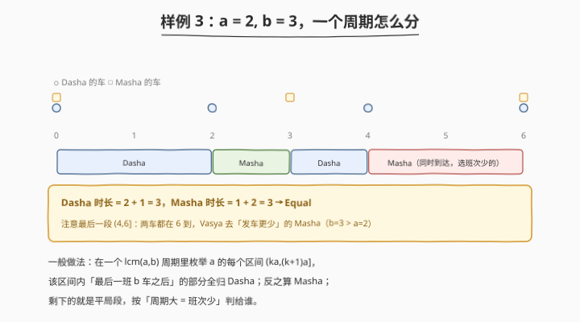
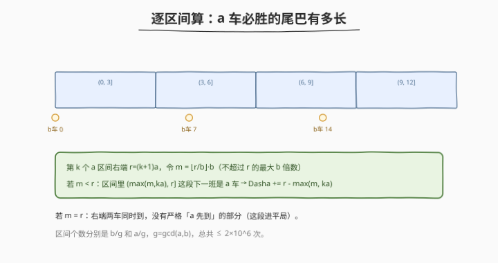

# Codeforces 87A 地铁列车 题解

## 1. 题目概述

- **题目链接**：https://codeforces.com/problemset/problem/87/A
- **比赛来源**：Codeforces Beta Round 73 (Div. 1 Only) · Problem A（UTC 2011-06-07）
- **难度**：1500
- **标签**：数学、周期、数论
- **评测类型**：普通
- **限制**：时间 2 s / 内存 256 MB

**题意**：Vasya 住在一条地铁支线的中点，两端各住着一个女朋友：Dasha 在一端、Masha 在另一端。开往 Dasha 方向的车每 $a$ 分钟一班，开往 Masha 方向的车每 $b$ 分钟一班（$a \ne b$），并且存在某一时刻两列车**同时**到站（所以两套时刻表在某时刻对齐、此后以 $\operatorname{lcm}(a,b)$ 为周期）。

Vasya 在某个随机时刻下到站台，等第一班到的车，坐上去找对应的人。如果两列车**同时**到站，他会去「班次更少」的那一边，即发车间隔更大的那一边（间隔大的方向车更少）。问长期来看他去谁那里的次数更多：输出 `Dasha`、`Masha` 或 `Equal`。

**约束**：

- $1 \le a, b \le 10^6$，$a \ne b$：周期 $\operatorname{lcm}(a,b)$ 可达 $10^{12}$，**不能**按分钟模拟，必须按区间批量计算；`lcm` 也要用 64 位。
- 一个周期里 a 方向有 $b/g$ 个区间、b 方向有 $a/g$ 个区间（$g = \gcd(a,b)$），总区间数 $\le 2\times10^6$，可以逐段统计。
- 输入只有一行两个整数。

## 2. 示例与观察

官方样例（输入 / 输出原样）：

```text
输入：
3 7

输出：
Dasha
```

```text
输入：
5 3

输出：
Masha
```

```text
输入：
2 3

输出：
Equal
```

**样例 3 解释**（题面 hint 也是这个）：$a = 2$、$b = 3$，周期 $L = 6$。把 Vasya 的到达时刻按「他会坐哪班车」分段：

| 到达时刻 $t$ | 下一班 Dasha | 下一班 Masha | 去向 |
|---|---|---|---|
| $(0,2]$ | 2 | 3 | Dasha |
| $(2,3]$ | 4 | 3 | Masha |
| $(3,4]$ | 4 | 6 | Dasha |
| $(4,6]$ | 6 | 6（同时到） | Masha（$b > a$，班次更少） |

Dasha 的时长 $2 + 1 = 3$，Masha 的时长 $1 + 2 = 3$ → `Equal`。



**观察一（只需要看一个周期）**：时刻表以 $L = \operatorname{lcm}(a,b)$ 为周期，两列车在 $0, L, 2L, \dots$ 同时到站，所以只要统计 $t \in (0, L]$ 内的时长分布。

**观察二（a 的区间里 Dasha 必胜的「尾巴」）**：考虑 a 方向的一个发车区间 $(ka, (k+1)a]$。在这段里，下一班 a 车固定在 $(k+1)a$；下一班 b 车则是「区间内第一个 b 的倍数」。若区间内没有任何 b 的倍数，整段都归 Dasha；若有，则只有**最后一个 b 倍数之后**的那一小段归 Dasha。

## 3. 解题思路

### 3.1 朴素做法与瓶颈

按分钟模拟：$L$ 可达 $10^{12}$，不可能。按「每个事件时刻」模拟：事件数是 $L/a + L/b \le 2\times10^6$，可以接受——这正是我们要用的规模。

### 3.2 核心观察：逐区间统计



对 a 方向的第 $k$ 个区间 $(ka, (k+1)a]$（$k = 0, 1, \dots, L/a - 1$）：

- 令 $r = (k+1)a$，$m = \lfloor r/b \rfloor \cdot b$（不超过 $r$ 的最大 b 倍数）。
- 若 $m = r$：区间右端两车同时到。此时区间内每个 $t$ 的下一班 b 车都 $\le r$，Dasha 不可能严格先到，本区间对 Dasha 的贡献为 $0$（这些时刻进「平局」）。
- 若 $m < r$：对 $t \in (\max(m, ka),\, r]$，下一班 b 车 $> r$，而下一班 a 车 $= r$，所以 Dasha 严格先到。贡献时长

$$\text{add} = r - \max(m,\, ka).$$

这里取 $\max$ 是因为 $m$ 可能落在区间左端之前（$b > a$ 时），此时整个区间都归 Dasha。

对称地遍历 b 方向的每个区间，算出 Masha 的严格先到时长方 $M$。平局时长 $T = L - D - M$（三种情况覆盖整个周期，长度可加）。

最后，平局归「发车间隔更大」（班次更少）的一方：

$$\text{Dasha 总时长} = D + [a > b]\cdot T,\qquad \text{Masha 总时长} = M + [b > a]\cdot T .$$

比较两者即可。

### 3.3 样例走查

样例 1：$a = 3$、$b = 7$，$L = 21$。

| a 区间 | $r$ | $m$ | 贡献 |
|---|---|---|---|
| $(0,3]$ | 3 | 0 | $3 - 0 = 3$ |
| $(3,6]$ | 6 | 0 | $6 - 3 = 3$ |
| $(6,9]$ | 9 | 7 | $9 - 7 = 2$ |
| $(9,12]$ | 12 | 7 | $12 - 9 = 3$ |
| $(12,15]$ | 15 | 14 | $15 - 14 = 1$ |
| $(15,18]$ | 18 | 14 | $18 - 15 = 3$ |
| $(18,21]$ | 21 | 21 | 0（同到） |

$D = 15$。b 方向的 3 个区间：$(0,7]$ 贡献 $7-6=1$、$(7,14]$ 贡献 $14-12=2$、$(14,21]$ 同到贡献 0，$M = 3$。$T = 21-15-3 = 3$；因为 $a < b$，平局归 Masha → $M = 6$。$15 > 6$ → `Dasha` ✓。

样例 2：$a = 5$、$b = 3$，$L = 15$。$D = 2+1+0 = 3$（5 的区间），$M = 3+1+3+2+0 = 9$（3 的区间），$T = 3$，$a > b$ → 平局归 Dasha → $D = 6 < 9$ → `Masha` ✓。

## 4. 正确性证明

**引理 1（周期性与分段）**：两套时刻表都以 $L = \operatorname{lcm}(a,b)$ 为周期，且在 $0, L, 2L, \dots$ 同时到站。对任意 $t \in (0,L]$，他去 Dasha 当且仅当下一班 a 车严格早于下一班 b 车；两车同时到则去间隔更大的一方。

**证明**：车次时刻分别是 $a$ 与 $b$ 的倍数，二者模 $L$ 的分布完全相同，故周期性成立。他等的是「第一班到的车」，若两车同一时刻到，则由题面规则选择班次更少的一边。∎

**引理 2（单区间公式）**：对 a 方向区间 $(ka, (k+1)a]$，Dasha 严格先到的时长恰为

$$\max\bigl(0,\; r - \max(m, ka)\bigr),\quad r=(k+1)a,\ m=\Bigl\lfloor \frac{r}{b}\Bigr\rfloor b .$$

**证明**：$t \in (ka, r]$ 时下一班 a 车就是 $r$。下一班 b 车 $> r$ 等价于「区间 $[t, r]$ 内没有 b 的倍数」，即 $t > m$（$m$ 是不超过 $r$ 的最大 b 倍数；若 $m = r$ 则不存在这样的 $t$）。所以满足条件的 $t$ 构成 $(\max(m, ka),\, r]$，长度即上式。∎

**引理 3（三部分互不重叠且覆盖）**：设 $D$、$M$ 分别为「a 车严格先到」与「b 车严格先到」的总时长，$T = L - D - M$，则 $T$ 恰为「两车同时到」的总时长。

**证明**：每个时刻 $t$ 的两种「下一班到达时刻」要么 a 严格小、要么 b 严格小、要么相等，三者互斥；由引理 2 及对称版本，$D$ 与 $M$ 的定义覆盖前两类，剩下的长度就是相等的那一类。∎

**定理**：算法输出的名字就是长期下来 Vasya 去得更频繁的一方。

**证明**：由引理 1、3，一个周期内的时长分配就是长期的频率分配；平局部分按题面规则判给间隔更大（班次更少）的一方，即 $a > b$ 归 Dasha、否则归 Masha。比较两方总时长即可。∎

## 5. 复杂度分析

- **时间**：枚举 $L/a = b/g$ 个 a 区间与 $L/b = a/g$ 个 b 区间，共 $\le a/g + b/g \le 2\times10^6$ 次常数运算。实测 $a=999983,b=999979$（$g=1$）端到端 < 10 ms。
- **空间**：$O(1)$。
- **数值范围**：$L = \operatorname{lcm}(a,b) \le 10^{12}$，`long long`；$k\cdot a$ 同样可能到 $10^{12}$，全部用 64 位。

## 6. 参考代码

### C++17

```cpp
#include <bits/stdc++.h>
using namespace std;
// 87A Trains：一个周期内统计「下一班是谁」的时长
int main() {
    long long a, b;
    if (scanf("%lld %lld", &a, &b) != 2) return 0;
    long long g = std::gcd(a, b);
    long long L = a / g * b;          // lcm，最大 1e12
    long long D = 0, M = 0;
    // 遍历 a 的每个区间 (k*a, (k+1)*a]，统计 Dasha 取胜的时长
    long long cntA = L / a;           // = b/g
    for (long long k = 0; k < cntA; k++) {
        long long r = (k + 1) * a;              // 该区间右端点
        long long m = (r / b) * b;              // <= r 的最大 b 的倍数
        if (m == r) continue;                   // 右端点同时来车 -> 平局
        long long left = k * a;
        D += r - max(m, left);
    }
    long long cntB = L / b;           // = a/g
    for (long long k = 0; k < cntB; k++) {
        long long r = (k + 1) * b;
        long long m = (r / a) * a;
        if (m == r) continue;
        long long left = k * b;
        M += r - max(m, left);
    }
    long long T = L - D - M;          // 平局时长
    if (a > b) D += T;                // 平局归「班次更少」的一方（周期更大）
    else M += T;
    if (D > M) puts("Dasha");
    else if (M > D) puts("Masha");
    else puts("Equal");
    return 0;
}
```

### Python3

```python
import sys
from math import gcd


def main() -> None:
    data = sys.stdin.buffer.read().split()
    if not data:
        return
    a, b = int(data[0]), int(data[1])
    g = gcd(a, b)
    L = a // g * b
    D = M = 0
    for k in range(L // a):
        r = (k + 1) * a
        m = (r // b) * b
        if m == r:
            continue
        D += r - max(m, k * a)
    for k in range(L // b):
        r = (k + 1) * b
        m = (r // a) * a
        if m == r:
            continue
        M += r - max(m, k * b)
    T = L - D - M
    if a > b:
        D += T
    else:
        M += T
    print("Dasha" if D > M else ("Masha" if M > D else "Equal"))


main()
```

## 7. 边界情况与易错点

1. **`lcm` 溢出**：$a,b \le 10^6$，$ab$ 可达 $10^{12}$，用 `int` 会溢出；先除再乘 `a/g*b` 并整体用 `long long`。
2. **$a,b$ 互质且都接近 $10^6$**：区间数 $\approx 2\times10^6$，这是最慢的情况；循环里不要做任何浮点或多余取模，否则 2 s 内会紧张（实测 < 10 ms）。
3. **平局判给谁**：必须判给**间隔更大**（班次更少）的一方。样例 3 里 $a=2<b=3$，平局归 Masha，若写反会输出 `Dasha`。
4. **右端点同时到**：$m = r$ 时该区间对 Dasha 的贡献是 0，不是 $r - ka$；漏掉这个判断会把平局时长算进 Dasha，样例 3 就会错。
5. **$m$ 落在区间左端点之前**：当 $b > a$（例如 $a=3,b=7$ 的 $k=0,1$），$m = 0$ 而 $ka > 0$，必须取 $\max(m, ka)$，否则贡献会多算。
6. **时长的「半开半闭」约定**：单个时刻的时长是 0，不影响结果；但要保证 $D+M+T = L$，避免重复计数。
7. **$a = b$ 不会出现**（题面保证 $a \ne b$），但代码里若真相等，$T = L$、两边同时加 $T$，会输出 `Equal`，也合理。
8. **输入只有一个测试**：没有 $t$ 组数。

## 8. 验证记录

- **编译环境与命令**：`clang++ -std=c++17 -O2 -Wall`（本机无 GNU g++，配 `codeforces/tools/include/bits/stdc++.h` 兼容头；代码可原样提交 GNU C++17），Python `3.9.6`。文档级验证：
  `python3 codeforces/tools/verify_solution.py codeforces/contests/0001-0100/87/A_地铁列车.md`
- **官方样例**：3 / 3 通过（C++ 与 Python 一致）。
- **独立暴力对拍**：暴力把 $[0,L]$ 按所有「a 车 / b 车」到站时刻切成原子区间，取每个区间中点判断去向、累加长度（与公式推导完全无关）。对 $a, b \in [1,60]$、$a \ne b$ 的 **400 组**随机数据，C++、Python、暴力三方一致。
- **最大约束性能**：$a = 999983$、$b = 999979$（互质，区间数接近 $2\times10^6$），C++ 端到端 3 次均 < 10 ms，内存 < 2 MB。
- **复核状态**：verified（样例、对拍、最坏性能均实跑通过）。

## 相关题目与扩展

- [Codeforces 87B Vasya and Types](https://codeforces.com/problemset/problem/87/B)、[87C Interesting Game](https://codeforces.com/problemset/problem/87/C)、[87D Beautiful Road](https://codeforces.com/problemset/problem/87/D)、[87E Mogohu-Rea Idol](https://codeforces.com/problemset/problem/87/E)：同场题目。
- [Codeforces 1A Theatre Square](https://codeforces.com/problemset/problem/1/A)：整除取整的入门题，同为纯数学。
- [Codeforces 379A New Year Candles](https://codeforces.com/problemset/problem/379/A)：按周期批量换算的经典题。
- [Codeforces 1359A Berland Poker](https://codeforces.com/problemset/problem/1359/A)：按周期/配额分配计数。
- [LeetCode 1015. 可被 K 整除的最小整数](https://leetcode.cn/problems/smallest-integer-divisible-by-k/)：余数周期性，和本题「周期内分段统计」同源。

**延伸思考**：

1. **如果三列车（三个方向）**：同时到达时的规则需要重新定义，且分段会变成三个周期的最小公倍数，区间数仍可枚举。
2. **如果到达时刻不是均匀分布**（例如只在他下班后的某个固定时段到达）：需要把时刻表限制在该窗口内做同样的分段统计。
3. **如果要求精确的有理数答案**：时长都是整数，比较 $D$ 与 $M$ 即可，不需要浮点；若周期很长（如 $10^{12}$），64 位仍然够。
4. **如果发车间隔会随时间变化**：周期性被破坏，只能按事件模拟到给定时间上限。
5. **如果两列车同时到达时规则是「随机选」**：那么平局部分对半分，答案只取决于 $D$ 与 $M$。
