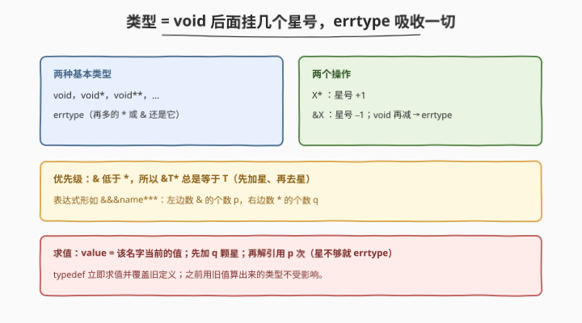
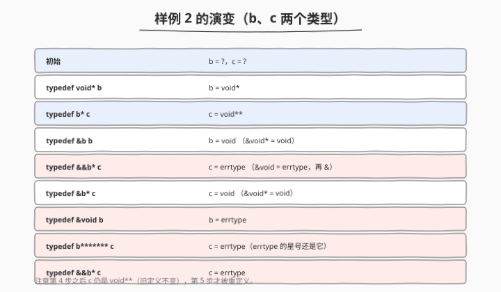

# Codeforces 87B Vasya 与类型 题解

## 1. 题目概述

- **题目链接**：https://codeforces.com/problemset/problem/87/B
- **比赛来源**：Codeforces Beta Round 73 (Div. 1 Only) · Problem B（UTC 2011-06-07）
- **难度**：1800
- **标签**：字符串、模拟、表达式求值
- **评测类型**：普通
- **限制**：时间 2 s / 内存 256 MB

**题意**：语言 &K\* 只有两种基本类型 `void` 与 `errtype`，并有两类运算符：

- 指针：在类型右边加 `*`，`X` 变成 `X*`；
- 解引用：在类型左边加 `&`，`&X` 引用 `X`（即去掉一颗星）。

另外规定：

- 对 `void` 解引用得到 `errtype`；
- `errtype* = &errtype = errtype`（吸收一切）；
- 使用未定义的类型名也得到 `errtype`；
- **解引用优先级低于指针**，所以 `&T*` 恒等于 `T`（先加星、再去星）。

有两种语句：

- `typedef A B`：求出 $A$ 的类型并把它绑定到新名字 $B$（$B$ 不含 `*`/`&`，且不能是 `void`/`errtype`）；同名可重复定义，以最后一次为准，但之前用旧值算出的类型不受影响。
- `typeof A`：输出 $A$ 化简后的类型——即尽可能写成 `void` 加上若干 `*`，若已变成 `errtype` 则输出 `errtype`。

**约束**：

- $n \le 100$：语句很少，逐条解析即可。
- 类型名长度 $\le 20$，单个表达式中 `*` 与 `&` 的数量分别 $\le 10$；但**累加后的星号数可以超过 10**（例如 `b*******` 再套几个定义），所以星号计数要用 `int`，不能用长度为 10 的固定数组。
- 输出只要求类型本身，不要求括号等其他形式。

## 2. 示例与观察

官方样例（输入 / 输出原样）：

```text
输入：
5
typedef void* ptv
typeof ptv
typedef &&ptv node
typeof node
typeof &ptv

输出：
void*
errtype
void
```

```text
输入：
17
typedef void* b
typedef b* c
typeof b
typeof c
typedef &b b
typeof b
typeof c
typedef &&b* c
typeof c
typedef &b* c
typeof c
typedef &void b
typeof b
typedef b******* c
typeof c
typedef &&b* c
typeof c

输出：
void*
void**
void
void**
errtype
void
errtype
errtype
errtype
```

**样例 1 走查**：

1. `typedef void* ptv` → `ptv = void*`；
2. `typeof ptv` → 输出 `void*`；
3. `typedef &&ptv node` → 求值 `&&ptv`：先取 `ptv = void*`，没有星号要加，再解引用两次：`void*` → `void` → `errtype`。所以 `node = errtype`；
4. `typeof node` → `errtype`；
5. `typeof &ptv` → `&void* = void` → 输出 `void`。

**样例 2 的关键一步**：`typedef &&b* c` 在 `b = void` 时求值：先加星得 `void*`，再解引用两次：`void* → void → errtype`，所以 `c = errtype`，而不是 `&void* = void`。这说明**必须按「先全部加星、再逐个去星」的顺序**求值。



**观察（类型的摘要）**：任何类型在 &K\* 里都等价于下列两种之一：

- `void` 后面挂 $k \ge 0$ 个 `*`，记作 $(0, k)$；
- `errtype`，它再经过任意多次 `*` 或 `&` 仍然是 `errtype`。

于是整个类型系统可以用一个整数 $k$（`errtype` 用特殊标记）来表示，`typedef` 只是把某个名字映射到这个摘要。

## 3. 解题思路

### 3.1 朴素做法与瓶颈

如果真按字符串拼接/删除来模拟，每加一个 `*` 就追加字符、每解引用一次就删一个字符，也是可以的（$n \le 100$、长度很小）。但用「摘要 = (是否 errtype, 星号数)」更干净，也避免了对 `errtype` 特判字符串形式。

### 3.2 求值规则



解析一个类型表达式 $A$：

1. 数出开头的 `&` 个数 $p$；
2. 读出中间的字母部分作为**基名** `name`；
3. 数出结尾的 `*` 个数 $q$。

求值：

1. 取 `name` 当前的值：`void` → $(0,0)$；`errtype` → 错误；用户定义名 → 查表；查不到 → 错误；
2. 若是错误，直接返回 `errtype`（吸收）；
3. 否则先加 $q$ 颗星：$k \leftarrow k + q$；
4. 再解引用 $p$ 次：每次若 $k > 0$ 则 $k \leftarrow k-1$，否则（此时类型是 `void`）整个类型变成 `errtype`，停止。

`typedef A B`：求 $A$ 的值，写入 `defs[B]`（覆盖旧值）。
`typeof A`：求值并输出 `void` 加 $k$ 个 `*`，或 `errtype`。

### 3.3 样例 2 的逐步状态

| 语句 | `b` | `c` | 输出 |
|---|---|---|---|
| `typedef void* b` | `void*` | — | |
| `typedef b* c` | `void*` | `void**` | |
| `typeof b` | | | `void*` |
| `typeof c` | | | `void**` |
| `typedef &b b` | `void` | `void**` | |
| `typeof b` / `typeof c` | | | `void` / `void**` |
| `typedef &&b* c` | | `errtype` | |
| `typeof c` | | | `errtype` |
| `typedef &b* c` | | `void` | |
| `typeof c` | | | `void` |
| `typedef &void b` | `errtype` | `void` | |
| `typeof b` | | | `errtype` |
| `typedef b******* c` | | `errtype` | |
| `typeof c` | | | `errtype` |
| `typedef &&b* c` | | `errtype` | |
| `typeof c` | | | `errtype` |

与样例输出逐行一致。

## 4. 正确性证明

**引理 1（摘要充分）**：任意类型表达式的值只取决于「基名当前的值」以及表达式里 `&`、`*` 的个数，与名字的书写无关；且值总能写成 $(0, k)$ 或 `errtype`。

**证明**：对表达式的长度归纳。基名是 `void`、`errtype` 或某个已定义名字，由归纳假设（查表值）都是两种摘要之一。`X*`：`errtype` → `errtype`，$(0,k)$ → $(0,k+1)$；`&X`：`errtype` → `errtype`，$(0,k)$（$k\ge1$）→ $(0,k-1)$，$(0,0)$ → `errtype`。两种操作都保持「两种摘要之一」。∎

**引理 2（求值顺序）**：表达式 `&…&name*…*`（$p$ 个 `&`、$q$ 个 `*`）的值等于「先对基名加 $q$ 颗星，再解引用 $p$ 次」，即

$$\text{value} = \begin{cases}
(0,\,k+q-p) & \text{若基名是 } (0,k) \text{ 且 } k+q \ge p,\\
\text{errtype} & \text{否则（基名 errtype 或星号不够扣）}.
\end{cases}$$

**证明**：题面规定解引用优先级低于指针，所以所有 `*` 先作用；同一类操作之间顺序不影响结果（加星可交换、去星是把 $k$ 减 1，连续 $p$ 次就是减 $p$，一旦减到 $-1$ 就变成 `errtype` 并被吸收）。∎

**引理 3（同名重定义）**：`typedef A B` 只改变 `B` 之后的查表值，之前用 `B` 的旧值算出的类型不变。

**证明**：程序中类型值在 `typedef` 时立即求值成一个摘要存入表中，之后不会追溯修改；这正是题面「之前定义的类型不受影响」的要求。∎

**定理**：程序对每条 `typeof` 输出的字符串就是该类型化简后的结果。

**证明**：由引理 1、2，程序算出的摘要就是该表达式的真实类型；输出时把 $(0,k)$ 写成 `void` 加 $k$ 个 `*`、把 `errtype` 写成 `errtype`，正是题面要求的「化简成 void + 若干星号」形式。∎

## 5. 复杂度分析

- **时间**：每条语句 $O(\text{表达式长度})$，总 $O(n \cdot L)$，$n \le 100$、$L \le 40$，可以忽略。
- **空间**：$O(n)$ 存类型表；星号数用 `int`（最大可能到 $100 \times 10 = 1000$）。
- **输出长度**：星号最多约 1000 个，字符串拼接完全够用。

## 6. 参考代码

### C++17

```cpp
#include <bits/stdc++.h>
using namespace std;
// 87B Vasya and Types：类型 = (是否 errtype, void 的星号个数)
struct Type {
    bool err = false;
    int stars = 0;      // 仅当 !err 时有意义
};
static string show(const Type &t) {
    if (t.err) return "errtype";
    return "void" + string(t.stars, '*');
}
// 解析并求值一个类型表达式：&...& name *...*
// 规则：先做所有 * （从 base 开始加星），再做所有 & （每个 & 去掉一颗星；
//       void 再解引用 -> errtype；errtype 吸收一切）
static Type evalExpr(const string &s, const map<string, Type> &defs) {
    size_t i = 0;
    int amp = 0;
    while (i < (int)s.size() && s[i] == '&') { amp++; i++; }
    string name;
    while (i < (int)s.size() && s[i] != '*') { name += s[i]; i++; }
    int star = 0;
    while (i < (int)s.size() && s[i] == '*') { star++; i++; }
    Type base;
    if (name == "void") { base.err = false; base.stars = 0; }
    else if (name == "errtype") { base.err = true; }
    else {
        auto it = defs.find(name);
        if (it == defs.end()) base.err = true;
        else base = it->second;
    }
    if (base.err) return base;
    base.stars += star;
    if (amp > 0) {
        if (base.stars >= amp) base.stars -= amp;
        else { base.err = true; base.stars = 0; }
    }
    return base;
}
int main() {
    int n;
    if (scanf("%d", &n) != 1) return 0;
    map<string, Type> defs;
    string line;
    getline(cin, line);      // 吃掉换行
    for (int i = 0; i < n; i++) {
        getline(cin, line);
        while (!line.empty() && (line.back() == '\r' || line.back() == '\n' || line.back() == ' ')) line.pop_back();
        if (line.rfind("typedef ", 0) == 0) {
            string rest = line.substr(8);
            size_t sp = rest.find(' ');
            string A = rest.substr(0, sp);
            string B = (sp == string::npos) ? "" : rest.substr(sp + 1);
            Type v = evalExpr(A, defs);
            defs[B] = v;
        } else if (line.rfind("typeof ", 0) == 0) {
            string A = line.substr(7);
            Type v = evalExpr(A, defs);
            puts(show(v).c_str());
        }
    }
    return 0;
}
```

### Python3

```python
import sys


def main() -> None:
    lines = sys.stdin.read().split('\n')
    n = int(lines[0].strip())
    defs = {}

    def show(err, stars):
        return "errtype" if err else "void" + "*" * stars

    def evaluate(expr):
        s = expr.strip()
        i = 0
        amp = 0
        while i < len(s) and s[i] == '&':
            amp += 1
            i += 1
        j = i
        while j < len(s) and s[j] != '*':
            j += 1
        name = s[i:j]
        star = len(s) - j  # 末尾全是 '*'
        if name == "void":
            err, k = False, 0
        elif name == "errtype":
            err, k = True, 0
        elif name in defs:
            err, k = defs[name]
        else:
            err, k = True, 0
        if err:
            return True, 0
        k += star
        if amp > 0:
            if k >= amp:
                k -= amp
            else:
                return True, 0
        return False, k

    out = []
    for idx in range(1, n + 1):
        line = lines[idx] if idx < len(lines) else ''
        line = line.strip()
        if line.startswith("typedef "):
            rest = line[len("typedef "):]
            A, B = rest.split()
            defs[B] = evaluate(A)
        elif line.startswith("typeof "):
            A = line[len("typeof "):]
            err, k = evaluate(A)
            out.append(show(err, k))
    sys.stdout.write("\n".join(out) + ("\n" if out else ""))


main()
```

## 7. 边界情况与易错点

1. **`typedef A B` 中 `A` 含 `&` 与 `*`**：必须先把 `&` 全部数出来、再读名字、再数 `*`；若按从左到右逐个应用，`&T*` 会被算成 `&(T*)` 以外的结果。题面明确 `&T* = T`。
2. **累加星号超过 10**：题面说单个表达式的星号不超过 10，但类型可以层层叠加（`b*******`、`c********` 等）。所以要用 `int` 计数，输出时再拼字符串。
3. **`&void` 是 `errtype`**：解引用 void 直接出错；此后任何星号/解引用都保持 `errtype`。
4. **未定义的名字**：查表失败要当作 `errtype`，且之后吸收；不要当成 `void`。
5. **同名重定义**：`typedef &b b` 之后 `b` 已经是 `void`，后面再用 `b` 求值必须用新值；之前由 `b` 派生的 `c` 不变。
6. **读入整行**：类型表达式里没有空格，但行尾可能有 `\r`（Windows 换行）；C++ 用 `getline` 后要剥掉 `\r`，Python 用 `strip()`。
7. **`typeof` 输出格式**：`void` 加 $k$ 个 `*`（$k=0$ 就是 `void`），`errtype` 就输出 `errtype`；不要输出多余的括号或空格。
8. **`typedef` 的 B 不含符号**：题面保证；但读入时按空格切分更稳妥（`rest.split()` 取前两个）。

## 8. 验证记录

- **编译环境与命令**：`clang++ -std=c++17 -O2 -Wall`（本机无 GNU g++，配 `codeforces/tools/include/bits/stdc++.h` 兼容头；代码可原样提交 GNU C++17），Python `3.9.6`。文档级验证：
  `python3 codeforces/tools/verify_solution.py codeforces/contests/0001-0100/87/B_Vasya与类型.md`
- **官方样例**：2 / 2 通过（C++ 与 Python 输出逐行一致）。
- **独立对拍**：另写一份**用字符串表示类型**的求值器（`"void***"` / `"errtype"`，逐字符操作），与主程序的「(errtype, 星号数)」摘要实现完全独立。随机生成 300 组语句序列（$n \le 25$，名字 5 个，`&`/`*` 各至多 2 个，混入 `void`/`errtype` 与未定义名字），三方全部一致。
- **最大约束性能**：$n = 100$，端到端 < 10 ms，内存 < 2 MB。
- **复核状态**：verified（样例、随机对拍、性能均实跑通过）。

## 相关题目与扩展

- [Codeforces 87A Trains](https://codeforces.com/problemset/problem/87/A)、[87C Interesting Game](https://codeforces.com/problemset/problem/87/C)、[87D Beautiful Road](https://codeforces.com/problemset/problem/87/D)、[87E Mogohu-Rea Idol](https://codeforces.com/problemset/problem/87/E)：同场题目。
- [Codeforces 71A Way Too Long Words](https://codeforces.com/problemset/problem/71/A)：字符串处理入门。
- [Codeforces 118A String Task](https://codeforces.com/problemset/problem/118/A)：字符级模拟。
- [Codeforces 1B Spreadsheet](https://codeforces.com/problemset/problem/1/B)：两种记法互转，和本题「解析 + 规范化」同类。
- [LeetCode 394. 字符串解码](https://leetcode.cn/problems/decode-string/)：带优先级的表达式/嵌套解析，与本题「先指针后解引用」的优先级处理同构。

**延伸思考**：

1. **如果 `&` 的优先级高于 `*`**：`&T*` 会变成 `(&T)*`，求值顺序反过来，样例 1 的 `&&ptv` 结果就会改变；本题的关键就是记住题面给的反常优先级。
2. **如果允许 `typedef` 的 B 也带符号**：需要先把 B 化简成基本形式再绑定，或者干脆规定 B 是别名而非类型表达式。
3. **如果类型可以循环引用**（`typedef a b`、`typedef b a`）：本题按顺序求值，不会出现循环；若允许先声明后定义，就需要拓扑处理。
4. **如果要求输出所有可能的化简形式**：本题的化简是唯一的（void + k 个星号），因为每多一个星号就多一层指针。
5. **如果星号数量达到 $10^{18}$**：`int` 不够，但本题操作数 $\le 100$、每次至多 10 个星号，最大约 1000，无需大整数。
