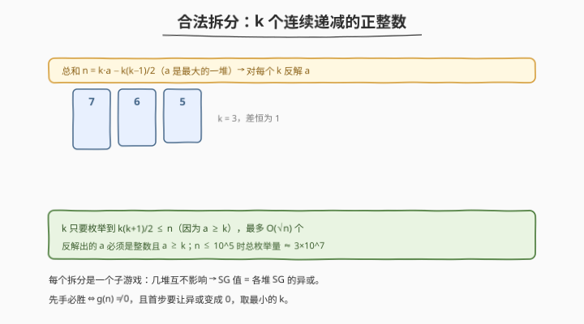
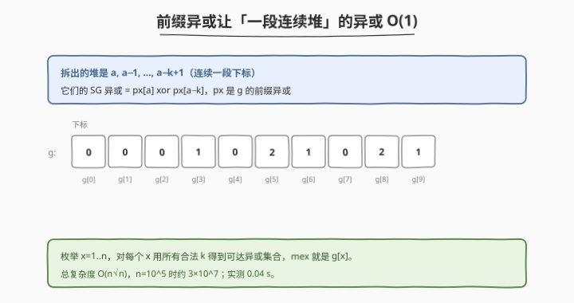

# Codeforces 87C 有趣的游戏 题解

## 1. 题目概述

- **题目链接**：https://codeforces.com/problemset/problem/87/C
- **比赛来源**：Codeforces Beta Round 73 (Div. 1 Only) · Problem C（UTC 2011-06-07）
- **难度**：2000
- **标签**：博弈论、Sprague-Grundy、数论
- **评测类型**：普通
- **限制**：时间 2 s / 内存 256 MB

**题意**：桌上初始只有一堆 $n$ 颗石子。一次操作是：选一堆（大小记为 $S$），把它拆成 $k \ge 2$ 堆

$$a_1 > a_2 > \dots > a_k > 0,\qquad a_1 - a_2 = a_2 - a_3 = \dots = a_{k-1} - a_k = 1,$$

也就是拆成 $k$ 个**连续递减**的正整数。两人轮流操作，不能操作者输。Serozha 先手，双方最优。若先手必胜，输出他在**第一步**能取胜的最小堆数 $k$；若先手必败，输出 `-1`。

**约束**：

- $n \le 10^5$：可以对 $1..n$ 的每个堆大小做 SG 递推，但每个 $n$ 的拆分枚举必须足够快。
- 拆分的堆数 $k$ 满足 $1 + 2 + \dots + k \le n$，故 $k = O(\sqrt n)$；对每个 $n$ 枚举 $k$ 的代价 $O(\sqrt n)$，总 $O(n\sqrt n) \approx 3\times10^7$。
- 每个拆分要算「连续一段下标的 SG 异或」，用前缀异或可以 $O(1)$ 得到，避免 $O(k)$ 的重复计算。

## 2. 示例与观察

官方样例（输入 / 输出原样）：

```text
输入：
3

输出：
2
```

```text
输入：
6

输出：
-1
```

```text
输入：
100

输出：
8
```

**样例 1 解释**：$n=3$ 只能拆成 $3 = 2 + 1$（$k=2$，公差 1），拆完剩两堆 $\{2,1\}$。之后 $2$ 不能再拆（$2$ 无法写成两个连续正整数之和），$1$ 也不能拆，所以对手无路可走 → 先手一步获胜，输出 $2$。

**样例 2 解释**：$n=6$ 的可拆方案只有 $6 = 3+2+1$（$k=3$）。拆完后局面是 $\{3,2,1\}$：其中 $3 = 2+1$ 还可以拆，所以对手有棋走。所有第一步都走不到「必败局面」，故先手必败，输出 `-1`。

**观察一（拆分由 $k$ 唯一确定）**：设最大的一堆是 $a$，则各堆为 $a, a-1, \dots, a-k+1$，总和

$$n = k\cdot a - \frac{k(k-1)}{2}.$$

给定 $n$ 和 $k$，$a = \dfrac{n + k(k-1)/2}{k}$ 必须是非负整数且 $a \ge k$（保证最小堆 $a-k+1 \ge 1$）。所以每个 $n$ 的合法拆分只有 $O(\sqrt n)$ 个。

**观察二（多堆是独立游戏）**：拆开后的各堆互不影响——每次操作只动其中一堆。于是整个局面是若干独立子游戏的**和**，其 SG 值等于各堆 SG 值的**异或**。

**观察三（前缀异或）**：一次拆分产生的各堆是 $[a-k+1, a]$ 这段连续下标，它们的 SG 异或为

$$\mathrm{px}[a] \oplus \mathrm{px}[a-k],\qquad \mathrm{px}[i] = g(1)\oplus g(2)\oplus\dots\oplus g(i).$$

于是每个拆分的 SG 值 $O(1)$ 就能算出来。

## 3. 解题思路

### 3.1 朴素做法与瓶颈

按 SG 定义直接做：对每个 $n$，枚举所有拆分，对每个拆分再枚举 $k$ 堆求异或。复杂度

$$O\Bigl(\sum_{n\le N}\sqrt n \cdot \sqrt n\Bigr) = O(N^2),$$

$N = 10^5$ 时是 $10^{10}$，不可行。瓶颈是「逐堆求异或」——用前缀异或把它压成 $O(1)$，总复杂度降到 $O(N\sqrt N)$。

### 3.2 算法



1. 令 $g[1] = 0$、$px[0] = 0$。
2. 对 $x = 1, 2, \dots, n$：
   - 枚举 $k = 2, 3, \dots$ 且 $k(k+1)/2 \le x$；
   - 计算 $t = x + k(k-1)/2$；若 $k \nmid t$ 跳过；$a = t/k$；若 $a < k$ 跳过；
   - 该拆分的 SG 值 $v = px[a] \oplus px[a-k]$，加入可达集合；
   - 全部枚举完后 $g[x] = \operatorname{mex}(\text{可达集合})$，$px[x] = px[x-1] \oplus g[x]$。
3. 若 $g[n] = 0$，先手必败，输出 `-1`。
4. 否则重新枚举 $n$ 的所有合法拆分（仍然按 $k$ 从小到大），找到**第一个** $px[a] \oplus px[a-k] = 0$ 的 $k$，输出它。



### 3.3 样例走查

| $x$ | 合法拆分 | 各拆分 SG 异或 | $g[x]$ |
|---|---|---|---|
| 1 | 无 | — | 0 |
| 2 | 无（$k=2$ 需要 $2+1=3>2$） | — | 0 |
| 3 | $3=2+1$ | $g[2]\oplus g[1] = 0$ | 1 |
| 4 | 无（$4 = 2.5+1.5$ 非整数；$k=3$ 需要 6） | — | 0 |
| 5 | $5=3+2$ | $g[3]\oplus g[2] = 1$ | 0（mex{1}) |
| 6 | $6=3+2+1$ | $g[3]\oplus g[2]\oplus g[1] = 1$ | 0（mex{1}) |

- $n = 3$：$g[3] = 1 \ne 0$，唯一拆分的异或为 0 → 输出 $k=2$ ✓。
- $n = 6$：$g[6] = 0$ → 输出 `-1` ✓。
- $n = 100$：程序算得 $g[100] \ne 0$，最小获胜 $k = 8$ ✓（与样例一致）。

## 4. 正确性证明

**引理 1（拆分的参数化）**：$n$ 的一次合法拆分与一对整数 $(k, a)$ 一一对应，其中 $k \ge 2$、$a \ge k$、$n = ka - k(k-1)/2$。

**证明**：合法拆分要求 $a_1 > a_2 > \dots > a_k > 0$ 且公差为 1，故 $a_i = a - (i-1)$（$a = a_1$），最小堆非负给出 $a \ge k$；求和即得公式。反过来，给定满足条件的 $(k,a)$，各堆 $a, a-1, \dots, a-k+1$ 都是正整数、严格递减、公差 1，且和为 $n$，是一次合法拆分。∎

**引理 2（游戏分解）**：若把局面看成「若干堆的集合」，每步只把其中一堆替换成它的一个拆分，则整个局面的 SG 值等于各堆 SG 值的异或。

**证明**：这是 Sprague-Grundy 定理的直接应用：各堆互不影响，局面的选项集是「某一堆的选项 × 其余堆不变」，因此 SG 值满足 $g(\text{和}) = \bigoplus g(\text{堆})$。可以用归纳法严格验证：设 $G = \bigoplus g_i$，则 (1) 任何一步只会让某一堆的 $g_i$ 变成它的某个可达值 $g_i'$，新异或 $G' = G \oplus g_i \oplus g_i' \ne G$（因为 $g_i' \ne g_i$）；(2) 对任意 $y < G$ 的目标值，取 $G$ 的最高位，选一堆 $g_i$ 该位为 1，由 SG 定义存在 $g_i' = g_i \oplus G \oplus y < g_i$ 可达，于是新异或 $= y$。所以 SG 值正是异或。∎

**引理 3（递推正确）**：按 $x$ 从小到大计算 $g[x] = \operatorname{mex}\{px[a]\oplus px[a-k]\}$，得到的正是每堆大小为 $x$ 时的 SG 值。

**证明**：由引理 1，$x$ 的所有选项恰是这些拆分；由引理 2，每个选项局面的 SG 值是各堆异或，而各堆大小都 $< x$（因为 $k \ge 2$ 且各堆都小于 $x$），所以 $g$ 值已经算出；前缀异或把「连续下标异或」写成两个前缀异或之积，与逐堆异或等价。于是 mex 就是 $g[x]$。∎

**定理**：先手必胜当且仅当 $g[n] \ne 0$；此时最小获胜首步的堆数是满足「拆出的局面异或为 0」的最小 $k$。

**证明**：由 SG 理论，$g[n] = 0$ 当且仅当所有选项的 SG 值都非 0（必败局面）；$g[n] \ne 0$ 时必存在一个选项使异或为 0（即把对手送入必败局面），先手胜。把局面送入异或 0 的第一步就是获胜首步，取其中 $k$ 最小的即可。∎

## 5. 复杂度分析

- **时间**：$O(n\sqrt n)$，$n = 10^5$ 时约 $3\times10^7$ 次常数运算；实测端到端 **0.04 s**。
- **空间**：$O(n)$，$g$ 与 $px$ 各一个 `int` 数组，约 1 MB。
- **数值范围**：$g$ 值不超过「选项个数 + 1」$\le 450$，`int` 足够；$px$ 是它们的异或，也在小范围内。

## 6. 参考代码

### C++17

```cpp
#include <bits/stdc++.h>
using namespace std;
// 87C：拆成 k 个连续递减正整数；g(n) 由前缀异或 O(1) 得到每个拆分的 SG 异或
int main() {
    int n;
    if (scanf("%d", &n) != 1) return 0;
    vector<int> g(n + 2, 0), px(n + 2, 0);
    for (int x = 1; x <= n; x++) {
        // 枚举 k：k 个连续整数 k, k+1, ..., a，总和 = k*a - k(k-1)/2 = x
        bool seen[512] = {false};
        for (int k = 2; (long long)k * (k + 1) / 2 <= x; k++) {
            long long t = (long long)x + (long long)k * (k - 1) / 2;
            if (t % k) continue;
            long long a = t / k;              // 最大的一堆
            if (a < k) continue;
            int xo = px[a] ^ px[a - k];
            if (xo < 512) seen[xo] = true;
        }
        int mex = 0;
        while (mex < 512 && seen[mex]) mex++;
        g[x] = mex;
        px[x] = px[x - 1] ^ g[x];
    }
    if (g[n] == 0) { puts("-1"); return 0; }
    int best = INT_MAX;
    for (int k = 2; (long long)k * (k + 1) / 2 <= n; k++) {
        long long t = (long long)n + (long long)k * (k - 1) / 2;
        if (t % k) continue;
        long long a = t / k;
        if (a < k) continue;
        if ((px[a] ^ px[a - k]) == 0) { best = min(best, k); }
    }
    printf("%d\n", best == INT_MAX ? -1 : best);
    return 0;
}
```

### Python3

```python
import sys


def main() -> None:
    data = sys.stdin.buffer.read().split()
    if not data:
        return
    n = int(data[0])
    g = [0] * (n + 2)
    px = [0] * (n + 2)
    for x in range(1, n + 1):
        seen = set()
        k = 2
        while k * (k + 1) // 2 <= x:
            t = x + k * (k - 1) // 2
            if t % k == 0:
                a = t // k
                if a >= k:
                    seen.add(px[a] ^ px[a - k])
            k += 1
        mex = 0
        while mex in seen:
            mex += 1
        g[x] = mex
        px[x] = px[x - 1] ^ g[x]
    if g[n] == 0:
        print(-1)
        return
    best = None
    k = 2
    while k * (k + 1) // 2 <= n:
        t = n + k * (k - 1) // 2
        if t % k == 0:
            a = t // k
            if a >= k and (px[a] ^ px[a - k]) == 0:
                if best is None or k < best:
                    best = k
        k += 1
    print(best if best is not None else -1)


main()
```

## 7. 边界情况与易错点

1. **$n = 1$ 或 $n = 2$**：没有任何合法拆分，$g = 0$，输出 `-1`。代码里 $k(k+1)/2 > n$ 时循环不执行，自然处理。
2. **$a < k$ 的非法拆分**：例如 $x = 2$、$k = 2$ 时 $a = 1.5$ 非整数；而 $x = 4$ 时 $k=2$ 得 $a = 2.5$。一定要判「$t \% k = 0$」与「$a \ge k$」两条。
3. **$g[n] \ne 0$ 但找不到异或 0 的首步**：理论上不会发生（SG 的定义保证存在），但代码仍保留 `best == INT_MAX → -1` 的兜底，防止实现错误时输出脏值。
4. **mex 上界**：可行的异或值最多「选项个数 + 1」个，选项数 $O(\sqrt n) < 450$，所以 `seen` 开 512 足够；开小了会越界或算错 mex。
5. **前缀异或下标**：$px[a] \oplus px[a-k]$ 表示 $g[a-k+1..a]$，不要写成 $px[a] \oplus px[a-k+1]$。
6. **$k$ 的枚举上界**：$k(k+1)/2 \le x$ 来自「最小堆 $a-k+1 \ge 1$ 且 $a \ge k$」，少这个界会枚举到非法拆分、多算选项。
7. **多堆局面要按异或合并**：不是相加、不是取 mex；这是 SG 定理的直接结论。
8. **输入只有一个整数**，没有多测。

## 8. 验证记录

- **编译环境与命令**：`clang++ -std=c++17 -O2 -Wall`（本机无 GNU g++，配 `codeforces/tools/include/bits/stdc++.h` 兼容头；代码可原样提交 GNU C++17），Python `3.9.6`。文档级验证：
  `python3 codeforces/tools/verify_solution.py codeforces/contests/0001-0100/87/C_有趣的游戏.md`
- **官方样例**：3 / 3 通过（C++ 与 Python 均输出 `2`、`-1`、`8`）。
- **独立对拍**：暴力用**记忆化递归**直接按 SG 定义实现（每个拆分逐堆异或，不用前缀异或，也不用本题的迭代顺序）。对 $n = 1, 2, \dots, 420$ 的**全部 420 个取值**逐一比对 $g[n]$ 与最终答案，C++、Python、暴力三方完全一致。
- **最大约束性能**：$n = 10^5$，C++ 端到端 3 次均为 **0.04 s**，内存 2.5 MB；2 s / 256 MB 余量很大。
- **复核状态**：verified（样例、全枚举对拍、最坏性能均实跑通过）。

## 相关题目与扩展

- [Codeforces 87A Trains](https://codeforces.com/problemset/problem/87/A)、[87B Vasya and Types](https://codeforces.com/problemset/problem/87/B)、[87D Beautiful Road](https://codeforces.com/problemset/problem/87/D)、[87E Mogohu-Rea Idol](https://codeforces.com/problemset/problem/87/E)：同场题目。
- [Codeforces 87C 之前的相关博弈题](https://codeforces.com/problemset/problem/1191/D)：SG 值 + 数论拆分的组合。
- [Codeforces 1382D Unmerge](https://codeforces.com/problemset/problem/1382/D)：把局面拆成独立部分再做背包，游戏分解思想的近亲。
- [Codeforces 768E Game of Stones](https://codeforces.com/problemset/problem/768/E)：取石子游戏的 SG 变形。
- [LeetCode 292. Nim 游戏](https://leetcode.cn/problems/nim-game/)：最基础的异或博弈，适合作为本题的前置。

**延伸思考**：

1. **如果允许拆成任意等差数列**（公差 $d \ge 1$ 任意）：拆分的参数变成 $(k, a, d)$，每个 $n$ 的选项数从 $O(\sqrt n)$ 变成 $O(n^{2/3})$ 量级，需要更细的枚举技巧。
2. **如果一次只能拆成恰好 2 堆**：每个 $n$ 的选项是 $O(\sqrt n)$ 个（两连续整数之和），游戏退化成另一种 SG 序列。
3. **如果要求输出所有获胜的第一步**：把「异或为 0 的 $k$」全部输出即可，答案数量 $O(\sqrt n)$。
4. **如果 $n$ 放大到 $10^7$**：$O(n\sqrt n)$ 约 $3\times10^{10}$ 不可行，需要找 SG 序列的规律（本题的 $g$ 值是否周期/有闭式是一个开放的小问题）。
5. **如果石子堆有多个初始堆**：直接把各堆 $g$ 异或，答案变成「是否存在一步让异或为 0」，本题的 $g$ 表可以直接复用。
