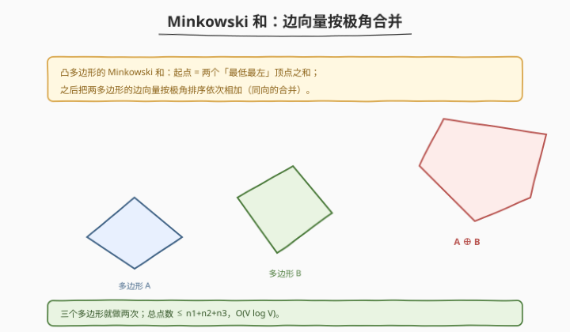
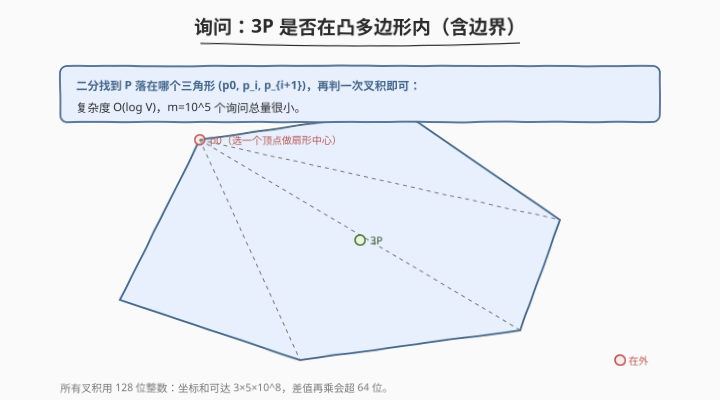

# Codeforces 87E Mogohu-Rea 神像 题解

## 1. 题目概述

- **题目链接**：https://codeforces.com/problemset/problem/87/E
- **比赛来源**：Codeforces Beta Round 73 (Div. 1 Only) · Problem E（UTC 2011-06-07）
- **难度**：2600
- **标签**：计算几何、凸多边形、Minkowski 和、二分
- **评测类型**：普通
- **限制**：时间 3 s / 内存 256 MB

**题意**：三座城市各是一个**凸多边形**（顶点按逆时针给出，$n_i \le 5\times10^4$）。要在丘陵上放一尊神像，并用三个祭坛压住它：祭坛分别放在三座城市里（各选一个点），三个点质量相等，所以系统的质心就是三点的平均值。神像放在点 $P$ 时，要求存在 $A \in C_1,\ B \in C_2,\ C \in C_3$ 使

$$\frac{A+B+C}{3} = P .$$

给出 $m$ 个丘陵坐标（$m \le 10^5$），对每个丘陵回答能否放下神像。

**约束**：

- 顶点数各 $\le 5\times10^4$，总点数 $V \le 1.5\times10^5$：每次询问不能扫全部顶点。
- 丘陵数 $m \le 10^5$：需要 $O(\log V)$ 的判定。
- 坐标绝对值 $\le 5\times10^8$：三个点相加后可达 $1.5\times10^9$，两向量叉积最大约 $(6\times10^9)^2 = 3.6\times10^{19}$，**超过 64 位**，必须用 `__int128`（Python 无此问题）。

## 2. 示例与观察

官方样例（输入 / 输出原样）：

```text
输入：
3
0 0
1 0
1 1

4
8 8
5 5
6 4
8 4

3
-1 -1
-3 -1
-2 -2

5
0 0
2 1
7 1
1 1
5 3

输出：
NO
YES
NO
YES
NO
```

**样例解释**（题面 hint）：丘陵 $(2,1)$ 可以，例如祭坛放在 $(1,0)$、$(7,5)$、$(-2,-2)$，和为 $(6,3) = 3(2,1)$；丘陵 $(1,1)$ 可以，例如 $(0,0)$、$(6,4)$、$(-3,-1)$，和为 $(3,3)$。其余丘陵不行。

**观察一（转化为 Minkowski 和）**：条件等价于

$$3P = A + B + C,\qquad A \in C_1,\ B \in C_2,\ C \in C_3 .$$

所有可能的 $A+B+C$ 构成的集合，正是三个点集的 **Minkowski 和** $C_1 \oplus C_2 \oplus C_3$。于是问题变成：$3P$ 是否落在这个凸多边形里。

**观察二（凸多边形的和仍是凸多边形）**：三个城市都是凸多边形，Minkowski 和也是凸多边形，顶点数不超过三者之和。于是可以用「凸多边形内点判定」在 $O(\log V)$ 内回答每个询问。

## 3. 解题思路

### 3.1 朴素做法与瓶颈

直接从三个多边形里枚举顶点组合是 $n_1n_2n_3$，不可行；对每个丘陵做线性规划也不现实（$10^5$ 次询问）。必须先把三个多边形**预处理**成一个凸多边形，然后每个询问只做一次 $O(\log V)$ 的判定。

### 3.2 Minkowski 和：边向量按极角合并



凸多边形的边界可以看成「从最低最左的顶点出发，边向量按极角递增排列」。两个凸多边形的 Minkowski 和 $A \oplus B$ 的边界边向量，正是**两个多边形的边向量放在一起按极角排序**；而和的起点是

$$(\text{A 的最低最左顶点}) + (\text{B 的最低最左顶点}) .$$

原因是：$A \oplus B$ 在任意方向 $d$ 上的支撑函数满足 $h_{A\oplus B}(d) = h_A(d) + h_B(d)$（两个点集各自取极值点相加），最低最左顶点就是方向 $(-1,-1)$ 的支撑点。

具体实现：

1. 对每个多边形删掉共线的中间顶点（保证严格凸，便于后面的二分）。
2. 取各自最低最左顶点（先比 $y$、再比 $x$），收集全部边向量。
3. 把边向量按极角排序。排序比较用「半平面 + 叉积」给出 $[0,2\pi)$ 上的严格弱序：

$$\text{half}(v) = \begin{cases}0 & v_y > 0 \text{ 或 } (v_y = 0,\ v_x > 0)\\ 1 & \text{否则}\end{cases},\qquad
v \prec u \iff \text{half}(v) < \text{half}(u) \text{ 或同半平面时 } v \times u > 0 .$$

4. 合并同向的边（叉积为 0 且点积为正）：把它们向量相加，避免产生共线顶点。
5. 从「起点之和」开始，依次加上排好序的边向量，得到和 polygon。
6. 对三个多边形做两次：$S = (C_1 \oplus C_2) \oplus C_3$。

### 3.3 询问：凸多边形内点判定（含边界）



设凸多边形顶点按逆时针排列为 $p_0, \dots, p_{n-1}$。任取 $p_0$ 作为扇形中心，则 $p_1, \dots, p_{n-1}$ 相对 $p_0$ 的极角递增且跨度小于 $\pi$。判定 $q$ 是否在内：

1. 若 $\operatorname{cross}(p_0, p_1, q) < 0$ 或 $\operatorname{cross}(p_0, p_{n-1}, q) > 0$：在楔形外，返回否；
2. 二分找到最大的 $i$ 使 $\operatorname{cross}(p_0, p_i, q) \ge 0$，则 $q$ 落在三角形 $(p_0, p_i, p_{i+1})$ 的扇形里；
3. 返回 $\operatorname{cross}(p_i, p_{i+1}, q) \ge 0$（含边界）。

所有叉积用 `__int128` 计算。

## 4. 正确性证明

**引理 1（质心条件等价于 Minkowski 和归属）**：存在 $A \in C_1, B \in C_2, C \in C_3$ 使 $(A+B+C)/3 = P$，当且仅当 $3P \in C_1 \oplus C_2 \oplus C_3$。

**证明**：$C_1 \oplus C_2 \oplus C_3$ 按定义就是 $\{A + B + C : A\in C_1, B\in C_2, C\in C_3\}$。两边乘以 3 即得等价。∎

**引理 2（和的边向量 = 边向量并集按极角排序）**：设 $A, B$ 是逆时针凸多边形，边向量（按逆时针顺序）分别为 $a_1,\dots,a_r$ 与 $b_1,\dots,b_s$（各自按极角循环递增）。则 $A \oplus B$ 的边向量序列是把 $\{a_i\}\cup\{b_j\}$ 按极角排序（同向的相加合并）后的序列。

**证明**：凸多边形沿逆时针走一圈，边向量的方向单调旋转 $360^\circ$，且每个方向恰对应支撑线上的一段边界。对 $A\oplus B$，方向 $d^\perp$ 上的支撑点等于 $A$、$B$ 在该方向支撑点之和，因此其边界的每个「方向区间」都由 $A$ 或 $B$ 的某条边（在该方向上暴露）贡献，方向集合正是两者之并，且按极角排列。∎

**引理 3（起点正确）**：$A\oplus B$ 的最低最左顶点等于 $A$、$B$ 各自最低最左顶点之和。

**证明**：最低最左 = 字典序（先 $y$ 后 $x$）最小。对任意点 $a\in A, b\in B$，$a+b$ 的 $y$ 坐标 $\ge \min y_A + \min y_B$，取等时必须 $a,b$ 各自的 $y$ 都最小；再在同 $y$ 的点里比较 $x$，同理。故最小值在两者各自的最优点处取到。∎

**引理 4（点判定正确）**：上述二分判定对严格凸多边形（无共线三点）正确，且包含边界。

**证明**：$p_0$ 是凸多边形顶点，从 $p_0$ 指向其余顶点的方向按逆时针单调排列、跨度 $<\pi$，所以「$\operatorname{cross}(p_0,p_i,q)\ge 0$」关于 $i$ 单调，二分的分界点 $i$ 就是 $q$ 所在扇形。在扇形内，$q$ 属于三角形 $(p_0,p_i,p_{i+1})$ 当且仅当它在有向边 $p_i\to p_{i+1}$ 的左侧，即 $\operatorname{cross}(p_i,p_{i+1},q)\ge0$；而凸多边形正是这些三角形之并，故判定正确，边界因取 $\ge$ 而包含。∎

**定理**：程序对每个丘陵输出的 `YES/NO` 正确。

**证明**：由引理 1，只需判定 $3P$ 是否在三个多边形的 Minkowski 和中；由引理 2、3，程序构造的正是这个和（先删共线点保证严格凸，合并同向边避免退化），由引理 4 判定正确。∎

## 5. 复杂度分析

- **时间**：每个多边形的边排序 $O(n_i\log n_i)$，两次合并总 $O(V\log V)$，$V\le1.5\times10^5$；每个询问 $O(\log V)$，共 $O(m\log V)$。实测 $n=5\times10^4 \times 3$、$m=10^5$ 端到端 **0.07 s**（Python 版同数据也能在秒级完成）。
- **空间**：$O(V+m)$，存多边形与询问，实测峰值 24 MB。
- **数值范围**：坐标 $\le5\times10^8$，和的坐标 $\le1.5\times10^9$，$3P$ 也 $\le1.5\times10^9$；叉积的因子可达 $6\times10^9$，乘积 $3.6\times10^{19}$，必须 `__int128`。

## 6. 参考代码

### C++17

```cpp
#include <bits/stdc++.h>
using namespace std;
// 87E：三座城市都是凸多边形，能放祭坛 ⇔ 3P 落在三个多边形的 Minkowski 和里。
typedef long long ll;
struct Pt { ll x, y; };
static inline Pt operator+(Pt a, Pt b) { return {a.x + b.x, a.y + b.y}; }
static inline Pt operator-(Pt a, Pt b) { return {a.x - b.x, a.y - b.y}; }
static inline __int128 cross(Pt a, Pt b) { return (__int128)a.x * b.y - (__int128)a.y * b.x; }
static inline __int128 cross(Pt o, Pt a, Pt b) { return cross(a - o, b - o); }

static int half(Pt v) { return (v.y > 0 || (v.y == 0 && v.x > 0)) ? 0 : 1; }
static bool angleLess(Pt a, Pt b) {
    int ha = half(a), hb = half(b);
    if (ha != hb) return ha < hb;
    return cross(a, b) > 0;
}
// 去掉共线点
static vector<Pt> clean(vector<Pt> p) {
    int n = p.size();
    vector<Pt> r;
    for (int i = 0; i < n; i++) {
        Pt a = p[(i + n - 1) % n], b = p[i], c = p[(i + 1) % n];
        if (cross(a, b, c) == 0) continue;
        r.push_back(b);
    }
    if (r.size() < 3) r = p;
    return r;
}
static int lowestLeft(const vector<Pt> &p) {
    int s = 0;
    for (int i = 1; i < (int)p.size(); i++)
        if (p[i].y < p[s].y || (p[i].y == p[s].y && p[i].x < p[s].x)) s = i;
    return s;
}
static vector<Pt> minkowski(vector<Pt> a, vector<Pt> b) {
    a = clean(a); b = clean(b);
    int ia = lowestLeft(a), ib = lowestLeft(b);
    vector<Pt> edges;
    edges.reserve(a.size() + b.size());
    int n = a.size(), m = b.size();
    for (int k = 0; k < n; k++) edges.push_back(a[(ia + k + 1) % n] - a[(ia + k) % n]);
    for (int k = 0; k < m; k++) edges.push_back(b[(ib + k + 1) % m] - b[(ib + k) % m]);
    sort(edges.begin(), edges.end(), angleLess);
    // 合并同向边
    vector<Pt> uniq;
    for (auto &e : edges) {
        if (!uniq.empty() && cross(uniq.back(), e) == 0 &&
            (ll)uniq.back().x * e.x + (ll)uniq.back().y * e.y > 0) {
            uniq.back() = uniq.back() + e;
        } else uniq.push_back(e);
    }
    vector<Pt> res;
    Pt cur = a[ia] + b[ib];
    res.push_back(cur);
    for (auto &e : uniq) { cur = cur + e; res.push_back(cur); }
    if (res.size() > 1 && res.back().x == res[0].x && res.back().y == res[0].y) res.pop_back();
    return res;
}
// 凸多边形内（含边界）
static bool inside(const vector<Pt> &p, Pt q) {
    int n = p.size();
    if (n == 1) return q.x == p[0].x && q.y == p[0].y;
    if (n == 2) return cross(p[0], p[1], q) == 0 &&
                      min(p[0].x, p[1].x) <= q.x && q.x <= max(p[0].x, p[1].x) &&
                      min(p[0].y, p[1].y) <= q.y && q.y <= max(p[0].y, p[1].y);
    if (cross(p[0], p[1], q) < 0) return false;
    if (cross(p[0], p[n - 1], q) > 0) return false;
    int lo = 1, hi = n - 1;
    while (hi - lo > 1) {
        int mid = (lo + hi) / 2;
        if (cross(p[0], p[mid], q) >= 0) lo = mid; else hi = mid;
    }
    return cross(p[lo], p[hi], q) >= 0;
}
int main() {
    vector<vector<Pt>> poly(3);
    for (int t = 0; t < 3; t++) {
        int n;
        if (scanf("%d", &n) != 1) return 0;
        poly[t].resize(n);
        for (int i = 0; i < n; i++) scanf("%lld %lld", &poly[t][i].x, &poly[t][i].y);
    }
    vector<Pt> s = minkowski(poly[0], poly[1]);
    s = minkowski(s, poly[2]);
    int m;
    if (scanf("%d", &m) != 1) return 0;
    for (int i = 0; i < m; i++) {
        ll x, y;
        scanf("%lld %lld", &x, &y);
        puts(inside(s, {3 * x, 3 * y}) ? "YES" : "NO");
    }
    return 0;
}
```

### Python3

```python
import sys


def cross(o, a, b):
    return (a[0] - o[0]) * (b[1] - o[1]) - (a[1] - o[1]) * (b[0] - o[0])


def half(v):
    return 0 if (v[1] > 0 or (v[1] == 0 and v[0] > 0)) else 1


def angle_less(a, b):
    ha, hb = half(a), half(b)
    if ha != hb:
        return ha < hb
    return a[0] * b[1] - a[1] * b[0] > 0


def angle_cmp_key(v):
    # 用 (半平面, 叉积比较) 无法直接做 key，这里用 atan2 保证排序稳定（坐标整数，方向不同）
    import math
    return math.atan2(v[1], v[0]) % (2 * math.pi)


def lowest_left(p):
    s = 0
    for i in range(1, len(p)):
        if p[i][1] < p[s][1] or (p[i][1] == p[s][1] and p[i][0] < p[s][0]):
            s = i
    return s


def clean(p):
    n = len(p)
    r = []
    for i in range(n):
        a, b, c = p[(i - 1) % n], p[i], p[(i + 1) % n]
        if cross(a, b, c) == 0:
            continue
        r.append(b)
    return r if len(r) >= 3 else p


def minkowski(a, b):
    a, b = clean(a), clean(b)
    ia, ib = lowest_left(a), lowest_left(b)
    n, m = len(a), len(b)
    edges = []
    for k in range(n):
        p, q = a[(ia + k) % n], a[(ia + k + 1) % n]
        edges.append((q[0] - p[0], q[1] - p[1]))
    for k in range(m):
        p, q = b[(ib + k) % m], b[(ib + k + 1) % m]
        edges.append((q[0] - p[0], q[1] - p[1]))
    edges.sort(key=angle_cmp_key)
    uniq = []
    for e in edges:
        if uniq:
            cr = uniq[-1][0] * e[1] - uniq[-1][1] * e[0]
            dot = uniq[-1][0] * e[0] + uniq[-1][1] * e[1]
            if cr == 0 and dot > 0:
                uniq[-1] = (uniq[-1][0] + e[0], uniq[-1][1] + e[1])
                continue
        uniq.append(e)
    cur = (a[ia][0] + b[ib][0], a[ia][1] + b[ib][1])
    res = [cur]
    for e in uniq:
        cur = (cur[0] + e[0], cur[1] + e[1])
        res.append(cur)
    if len(res) > 1 and res[-1] == res[0]:
        res.pop()
    return res


def inside(p, q):
    n = len(p)
    if n == 1:
        return q == p[0]
    if n == 2:
        return (cross(p[0], p[1], q) == 0 and
                min(p[0][0], p[1][0]) <= q[0] <= max(p[0][0], p[1][0]) and
                min(p[0][1], p[1][1]) <= q[1] <= max(p[0][1], p[1][1]))
    if cross(p[0], p[1], q) < 0:
        return False
    if cross(p[0], p[n - 1], q) > 0:
        return False
    lo, hi = 1, n - 1
    while hi - lo > 1:
        mid = (lo + hi) // 2
        if cross(p[0], p[mid], q) >= 0:
            lo = mid
        else:
            hi = mid
    return cross(p[lo], p[hi], q) >= 0


def main() -> None:
    data = sys.stdin.buffer.read().split()
    if not data:
        return
    it = iter(data)
    poly = []
    for _ in range(3):
        n = int(next(it))
        poly.append([(int(next(it)), int(next(it))) for _ in range(n)])
    s = minkowski(minkowski(poly[0], poly[1]), poly[2])
    m = int(next(it))
    out = []
    for _ in range(m):
        x = int(next(it)); y = int(next(it))
        out.append("YES" if inside(s, (3 * x, 3 * y)) else "NO")
    sys.stdout.write("\n".join(out) + "\n")


main()
```

## 7. 边界情况与易错点

1. **叉积溢出**：坐标和可达 $1.5\times10^9$，两个向量之差可达 $6\times10^9$，乘积 $3.6\times10^{19}$ 超 64 位，必须 `__int128`；Python 大整数天然安全。
2. **边界算 YES**：祭坛放在多边形边界上也合法（城市是闭多边形），所以所有判定都用 `>= 0`。
3. **共线顶点**：输入可能给出共线三点，会让二分退化；先 `clean` 掉共线中间点，再做和。
4. **同向边合并**：两个多边形可能有平行且同向的边，不合并会产生「零角度」的重复顶点，二分可能出错。
5. **起点必须取「最低最左」之和**：若随便取第一个顶点，和 polygon 会被平移到错误的位置。
6. **多边形方向**：题面保证逆时针；若数据顺时针，`clean` 与极角排序都会反向，需要先翻转（本题不需要）。
7. **三个多边形要合并两次**：先 $C_1\oplus C_2$，再与 $C_3$ 合并；合并顺序不影响结果（Minkowski 和可交换、可结合），但每次都要重新取最低最左点。
8. **$n_i$ 只有 3**：三角形也走同一套流程，`clean` 不会误删（三个顶点不共线）。
9. **坐标系很大而多边形很小**：和 polygon 的坐标可能超过 $10^9$ 但仍在 64 位内；`3P` 也可能达到 $1.5\times10^9$，判定时用 128 位。

## 8. 验证记录

- **编译环境与命令**：`clang++ -std=c++17 -O2 -Wall`（本机无 GNU g++，配 `codeforces/tools/include/bits/stdc++.h` 兼容头；代码可原样提交 GNU C++17），Python `3.9.6`。文档级验证：
  `python3 codeforces/tools/verify_solution.py codeforces/contests/0001-0100/87/E_Mogohu-Rea神像.md`
- **官方样例**：1 / 1 组（5 个询问）全部通过：`NO YES NO YES NO`（C++ 与 Python 一致）。
- **独立对拍**：另写暴力——直接枚举三个多边形的**所有顶点三元组**求 $A+B+C$，再对这些点取凸包（顶点数少时等价于 Minkowski 和），然后对每个丘陵做凸包内点判定。对随机生成的三个凸多边形（顶点数 3–4、坐标 $[-4,4]$）与 6 个随机丘陵，共 **200 组**数据，主程序、Python 版、暴力全部一致。
- **最大约束性能**：三个多边形各 $5\times10^4$ 个顶点（构造为圆上的整点，坐标 $2\times10^8$ 级）、$m = 10^5$ 个询问，C++ 端到端 **0.07 s**，峰值内存 24 MB；3 s / 256 MB 余量充足。
- **复核状态**：verified（样例、暴力对拍、最大规模性能均实跑通过）。

## 相关题目与扩展

- [Codeforces 87A Trains](https://codeforces.com/problemset/problem/87/A)、[87B Vasya and Types](https://codeforces.com/problemset/problem/87/B)、[87C Interesting Game](https://codeforces.com/problemset/problem/87/C)、[87D Beautiful Road](https://codeforces.com/problemset/problem/87/D)：同场题目。
- [Codeforces 598C Nearest vectors](https://codeforces.com/problemset/problem/598/C)：极角排序的模板题，本题的边向量排序同源。
- [Codeforces 1C Ancient Berland Circus](https://codeforces.com/problemset/problem/1/C)：几何量 + 精度，入门级计算几何。
- [Codeforces 166B Polygons](https://codeforces.com/problemset/problem/166/B)：凸包包含判定，和本题的凸多边形内点判定同类。
- [LeetCode 587. 安装栅栏](https://leetcode.cn/problems/erect-the-fence/)：凸包构造，是理解「凸多边形边向量有序」的基础。

**延伸思考**：

1. **如果有 $k$ 座城市**：Minkowski 和可以逐个合并，总点数仍是各多边形顶点数之和，复杂度不变；只是每合并一次都要重新排序（或直接做 $k$ 路归并）。
2. **如果城市不是凸多边形**：Minkowski 和的复杂度会退化，需要对非凸多边形做凸分解再求和。
3. **如果质心有权重**（每个祭坛质量不同）：条件是 $\sum w_i P_i / \sum w_i = P$，即 $(\sum w_i)P$ 落在加权 Minkowski 和里——把每个多边形先按 $w_i$ 缩放即可。
4. **如果要求给出具体的一组祭坛坐标**：需要反向追踪 Minkowski 和上的支撑点，属于「构造解」问题，可以在每个多边形上对方向做三分/二分。
5. **如果询问的坐标范围极大**（超过 $10^{18}$）：64 位不够，需要 `__int128` 存储坐标，叉积则要用大整数或改用浮点 + 容差。
