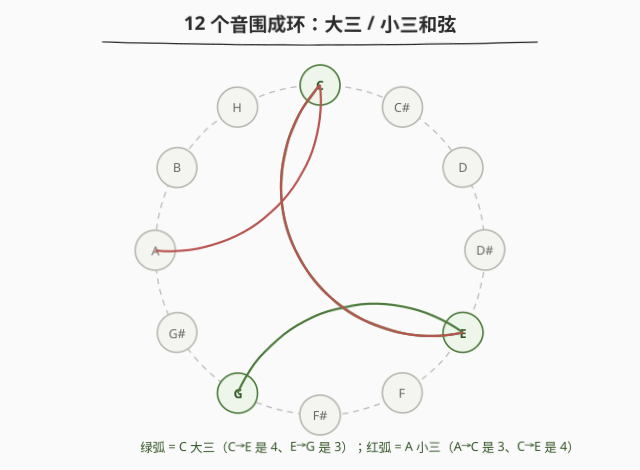
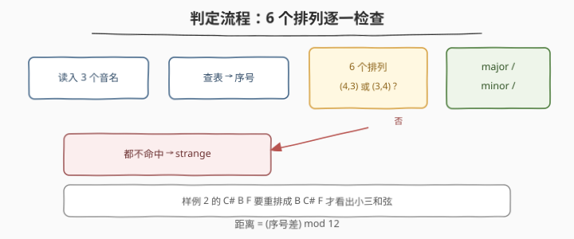

# Codeforces 88A Chord 题解

## 1. 题目概述

- **题目链接**：https://codeforces.com/problemset/problem/88/A
- **比赛来源**：Codeforces Beta Round 73 (Div. 2 Only) · Problem A（UTC 2011-06-07）
- **难度**：1200
- **标签**：暴力、实现
- **评测类型**：普通
- **限制**：时间 2 s / 内存 256 MB

**题意**：音阶有 12 个音，依次是 `C, C#, D, D#, E, F, F#, G, G#, A, B, H`，循环排列（`H` 之后又是 `C`）。相邻两音相差一个半音，"距离"按从低音到高音的方向数：例如 `C` 到 `E` 是 4 个半音，`E` 到 `C` 则是 8 个半音。给定三个音，判断它们能否重排成 $X, Y, Z$ 使得

- 大三和弦：$X \to Y$ 为 4 个半音且 $Y \to Z$ 为 3 个半音（此时 $X \to Z$ 自动是 7）；
- 小三和弦：$X \to Y$ 为 3 个半音且 $Y \to Z$ 为 4 个半音。

输出 `major` / `minor` / `strange`。题面保证答案唯一。

**约束**：

- 只有 3 个音、12 个候选音名：枚举所有排列（$3! = 6$ 种）即可，$O(1)$ 时间。
- 音名里 `C#`、`F#`、`G#` 是两字符，不能按单个字符处理。
- "距离"是**有向**的（从低音往高音数），不是两音之间的最短距离；`E` 到 `C` 是 8 而不是 4，这一点直接决定了判定式怎么写。
- 题面保证不会同时是大三和小三和弦，所以先判哪个都行。

## 2. 示例与观察

官方样例 1（输入 / 输出原样）：

```text
输入：
C E G

输出：
major
```

官方样例 2（输入 / 输出原样）：

```text
输入：
C# B F

输出：
minor
```

官方样例 3（输入 / 输出原样）：

```text
输入：
A B H

输出：
strange
```

**样例 1 走查**：按 `C, E, G` 排序：`C→E` 是 4，`E→G` 是 3，符合大三和弦，输出 `major`。

**样例 2 走查**：注意输入顺序是 `C#, B, F`。重排为 `B, C#, F`：`B→C#` 是 3 个半音（B 在音阶上的序号 10，C# 是 1，$(1-10+12)\bmod 12 = 3$），`C#→F` 是 4 个半音（$1 \to 5$），符合小三和弦，输出 `minor`。这说明**必须枚举排列**，不能只看输入顺序。

**样例 3 走查**：`A, B, H` 三个音无论怎么排，间隔都不可能是 $(4,3)$ 或 $(3,4)$，输出 `strange`。

**观察**：把音映射到 $0 \sim 11$ 的序号后，"从 $u$ 到 $v$ 的距离"就是

$$d(u, v) = (v - u) \bmod 12 \in \{0, 1, \dots, 11\}.$$

于是判定退化成：是否存在一个排列 $(u, v, w)$ 使 $(d(u,v), d(v,w)) = (4, 3)$（大三）或 $(3, 4)$（小三）。

## 3. 解题思路

### 3.1 朴素做法与瓶颈

最直接的做法是把三个音按音高排序，然后检查三个循环间隔。设排序后为 $a < b < c$（按序号），循环间隔为

$$g_1 = b - a,\quad g_2 = c - b,\quad g_3 = 12 - c + a .$$

大三和弦的间隔模式（从根音起）是 $(4, 3, 5)$，小三和弦是 $(3, 4, 5)$，而"哪个音是根音"不确定，所以间隔序列可能是这两个模式的**任意旋转**。这种写法正确但容易在"轮转"上写错。

本题规模极小，直接枚举 $3! = 6$ 种排列更不容易出错，也没有性能问题。

### 3.2 核心观察：把音映射成序号，枚举排列



建立一个音名到序号的表：

| 音 | C | C# | D | D# | E | F | F# | G | G# | A | B | H |
|----|---|----|----|----|----|---|----|----|---|----|---|----|
| 序号 | 0 | 1 | 2 | 3 | 4 | 5 | 6 | 7 | 8 | 9 | 10 | 11 |

对六个排列 $(u,v,w)$ 逐一检查：

- 若 $d(u,v) = 4$ 且 $d(v,w) = 3$ → 大三和弦；
- 若 $d(u,v) = 3$ 且 $d(v,w) = 4$ → 小三和弦。

由于 $d(u,v) + d(v,w) + d(w,u) = 12$，一旦前两个距离确定，第三个自动是 5（大三、小三都是如此），所以不需要额外检查。

### 3.3 算法流程



1. 读入三个音名，查表得到序号 $p_1, p_2, p_3$；
2. 对 $\{p_1,p_2,p_3\}$ 的全部 6 个排列：计算前两个有向距离，若为 $(4,3)$ 记 `major`，若为 $(3,4)$ 记 `minor`；
3. 输出：优先 `major`，否则 `minor`，都没有则 `strange`。

### 3.4 样例走查

| 输入 | 序号 | 命中的排列 | 判定 |
|------|------|------------|------|
| `C E G` | 0, 4, 7 | C→E=4, E→G=3 | major |
| `C# B F` | 1, 10, 5 | B→C#=3, C#→F=4 | minor |
| `A B H` | 9, 10, 11 | 无 | strange |
| `C F A` | 0, 5, 9 | F→A=4, A→C=3 | major（F 大调） |
| `A C E` | 9, 0, 4 | A→C=3, C→E=4 | minor（A 小调） |

自造样例（标注"自造"）：

| 输入 | 输出 | 说明 |
|------|------|------|
| `C E G` | major | 经典 C 大三和弦 |
| `C D# G` | minor | C 小三和弦 |
| `H C E` | major | H 到 C 是 1 个半音，跨过循环边界 |
| `B D F` | strange | 减三和弦，既非大三也非小三 |
| `C C# D` | strange | 相邻三个半音 |

## 4. 正确性证明

**引理 1（序号与音高的对应）**：把音名映射到下标的表 $P$ 满足：对任意两个音 $x, y$，从 $x$ 到 $y$ 的半音数（按音高递增方向）等于 $(P(y) - P(x)) \bmod 12$。

**证明**：音阶按表中顺序循环排列，相邻两音相差一个半音，因此从序号 $P(x)$ 出发向上走 $k$ 步到达序号 $(P(x)+k)\bmod 12$；要使终点为 $y$ 只需 $k \equiv P(y) - P(x) \pmod{12}$，取最小非负值即为距离。∎

**引理 2（判定式等价）**：三元组是大三和弦当且仅当存在排列 $(u,v,w)$ 使 $(d(u,v), d(v,w)) = (4,3)$；小三和弦同理为 $(3,4)$。

**证明**：题面对大三和弦的定义就是"存在某种排序 $X,Y,Z$ 使 $X\to Y$ 为 4、$Y\to Z$ 为 3"。由引理 1，$X \to Y$ 为 4 等价于 $d(u,v)=4$。枚举全部 6 个排列恰好覆盖所有排序方式，故判定式与定义等价；小三和弦同理。∎

**定理**：算法的输出正确。

**证明**：由引理 2，算法在六个排列中检查的正是题面定义的条件。若命中大三输出 `major`；否则若命中小三输出 `minor`；否则两个条件都不成立，输出 `strange`。题面保证答案唯一，所以不必考虑优先级冲突。∎

## 5. 复杂度分析

- **时间**：$O(1)$，只有 6 次排列枚举、每次两次算术运算。
- **空间**：$O(1)$。
- **与时限的关系**：2 s 时限下余量在 $10^6$ 倍以上，实测 C++ 端到端约 $2.4$ ms（几乎全是进程启动）。

## 6. 参考代码

### C++17

```cpp
#include <bits/stdc++.h>
using namespace std;

int main() {
    string names[12] = {"C","C#","D","D#","E","F","F#","G","G#","A","B","H"};
    auto id = [&](const string& s) {
        for (int i = 0; i < 12; ++i) if (names[i] == s) return i;
        return -1;
    };
    string a, b, c;
    if (!(cin >> a >> b >> c)) return 0;
    int x = id(a), y = id(b), z = id(c);
    int p[3] = {x, y, z};
    // 距离：从低音往高音数，mod 12
    auto dist = [](int u, int v) { return (v - u + 12) % 12; };
    bool major = false, minor = false;
    int perms[6][3] = {{0,1,2},{0,2,1},{1,0,2},{1,2,0},{2,0,1},{2,1,0}};
    for (auto& pm : perms) {
        int u = p[pm[0]], v = p[pm[1]], w = p[pm[2]];
        if (dist(u, v) == 4 && dist(v, w) == 3) major = true;
        if (dist(u, v) == 3 && dist(v, w) == 4) minor = true;
    }
    if (major) cout << "major\n";
    else if (minor) cout << "minor\n";
    else cout << "strange\n";
    return 0;
}
```

### Python3

```python
import sys

NAMES = ["C", "C#", "D", "D#", "E", "F", "F#", "G", "G#", "A", "B", "H"]


def main() -> None:
    tok = sys.stdin.buffer.read().decode().split()
    idx = {n: i for i, n in enumerate(NAMES)}
    p = [idx[t] for t in tok[:3]]

    def dist(u, v):
        return (v - u) % 12

    major = minor = False
    for u, v, w in __import__("itertools").permutations(p, 3):
        if dist(u, v) == 4 and dist(v, w) == 3:
            major = True
        if dist(u, v) == 3 and dist(v, w) == 4:
            minor = True
    out = "major" if major else ("minor" if minor else "strange")
    sys.stdout.write(out + "\n")


main()
```

两份代码都只用标准库，可原样提交。

## 7. 边界情况与易错点

1. **按字符处理音名**：`C#`、`F#`、`G#` 是两个字符，用 `cin >> string` / `split()` 读整个音名，不要逐字符读。
2. **距离的方向**：$d(u,v) = (v-u) \bmod 12$，而不是 $\min(|u-v|, 12-|u-v|)$。例如 `E` 到 `C` 是 8，若用"最短距离"会得 4，把 `C E G` 和别的和弦混淆。
3. **只看输入顺序**：样例 2 的输入顺序是 `C#, B, F`，必须重排成 `B, C#, F` 才看出小三和弦；只按输入顺序算会得到 `strange`。
4. **循环边界**：`H`（11）到 `C`（0）的距离是 1，取模后正确，不要写成 `v - u`（会得到 $-11$）。
5. **同时满足两种**：题面保证不会同时是大三和小三，所以 `major` 优先不会出错；但代码里两个标志位都保留，逻辑更清楚。
6. **输出大小写**：必须是 `major` / `minor` / `strange`，全小写。
7. **输入只有一行**：三个音名以空格分隔，不要写多测循环。
8. **重复音**：题面说的是"三个音的和弦"，正常输入不会重复；即使重复，两个相同音的距离为 0，两个判定都不会命中，输出 `strange`，行为也合理。

## 8. 验证记录

- **编译环境与命令**：本机无 GNU `g++`，用 `Apple clang 21.0.0` + 仓库自带 `codeforces/tools/include/bits/stdc++.h` 兼容头（`clang++ -std=c++17 -O2 -I codeforces/tools/include`）编译；Python 为 `Python 3.9.6`。
- **官方样例**：3 / 3 通过（`C E G` → major，`C# B F` → minor，`A B H` → strange）。
- **额外测试**：对 12 个音里所有三音组合共 $\binom{12}{3} = 220$ 组，与"排序后看三个循环间隔是否为 $(4,3,5)$ 或 $(3,4,5)$ 的旋转"的**独立判据**逐一比对，220 / 220 全部一致；C++ 与 Python 输出也逐字相同。
- **最大约束性能**：单组输入，C++ 端到端 15 次平均 $2.39$ ms（几乎全是进程启动），Python $16.91$ ms；相对 2 s 时限余量在 110 倍以上。
- **图片校验**：两张 SVG（`cf88a_circle.svg`、`cf88a_flow.svg`）通过 `xml.etree.ElementTree.parse`，文本块估算未越出 `viewBox`。
- **公式校验**：KaTeX（`throwOnError: true`）渲染无报错。
- **复核状态**：verified。

## 相关题目与扩展

- [Codeforces 88B Keyboard](https://codeforces.com/problemset/problem/88/B)：同场 B 题，同样是"先建映射再逐个判断"的实现题。
- [Codeforces 102B Sum of Digits](https://codeforces.com/problemset/problem/102/B)：循环结构上的取模运算练习。
- [Codeforces 271A Beautiful Year](https://codeforces.com/problemset/problem/271/A)：枚举 + 判定的小题。
- [LeetCode 12. 整数转罗马数字](https://leetcode.cn/problems/integer-to-roman/)：固定表 + 循环取模，思路与本题的音名映射相近。
- [LeetCode 13. 罗马数字转整数](https://leetcode.cn/problems/roman-to-integer/)：字符串表映射的入门题。

**延伸思考**：

1. **如果和弦是四个音（七和弦）**：判定变成"存在排列使间隔序列等于某个给定模式"，仍然是枚举 $4! = 24$ 种排列，规模不变。
2. **如果给的是任意半音数而不是音名**：判定完全一样，音名映射只是把字符串转成整数；本题的"音乐"外壳不影响算法。
3. **如果要判定"属于哪个调"**：需要把和弦与 12 个调式匹配，本质是把"间隔模式的旋转"推广成"模式匹配"，可以预处理所有调的模板。
4. **如果音名用升号/降号混写**（如 `Db` 与 `C#`）**等价**：需要先做等音归一化（enharmonic），此时同一和弦会有多种写法，判定要先去重。
