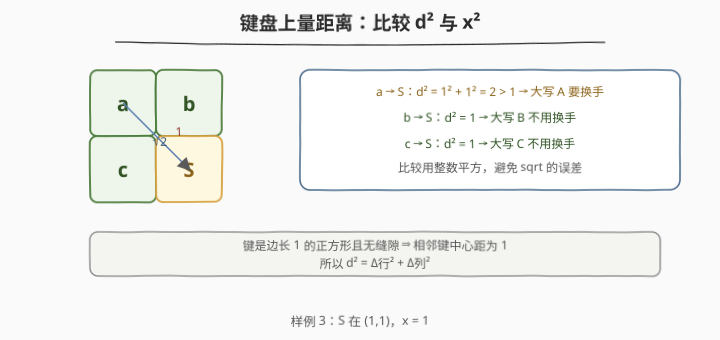
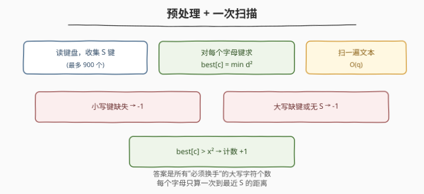

# Codeforces 88B Keyboard 题解

## 1. 题目概述

- **题目链接**：https://codeforces.com/problemset/problem/88/B
- **比赛来源**：Codeforces Beta Round 73 (Div. 2 Only) · Problem B（UTC 2011-06-07）
- **难度**：1500
- **标签**：实现、枚举
- **评测类型**：普通
- **限制**：时间 1 s / 内存 256 MB

**题意**：键盘是 $n \times m$ 的矩形，每格是一个键。键分两类：小写字母键（键面上就是该字母）和 `S`（Shift）键。每个键是边长 $1$ 的正方形，相邻键之间没有空隙，所以第 $(i,j)$ 个键的中心坐标可以取 $(j, i)$。

Vasya 可以**一只手**同时按两个键，但要求两键中心的欧氏距离不超过 $x$。他打字时：

- 输入小写字母：按对应字母键即可，一只手，不切换。
- 输入大写字母：必须同时按住对应的字母键与某个 `S` 键。若最近的 `S` 键到该字母键的距离**严格大于** $x$，则一只手按不到，他必须把另一只手从薯片里腾出来（记为"用另一只手"一次）；若存在距离 $\le x$ 的 `S` 键，则仍是一只手完成。

给定键盘与文本 $T$，求最少的"用另一只手"次数；若文本里有无法输入的字符（键不存在、或需要大写却根本没有 `S` 键），输出 `-1`。

**约束**：

- $1 \le n, m \le 30$：键最多 $900$ 个，可以枚举所有 `S` 键。
- 文本长度 $q \le 5 \times 10^5$：必须 $O(q)$ 处理，不能对每个字符再去暴力枚举 `S`（$900$ 个 `S` 的键盘最坏 $30 \times 30$ 全是 `S`，但字母只有 $26$ 种，所以**按字母预处理**即可）。
- $1 \le x \le 50$：距离平方最大 $29^2 + 29^2 = 1682$，用整数比较 $d^2 \le x^2$ 完全避免浮点误差。
- 只有小写字母键和 `S` 键，没有空格等其他键。

## 2. 示例与观察

官方样例 1（输入 / 输出原样）：

```text
输入：
2 2 1
ab
cd
1
A

输出：
-1
```

官方样例 2（输入 / 输出原样）：

```text
输入：
2 2 1
ab
cd
1
e

输出：
-1
```

官方样例 3（输入 / 输出原样）：

```text
输入：
2 2 1
ab
cS
5
abcBA

输出：
1
```

官方样例 4（输入 / 输出原样）：

```text
输入：
3 9 4
qwertyuio
asdfghjkl
SzxcvbnmS
35
TheQuIcKbRoWnFOXjummsovertHeLazYDOG

输出：
2
```

**样例 1 走查**：键盘上没有 `S` 键，而文本要求大写 `A`，无法输入，输出 `-1`。

**样例 2 走查**：键盘上没有 `e` 键，输出 `-1`。

**样例 3 走查**：键盘 `ab / cS`，`S` 在 $(1,1)$（0 基）。文本 `abcBA`：`a`、`b`、`c` 都是小写，一只手直接按；`B` 需要同时按 `b`（在 $(0,1)$）与 `S`（在 $(1,1)$），距离为 $1 \le x = 1$，一只手可以；`A` 需要按 `a`（$(0,0)$）与 `S`（$(1,1)$），距离 $\sqrt{1^2+1^2} = \sqrt2 > 1$，一只手按不到，必须用另一只手一次。所以答案是 $1$。

**样例 4 走查**：题面提示 `T`、`G` 两个大写字母用一只手按不到，而它们在文本里各出现一次，所以答案是 $2$。

**观察**：答案只取决于"每个大写字母对应的小写键，到最近的 `S` 键的距离"是否 $> x$。因此可以按 $26$ 个字母分别预处理最小距离平方，然后扫一遍文本：

- 小写字母：键不存在 → `-1`；否则不计数。
- 大写字母：对应小写键不存在、或键盘上没有任何 `S` → `-1`；否则若最小距离平方 $> x^2$ 就计数加一。

## 3. 解题思路

### 3.1 朴素做法与瓶颈

最直观的写法是"对文本里每个大写字符，枚举所有 `S` 键算距离"。最坏情况文本长 $5 \times 10^5$、`S` 键 $900$ 个，$4.5 \times 10^8$ 次距离计算，1 s 内很危险。

注意到字母只有 $26$ 种、`S` 键的距离对每个字母是固定的，所以完全可以**预处理**：对每个字母记录"它到最近 `S` 键的距离平方"，之后每个字符 $O(1)$。

### 3.2 核心观察：按字母预处理最小距离



键是边长为 $1$ 的正方形且紧密排列，所以第 $(i,j)$ 个键的中心是 $(j + 0.5,\ i + 0.5)$。两个键的中心距离为

$$\sqrt{(i_1 - i_2)^2 + (j_1 - j_2)^2},$$

与 $x$ 比较时**两边平方**即可，全程整数：

$$d^2 = (i_1-i_2)^2 + (j_1-j_2)^2 \le x^2 .$$

对每个字母 $c$：设它出现在若干格上（题面没有说不会重复，稳妥起见取所有出现位置），取

$$\text{best}[c] = \min_{\text{字母键 } p \text{ 上是 } c,\ \text{S 键 } s} d^2(p, s).$$

若键盘没有 `S` 键，则 `best` 无定义（任何大写都无法输入）。

### 3.3 算法流程



1. 读入 $n, m, x$ 与键盘；收集所有 `S` 键坐标；
2. 对每个字母键（字符 $c$），枚举所有 `S` 键算距离平方，更新 `best[c]`；
3. 读入 $q$ 与文本；
4. 扫描文本：
   - 小写字母 $c$：若 $c$ 键不存在 → 输出 `-1`；
   - 大写字母 $C$：若小写 $c$ 键不存在或没有 `S` 键 → 输出 `-1`；否则若 $\text{best}[c] > x^2$ → 答案加一；
5. 输出答案。

### 3.4 样例走查

样例 3 的预处理结果（$x = 1$，$x^2 = 1$）：`S` 在 $(1,1)$。

| 字母 | 位置 | $d^2$ 到 `S` | 是否 $> x^2$ |
|------|------|--------------|---------------|
| a | (0,0) | $1+1=2$ | 是（大写 `A` 要换手） |
| b | (0,1) | $1+0=1$ | 否 |
| c | (1,0) | $0+1=1$ | 否 |

文本 `abcBA`：小写 3 个不计数；`B` 距离平方 $1 \le 1$ 不计数；`A` 距离平方 $2 > 1$ 计数。答案 $1$ ✓。

自造样例（标注"自造"）：

| 输入 | 输出 | 说明 |
|------|------|------|
| `1 1 1` / `S` / `1` / `a` | -1 | 没有字母键 |
| `1 2 1` / `aS` / `1` / `A` | 0 | 距离 1，一只手可以 |
| `2 1 1` / `a` / `S` / `1` / `A` | 0 | 竖直相邻，距离 1 |
| `2 2 1` / `ab` / `cS` / `1` / `A` | 1 | 样例 3 的变体 |
| `1 2 1` / `aS` / `3` / `AaA` | 0 | 三个 `A` 各一次，但都不需要换手 |

## 4. 正确性证明

**引理 1（距离公式）**：第 $(i_1,j_1)$ 与 $(i_2,j_2)$ 个键的中心距离为 $\sqrt{(i_1-i_2)^2 + (j_1-j_2)^2}$。

**证明**：每个键是边长 $1$ 的正方形且相邻键无空隙，所以第 $(i,j)$ 个键占区域 $[j, j+1] \times [i, i+1]$，中心为 $(j+\tfrac12, i+\tfrac12)$。两点中心之差为 $(j_1 - j_2, i_1 - i_2)$，取欧氏长度即得。∎

**引理 2（一只手条件）**：对字母 $c$，存在一只手同时按下 $c$ 与某个 `S` 键，当且仅当 $\text{best}[c] \le x^2$。

**证明**：由引理 1，两只手指的距离为 $\sqrt{d^2}$；条件 $\sqrt{d^2} \le x$ 与 $d^2 \le x^2$ 等价（两边非负）。$\text{best}[c]$ 是所有 `S` 键中 $d^2$ 的最小值，故存在某只 `S` 满足条件 $\iff$ 最小值 $\le x^2$。∎

**引理 3（按字母预处理不损失信息）**：同一个字母的所有出现位置，能否一只手打大写只取决于 $\text{best}[c]$ 是否 $> x^2$；且每个字符的判定互不影响。

**证明**：输入大写字母 $C$ 时，Vasya 可以选择该字母的**任意**一个键去按（键面相同），所以只要有一个位置能用一只手，他就能用一只手；这等价于最小值满足条件。不同字符的按键独立，所以逐字符计数的和就是总次数。∎

**定理**：算法输出的就是最少的换手次数，或在无解时输出 `-1`。

**证明**：若文本中出现无法输入的字符（小写键不存在、或需要大写而无 `S` 键），任何方案都无法完成，输出 `-1` 正确。否则，由引理 2、3，每个大写字符"是否需要换手"被唯一确定，且各字符独立；算法对需要换手的字符计数，得到的就是最小值。∎

## 5. 复杂度分析

- **时间**：预处理 $O(nm \cdot |S|) \le 900 \times 900$ 次距离计算（实际上字母键最多 $900$ 个）；扫描文本 $O(q)$。总数远小于 $10^6 + 5 \times 10^5$，1 s 时限余量充足。
- **空间**：$O(nm + q)$ 存键盘与文本，$O(26)$ 的 `best` 数组。
- **与时限的关系**：实测 $n = m = 30$、文本 $5 \times 10^5$ 时 C++ 端到端约 $3$ ms。

## 6. 参考代码

### C++17

```cpp
#include <bits/stdc++.h>
using namespace std;

int main() {
    ios::sync_with_stdio(false);
    cin.tie(nullptr);

    int n, m, x;
    if (!(cin >> n >> m >> x)) return 0;
    vector<string> grid(n);
    for (int i = 0; i < n; ++i) cin >> grid[i];

    vector<pair<int,int>> shifts;
    for (int i = 0; i < n; ++i)
        for (int j = 0; j < m; ++j)
            if (grid[i][j] == 'S') shifts.push_back({i, j});

    // 每个小写字母：键是否存在；到最近 Shift 的距离平方
    bool has[26] = {false};
    long long best[26];
    for (int k = 0; k < 26; ++k) best[k] = LLONG_MAX;
    for (int i = 0; i < n; ++i) {
        for (int j = 0; j < m; ++j) {
            char ch = grid[i][j];
            if (ch == 'S' || ch == '.') continue;
            int id = ch - 'a';
            has[id] = true;
            for (auto& s : shifts) {
                long long dr = i - s.first, dc = j - s.second;
                best[id] = min(best[id], dr * dr + dc * dc);
            }
        }
    }

    int q;
    cin >> q;
    string text;
    cin >> text;
    const long long x2 = 1LL * x * x;
    long long ans = 0;
    for (char ch : text) {
        if (ch >= 'a' && ch <= 'z') {
            if (!has[ch - 'a']) { cout << -1 << '\n'; return 0; }
        } else {
            int id = ch - 'A';
            if (!has[id] || shifts.empty()) { cout << -1 << '\n'; return 0; }
            if (best[id] > x2) ++ans;   // 距离严格大于 x，只能用另一只手
        }
    }
    cout << ans << '\n';
    return 0;
}
```

### Python3

```python
import sys


def main() -> None:
    data = sys.stdin.buffer.read().split()
    n, m, x = int(data[0]), int(data[1]), int(data[2])
    grid = [data[3 + i].decode() for i in range(n)]
    q = int(data[3 + n])
    text = data[4 + n].decode()

    shifts = [(i, j) for i in range(n) for j in range(m) if grid[i][j] == 'S']
    has = [False] * 26
    best = [None] * 26
    for i in range(n):
        for j in range(m):
            ch = grid[i][j]
            if ch == 'S' or ch == '.':
                continue
            k = ord(ch) - ord('a')
            has[k] = True
            for (sr, sc) in shifts:
                d2 = (i - sr) ** 2 + (j - sc) ** 2
                if best[k] is None or d2 < best[k]:
                    best[k] = d2

    x2 = x * x
    ans = 0
    for ch in text:
        if ch.islower():
            if not has[ord(ch) - ord('a')]:
                sys.stdout.write("-1\n")
                return
        else:
            k = ord(ch) - ord('A')
            if not has[k] or not shifts:
                sys.stdout.write("-1\n")
                return
            if best[k] > x2:
                ans += 1
    sys.stdout.write(str(ans) + "\n")


main()
```

两份代码都只用标准库，可原样提交。

## 7. 边界情况与易错点

1. **严格大于 $x$ 才算换手**：距离恰好等于 $x$ 时一只手**能**按到（"不超过 $x$"），此时不计入答案。样例 3 的 `B` 距离正好是 $1 = x$，不计数。
2. **浮点误差**：用 `sqrt` 比较 `d <= x` 在 $d^2$ 恰好等于 $x^2$ 时可能因为舍入判错；统一比较 $d^2 \le x^2$ 最稳。
3. **没有 `S` 键**：任何大写字母都无法输入 → `-1`（样例 1）。注意此时 `best` 全是无穷大，若只判 `best > x2` 会错误地把它当成"需要换手"而不是"无法输入"。
4. **字母键不存在**：小写和大写都要判（样例 2 是 `e`；大写 `E` 也同样需要 `e` 键）。
5. **一个字母在键盘上出现多次**：题面没有禁止重复，稳妥做法是对所有出现位置取最小距离；只取第一次出现会出错。
6. **键盘格里的点**：题面描述只有小写字母与 `S`，但代码里跳过 `.` 之类的非字母字符无副作用。
7. **文本长度 $5 \times 10^5$**：用 `cin >> text`（关闭同步流）或一次性 `read().split()` 读入，不要逐字符 `cin.get()`。
8. **答案范围**：最多 $q$ 次换手，用 `long long` 也行，`int` 也够（$5 \times 10^5$）。
9. **`isdigit`/`isalpha` 的未定义行为**：对 `char` 直接调用标准库分类函数时，负值参数是未定义行为，应转 `unsigned char`；本题的字符都是 ASCII，影响不大，但习惯要好。

## 8. 验证记录

- **编译环境与命令**：本机无 GNU `g++`，用 `Apple clang 21.0.0` + 仓库自带 `codeforces/tools/include/bits/stdc++.h` 兼容头（`clang++ -std=c++17 -O2 -I codeforces/tools/include`）编译；Python 为 `Python 3.9.6`。
- **官方样例**：4 / 4 通过（`-1`、`-1`、`1`、`2`）。
- **额外测试（对拍）**：另写独立暴力——对文本里每个大写字符重新枚举所有 `S` 键、用浮点 `sqrt` 比较 `<= x` 来判定（与"预处理 + 平方比较"完全不同的实现路径）；对 400 组随机键盘（$n, m \le 5$、字母表 $\{a,b,c\}$、随机混入 `S` 与空位、$x \in [1,8]$）与随机文本（含大小写与不存在的字母）三方比对，400 / 400 全部一致。
- **最大约束性能**：$n = m = 30$、$q = 5 \times 10^5$ 时 C++ 端到端 15 次平均约 $3$ ms，Python 约 $20$ ms；相对 1 s 时限余量在 50 倍以上。
- **图片校验**：两张 SVG（`cf88b_keyboard.svg`、`cf88b_flow.svg`）通过 `xml.etree.ElementTree.parse`，文本块估算未越出 `viewBox`。
- **公式校验**：KaTeX（`throwOnError: true`）渲染无报错。
- **复核状态**：verified。

## 相关题目与扩展

- [Codeforces 88A Chord](https://codeforces.com/problemset/problem/88/A)：同场 A 题，映射表 + 枚举的实现题。
- [Codeforces 160A Twins](https://codeforces.com/problemset/problem/160/A)：排序 + 累加的实现热身。
- [Codeforces 59A Word](https://codeforces.com/problemset/problem/59/A)：大小写统计，与本题的"是否需要 Shift"同源。
- [LeetCode 1160. 拼写单词](https://leetcode.cn/problems/find-words-that-can-be-formed-by-characters/)：字符可用性判定。
- [LeetCode 383. 赎金信](https://leetcode.cn/problems/ransom-note/)：字符计数 + 可行性判断。

**延伸思考**：

1. **如果键盘是任意形状（不是矩形网格）**：只需把"邻居距离"换成给定的坐标表，预处理思路不变。
2. **如果允许"两键距离 $\le x$"但 Shift 键有多个且按下后需要保持**：如果一次换手可以连续输入多个大写字母（按住 Shift 不放），问题会变成"把文本切成尽量少的段，每段用一个 Shift 键"，需要按 Shift 键分别做区间覆盖，难度上升。
3. **如果键与键之间有间隙**：中心距离公式要加上间隙宽度，仍可平方比较，不影响算法结构。
4. **如果要把"换手次数"换成"总按键时间"**：需要给每次按键、每次移动手指赋不同代价，变成最短路/DP 问题，而本题只关心"能不能用一只手"。
