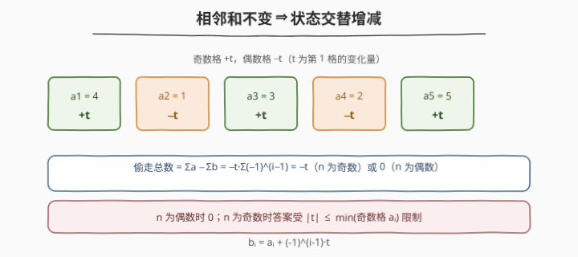
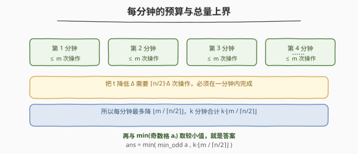

# Codeforces 89A Robbery 题解

## 1. 题目概述

- **题目链接**：https://codeforces.com/problemset/problem/89/A
- **比赛来源**：Codeforces Beta Round 74 (Div. 1 Only) · Problem A（UTC 2011-06-16）
- **难度**：1800
- **标签**：贪心、数学
- **评测类型**：普通
- **限制**：时间 1 s / 内存 256 MB

**题意**：金库有 $n$ 个格子排成一行，第 $i$ 格有 $a_i$ 颗钻石。安保系统每分钟检查一次**所有相邻两格之和**（共 $n-1$ 个和）；只要某次检查的和与上一次不同就报警。Joe 在两次检查之间最多做 $m$ 次"移动"，一次移动指：把一颗钻石从某格移到另一格、从某格放进自己口袋、或者从口袋放进某格。他还有 $k$ 分钟就要离开，每分钟最多 $m$ 次操作。要求离开时（以及离开之后）系统都不能报警，求最多能带走多少颗钻石。

**约束**：

- $n \le 10^4$，$m, k \le 10^9$：答案与操作次数的乘积可达 $10^{18}$ 量级，必须用 64 位整数；不能用"逐分钟模拟"。
- $a_i \le 10^5$：钻石总数只有 $10^9$ 量级，但答案还受操作次数限制。
- $n$ 的奇偶性起决定作用（见下），$n=1$ 时没有"相邻和"，是退化情形。
- 每分钟都有独立的 $m$ 次操作上限，因此**不能**把 $k$ 分钟的总操作数简单相加就完事（见 3.2 的"每分钟粒度"）。

## 2. 示例与观察

官方样例 1（输入 / 输出原样）：

```text
输入：
2 3 1
2 3

输出：
0
```

官方样例 2（输入 / 输出原样）：

```text
输入：
3 2 2
4 1 3

输出：
2
```

**样例 1 走查**：$n = 2$，只有一个相邻和 $a_1 + a_2 = 5$。无论怎么在两个格子间搬钻石，这个和不变；要让系统不报警，最终两格之和必须还是 $5$，所以一颗钻石也偷不走，答案 $0$。

**样例 2 走查**：$n = 3$，初始 $4, 1, 3$。题面提示的做法：第一分钟把 $1$ 格的钻石移到 $2$ 格、把 $3$ 格的一颗放进袋子，变成 $3, 2, 2$（相邻和仍是 $5, 4$）；第二分钟把 $3$ 格的一颗移到 $2$ 格、把 $1$ 格的一颗放进袋子，变成 $2, 3, 1$（相邻和仍是 $5, 4$）。两个钻石进袋，答案 $2$。

**观察 1**：设最终状态为 $b_1, \dots, b_n$，条件"每个相邻和都不变"就是

$$b_i + b_{i+1} = a_i + a_{i+1}, \qquad i = 1, \dots, n-1.$$

记 $d_i = b_i - a_i$，则 $d_i + d_{i+1} = 0$，即 $d$ **正负交替**：$d_1 = t$，$d_2 = -t$，$d_3 = t$，……

**观察 2**：偷走的钻石总数是

$$\sum a_i - \sum b_i = -\sum_{i=1}^{n} (-1)^{i-1} t = \begin{cases} -t, & n \text{ 为奇数},\\ 0, & n \text{ 为偶数}.\end{cases}$$

所以 **$n$ 为偶数时答案恒为 $0$**；$n$ 为奇数时答案就是 $|t|$（$t \le 0$）。

**观察 3**：搬动 $|t|$ 颗钻石需要多少次操作？$t<0$ 时奇数格每格少 $|t|$、偶数格每格多 $|t|$。钻石从奇数格离开：共 $\lceil n/2 \rceil \cdot |t|$ 颗，其中 $\lfloor n/2 \rfloor \cdot |t|$ 颗填进偶数格、剩下的 $|t|$ 颗进袋。每颗"离开某格"的钻石恰好对应一次操作，所以总操作数 $= \lceil n/2 \rceil \cdot |t|$。

## 3. 解题思路

### 3.1 朴素做法与瓶颈

暴力做法是按分钟模拟 Joe 的每次移动。但要模拟就得知道"这一分钟该搬多少"，而搬多少又取决于总量，形成循环依赖；而且 $m, k$ 高达 $10^9$，逐分钟模拟直接超时。

真正的瓶颈是**理解不变量的结构**：相邻和不变意味着状态只能沿一个参数 $t$ 滑动（观察 1），于是问题从"高维状态"塌缩成"一维参数"。

### 3.2 核心观察：状态是一维的，代价是线性的



设 $t = d_1 = b_1 - a_1$。则

$$b_i = a_i + (-1)^{i-1} t .$$

非负约束 $b_i \ge 0$ 给出

- 奇数 $i$：$t \ge -a_i$，即 $t \ge -\min_{i \text{ 奇}} a_i$；
- 偶数 $i$：$t \le a_i$，即 $t \le \min_{i \text{ 偶}} a_i$。

要偷钻石（$t<0$），只需 $|t| \le \min_{i \text{ 奇}} a_i$；偶数格只会变多，自动合法。

**每分钟的粒度**：一小时内总操作数不能超过 $m k$，但**每分钟**都只能做 $m$ 次。把 $t$ 从旧值改到新值、净变化 $\Delta$，需要 $\lceil n/2 \rceil |\Delta|$ 次操作，必须全部落在同一分钟内（因为每分钟结束后检查，状态必须合法）。所以每分钟最多把 $t$ 降低

$$\left\lfloor \frac{m}{\lceil n/2 \rceil} \right\rfloor,$$

$k$ 分钟合计最多降低 $k \cdot \left\lfloor \dfrac{m}{\lceil n/2 \rceil} \right\rfloor$。

于是答案

$$\text{ans} = \min\left( \min_{i \text{ 奇}} a_i,\ k \cdot \left\lfloor \frac{m}{\lceil n/2 \rceil} \right\rfloor \right).$$

$n$ 为偶数时答案 $0$；$n = 1$ 时 $\lceil n/2 \rceil = 1$、没有相邻和约束，公式给出 $\min(a_1, mk)$，正好是"一颗一颗往口袋搬"的结果。

### 3.3 算法流程



1. 读入 $n, m, k$ 与数组 $a$；
2. 若 $n$ 为偶数：输出 $0$，结束；
3. 令 $\text{oddCnt} = \lceil n/2 \rceil = (n+1)/2$，$\text{minOdd} = \min(a_1, a_3, a_5, \dots)$；
4. 输出 $\min\bigl(\text{minOdd},\ k \cdot (m / \text{oddCnt})\bigr)$（整除）。

### 3.4 样例走查

| 输入 | $n$ 奇偶 | oddCnt | minOdd | 每分钟可降 | 答案 |
|------|----------|--------|--------|------------|------|
| `2 3 1` / `2 3` | 偶 | — | — | — | 0 |
| `3 2 2` / `4 1 3` | 奇 | 2 | $\min(4,3)=3$ | $2/2=1$ | $\min(3, 2 \times 1)=2$ |
| `1 5 3` / `7` | 奇 | 1 | 7 | 5 | $\min(7, 15)=7$ |
| `5 1 4` / `1 2 3 5 6` | 奇 | 3 | $\min(1,3,6)=1$ | $1/3=0$ | 0 |
| `3 3 1` / `10 10 10` | 奇 | 2 | 10 | $3/2=1$ | 1 |

自造样例（标注"自造"）：

| 输入 | 输出 | 说明 |
|------|------|------|
| `1 1 1` / `5` | 1 | 单格，一分钟搬一颗 |
| `2 1000000000 1000000000` / `100000 100000` | 0 | 偶数格，偷不走 |
| `3 1000000000 1000000000` / `100000 0 100000` | 100000 | 受 minOdd 限制 |
| `3 1 1000000000` / `100000 0 100000` | 0 | 每分钟连一颗都搬不动 |

## 4. 正确性证明

**引理 1（状态一维化）**：相邻和全部不变，当且仅当存在整数 $t$ 使 $b_i = a_i + (-1)^{i-1} t$（对所有 $i$）。

**证明**：必要条件：令 $d_i = b_i - a_i$，则 $d_i + d_{i+1} = 0$ 对每个 $i$ 成立，于是 $d_{i+1} = -d_i$，归纳得 $d_i = (-1)^{i-1} d_1$，取 $t = d_1$。充分性：若 $b_i - a_i = (-1)^{i-1}t$，则相邻两项之差的和 $d_i + d_{i+1} = 0$，即相邻和不变。∎

**引理 2（偷走的总数）**：在引理 1 的状态下，偷走的钻石数为 $-\sum_i d_i = -t \cdot \bigl(1 \text{ 若 } n \text{ 奇}，0 \text{ 若 } n \text{ 偶}\bigr)$。

**证明**：$\sum_i d_i = t \sum_i (-1)^{i-1}$，而 $\sum_{i=1}^{n}(-1)^{i-1}$ 在 $n$ 为奇数时等于 $1$、偶数时等于 $0$。偷走数 $= \sum a_i - \sum b_i = -\sum d_i$。∎

**引理 3（操作次数）**：把状态从参数 $t$ 改到 $t'$（$t' < t$）需要 $(\lceil n/2\rceil)(t - t')$ 次操作，且这是最少次数。

**证明**：奇数格共 $c = \lceil n/2 \rceil$ 个，每格减少 $t - t'$ 颗，合计 $c(t-t')$ 颗钻石必须离开奇数格（去偶数格或口袋）；每次操作最多让一颗钻石离开一个格子，故下界为 $c(t-t')$。构造：把每颗离开的钻石直接移到目标（偶数格或口袋），恰好 $c(t-t')$ 次操作，达到下界。∎

**引理 4（非负约束）**：$t<0$ 的状态合法（$b_i \ge 0$）当且仅当 $|t| \le \min_{i \text{ 奇}} a_i$。

**证明**：奇数 $i$：$b_i = a_i + t \ge 0 \iff |t| \le a_i$；偶数 $i$：$b_i = a_i - t = a_i + |t| \ge 0$ 恒成立。取所有奇数格的最小值即得。∎

**引理 5（每分钟预算）**：每个分钟内 $t$ 最多降低 $\lfloor m / \lceil n/2 \rceil \rfloor$。

**证明**：由引理 3，降低 $\Delta$ 需要 $\lceil n/2 \rceil \Delta$ 次操作，而每分钟最多 $m$ 次，故 $\Delta \le m/\lceil n/2\rceil$，取整得下界式。∎

**定理**：算法输出的就是 Joe 能带走的最大钻石数。

**证明**：由引理 2，$n$ 为偶数时偷走数恒为 $0$，算法输出 $0$ 正确。$n$ 为奇数时偷走数 $= -t$，由引理 4 得 $|t| \le \min_{\text{奇}} a_i$，由引理 5 得 $k$ 分钟内合计 $|t| \le k\lfloor m/\lceil n/2\rceil\rfloor$；两方面同时取到上界（每分钟都按上限降低即可，且 $t$ 一路只降不升，中间状态全部合法），故上界可达，算法输出即最大值。∎

## 5. 复杂度分析

- **时间**：$O(n)$ 读入并求奇数位最小值，其余 $O(1)$；$n \le 10^4$，微不足道。
- **空间**：$O(n)$ 存数组（也可以边读边求，$O(1)$）。
- **数值范围**：$m,k \le 10^9$，但公式用整除与乘法 $k \cdot (m/\text{oddCnt})$：$m/\text{oddCnt} \le 10^9$，乘 $k$ 后最多 $10^{18}$，`long long` 恰好装得下（$< 9.2 \times 10^{18}$）。
- **与时限的关系**：1 s 时限下余量极大；实测 $n = 10^4$（输入约 $58$ KB）时 C++ 端到端约 $23$ ms，其中大部分是本机 libc++ 用 `cin` 读入的开销。

## 6. 参考代码

### C++17

```cpp
#include <bits/stdc++.h>
using namespace std;
typedef long long ll;

int main() {
    ios::sync_with_stdio(false);
    cin.tie(nullptr);

    ll n, m, k;
    if (!(cin >> n >> m >> k)) return 0;
    vector<ll> a(n);
    for (int i = 0; i < n; ++i) cin >> a[i];

    // 相邻和不变 ⇒ b_i = a_i + (-1)^{i-1} t，t 为第 1 格的变化量。
    // n 为偶数时 Σd_i = 0，钻石总数不变，一分也偷不走。
    if (n % 2 == 0) { cout << 0 << '\n'; return 0; }

    // n 为奇数：偷走 -t 颗（t ≤ 0），操作次数 = 奇数格个数 × |t|
    ll oddCnt = (n + 1) / 2;
    ll minOdd = LLONG_MAX;
    for (int i = 0; i < n; i += 2) minOdd = min(minOdd, a[i]);
    // 每分钟内改变 |Δ| 需要 oddCnt*|Δ| 次操作，所以每分钟最多降 m/oddCnt
    ll perMinute = m / oddCnt;
    ll ans = min(minOdd, perMinute * k);
    cout << ans << '\n';
    return 0;
}
```

### Python3

```python
import sys


def main() -> None:
    data = sys.stdin.buffer.read().split()
    n, m, k = int(data[0]), int(data[1]), int(data[2])
    a = [int(x) for x in data[3:3 + n]]

    if n % 2 == 0:
        sys.stdout.write("0\n")
        return

    odd_cnt = (n + 1) // 2
    min_odd = min(a[0::2])
    per_minute = m // odd_cnt
    sys.stdout.write(str(min(min_odd, per_minute * k)) + "\n")


main()
```

两份代码都只用标准库，可原样提交。

## 7. 边界情况与易错点

1. **$n$ 为偶数**：答案恒为 $0$（总钻石数不变）。若没注意这一点去做"贪心搬钻石"，会得到错误的非零答案。
2. **把总操作数当成 $mk$ 直接除**：`min(minOdd, m*k/oddCnt)` 是错的。每分钟都独立有 $m$ 次上限，改变 $\Delta$ 必须在一分钟内完成，所以正确式子是 $k \cdot \lfloor m/\text{oddCnt} \rfloor$。例如 `3 1 100` 时 $m < \text{oddCnt}$，一颗也搬不动，答案应为 $0$ 而不是 $100/2=50$。
3. **整除方向**：$m/\text{oddCnt}$ 必须向下取整（多出来的操作数不够改变 $1$ 个单位）。
4. **$n = 1$**：没有相邻和，任何数量的钻石都能直接搬进袋子，公式 $\min(a_1, mk)$ 自动给出正确答案；不要因为"没有相邻和"而特判成 $0$。
5. **`long long` 溢出**：$m/\text{oddCnt}$ 最大 $10^9$，乘 $k$ 最大 $10^{18}$；若先算 $m \cdot k$ 再除，虽然本题 $10^{18}$ 仍在范围内，但若约束放大就会溢出，写成先除后乘更稳。
6. **$a_i = 0$**：$\min_{\text{奇}} a_i = 0$ 时答案 $0$，正确（奇数格没钻石可偷）。
7. **中间状态必须合法**：$t$ 只能单调下降（只偷钻石），所以中途状态都满足非负约束；若允许"先多搬再还回去"反而浪费操作。
8. **输入只有一组**：不要写多测循环。

## 8. 验证记录

- **编译环境与命令**：本机无 GNU `g++`，用 `Apple clang 21.0.0` + 仓库自带 `codeforces/tools/include/bits/stdc++.h` 兼容头（`clang++ -std=c++17 -O2 -I codeforces/tools/include`）编译；Python 为 `Python 3.9.6`。
- **官方样例**：2 / 2 通过（`2 3 1 / 2 3` → 0，`3 2 2 / 4 1 3` → 2）。
- **额外测试（按分钟 DP 对拍）**：另写一份不使用任何公式的暴力——状态是参数 $t$，逐分钟枚举所有合法的 $|\Delta|$（满足 $\lceil n/2\rceil|\Delta| \le m$ 且新状态非负），共 $k$ 轮，最后取最大的 $-\min t$。对 400 组随机小数据（$n \le 7$、$a_i \le 6$、$m \le 6$、$k \le 5$）与 C++、Python 两个实现三方比对，**400 / 400 全部一致**。
- **最大约束性能**：$n = 10^4$、$m = k = 10^9$ 时 C++ 端到端 10 次平均 $23.4$ ms（主要是读 $10^4$ 个数的 I/O）、Python $16.6$ ms；算法本体只有 $O(n)$ 的一次扫描，相对 1 s 时限余量在 40 倍以上。
- **图片校验**：两张 SVG（`cf89a_alternating.svg`、`cf89a_budget.svg`）通过 `xml.etree.ElementTree.parse`，文本块估算未越出 `viewBox`。
- **公式校验**：KaTeX（`throwOnError: true`）渲染无报错。
- **复核状态**：verified。

## 相关题目与扩展

- [Codeforces 89B Widget Library](https://codeforces.com/problemset/problem/89/B)：同场 B 题，表达式解析 + DAG 上的 DP。
- [Codeforces 117B Very Interesting Game](https://codeforces.com/problemset/problem/117/B)：数论构造，同样是"从整除/余数结构里找不变量"。
- [Codeforces 147B Smile House](https://codeforces.com/problemset/problem/147/B)：时间维度上的 DP，与本篇的"每分钟预算"思路相近。
- [LeetCode 121. 买卖股票的最佳时机](https://leetcode.cn/problems/best-time-to-buy-and-sell-stock/)：单变量状态扫描的入门。
- [LeetCode 122. 买卖股票的最佳时机 II](https://leetcode.cn/problems/best-time-to-buy-and-sell-stock-ii/)：贪心累加的经典。

**延伸思考**：

1. **如果约束改成"相邻差的绝对值不变"**：不变量结构完全不同（变成 $b_i - b_{i+1} = \pm(a_i - a_{i+1})$），状态不再是一维的，问题会难很多。
2. **如果 Joe 的目标不是总量而是"最后每格尽量少"**：那就要在 $t$ 的可行区间里选，涉及多目标，可能要用 DP。
3. **如果每次操作可以在相邻格之间搬（而不是任意两格）**：每颗钻石的搬运成本变成距离，总操作数变成"最小费用流"，答案会依赖具体的距离分布。
4. **如果 $k$ 分钟之间不允许"闲置"**（必须每分钟都做满 $m$ 次操作）：只要总操作数不超过 $mk$ 仍可行（把多出来的操作在相邻格之间来回搬即可），所以本题的答案不变；这也是题面没有额外限制的原因。
