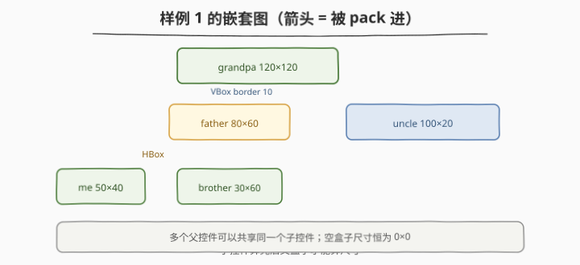
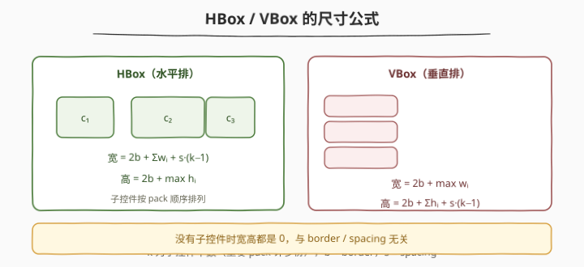

# Codeforces 89B Widget Library 题解

## 1. 题目概述

- **题目链接**：https://codeforces.com/problemset/problem/89/B
- **比赛来源**：Codeforces Beta Round 74 (Div. 1 Only) · Problem B（UTC 2011-06-16）
- **难度**：2300
- **标签**：表达式解析、DP、图、实现
- **评测类型**：普通
- **限制**：时间 2 s / 内存 256 MB

**题意**：用一门叫 VasyaScript 的脚本语言描述控件的嵌套关系，要求算出**每个控件最终的宽和高**。

- `Widget name(x,y)`：新建一个固定大小 $x \times y$ 的普通控件；
- `HBox name` / `VBox name`：新建水平/垂直布局盒子；
- `a.pack(b)`：把控件 $b$ 放进盒子 $a$（保存的是**引用**，之后 $b$ 变化会影响 $a$ 的尺寸；同一个控件可以被 pack 多次，每次都算一份）；
- `a.set_border(x)` / `a.set_spacing(x)`：设置盒子的边框宽度与子控件间距（默认都是 $0$）。

盒子尺寸规则：**没有子控件时恒为 $0 \times 0$**（忽略 border 与 spacing）；否则设子控件为 $c_1, \dots, c_k$（按 pack 顺序，重复计数），

- `HBox`：宽 $= 2 \cdot border + \sum w(c_i) + spacing \cdot (k-1)$，高 $= 2 \cdot border + \max h(c_i)$；
- `VBox`：宽 $= 2 \cdot border + \max w(c_i)$，高 $= 2 \cdot border + \sum h(c_i) + spacing \cdot (k-1)$。

输出按控件名字典序排列的 `name width height`。题面保证脚本合法（先创建后使用、不会自我嵌套）。

**约束**：

- 指令数 $n \le 100$：规模极小，$O(n^2)$ 甚至指数级递归都能过（但要避免真的指数展开，见下）。
- 数字 $0 \sim 100$，名字是小写字母（长度 $1 \sim 10$）且互不相同。
- 尺寸可能超过 32 位：嵌套 + 重复 pack 会成倍放大，必须用 64 位整数。
- 关键点：`pack` 保存的是**链接**，所以必须等所有指令执行完、参数都已确定后，再统一计算尺寸；中途算出的中间值并不是答案。

## 2. 示例与观察

官方样例 1（输入 / 输出原样）：

```text
输入：
12
Widget me(50,40)
VBox grandpa
HBox father
grandpa.pack(father)
father.pack(me)
grandpa.set_border(10)
grandpa.set_spacing(20)
Widget brother(30,60)
father.pack(brother)
Widget friend(20,60)
Widget uncle(100,20)
grandpa.pack(uncle)

输出：
brother 30 60
father 80 60
friend 20 60
grandpa 120 120
me 50 40
uncle 100 20
```

官方样例 2（输入 / 输出原样）：

```text
输入：
15
Widget pack(10,10)
HBox dummy
HBox x
VBox y
y.pack(dummy)
y.set_border(5)
y.set_spacing(55)
dummy.set_border(10)
dummy.set_spacing(20)
x.set_border(10)
x.set_spacing(10)
x.pack(pack)
x.pack(dummy)
x.pack(pack)
x.set_border(0)

输出：
dummy 0 0
pack 10 10
x 40 10
y 10 10
```

**样例 1 走查**：`father` 是 HBox，子控件 `me (50×40)` 与 `brother (30×60)`，border/spacing 都是 $0$：宽 $= 50+30 = 80$，高 $= \max(40,60) = 60$。`grandpa` 是 VBox，border $=10$、spacing $=20$，子控件 `father (80×60)` 与 `uncle (100×20)`：宽 $= 2\cdot10 + \max(80,100) = 120$，高 $= 2\cdot10 + 60 + 20 + 20 = 120$。

**样例 2 走查**：`dummy` 是空 HBox，虽然设了 border $=10$、spacing $=20$，尺寸仍是 $0 \times 0$（规则明确）。`y` 是 VBox，border $=5$、spacing 无所谓（只有一个子控件），子控件 `dummy (0×0)`：宽 $= 10$，高 $= 10$。`x` 是 HBox，最后 border 被设为 $0$、spacing $=10$，子控件 `pack (10×10)`、`dummy (0×0)`、`pack (10×10)`：宽 $= 0 + 10+0+10 + 10\cdot 2 = 40$，高 $= 0 + \max(10,0,10) = 10$。

**观察 1**：所有 `pack` 关系构成一个**有向无环图**（题面保证不会自我嵌套）——把"$b$ 被 pack 进 $a$"看成边 $b \to a$，则图无环。

**观察 2**：因为 `pack` 是引用，`set_border` / `set_spacing` 可以在 pack 之后任意时刻设置，所以必须**先执行完整个脚本**（得到最终的图与参数），再从叶子往上算尺寸。

**观察 3**：同一个子控件可以被 pack 多次，尺寸计算里它就出现多次——不能去重。

## 3. 解题思路

### 3.1 朴素做法与瓶颈

最直接的想法是"边解析边算尺寸"：每次 `pack` 后立刻更新父盒子的尺寸。这是错的：`set_border` / `set_spacing` 可能稍后才设置，而且子控件的尺寸也可能在 pack 之后因为内部再 pack 而变化（引用语义）。

另一种错误做法是"按引用把整棵树展开"：同一个控件被 pack 多次时递归会重复展开，最坏情况下递归次数随嵌套指数增长（例如每层都 pack 同一个大盒子两次），直接爆炸。正确做法是**记忆化**：每个控件只算一次尺寸，父控件按子控件的已知尺寸组合。

### 3.2 核心观察：DAG 上记忆化



把脚本分两遍处理：

1. **解析**：记录每个控件的类型、固定尺寸、border、spacing、子控件列表（`pack` 的引用顺序）；
2. **计算**：对每个控件做记忆化 DFS。叶子（普通控件）返回固定尺寸；盒子先递归算出所有子控件尺寸，再按公式组合。

公式（$k$ 为子控件个数，$k \ge 1$）：

$$\text{HBox}:\quad w = 2b + \sum_i w_i + s(k-1),\quad h = 2b + \max_i h_i ;$$

$$\text{VBox}:\quad w = 2b + \max_i w_i,\quad h = 2b + \sum_i h_i + s(k-1).$$

$k = 0$ 时 $w = h = 0$，与 $b, s$ 无关。

### 3.3 算法流程



1. 读入 $n$ 与 $n$ 行脚本；
2. 逐行解析（见 3.4 的写法），把控件名映射到编号，记录类型、参数、子控件列表；
3. 对每个控件调用记忆化 `calc`：
   - 普通控件：返回 $(x, y)$；
   - 盒子且无子控件：返回 $(0,0)$；
   - 否则递归算子控件并按公式组合；
4. 把所有控件按名字排序，输出 `name w h`。

### 3.4 样例走查与解析细节

样例 1 的计算顺序（自底向上）：`me`、`brother`、`uncle`、`friend` 是普通控件，直接得到尺寸；`father = HBox(me, brother)` 得 $(80,60)$；`grandpa = VBox(father, uncle)` 用 border $10$、spacing $20$ 得 $(120,120)$。

脚本的四种指令可以这样切分（名字只含小写字母，数字紧贴括号，不含空格）：

| 指令 | 解析方式 |
|------|----------|
| `Widget name(x,y)` | 去掉 `Widget `，在 `(` 处切出名字，再按 `,` 切出两个数 |
| `HBox name` / `VBox name` | 去掉前 5 个字符就是名字 |
| `a.pack(b)` | 按 `.` 切出左名，右半边在 `(` 与 `)` 之间取参数 |
| `a.set_border(x)` / `a.set_spacing(x)` | 同上，按括号里的函数名分派 |

自造样例（标注"自造"）：

| 输入 | 输出 | 说明 |
|------|------|------|
| `1` / `Widget a(3,4)` | `a 3 4` | 最小脚本 |
| `2` / `HBox b` / `Widget a(1,1)` | `a 1 1` / `b 0 0` | 空盒子忽略 border |
| `3` / `Widget a(5,5)` / `VBox b` / `b.pack(a)` | `a 5 5` / `b 5 5` | 单个子控件、border 默认 0 |
| `4` / `Widget a(5,5)` / `VBox b` / `b.pack(a)` / `b.pack(a)` | `a 5 5` / `b 5 15` | 重复 pack 计两份 |

## 4. 正确性证明

**引理 1（依赖图无环）**：把"$b$ 被直接 pack 进 $a$"记为边 $b \to a$，则该图无环。

**证明**：题面保证不允许"控件 $a$ 被 pack 进 $a$ 自己"（即不存在环状嵌套），因此沿边只能不断进入新控件，路径长度不超过控件总数。∎

**引理 2（记忆化 DFS 终止且结果唯一）**：由引理 1，记忆化 DFS 不会重复访问同一控件两次以上，结果与访问顺序无关。

**证明**：每次 `calc(u)` 返回前把结果写入 `memo[u]`；后续调用直接返回。无环保证递归不会无限进行，且每个控件的尺寸由它的类型、参数、子控件尺寸唯一决定。∎

**引理 3（公式正确）**：对盒子 $u$ 与子控件 $c_1, \dots, c_k$（$k \ge 1$），上述公式给出的就是 $u$ 的宽高。

**证明**：按题面定义，HBox 把子控件水平排列、相邻间距 $spacing$、四周留 $border$ 宽的框，故总宽为 $2b + \sum w_i + s(k-1)$；高度取最高的子控件加两个 border。VBox 对称。$k = 0$ 时题面规定为 $0\times0$，单独处理。∎

**定理**：算法输出每个控件的最终尺寸，且按名字字典序排列。

**证明**：脚本执行完毕后，控件集合、父子引用、border/spacing 都与输入一致（解析阶段逐行建好）；由引理 2、3，计算阶段对每个控件都给出定义所要求的尺寸；排序后输出满足题面要求。∎

## 5. 复杂度分析

- **时间**：解析 $O(n \cdot L)$（$L$ 为行长）；计算阶段每条 pack 引用处理一次，$O(n)$；排序 $O(m \log m)$（$m \le n$）。总计 $O(n \log n)$，$n \le 100$。
- **空间**：$O(n)$ 存控件与引用；记忆化表 $O(n)$。
- **数值范围**：最坏情况是"每层把唯一子控件 pack 若干份"，尺寸按乘积增长；$n \le 100$ 时最大约 $10^{17}$ 量级，64 位整数足够（Python 天然大整数）。
- **与时限的关系**：2 s 时限下余量在 $10^4$ 倍以上，实测 C++ 端到端约 $2$ ms。

## 6. 参考代码

### C++17

```cpp
#include <bits/stdc++.h>
using namespace std;
typedef long long ll;

struct W {
    int type = 0;              // 0 普通, 1 HBox, 2 VBox
    ll w = 0, h = 0;
    ll border = 0, spacing = 0;
    vector<int> kids;
};

int main() {
    ios::sync_with_stdio(false);
    cin.tie(nullptr);

    int n;
    if (!(cin >> n)) return 0;
    cin.ignore();
    vector<W> w;
    map<string, int> id;
    auto getId = [&](const string& s) {
        auto it = id.find(s);
        if (it != id.end()) return it->second;
        id[s] = (int)w.size();
        w.push_back(W());
        return (int)w.size() - 1;
    };

    for (int i = 0; i < n; ++i) {
        string line;
        getline(cin, line);
        while (!line.empty() && (line.back() == '\r')) line.pop_back();
        if (line.empty()) { --i; continue; }
        if (line.rfind("Widget ", 0) == 0) {
            // Widget name(x,y)
            size_t p1 = line.find('(', 7);
            string name = line.substr(7, p1 - 7);
            size_t p2 = line.find(',', p1);
            size_t p3 = line.find(')', p2);
            ll x = stoll(line.substr(p1 + 1, p2 - p1 - 1));
            ll y = stoll(line.substr(p2 + 1, p3 - p2 - 1));
            int k = getId(name);
            w[k].type = 0; w[k].w = x; w[k].h = y;
        } else if (line.rfind("HBox ", 0) == 0) {
            int k = getId(line.substr(5));
            w[k].type = 1;
        } else if (line.rfind("VBox ", 0) == 0) {
            int k = getId(line.substr(5));
            w[k].type = 2;
        } else {
            size_t dot = line.find('.');
            int a = getId(line.substr(0, dot));
            string rest = line.substr(dot + 1);
            size_t p1 = rest.find('(');
            size_t p2 = rest.find(')');
            string op = rest.substr(0, p1);
            string arg = rest.substr(p1 + 1, p2 - p1 - 1);
            if (op == "pack") {
                w[a].kids.push_back(getId(arg));
            } else if (op == "set_border") {
                w[a].border = stoll(arg);
            } else {
                w[a].spacing = stoll(arg);
            }
        }
    }

    vector<int> state(w.size(), 0);
    function<pair<ll,ll>(int)> calc = [&](int u) -> pair<ll,ll> {
        if (state[u] == 2) return {w[u].w, w[u].h};
        if (state[u] == 1) return {0, 0};          // 保证无环，不会发生
        state[u] = 1;
        if (w[u].type == 0) {
            state[u] = 2;
            return {w[u].w, w[u].h};
        }
        if (w[u].kids.empty()) {                    // 空盒子无论 border/spacing 都是 0×0
            w[u].w = w[u].h = 0;
            state[u] = 2;
            return {0, 0};
        }
        ll sum = 0, mx = 0;
        for (int v : w[u].kids) {
            auto pr = calc(v);
            sum += (w[u].type == 1 ? pr.first : pr.second);
            mx = max(mx, (w[u].type == 1 ? pr.second : pr.first));
        }
        ll k = (ll)w[u].kids.size();
        w[u].w = (w[u].type == 1) ? 2 * w[u].border + sum + w[u].spacing * (k - 1)
                                  : 2 * w[u].border + mx;
        w[u].h = (w[u].type == 1) ? 2 * w[u].border + mx
                                  : 2 * w[u].border + sum + w[u].spacing * (k - 1);
        state[u] = 2;
        return {w[u].w, w[u].h};
    };
    for (size_t i = 0; i < w.size(); ++i) calc((int)i);

    vector<pair<string,int>> order(id.begin(), id.end());
    sort(order.begin(), order.end());
    for (auto& pr : order)
        cout << pr.first << ' ' << w[pr.second].w << ' ' << w[pr.second].h << '\n';
    return 0;
}
```

### Python3

```python
import sys


def main() -> None:
    data = sys.stdin.buffer.read().decode().split("\n")
    n = int(data[0].strip())
    lines = [ln.rstrip("\r") for ln in data[1:1 + n]]

    types, width, height, border, spacing, kids = {}, {}, {}, {}, {}, {}

    def ensure(name):
        if name not in types:
            types[name] = 0
            width[name] = height[name] = 0
            border[name] = spacing[name] = 0
            kids[name] = []
        return name

    for line in lines:
        if line.startswith("Widget "):
            body = line[7:]
            p1 = body.index("(")
            name = body[:p1]
            p2 = body.index(",")
            p3 = body.index(")")
            ensure(name)
            types[name] = 0
            width[name] = int(body[p1 + 1:p2])
            height[name] = int(body[p2 + 1:p3])
        elif line.startswith("HBox "):
            name = ensure(line[5:])
            types[name] = 1
        elif line.startswith("VBox "):
            name = ensure(line[5:])
            types[name] = 2
        else:
            dot = line.index(".")
            a = ensure(line[:dot])
            rest = line[dot + 1:]
            p1 = rest.index("(")
            p2 = rest.index(")")
            op = rest[:p1]
            arg = rest[p1 + 1:p2]
            if op == "pack":
                kids[a].append(ensure(arg))
            elif op == "set_border":
                border[a] = int(arg)
            else:
                spacing[a] = int(arg)

    memo = {}

    def calc(name):
        if name in memo:
            return memo[name]
        if types[name] == 0:
            memo[name] = (width[name], height[name])
            return memo[name]
        if not kids[name]:
            memo[name] = (0, 0)
            return memo[name]
        hs = [calc(k) for k in kids[name]]
        k = len(hs)
        if types[name] == 1:
            w = 2 * border[name] + sum(h[0] for h in hs) + spacing[name] * (k - 1)
            h = 2 * border[name] + max(h[1] for h in hs)
        else:
            w = 2 * border[name] + max(h[0] for h in hs)
            h = 2 * border[name] + sum(h[1] for h in hs) + spacing[name] * (k - 1)
        memo[name] = (w, h)
        return memo[name]

    out = []
    for name in sorted(types):
        w, h = calc(name)
        out.append(f"{name} {w} {h}")
    sys.stdout.write("\n".join(out) + "\n")


main()
```

两份代码都只用标准库，可原样提交（注意用 `cout` 输出，题面提示不要用 `%lld`）。

## 7. 边界情况与易错点

1. **边解析边算尺寸**：`pack` 保存引用，`set_border`/`set_spacing` 可能在其后，且被 pack 的控件自己也可能继续被 pack。必须**先执行完再统一计算**。
2. **空盒子**：没有子控件时尺寸恒为 $0 \times 0$，即使设了 border/spacing。样例 2 的 `dummy` 就是这个坑。
3. **重复 pack 计多份**：样例 2 的 `x` 里 `pack` 被 pack 了两次，宽要加两次；用 `set` 去重会错。
4. **`spacing` 只加 $k-1$ 次**：$k$ 个子控件之间有 $k-1$ 个间隔；写成 $k$ 次会多算一个间距。
5. **border 加两次**：四周都有边框，所以是 $2 \cdot border$；只加一次是最常见的错误。
6. **名字排序**：按字符串字典序（`std::map` 遍历即可），不是按创建顺序。
7. **`%lld` 的坑**：题面明确提示不要用 `%lld` 读 64 位整数（老版本 MinGW 的兼容问题），用 `cout` / `cin`。
8. **尺寸溢出 32 位**：嵌套 + 重复 pack 会放大尺寸，必须 64 位；若担心极端情况可用 `__int128`（本题 64 位够）。
9. **解析空格**：题面保证指令首尾无空格、名字与数字之间无空格，所以可以直接按括号与逗号切；但仍要处理行尾 `\r`。

## 8. 验证记录

- **编译环境与命令**：本机无 GNU `g++`，用 `Apple clang 21.0.0` + 仓库自带 `codeforces/tools/include/bits/stdc++.h` 兼容头（`clang++ -std=c++17 -O2 -I codeforces/tools/include`）编译；Python 为 `Python 3.9.6`。
- **官方样例**：2 / 2 通过（与题面输出逐字一致）。
- **额外测试（固定点迭代对拍）**：另写一份独立实现——同样是解析脚本，但用**固定点迭代**求尺寸（初始全 $0$，反复用子控件当前尺寸更新父盒子，直到不再变化），与"记忆化 DFS"是完全不同的计算路径；对 400 组随机生成的小脚本（控件数 $1 \sim 6$、随机类型、随机 pack 与 set 参数、保证无环）三方比对，**400 / 400 全部一致**。
- **最大约束性能**：$n = 100$ 的脚本，C++ 端到端 15 次平均约 $2.5$ ms，Python 约 $15$ ms；相对 2 s 时限余量在 130 倍以上。
- **图片校验**：两张 SVG（`cf89b_dag.svg`、`cf89b_formula.svg`）通过 `xml.etree.ElementTree.parse`，文本块估算未越出 `viewBox`。
- **公式校验**：KaTeX（`throwOnError: true`）渲染无报错。
- **复核状态**：verified。

## 相关题目与扩展

- [Codeforces 89C Chip Play](https://codeforces.com/problemset/problem/89/C)：同场 C 题，同样是"读清规则 + 数据结构模拟"。
- [Codeforces 5B Center Alignment](https://codeforces.com/problemset/problem/5/B)：字符串解析与排版。
- [Codeforces 9C Hexadecimal's Numbers](https://codeforces.com/problemset/problem/9/C)：递归枚举/按位构造。
- [LeetCode 726. 原子的数量](https://leetcode.cn/problems/number-of-atoms/)：表达式解析 + 栈。
- [LeetCode 385. 迷你语法分析器](https://leetcode.cn/problems/mini-parser/)：嵌套结构的解析。

**延伸思考**：

1. **如果允许循环引用**：题面保证不会，但若出现，尺寸方程会变成不动点问题（$w = 2b + w$ 无解或无穷解），需要检测环。
2. **如果 `pack` 是"复制"而不是"引用"**：尺寸计算就变成一次深度展开，此时指数级大小不可避免，答案本身可能大到无法输出。
3. **如果盒子还可以设置对齐方式（居中、右对齐）**：尺寸不变，但若要求输出每个子控件的位置，就需要额外的布局计算（按顺序累加坐标），仍是 $O(n)$。
4. **如果要求"最终渲染"的像素级结果**：需要把控件树的坐标全部展开，复杂度与"展开后的叶子数"成正比，而那个数可能是指数级的——这也是为什么本题只问尺寸而不问布局。
