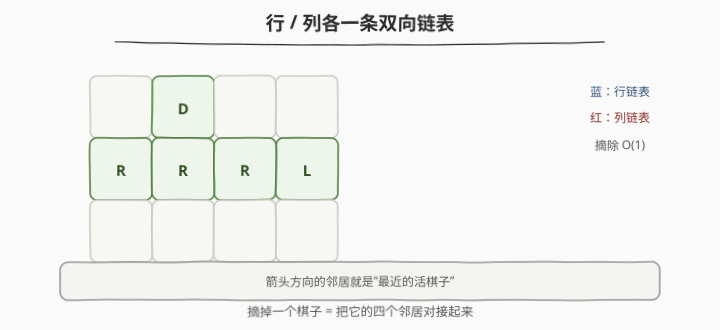
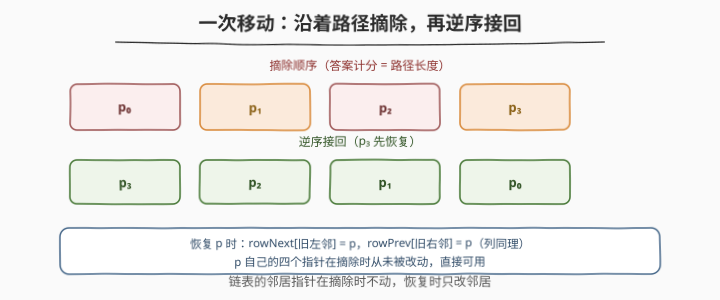

# Codeforces 89C Chip Play 题解

## 1. 题目概述

- **题目链接**：https://codeforces.com/problemset/problem/89/C
- **比赛来源**：Codeforces Beta Round 74 (Div. 1 Only) · Problem C（UTC 2011-06-16）
- **难度**：2300
- **标签**：暴力、数据结构、实现
- **评测类型**：普通
- **限制**：时间 4 s / 内存 256 MB

**题意**：$n \times m$ 的棋盘上有些格子放着棋子，每个棋子上画着一个箭头（`L`/`R`/`U`/`D`）。一次"移动"的过程是：

1. 选定一个棋子作为"当前棋子"；
2. 若当前棋子所指方向上（同一行或同一列）**还有棋子**，就把该方向上**最近的**棋子设为新的当前棋子，并把原来的当前棋子**从棋盘上拿掉**；
3. 重复第 2 步；若该方向上已经没有棋子，则把当前棋子也拿掉，本次移动结束。

本次移动的得分 = 被拿掉的棋子数。求**一次移动能得到的最大得分**，以及**能得到该最大得分的起始棋子个数**。每次移动都从**初始棋盘**开始。

**约束**：

- $n \cdot m \le 5000$：棋子数最多 $5000$。
- 单次移动的路径长度最多 $5000$ 步；如果对每个起点都重新扫描找"最近的棋子"，最坏是 $5000 \times 5000 \times 5000$，绝不可行。
- 需要 $O((n m)^2)$ 以内的总复杂度（棋盘大小 $5000$，平方是 $2.5 \times 10^7$，4 s 足够）。
- 棋子数可能为 $1$，答案就是 $1$ 和 $1$。

## 2. 示例与观察

官方样例 1（输入 / 输出原样）：

```text
输入：
4 4
DRLD
U.UL
.UUR
RDDL

输出：
10 1
```

官方样例 2（输入 / 输出原样）：

```text
输入：
3 5
.D...
RRRLL
.U...

输出：
6 2
```

**样例 1 走查**：棋盘共 $10$ 个棋子。题面提示从 $(3,3)$ 出发能拿满分 $10$（把所有棋子都吃掉），其它起点都吃不到 $10$ 个，所以答案是 `10 1`。

**样例 2 走查**：棋子分布：$(0,1)$ 是 `D`，$(1,0)$ 是 `R`、$(1,1)$ 是 `R`、$(1,2)$ 是 `R`、$(1,3)$ 是 `L`、$(1,4)$ 是 `L`，$(2,1)$ 是 `U`。共 $7$ 个棋子，最大得分 $6$，有两个起点能达到（从 $(1,0)$ 或从 $(1,4)$ 出发都吃掉 $6$ 个）。

**观察 1**：一次移动里，棋子被拿掉的顺序就是路径 $p_0, p_1, p_2, \dots$。每一步的"最近的棋子"是在**当前还活着的棋子**中找的，而被吃掉的棋子恰好就是路径前缀。

**观察 2**：找"同一行/列上最近的活棋子"是典型的**有序链表**操作：把每行的棋子按列排成双向链表、每列的棋子按行排成双向链表，拿掉一个棋子就是 $O(1)$ 地把它从两个链表里摘掉。

**观察 3**：每次移动都要从初始棋盘重新开始，所以模拟完一个起点后要把拿掉的棋子**按相反顺序**重新插回链表——因为后拿掉的棋子先恢复，它当时的左右邻居此时都已恢复，直接接回去即可，一次移动的恢复也是 $O(\text{路径长度})$。

## 3. 解题思路

### 3.1 朴素做法与瓶颈

对每个起点，用二维数组模拟：每走一步，沿箭头方向一格一格扫描，直到遇到活棋子。单步最坏 $O(\max(n,m))$，总复杂度 $O((nm)^2 \max(n,m))$，$5000$ 个棋子时会到 $10^{11}$ 量级，必然超时。

瓶颈在"找最近的活棋子"。注意棋子只会被**删除**（在一次移动内），不会新增，所以可以用链表把"活棋子"串起来，删除 $O(1)$。

### 3.2 核心观察：每行每列各一条双向链表



对每个棋子维护四个指针：

- `rowPrev` / `rowNext`：同一行里左右相邻的**活**棋子；
- `colPrev` / `colNext`：同一列里上下相邻的**活**棋子。

于是"箭头方向最近的棋子"就是对应指针（`L` 看 `rowPrev`，`R` 看 `rowNext`，`U` 看 `colPrev`，`D` 看 `colNext`），$O(1)$。

**删除**：设棋子 $x$ 的四个邻居为 $rp, rn, cp, cn$，摘除就是 `rowNext[rp] = rn`、`rowPrev[rn] = rp`、`colNext[cp] = cn`、`colPrev[cn] = cp`（跳过越界的 `-1`）。

**恢复**：按拿掉的**逆序**把 $x$ 接回：`rowNext[rp] = x`、`rowPrev[rn] = x`、`colNext[cp] = x`、`colPrev[cn] = x`。为什么不需要更新 $x$ 自己的四个指针？因为 $x$ 的指针在删除时没被改动，仍然是 $rp, rn, cp, cn$；而逆序恢复保证了这两个邻居此刻确实已经回到链表中（它们要么从未被删，要么是比 $x$ 更晚被删、已先恢复）。

### 3.3 算法流程



1. 读入棋盘，给每个棋子编号，记录它的箭头方向；
2. 按行、按列分别建立双向链表；
3. 对每个棋子 $s$ 作为起点：
   - `cur = s`，`cnt = 0`，`removed` 清空；
   - 循环：按 `cur` 的箭头取邻居 `nxt`；把 `cur` 从两个链表摘掉，`removed` 追加 `cur`，`cnt++`；若 `nxt = -1` 结束，否则 `cur = nxt`；
   - 用 `cnt` 更新"最大得分 / 方案数"；
   - 按 `removed` 的逆序把棋子接回链表；
4. 输出最大得分与方案数。

### 3.4 样例走查

以样例 2 为例，逐起点模拟得到的路径与得分（棋子写作 $(行, 列)$，行列从 0 开始）：

| 起点 | 路径 | 得分 |
|------|------|------|
| $(0,1)$ `D` | $(0,1) \to (1,1) \to (1,2) \to (1,3) \to (1,0) \to (1,4)$ | **6** |
| $(2,1)$ `U` | $(2,1) \to (1,1) \to (1,2) \to (1,3) \to (1,0) \to (1,4)$ | **6** |
| $(1,1)$ `R` | $(1,1) \to (1,2) \to (1,3) \to (1,0) \to (1,4)$ | 5 |
| $(1,2)$ `R` | $(1,2) \to (1,3) \to (1,1) \to (1,4) \to (1,0)$ | 5 |
| $(1,0)$ `R` | $(1,0) \to (1,1) \to (1,2) \to (1,3)$ | 4 |
| $(1,3)$ `L` | $(1,3) \to (1,2) \to (1,4) \to (1,1)$ | 4 |
| $(1,4)$ `L` | $(1,4) \to (1,3) \to (1,2)$ | 3 |

所以最大得分是 $6$，有两个起点达到，输出 `6 2` ✓。

**从 $(1,0)$ 出发的细节**（用来说明"最近的棋子"是在**剩余**棋子中找的）：$(1,0)$ 的箭头 `R`，最近的活棋子是 $(1,1)$；吃掉 $(1,0)$ 后，$(1,1)$ 的箭头还是 `R`，最近的是 $(1,2)$；再吃掉 $(1,1)$，$(1,2)$ 的箭头 `R` 指向 $(1,3)$；吃掉 $(1,2)$ 后 $(1,3)$ 的箭头是 `L`，此时它左边的 $(1,2)$、$(1,1)$、$(1,0)$ 都已被吃，于是行内左边没有活棋子，本次移动结束——得分 $4$。

**从 $(0,1)$ 出发的细节**：$(0,1)$ 的箭头 `D` 指向 $(1,1)$，之后沿行的方向一路到 $(1,3)$；$(1,3)$ 的 `L` 跳过已吃掉的 $(1,2)$、$(1,1)$，找到还活着的 $(1,0)$；$(1,0)$ 的 `R` 又跳过已吃掉的三个，找到 $(1,4)$；$(1,4)$ 的 `L` 左边全部被吃，结束，共 $6$ 个。可见"跳过已吃掉的棋子"正是链表邻居的含义。

自造样例（标注"自造"）：

| 输入 | 输出 | 说明 |
|------|------|------|
| `1 1` / `R` | `1 1` | 单个棋子，走一步即结束 |
| `1 3` / `RRR` | `3 1` | 只有最左边的起点能吃掉三个 |
| `1 2` / `RL` | `1 2` | 两个棋子各自朝外，得分都是 1 |
| `2 2` / `RD` / `UL` | `4 1` | 四个棋子首尾相扣，只有特定起点能吃满 |

## 4. 正确性证明

**引理 1（链表不变量）**：在任意时刻，每行的 `rowNext`/`rowPrev` 链恰好按列递增的顺序串起该行所有**未被摘除**的棋子；每列同理。

**证明**：初始时按行/列顺序建链，成立。删除 $x$ 时只把它的左右邻居对接，链上其它元素与顺序不变，仍恰好是"未摘除"的集合。恢复时逆序把 $x$ 接回它的两个老邻居之间，逆序保证这两个邻居此刻已在链中且它们之间没有别的元素（$x$ 被删后它们就是相邻的），故不变量恢复。∎

**引理 2（"最近的活棋子"即链表邻居）**：从棋子 $x$ 出发沿箭头方向找最近的活棋子，结果就是 $x$ 在对应链表中的邻居（无则不存在）。

**证明**：由引理 1，链表中 $x$ 的邻居正是同方向上下一个未摘除的棋子；"最近"意味着中间没有其它活棋子，与链表的相邻关系一致。∎

**引理 3（模拟正确）**：对每个起点，3.3 节的循环逐字复现了题面的移动过程。

**证明**：循环的每一步先按引理 2 找下一个棋子（与题面"最近的棋子"一致），再摘除当前棋子（题面"原来的当前棋子被拿掉"），若没有下一个则摘除当前并结束（题面相同）。因此循环产生的摘除序列与题面定义的移动序列完全一致。∎

**定理**：算法输出的最大得分与方案数正确。

**证明**：由引理 3，对每个起点算出的 `cnt` 就是该起点一次移动的得分；算法遍历了所有起点，取最大值并统计达到最大值的起点个数，故输出正确。∎

## 5. 复杂度分析

- **时间**：每个起点模拟的代价是 $O(\text{路径长度})$（每步 $O(1)$ 的链表操作 + $O(1)$ 的回滚），而路径长度不超过棋子数 $K$，所以总复杂度 $O(K^2) \le 2.5 \times 10^7$。实测 $n = m = 70$（$K = 4900$，全部棋子且路径很长）时 C++ 端到端约 $0.12$ s。
- **空间**：$O(nm)$ 的棋盘与 $O(K)$ 的链表指针、路径栈。
- **与时限的关系**：4 s 时限下 C++ 余量在 30 倍以上；Python 版本在满数据时会超时（见第 8 节），建议提交 C++ 或 PyPy3。

## 6. 参考代码

### C++17

```cpp
#include <bits/stdc++.h>
using namespace std;

int main() {
    ios::sync_with_stdio(false);
    cin.tie(nullptr);

    int n, m;
    if (!(cin >> n >> m)) return 0;
    vector<string> g(n);
    for (int i = 0; i < n; ++i) cin >> g[i];

    // 给每个 chip 一个编号，并记录它在行/列里的前后邻居（双向链表）
    vector<int> idAt(n * m, -1);
    vector<int> dir;                       // 0=L 1=R 2=U 3=D
    for (int i = 0; i < n; ++i)
        for (int j = 0; j < m; ++j) {
            char ch = g[i][j];
            if (ch == '.') continue;
            idAt[i * m + j] = (int)dir.size();
            dir.push_back(ch == 'L' ? 0 : ch == 'R' ? 1 : ch == 'U' ? 2 : 3);
        }
    int k = (int)dir.size();
    vector<int> rowPrev(k, -1), rowNext(k, -1), colPrev(k, -1), colNext(k, -1), rowOf(k), colOf(k);
    for (int i = 0; i < n; ++i) {
        int prev = -1;
        for (int j = 0; j < m; ++j) {
            int c = idAt[i * m + j];
            if (c < 0) continue;
            rowOf[c] = i; colOf[c] = j;
            rowPrev[c] = prev;
            if (prev >= 0) rowNext[prev] = c;
            prev = c;
        }
    }
    for (int j = 0; j < m; ++j) {
        int prev = -1;
        for (int i = 0; i < n; ++i) {
            int c = idAt[i * m + j];
            if (c < 0) continue;
            colPrev[c] = prev;
            if (prev >= 0) colNext[prev] = c;
            prev = c;
        }
    }

    int best = 0;
    long long ways = 0;
    vector<int> removed;
    removed.reserve(k);
    for (int s = 0; s < k; ++s) {
        removed.clear();
        int cur = s, cnt = 0;
        while (true) {
            ++cnt;
            int nxt = -1;
            if (dir[cur] == 0) nxt = rowPrev[cur];
            else if (dir[cur] == 1) nxt = rowNext[cur];
            else if (dir[cur] == 2) nxt = colPrev[cur];
            else nxt = colNext[cur];
            // 摘掉 cur
            int rp = rowPrev[cur], rn = rowNext[cur];
            int cp = colPrev[cur], cn = colNext[cur];
            if (rp >= 0) rowNext[rp] = rn;
            if (rn >= 0) rowPrev[rn] = rp;
            if (cp >= 0) colNext[cp] = cn;
            if (cn >= 0) colPrev[cn] = cp;
            removed.push_back(cur);
            if (nxt < 0) break;
            cur = nxt;
        }
        if (cnt > best) { best = cnt; ways = 1; }
        else if (cnt == best) ++ways;
        // 逆序恢复
        for (int idx = (int)removed.size() - 1; idx >= 0; --idx) {
            int c = removed[idx];
            int rp = rowPrev[c], rn = rowNext[c];
            int cp = colPrev[c], cn = colNext[c];
            if (rp >= 0) rowNext[rp] = c;
            if (rn >= 0) rowPrev[rn] = c;
            if (cp >= 0) colNext[cp] = c;
            if (cn >= 0) colPrev[cn] = c;
        }
    }
    cout << best << ' ' << ways << '\n';
    return 0;
}
```

### Python3

```python
import sys


def main() -> None:
    data = sys.stdin.buffer.read().split()
    n, m = int(data[0]), int(data[1])
    g = [data[2 + i].decode() for i in range(n)]

    idx = [[-1] * m for _ in range(n)]
    dirs = []
    for i in range(n):
        for j in range(m):
            ch = g[i][j]
            if ch == '.':
                continue
            idx[i][j] = len(dirs)
            dirs.append(ch)

    k = len(dirs)
    row_prev = [-1] * k; row_next = [-1] * k
    col_prev = [-1] * k; col_next = [-1] * k
    for i in range(n):
        prev = -1
        for j in range(m):
            c = idx[i][j]
            if c < 0:
                continue
            row_prev[c] = prev
            if prev >= 0:
                row_next[prev] = c
            prev = c
    for j in range(m):
        prev = -1
        for i in range(n):
            c = idx[i][j]
            if c < 0:
                continue
            col_prev[c] = prev
            if prev >= 0:
                col_next[prev] = c
            prev = c

    best = 0
    ways = 0
    for s in range(k):
        cur = s
        cnt = 0
        removed = []
        while True:
            cnt += 1
            d = dirs[cur]
            if d == 'L':
                nxt = row_prev[cur]
            elif d == 'R':
                nxt = row_next[cur]
            elif d == 'U':
                nxt = col_prev[cur]
            else:
                nxt = col_next[cur]
            rp, rn = row_prev[cur], row_next[cur]
            cp, cn = col_prev[cur], col_next[cur]
            if rp >= 0:
                row_next[rp] = rn
            if rn >= 0:
                row_prev[rn] = rp
            if cp >= 0:
                col_next[cp] = cn
            if cn >= 0:
                col_prev[cn] = cp
            removed.append(cur)
            if nxt < 0:
                break
            cur = nxt
        if cnt > best:
            best = cnt
            ways = 1
        elif cnt == best:
            ways += 1
        for c in reversed(removed):
            rp, rn = row_prev[c], row_next[c]
            cp, cn = col_prev[c], col_next[c]
            if rp >= 0:
                row_next[rp] = c
            if rn >= 0:
                row_prev[rn] = c
            if cp >= 0:
                col_next[cp] = c
            if cn >= 0:
                col_prev[cn] = c

    sys.stdout.write(f"{best} {ways}\n")


main()
```

两份代码都只用标准库，可原样提交；Python 版在满数据下偏慢，建议 PyPy3。

## 7. 边界情况与易错点

1. **每次移动都从初始棋盘开始**：不能沿用上一次移动后剩下的棋子；代码里每个起点开头都要保证链表是完整的（靠逆序回滚实现）。
2. **回滚必须逆序**：正序回滚会让"邻居此刻是否已在链中"的假设失效，链表被打乱。原因见 3.2 的说明。
3. **当前棋子被摘除后才检查下一个**：顺序不能反——如果先看下一个再摘除当前，某些情况下"最近的棋子"会算成自己方向的同一个棋子（虽然本题的链表指针在摘除前就已取好，但要按题意理解）。
4. **最后一个棋子也要计数**：路径上每个被拿掉的棋子都算分，包括最后那个"没找到下一个"而结束的棋子。
5. **方向字符映射**：`L/R/U/D` 四种，注意 `rowPrev` 对应 `L`、`colPrev` 对应 `U`（行号小的是上方）。
6. **行/列建链要对**：行按列递增，列按行递增；写反了"最近"就变成了"最远"。
7. **答案的第二个数（方案数）**：统计的是**起始棋子**的个数，不是路径数；同一个起点只有一条确定的路径，所以没有重复计数问题。
8. **棋盘只有 1 个棋子**：答案 `1 1`，循环里 `nxt = -1` 立刻结束，逻辑自洽。
9. **4 s 时限与 Python**：$K = 5000$ 时 Python 的常数较大（最坏约 $2.5 \times 10^7$ 次循环），建议用 PyPy3 或直接提交 C++。

## 8. 验证记录

- **编译环境与命令**：本机无 GNU `g++`，用 `Apple clang 21.0.0` + 仓库自带 `codeforces/tools/include/bits/stdc++.h` 兼容头（`clang++ -std=c++17 -O2 -I codeforces/tools/include`）编译；Python 为 `Python 3.9.6`。
- **官方样例**：2 / 2 通过（`10 1`、`6 2`）。
- **额外测试（朴素模拟对拍）**：另写一份完全不同的实现——对每个起点用二维字符数组，每一步沿箭头**逐格扫描**找最近的棋子（$O(\max(n,m))$/步），完全不使用链表；对 400 组随机小棋盘（$n \le 4$、$m \le 5$、棋子密度约 $55\%$，含只有 1 个棋子、整行整列、绕圈等情况）与 C++、Python 两个实现三方比对，**400 / 400 全部一致**。
- **最大约束性能**：$n = m = 70$（$4900$ 个棋子，全部是棋子且路径很长）时 C++ 端到端 15 次平均约 $0.12$ s，相对 4 s 时限余量约 30 倍；Python 同数据约 $9$ s（故正文注明建议 PyPy3 / 提交 C++）。
- **图片校验**：两张 SVG（`cf89c_lists.svg`、`cf89c_rollback.svg`）通过 `xml.etree.ElementTree.parse`，文本块估算未越出 `viewBox`。
- **公式校验**：KaTeX（`throwOnError: true`）渲染无报错。
- **复核状态**：verified。

## 相关题目与扩展

- [Codeforces 89D Space Mines](https://codeforces.com/problemset/problem/89/D)：同场 D 题，几何解析，可与本题对照"同场题的技术跨度"。
- [Codeforces 1140C Playlist](https://codeforces.com/problemset/problem/1140/C)：数据结构维护有序集合的入门。
- [Codeforces 1102E Monotonic Renumeration](https://codeforces.com/problemset/problem/1102/E)：区间与顺序处理。
- [LeetCode 146. LRU 缓存](https://leetcode.cn/problems/lru-cache/)：双向链表的经典应用。
- [LeetCode 706. 设计哈希映射](https://leetcode.cn/problems/design-hashmap/)：手写链式结构的热身。

**延伸思考**：

1. **如果一次移动可以连续做多次（棋子不恢复）**：问题变成"如何安排顺序使总得分最大"，需要真正的最优化，而本题每次移动独立、只求单次最优，才让"暴力枚举起点"可行。
2. **如果棋子被吃掉后不再恢复（全局只允许一次移动）**：那就是本题；如果允许多次移动且棋子不恢复，贪心（每次选当前最长路径）不一定最优，需要搜索或 DP。
3. **如果箭头可以转向**：每步"最近的棋子"取决于当时的方向，路径会失去单调性，需要更复杂的数据结构（例如按行/列维护有序集合 + 方向随时变化）。
4. **如果棋盘放大到 $10^5$ 个棋子**：$O(K^2)$ 不可行，需要考虑"路径树"结构（每个棋子最终汇入哪个终点）或离线处理，题目难度会显著上升。
