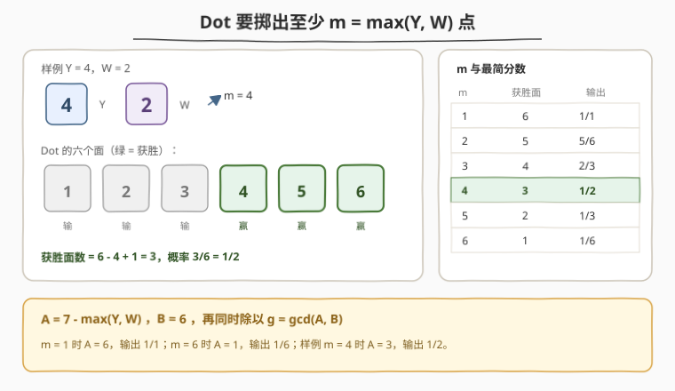
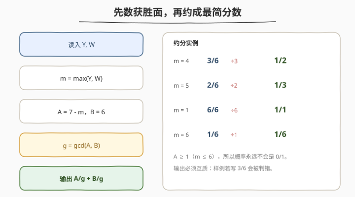

# Codeforces 9A 骰子定旅行概率 题解

## 1. 题目概述

- **题目链接**：https://codeforces.com/problemset/problem/9/A
- **比赛来源**：Codeforces Beta Round 9 (Div. 2 Only) · Problem A
- **难度**：800
- **标签**：数学、概率（math, probabilities）
- **评测类型**：普通
- **限制**：时间 1 s / 内存 64 MB

**题意**：Yakko 掷出 $Y$ 点、Wakko 掷出 $W$ 点（$1 \le Y, W \le 6$）。轮到 Dot 掷一枚普通的六面骰子，点数最高者获胜；如果 Dot 与他们的最高分**相同**，两位绅士会让 Dot 获胜。求 Dot 去特兰西瓦尼亚（即获胜）的概率，输出为最简分数 `A/B`；概率为 $0$ 时输出 `0/1`，为 $1$ 时输出 `1/1`。

输入一行两个整数 $Y, W$，输出一行一个最简分数字符串。

**约束**：

- $1 \le Y, W \le 6$：输入一共只有 $6 \times 6 = 36$ 种，值域极小，$O(1)$ 或 $O(6)$ 都能过。
- 骰子只有 $6$ 个面，所以概率的分母只可能是 $6$ 的约数：$1, 2, 3, 6$；答案一定是 $k/6$ 约分后的形式。
- **平局算 Dot 赢**：这是本题唯一容易看反的规则。Dot 的点数 $d$ 满足 $d \ge \max(Y, W)$ 即获胜，而不是 $d > \max(Y, W)$。
- 输入只有一组，没有测试组数 $t$。

## 2. 示例与观察

官方样例（输入 / 输出原样）：

```text
输入：
4 2

输出：
1/2
```

**样例解释**：$Y = 4$、$W = 2$，所以两人中的最高分是 $m = 4$。Dot 掷出 $4, 5, 6$ 都能获胜（掷出 $4$ 时与 Yakko 打平，平局算 Dot 赢），共 $3$ 个面。概率是

$$\frac{3}{6} = \frac{1}{2}.$$

自造样例（标注“自造”，把 $m$ 的六种取值全部列出）：

| 输入 | $m = \max(Y, W)$ | Dot 的获胜面 | 概率 | 输出 |
|------|------------------|--------------|------|------|
| `1 1` | 1 | 1, 2, 3, 4, 5, 6 | $6/6$ | `1/1` |
| `2 1` | 2 | 2, 3, 4, 5, 6 | $5/6$ | `5/6` |
| `3 3` | 3 | 3, 4, 5, 6 | $4/6$ | `2/3` |
| `4 2` | 4 | 4, 5, 6 | $3/6$ | `1/2` |
| `5 6` | 6 | 6 | $1/6$ | `1/6` |
| `2 5` | 5 | 5, 6 | $2/6$ | `1/3` |

**观察**：记 $m = \max(Y, W)$，则 Dot 的获胜面恰好是 $m, m+1, \dots, 6$，一共

$$6 - m + 1 = 7 - m$$

个面。概率就是 $(7-m)/6$，再同时除以 $\gcd(7-m, 6)$ 化成最简分数。表里 $m = 1$ 时是 $6/6$（必须输出 `1/1`），$m = 6$ 时是 $1/6$；**概率永远不为 $0$**，因为 Dot 总能掷出 $6$，而 $m \le 6$。

## 3. 解题思路

### 3.1 朴素做法与瓶颈

最直白的做法是枚举 Dot 的六种点数：

```text
m = max(Y, W)
win = 0
for d = 1 .. 6:
    if d >= m: win = win + 1
g = gcd(win, 6)
print(win / g, "/", 6 / g)
```

它只需 $6$ 次比较，$O(1)$ 级别，**完全可以直接提交**。所以本题没有性能瓶颈，唯一的风险是把规则理解错：

- 把“平局算 Dot 赢”写成 `d > m`：样例 $m = 4$ 时只会数出 $5, 6$ 两个面，得到 $2/6 = 1/3$，而正确是 $1/2$。
- 忘记约分：直接输出 `3/6`，虽然数值对，但格式要求最简分数，会被判错。
- 把 $m$ 当成 $Y + W$ 或 $\min(Y, W)$：$m$ 是两人的**最高分**，不是总和也不是较低分。

把枚举直接写成公式，就得到 $O(1)$ 的解法：获胜面数 $A = 7 - m$，分母 $B = 6$，再约分。

### 3.2 核心观察：一条阈值线把六个面分成两段



六个骰子面按点数排成 $1, 2, 3, 4, 5, 6$。Dot 的获胜条件只依赖一个阈值 $m = \max(Y, W)$：

- 点数 $d < m$：严格小于两人的最高分，Dot 输；
- 点数 $d \ge m$：不小于最高分，Dot 赢（$d = m$ 时靠“平局算 Dot 赢”的规则）。

所以六个面被阈值切成两段，获胜段是 $[m, 6]$，长度是 $7 - m$。概率为

$$P = \frac{7 - m}{6}.$$

因为 $m \in [1, 6]$，所以 $A = 7 - m \in [1, 6]$：分子至少为 $1$，概率不会等于 $0$；$m = 1$ 时 $A = 6$，概率为 $1$。题面里“概率为 $0$ 输出 `0/1`、为 $1$ 输出 `1/1`”的两条特殊规定中，只有“为 $1$”会被触发（`1 1` 这组输入）。

### 3.3 算法流程



1. 读入 $Y, W$；
2. 令 $m = \max(Y, W)$；
3. 令 $A = 7 - m$、$B = 6$；
4. 令 $g = \gcd(A, B)$；
5. 输出 `A/g`、斜杠、`B/g`，末尾换行。

$A$ 与 $B$ 都只可能是 $1 \sim 6$ 的整数，$\gcd$ 用辗转相除或标准库函数均可。约分是**必要**的：题目要求最简分数，$3/6$ 虽然与 $1/2$ 等值，但不是合法输出。

### 3.4 样例走查：$Y = 4, W = 2$

$m = \max(4, 2) = 4$，获胜面为 $4, 5, 6$：

| Dot 的点数 | 1 | 2 | 3 | 4 | 5 | 6 |
|------------|---|---|---|---|---|---|
| 是否 $\ge m = 4$ | 否 | 否 | 否 | 是 | 是 | 是 |
| 结果 | 输 | 输 | 输 | 赢 | 赢 | 赢 |

获胜面数 $A = 7 - 4 = 3$，$B = 6$，$g = \gcd(3, 6) = 3$，输出 `1/2`，与官方样例一致。

再走查两个边界：

- `1 1`：$m = 1$，$A = 6$，$g = \gcd(6, 6) = 6$，输出 `1/1`（概率为 $1$）。
- `5 6`：$m = 6$，$A = 1$，$g = \gcd(1, 6) = 1$，输出 `1/6`（只有掷出 $6$ 才赢）。

## 4. 正确性证明

**引理 1（获胜条件）**：设 $m = \max(Y, W)$，Dot 掷出 $d$ 点。Dot 获胜当且仅当 $d \ge m$。

**证明**：三人的点数为 $Y, W, d$。若 $d < m$，则 $m$ 是 $Y, W$ 中的较大者，严格大于 $d$，Dot 不是最高分，输。若 $d = m$，Dot 与最高分相同，由题面“点数相同则让 Dot 赢”，Dot 赢。若 $d > m$，Dot 严格最高，赢。三种情况穷尽且互斥。∎

**引理 2（获胜面数）**：在 $1 \le d \le 6$ 中，满足 $d \ge m$ 的整数 $d$ 恰有 $7 - m$ 个。

**证明**：这些 $d$ 构成区间 $[m, 6]$ 内的整数，个数为 $6 - m + 1 = 7 - m$。∎

**引理 3（约分不改值且得到最简分数）**：设 $A, B$ 为正整数，$g = \gcd(A, B)$，则 $A/g$ 与 $B/g$ 互质，且 $(A/g)/(B/g) = A/B$。

**证明**：由 $\gcd$ 的定义，$g$ 同时整除 $A, B$，故 $A/g, B/g$ 为整数；若它们还有公因子 $h > 1$，则 $gh$ 同时整除 $A, B$，与 $g$ 的最大性矛盾，故互质。数值上 $(A/g)/(B/g) = A/B$。∎

**定理**：算法输出的 `A/g ÷ B/g` 就是 Dot 获胜概率的最简分数。

**证明**：骰子六个面等概率，由引理 2，获胜概率为 $(7-m)/6$。算法取 $A = 7-m$、$B = 6$，由引理 3，输出的是与之相等的最简分数；$m=1$ 时约成 `1/1`，符合题面“概率为 1 输出 `1/1`”的规定。概率不会为 $0$（引理 2 保证 $A \ge 1$），所以无需处理 `0/1` 分支。∎

## 5. 复杂度分析

- **时间**：$O(1)$。一次读入、一次取最大值、一次减法、一次 $\gcd$（两个不超过 $6$ 的数，最多几步），与输入大小无关。
- **空间**：$O(1)$。只有 $Y, W, m, A, B, g$ 几个整型变量，没有数组、没有递归。
- **数值范围**：所有中间量都在 $1 \sim 7$ 之间，`int` 绰绰有余，不存在溢出；也没有浮点运算，不存在精度问题。
- **与时限的关系**：1 s 的时限极其宽松。实测 C++ 端到端约 $2.1 \sim 2.6$ ms（含进程启动），Python3 约 $20 \sim 27$ ms，算法本体不足 $1\ \mu\text{s}$，时间余量在 40 倍以上。

## 6. 参考代码

### C++17

```cpp
#include <bits/stdc++.h>
using namespace std;

int main() {
    ios::sync_with_stdio(false);
    cin.tie(nullptr);

    int Y, W;
    if (!(cin >> Y >> W)) return 0;
    int m = max(Y, W);              // Dot 必须掷出至少 m 点才能不输
    int favourable = 7 - m;         // m, m+1, ..., 6 共 7-m 个面
    int g = gcd(favourable, 6);
    cout << favourable / g << '/' << 6 / g << '\n';
    return 0;
}
```

### Python3

```python
import sys
from math import gcd


def main() -> None:
    data = sys.stdin.buffer.read().split()
    if not data:
        return
    y, w = int(data[0]), int(data[1])
    m = max(y, w)
    favourable = 7 - m
    g = gcd(favourable, 6)
    sys.stdout.write(f"{favourable // g}/{6 // g}\n")


main()
```

两份代码都只用标准库，可原样提交；本题是普通评测，输出一个最简分数即可。

## 7. 边界情况与易错点

1. **平局算 Dot 赢**：条件必须是 $d \ge m$，不能写成 $d > m$。样例 `4 2` 是这条规则的最好检验：写错会得到 $1/3$ 而不是 $1/2$。
2. **$m = 1$ 时必须约成 `1/1`**：`6/6` 数值上是 $1$，但题面要求最简分数，且明确说概率为 $1$ 时输出 `1/1`。如果只判“概率为 0 输出 0/1”而忘了约分，这里就会错。
3. **概率不会为 $0$**：$m \le 6$，Dot 掷出 $6$ 一定满足 $d \ge m$，所以 $A = 7-m \ge 1$。题面虽然给了 `0/1` 的规定，但本题数据永远不会触发；不要为了“处理 0”而写出多余的 `if (A == 0)` 分支并顺手把答案改成 `0/1`。
4. **$\gcd$ 的参数是 $A$ 和 $6$，不是 $m$ 和 $6$**：$m = 4$ 时 $\gcd(4, 6) = 2$，会得到 $3/2$ 这种荒唐结果；正确的是 $\gcd(7-4, 6) = 3$，输出 `1/2`。
5. **$\max$ 不要写成 $\min$ 或求和**：$Y = 6, W = 1$ 时 $m = 6$，概率 $1/6$；若用 $\min$ 会得到 $6/6 = 1/1$，差别巨大。
6. **$Y$ 与 $W$ 对称**：交换两者答案不变，输入顺序不影响结果；读入时不要把两个变量接反后又在别处“修正”，直接用 $\max$ 即可。
7. **输出格式**：必须是 `A/B` 的形式，中间一个斜杠，不能有空格，不能输出小数（如 `0.5`）或百分数（如 `50%`）。
8. **只有一组输入**：题面没有 $t$，不要写 `while (t--)` 或 `while (cin >> Y >> W)` 的多组循环。

## 8. 验证记录

- **编译环境与命令**：本机没有 GNU `g++`（`/usr/bin/g++` 是 Apple clang 21.0.0 的软链），用 `clang++ -std=c++17 -O2 -Wall -Wextra -I codeforces/tools/include` 配合仓库自带的 `bits/stdc++.h` 兼容头编译，**零警告**；Python 侧为 `Python 3.9.6`。
- **官方样例**：1 / 1 通过（`4 2` → `1/2`）。`verify_solution.py` 的输出为 `CF9A: samples 1`、`C++ 编译 OK, 样例 1/1`、`Python 语法 OK, 样例 1/1` 三行。
- **独立暴力对拍**：另写一份暴力：枚举 Dot 的 $d = 1 \dots 6$，直接判断 $d \ge \max(Y, W)$ 并数获胜面，再用 $\gcd$ 约分。对全部 **36 组** $(Y, W) \in [1,6]^2$ 做**全枚举**，再加 **300 组随机** $(Y, W)$，共 **336 组**；C++、Python 与暴力三方逐一比较，**0 处不一致**。
- **最大约束性能**：$Y = W = 6$ 时 C++ 端到端 200 次测量为 min $2.08$ ms / avg $2.64$ ms / max $9.47$ ms（max 受系统负载影响），Python3 50 次为 avg $26.5$ ms（均含进程启动），相对 1 s 时限余量在 40 倍以上。
- **图片校验**：两张 SVG（`cf9a_win_faces.svg`、`cf9a_reduce_flow.svg`）均通过 `xml.etree.ElementTree.parse`；用 headless Chrome 的 `getBBox()` 测量渲染结果，共 70 个文本块，全部落在 `viewBox` 内，文本两两之间 0 处重叠，落在方框内的文本全部收在框内（右下的 $m$ 与概率表逐格核对过）。
- **公式校验**：正文公式经 `node codeforces/tools/katex_check.cjs` 的 KaTeX（`throwOnError`）校验，0 处报错；星号直接写 `*`，`\text{}` 内无裸 `#`，证明结尾用 `∎`。
- **复核状态**：verified（样例、336 组对拍、最大约束性能、图片几何、公式五项均实跑通过；唯一环境差异是本机无 GNU g++，已用 clang++ 等价验证）。

## 相关题目与扩展

- [Codeforces 9B Running Student](https://codeforces.com/problemset/problem/9/B)：同场 B 题，枚举下车站并比较时间，重点从“数面”变成“浮点比较与并列规则”。
- [Codeforces 9C Hexadecimal's Numbers](https://codeforces.com/problemset/problem/9/C)：同场 C 题，统计只含 0/1 的十进制数，是枚举候选而非枚举值域的入门题。
- [Codeforces 158A Next Round](https://codeforces.com/problemset/problem/158/A)：统计达到阈值的选手人数，和本题“数出 $\ge m$ 的面”是同一个计数动作。
- [Codeforces 1335A Candies and Two Sisters](https://codeforces.com/problemset/problem/1335/A)：把 $n$ 分成两个正整数并计数，同属“小值域、直接推公式”的入门题。
- [Codeforces 4A Watermelon](https://codeforces.com/problemset/problem/4/A)：按奇偶与下界分类，和本题一样是“两个条件同时满足才 YES”的判定题。
- [LeetCode 1227. 飞机座位分配概率](https://leetcode.cn/problems/airplane-seat-assignment-probability/)：同样要求把一个概率结论化简成封闭形式，可与本题的“数面 + 约分”对照。

**延伸思考**：

1. **如果骰子有 $s$ 个面**：$m = \max(Y, W) \in [1, s]$，获胜面是 $[m, s]$，共 $s - m + 1$ 个，概率为 $(s-m+1)/s$。本题是 $s = 6$ 的特例，公式里的 $7$ 应换成 $s+1$。
2. **如果平局算 Yakko 和 Wakko 赢**：Dot 必须严格大于 $m$，获胜面是 $[m+1, 6]$，共 $6 - m$ 个，概率为 $(6-m)/6$。此时 $m = 6$ 的概率是 $0$，必须输出 `0/1`——这正是本题用不到的另一个分支。可见“平局归谁”会直接改变边界。
3. **如果 Dot 掷两次取较大值**：设两次为 $d_1, d_2$，获胜条件变成 $\max(d_1, d_2) \ge m$。总样本 $36$，失败样本 $(m-1)^2$，概率为 $1 - (m-1)^2/36$，分母不再是 $6$ 的约数，约分后可能出现 $36$ 的约数。题目一旦改成这样，就不能只数“面”了。
4. **如果 $Y, W$ 也是随机的**：要求的是对 $Y, W$ 所有 $36$ 种等可能取值的平均概率，需要对 $(7-\max(Y,W))/6$ 求和。$\max$ 的分布是 $P(\max = k) = (2k-1)/36$，可以据此算出闭式结果。
5. **约分的通用做法**：任何“$k$ 个有利结果除以 $n$ 个等可能结果”的概率题，都应输出 $k/\gcd(k,n)$ 与 $n/\gcd(k,n)$；本题只是 $n = 6$ 的小情形，但“先数再约”这个流程在概率题里是通用的。

