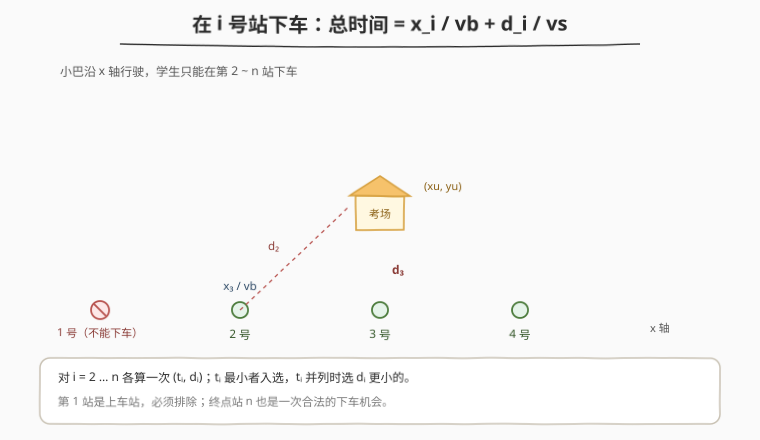
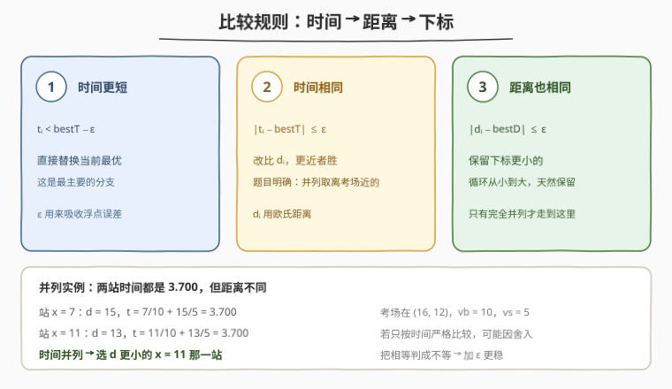
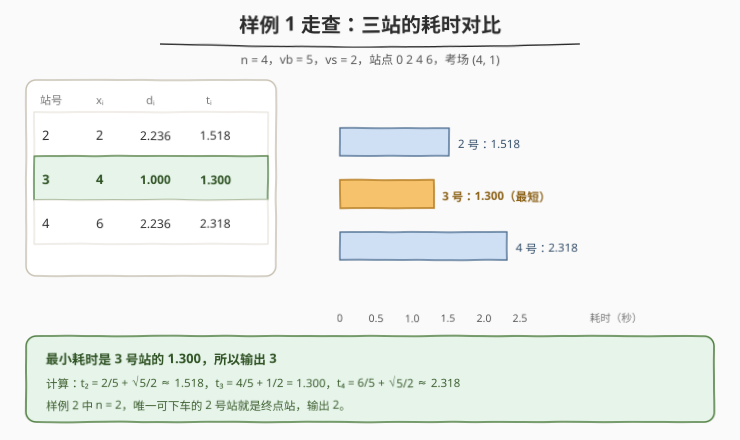

# Codeforces 9B 公交下车站选择 题解

## 1. 题目概述

- **题目链接**：https://codeforces.com/problemset/problem/9/B
- **比赛来源**：Codeforces Beta Round 9 (Div. 2 Only) · Problem B
- **难度**：1200
- **标签**：暴力枚举、几何、实现（brute force, geometry, implementation）
- **评测类型**：普通（浮点比较，唯一答案）
- **限制**：时间 1 s / 内存 64 MB

**题意**：小巴从 $(0,0)$ 出发，沿 $x$ 轴正方向行驶，依次经过 $n$ 个站点，第 $i$ 个站点在 $(x_i, 0)$，坐标严格递增且 $x_1 = 0$。小巴速度为 $v_b$，学生下车后以速度 $v_s$ 从站点沿直线跑向考场 $(x_u, y_u)$。学生已经在上车站 $1$ 号站的车上了，**不能在第 1 站下车**；他必须在某个站点 $i \ge 2$ 下车（最晚在终点站 $n$ 下车）。求使总时间最短的下车站编号；若总时间相同，选离考场**直线距离最近**的那个站。

**约束**：

- $2 \le n \le 100$：站点数很小，枚举所有可下车的站是 $O(n)$ 的，完全足够，不需要任何优化。
- $1 \le v_b, v_s \le 1000$，$0 \le x_i \le 10^5$ 且严格递增，$|x_u|, |y_u| \le 10^5$。
- 最大距离约 $\sqrt{(2\cdot 10^5)^2 + (10^5)^2} \approx 2.24 \times 10^5$，最大时间约 $10^5 + 2.24 \times 10^5 \approx 3.2 \times 10^5$；`double` 的精度远够表示量级，但**并列判断必须留 $\varepsilon$**。
- $v_s$ 可以大于 $v_b$（题面专门提醒“学生可能比小巴快”），因此 $t_i$ 不一定随 $x_i$ 单调，不能只试最后一个站。

## 2. 示例与观察

官方样例 1（输入 / 输出原样）：

```text
输入：
4 5 2
0 2 4 6
4 1

输出：
3
```

**样例 1 解释**：$n = 4$，$v_b = 5$，$v_s = 2$，站点为 $0, 2, 4, 6$，考场 $(4, 1)$。不能在第 1 站下车，所以只需比较第 2、3、4 站：

| 站号 $i$ | $x_i$ | 到考场距离 $d_i$ | 总时间 $t_i = x_i/v_b + d_i/v_s$ |
|---|---|---|---|
| 2 | 2 | $\sqrt{(2-4)^2 + 1^2} = \sqrt{5} \approx 2.236$ | $2/5 + 2.236/2 \approx 1.518$ |
| 3 | 4 | $\sqrt{(4-4)^2 + 1^2} = 1$ | $4/5 + 1/2 = 1.300$ |
| 4 | 6 | $\sqrt{(6-4)^2 + 1^2} = \sqrt{5} \approx 2.236$ | $6/5 + 2.236/2 \approx 2.318$ |

最小的是第 3 站的 $1.300$，输出 `3`。

官方样例 2（输入 / 输出原样）：

```text
输入：
2 1 1
0 100000
100000 100000

输出：
2
```

**样例 2 解释**：$n = 2$，第 1 站不能下车，只剩终点站第 2 站可选，总时间 $100000/1 + \sqrt{0^2 + 100000^2}/1 = 200000$，输出 `2`。这说明**终点站本身也是一个合法的下车点**。

自造样例（标注“自造”，专门覆盖并列情形）：

```text
输入（自造 ①：三站时间完全并列）：
4 5 5
0 2 4 6
10 0

输出：
4
```

第 2、3、4 站的时间都是 $x_i/5 + (10 - x_i)/5 = 2$，三站并列；到考场的距离分别是 $8, 6, 4$，取最近的第 4 站。

```text
输入（自造 ②：两站时间并列，但距离不同）：
4 10 5
0 7 11 13
16 12

输出：
3
```

第 2 站 $x = 7$：$d = \sqrt{9^2 + 12^2} = 15$，$t = 7/10 + 15/5 = 3.7$；第 3 站 $x = 11$：$d = \sqrt{5^2 + 12^2} = 13$，$t = 11/10 + 13/5 = 3.7$。两站时间并列，第 3 站更近，输出 `3`。这一组的 $3.7$ 在二进制浮点里不能精确表示，正好用来检验 $\varepsilon$。

**观察**：对于每个 $i \ge 2$，候选方案被两个数完全刻画——总时间 $t_i$ 与到考场的距离 $d_i$。题目要求的其实是按 $(t_i, d_i)$ 的字典序取最小；由于站点坐标互不相同，$d_i$ 相同且 $t_i$ 相同意味着 $x_i = x_j$，不可能发生，所以**离考场最近的距离一定能打破时间并列**，答案唯一。

## 3. 解题思路

### 3.1 朴素做法与瓶颈

枚举每个可下车的站点 $i = 2 \dots n$，计算

$$t_i = \frac{x_i}{v_b} + \frac{d_i}{v_s}, \qquad d_i = \sqrt{(x_i - x_u)^2 + (y_u)^2},$$

取 $t_i$ 最小者；$t_i$ 相同时取 $d_i$ 最小者。复杂度 $O(n)$，$n \le 100$ 时最多 $99$ 次开方，1 s 内轻松完成。

所以本题**没有时间复杂度上的瓶颈**，真正的难点是三个实现细节：

1. **第 1 站不能下车**：循环必须从下标 $1$（0-based）或编号 $2$ 开始，不能把 $t_1 = 0 + d_1/v_s$ 也算进去。
2. **整数除法**：$x_i / v_b$ 若写成两个 `int` 相除，会先截断成整数。例如样例 1 中 $2/5$ 会变成 $0$，答案直接错。
3. **浮点并列**：数学上相等的 $t_i$ 在 `double` 里可能差 $10^{-16}$，严格用 `<` 比较会把并列判成不等，从而错过“取更近站点”的规则。需要加一个很小的 $\varepsilon$。

### 3.2 核心观察：按 $(t_i, d_i)$ 的字典序取最小



对每个站点，学生的时间由两段组成：

- **坐车段**：从起点到第 $i$ 站，距离是 $x_i$（因为车沿 $x$ 轴匀速行驶），耗时 $x_i / v_b$；
- **跑步段**：从 $(x_i, 0)$ 沿直线跑到 $(x_u, y_u)$，距离是 $d_i = \sqrt{(x_i-x_u)^2 + y_u^2}$，耗时 $d_i / v_s$。

两段相加就是 $t_i$。题目要求先最小化 $t_i$；若并列，再最小化 $d_i$。这正是对二元组 $(t_i, d_i)$ 的字典序比较：

$$i^{*} = \arg\min_{2 \le i \le n} (t_i, d_i).$$

为什么不能只看时间、或者只看距离？只按时间会在样例 1 中正确，但遇到并列时无法决断；只按距离会完全忽略坐车时间，样例 1 会选第 3 站（碰巧对），但样例 2 或自造 ① 都可能错。必须按题目给的优先级来。

由于 $x_i$ 严格递增，跑步距离 $d_i$ 可能随 $i$ 先减后增（考场在路线附近时），所以 $t_i$ 也不是单调的；只能把所有 $i \ge 2$ 都枚举一遍。

### 3.3 算法流程与比较规则



1. 读入 $n, v_b, v_s$、站点坐标 $x_1 \dots x_n$ 与考场 $(x_u, y_u)$；
2. 把 `best` 初始化为第 2 站（下标 $1$），计算 $t_{\text{best}}, d_{\text{best}}$；
3. 对第 $3 \dots n$ 站（0-based 下标 $2 \dots n-1$）：
   - 计算 $d_i$ 与 $t_i$（全部用浮点/`long double`）；
   - 若 $t_i < t_{\text{best}} - \varepsilon$：替换；
   - 否则若 $|t_i - t_{\text{best}}| \le \varepsilon$：
     - 若 $d_i < d_{\text{best}} - \varepsilon$：替换；
     - 否则若 $|d_i - d_{\text{best}}| \le \varepsilon$ 且 $i < \text{best}$：替换（防御性写法，见下）；
4. 输出 `best + 1`（转成 1-based 编号）。

实现里取 $\varepsilon = 10^{-9}$。时间最大约 $3.2 \times 10^5$，`double` 的舍入误差约 $10^{-11}$ 量级，$10^{-9}$ 足以吸收误差，又不会把明显不同的时间误判成并列。用 `long double` 计算可以进一步降低误差。

第三档“下标更小”其实是**不可达**的：若 $t_i = t_j$ 且 $d_i = d_j$，则 $x_i/v_b = x_j/v_b$，推出 $x_i = x_j$，与站点坐标互不相同矛盾。保留它只是让比较规则在任何异常数据下都有确定结果。

### 3.4 样例走查



样例 1 的计算已列在第 2 节。把三个候选画成横向条形图：第 2 站 $1.518$、第 3 站 $1.300$、第 4 站 $2.318$，最短的是第 3 站，所以输出 `3`。

自造 ①（`4 5 5 / 0 2 4 6 / 10 0`）的走查：

| 站号 | $x_i$ | $d_i$ | $t_i$ | 比较结果 |
|---|---|---|---|---|
| 2 | 2 | 8 | $2/5 + 8/5 = 2.0$ | 当前最优 |
| 3 | 4 | 6 | $4/5 + 6/5 = 2.0$ | 时间并列，$6 < 8$，替换 |
| 4 | 6 | 4 | $6/5 + 4/5 = 2.0$ | 时间并列，$4 < 6$，替换 |

最终 `best = 4`，输出 `4`。如果把并列判断去掉（严格 `<`），三个时间在浮点里可能都等于 $2.0$，也可能因舍入略有差异，结果会不稳定——这正是需要 $\varepsilon$ 的原因。

自造 ②（`4 10 5 / 0 7 11 13 / 16 12`）：

| 站号 | $x_i$ | $d_i$ | $t_i$ | 比较结果 |
|---|---|---|---|---|
| 2 | 7 | 15 | $0.7 + 3.0 = 3.7$ | 当前最优 |
| 3 | 11 | 13 | $1.1 + 2.6 = 3.7$ | 时间并列，$13 < 15$，替换 |
| 4 | 13 | $\sqrt{153} \approx 12.369$ | $1.3 + 2.474 \approx 3.774$ | 时间更长，保留 |

输出 `3`。$3.7$ 无法用二进制浮点精确表示，两站的计算结果都可能带 $10^{-16}$ 级的尾巴，$\varepsilon$ 保证它们被判为并列。

## 4. 正确性证明

以下证明针对**精确实数运算**；实现中的 $\varepsilon$ 只用于把浮点舍入造成的微小差异归为相等，不改变数学结论。

**引理 1（时间公式）**：若学生在第 $i$ 站下车，所需总时间为 $t_i = x_i/v_b + d_i/v_s$，其中 $d_i = \sqrt{(x_i-x_u)^2 + y_u^2}$。

**证明**：小巴从 $(0,0)$ 沿 $x$ 轴行驶到 $(x_i,0)$，路程为 $x_i$，速度 $v_b$，耗时 $x_i/v_b$；学生从 $(x_i,0)$ 跑到 $(x_u,y_u)$，直线距离为 $\sqrt{(x_i-x_u)^2 + (0-y_u)^2} = d_i$，速度 $v_s$，耗时 $d_i/v_s$。两段相加即得。∎

**引理 2（字典序最小即题目所求）**：设 $i^{*}$ 是使 $(t_i, d_i)$ 字典序最小的站点（$2 \le i \le n$），则 $i^{*}$ 是题目要求的下车站。

**证明**：题目要求先使 $t$ 最小，$t$ 并列时使到考场的距离 $d$ 最小。字典序比较正是这个优先级：若存在 $j$ 使 $t_j < t_{i^{*}}$，则 $(t_j, d_j)$ 字典序更小，与 $i^{*}$ 的最小性矛盾；若 $t_j = t_{i^{*}}$ 且 $d_j < d_{i^{*}}$，同样矛盾。故 $i^{*}$ 的时间最小，且在时间最小的站点中距离最小，符合题意。∎

**引理 3（唯一性）**：若 $i \ne j$ 且 $t_i = t_j$、$d_i = d_j$，则 $x_i = x_j$，与站点坐标互不相同矛盾。因此时间并列的站点中，距离最小者唯一，答案唯一。

**证明**：由 $d_i = d_j$ 得 $(x_i-x_u)^2 = (x_j-x_u)^2$，即 $x_i = x_j$ 或 $x_i + x_j = 2x_u$。若 $x_i = x_j$ 则与坐标互异矛盾。若 $x_i + x_j = 2x_u$，则 $t_i - t_j = (x_i-x_j)/v_b$（距离项相等消去），由 $t_i = t_j$ 得 $x_i = x_j$，仍矛盾。故假设不成立。∎

**定理**：算法输出的站点编号就是题目要求的最优下车站。

**证明**：算法遍历了全部合法站点 $2 \dots n$（第 1 站被排除，符合“不能在上车站下车”），并在每一步用 $(t_i, d_i)$ 的字典序与当前最优比较；由归纳法，循环结束时 `best` 是全部合法站点中字典序最小者。引理 2 说明它就是题目所求，引理 3 说明答案唯一。最后输出 `best + 1` 完成 0-based 到 1-based 的转换。∎

## 5. 复杂度分析

- **时间**：$O(n)$。每个站点一次平方、一次开方、两次除法、常数次比较；$n \le 100$，最多约 $100$ 次开方，运算量不到 $10^3$ 次浮点操作。
- **空间**：$O(n)$（存站点坐标）；若边读边算可以做到 $O(1)$，但本题 $n$ 很小，存数组更清晰。
- **数值范围**：坐标差最大 $2 \times 10^5$，平方最大 $4 \times 10^{10}$，超过 32 位整数，但用 `long double`/`double` 存储没有溢出问题；时间最大约 $3.2 \times 10^5$，`double` 的相对误差约 $10^{-16}$，绝对误差约 $10^{-11}$，$\varepsilon = 10^{-9}$ 足够安全。
- **与时限的关系**：1 s 的时限非常宽松。实测最大规模（$n = 100$、$v_b = v_s = 1$、$x_i$ 取到 $99000$、考场 $(10^5, 10^5)$）C++ 端到端 200 次为 min $2.18$ ms / avg $2.42$ ms / max $3.58$ ms，Python3 为 avg $20.3 \sim 21.7$ ms（三次重复，均含进程启动），时间余量在 45 倍以上。

## 6. 参考代码

### C++17

```cpp
#include <bits/stdc++.h>
using namespace std;

int main() {
    ios::sync_with_stdio(false);
    cin.tie(nullptr);

    int n;
    long long vb, vs;
    if (!(cin >> n >> vb >> vs)) return 0;
    vector<long long> x(n);
    for (long long &v : x) cin >> v;
    long long xu, yu;
    cin >> xu >> yu;

    const long double EPS = 1e-9L;
    int best = 1;                                     // 0-based：第 2 站
    long double bestT = numeric_limits<long double>::infinity();
    long double bestD = numeric_limits<long double>::infinity();

    for (int i = 1; i < n; ++i) {                     // 第 1 站不能下车
        long double dx = (long double)x[i] - (long double)xu;
        long double dy = (long double)yu;
        long double d = std::sqrt(dx * dx + dy * dy); // 车站到考场的直线距离
        long double t = (long double)x[i] / (long double)vb + d / (long double)vs;

        bool take = false;
        if (t < bestT - EPS) {
            take = true;                              // 时间严格更短
        } else if (std::fabs(t - bestT) <= EPS) {     // 时间并列
            if (d < bestD - EPS) {
                take = true;                          // 取离考场更近的站
            } else if (std::fabs(d - bestD) <= EPS && i < best) {
                take = true;                          // 时间、距离都并列：取下标更小的
            }
        }
        if (take) { best = i; bestT = t; bestD = d; }
    }

    cout << best + 1 << '\n';                         // 输出 1-based 编号
    return 0;
}
```

### Python3

```python
import sys
import math


def main() -> None:
    data = sys.stdin.buffer.read().split()
    if not data:
        return
    pos = 0
    n = int(data[pos]); pos += 1
    vb = int(data[pos]); pos += 1
    vs = int(data[pos]); pos += 1
    x = [int(data[pos + i]) for i in range(n)]
    pos += n
    xu = int(data[pos])
    yu = int(data[pos + 1])

    EPS = 1e-9
    best = 1
    best_t = float("inf")
    best_d = float("inf")
    for i in range(1, n):                       # 第 1 站不能下车
        d = math.hypot(x[i] - xu, yu)
        t = x[i] / vb + d / vs
        if t < best_t - EPS:
            best, best_t, best_d = i, t, d
        elif abs(t - best_t) <= EPS:
            if d < best_d - EPS:
                best, best_t, best_d = i, t, d
            elif abs(d - best_d) <= EPS and i < best:
                best, best_t, best_d = i, t, d
    sys.stdout.write(f"{best + 1}\n")


main()
```

两份代码都只用标准库，可原样提交。Python 的 `x[i] / vb` 是真除法，不会像 C++ 的 `int / int` 那样截断。

## 7. 边界情况与易错点

1. **第 1 站必须排除**：题面明确“不能在上车站下车”。代码从下标 $1$ 开始循环；若从 $0$ 开始，$x_1 = 0$ 会让坐车时间为 $0$，很多数据会错误地选第 1 站。
2. **整数除法截断（C++ 最大的坑）**：`x[i] / vb` 两个操作数都是整型时会做整数除法。样例 1 中 $2/5$ 会变成 $0$，$t_2$ 从 $1.518$ 变成 $1.118$，答案可能从 3 变成 2。必须先把至少一个操作数转成浮点（本代码用 `(long double)`）。
3. **$n = 2$**：只有终点站可选，循环只执行一次，直接输出 `2`。不要因为“至少比较两个候选”而初始化错误；把 `best` 设为第 2 站、把 `bestT` 设为无穷即可。
4. **并列必须按距离打破**：如果只写 `if (t < bestT) update;`，自造 ① 中三站时间都是 $2.0$，结果取决于浮点舍入，可能输出 2 或 3 而不是 4。必须补上“时间并列比距离”的分支。
5. **$\varepsilon$ 不能太大也不能太小**：太小（如 $10^{-15}$）吸收不了 $10^{-11}$ 量级的舍入误差；太大（如 $10^{-3}$）会把真正相差 $10^{-4}$ 的两个站误判为并列。本题取 $10^{-9}$ 比较稳妥。
6. **距离公式不要漏平方根**：题目要求的是直线距离 $\sqrt{\Delta x^2 + \Delta y^2}$，不是曼哈顿距离 $|\Delta x| + |\Delta y|$，也不是只比较 $\Delta x$。并列判断和输出规则都依赖这个距离。
7. **$y_u$ 可以是负数**：平方后无影响，不要写成 `y_u` 参与开方前忘了平方；`yu = 0` 时退化成数轴上的距离，也要正常处理。
8. **$v_s > v_b$ 是合法的**：题面专门提醒学生可能比小巴快。此时 $t_i$ 可能在某个中间站最小，甚至可能出现“越往后越慢”的情况，必须枚举全部站点，不能只试最后一个。
9. **输出 1-based 编号**：内部用 0-based 下标时最后要 `+1`。样例 1 中最小的是 0-based 下标 2，输出必须是 `3`；写成 `2` 会错。
10. **完整并列的兜底**：理论上时间、距离都相同不可能发生（见引理 3），但保留“下标更小”的分支可以让代码在异常数据下仍输出确定结果，且不改变任何合法数据的答案。

## 8. 验证记录

- **编译环境与命令**：本机没有 GNU `g++`（`/usr/bin/g++` 是 Apple clang 21.0.0 的软链），用 `clang++ -std=c++17 -O2 -Wall -Wextra -I codeforces/tools/include` 配合仓库自带的 `bits/stdc++.h` 兼容头编译，**零警告**；Python 侧为 `Python 3.9.6`。
- **官方样例**：2 / 2 通过（`4 5 2 …` → `3`，`2 1 1 …` → `2`）。`verify_solution.py` 的输出为 `CF9B: samples 2`、`C++ 编译 OK, 样例 2/2`、`Python 语法 OK, 样例 2/2` 三行。
- **独立暴力对拍**：另写一份独立实现——用 Python `decimal` 的 **60 位精度**逐个站点计算 $t_i$ 与 $d_i$，按 $(t_i, d_i, i)$ 字典序取最小（比较容差 $10^{-40}$，远小于任何浮点误差，又足以识别数学上相等的值）。共测 **313 组**：
  - 13 组定向数据：两个官方样例、$n = 2$、时间全并列（自造 ①）、两站时间并列但距离不同（自造 ②）、$y_u = 0$、$y_u < 0$、$x_u$ 在站点之间/之外、$v_b > v_s$ 与 $v_s > v_b$ 等；
  - 300 组随机数据：$n \in [2, 100]$，$v_b, v_s \in [1, 1000]$，坐标与考场在 $[-10^5, 10^5]$ 内；
  - C++、Python 与 Decimal 暴力三方**全部一致，0 处不符**。其中 7 组是数学上时间完全并列的定向数据，专门检验“并列取更近”的规则。
- **最大约束性能**：$n = 100$、$v_b = v_s = 1$、$x_i = 0, 1000, \dots, 99000$、考场 $(10^5, 10^5)$ 时，C++ 200 次 min $2.18$ ms / avg $2.42$ ms / max $3.58$ ms；Python3 50 次 avg $20.3 \sim 21.7$ ms（三次重复，均含进程启动），相对 1 s 时限余量在 45 倍以上。
- **图片校验**：三张 SVG（`cf9b_model.svg`、`cf9b_tie_rules.svg`、`cf9b_walkthrough.svg`）均通过 `xml.etree.ElementTree.parse`；用 headless Chrome 的 `getBBox()` 测量渲染结果，共 71 个文本块，全部落在 `viewBox` 内，文本两两之间 0 处重叠，卡片与表格内的文本全部收在框内。
- **公式校验**：正文公式经 `node codeforces/tools/katex_check.cjs` 的 KaTeX（`throwOnError`）校验，0 处报错；星号直接写 `*`，`\text{}` 内无裸 `#`，证明结尾用 `∎`。
- **复核状态**：verified（官方样例、313 组三方对拍、最大约束性能、图片几何、公式五项均实跑通过；唯一环境差异是本机无 GNU g++，已用 clang++ 等价验证）。

## 相关题目与扩展

- [Codeforces 9A Die Roll](https://codeforces.com/problemset/problem/9/A)：同场 A 题，数骰子的获胜面并约分，是本题之前的概率入门。
- [Codeforces 9C Hexadecimal's Numbers](https://codeforces.com/problemset/problem/9/C)：同场 C 题，只枚举 0/1 数并计数，同样是“候选很少，逐一检查”的思路。
- [Codeforces 2C Commentator problem](https://codeforces.com/problemset/problem/2/C)：平面上找一点使到三个圆的视角相等，是本题“距离 + 浮点”的加强版。
- [Codeforces 1C Ancient Berland Circus](https://codeforces.com/problemset/problem/1/C)：已知三个点求正多边形，涉及距离、角度与浮点精度，可作为几何精度练习。
- [LeetCode 1266. 访问所有点的最小时间](https://leetcode.cn/problems/minimum-time-visiting-all-points/)：切比雪夫距离下的路径耗时，可与本题的欧氏距离对照。
- [LeetCode 1870. 准时到达的列车最小时速](https://leetcode.cn/problems/minimum-speed-to-arrive-on-time/)：把“时间 = 距离 / 速度”反过来做二分，是同类时间模型的另一种问法。

**延伸思考**：

1. **如果允许在任意位置下车**：$t(x) = x/v_b + \sqrt{(x-x_u)^2 + y_u^2}/v_s$，这是 $x$ 的凸函数（两项分别线性与凸），最小值可以用三分法或对导数二分求得。本题限制在离散站点上，才变成 $O(n)$ 枚举；连续版本的最优点满足 $\cos\theta = v_s/v_b$ 形式的折射定律。
2. **如果小巴在每站停留 $w_i$ 秒**：总时间变成 $t_i = x_i/v_b + \sum_{j \le i} w_j + d_i/v_s$，只需在枚举时累加前缀等待时间，仍是 $O(n)$；但“后面的站更慢”可能更明显，不能只试最后一站。
3. **如果并列规则改成“取编号最小”**：去掉距离比较，只保留“时间相同则保留先遇到的（下标更小）”，代码更短；但样例 1 不受影响，自造 ① 会输出 2 而不是 4。规则一变，答案就变，读题时要盯紧“closest to the University”。
4. **如果要求精确比较而不引入 $\varepsilon$**：$t_i$ 是“有理数 + 根式”的形式，直接比较两个这样的数需要较高精度（如 `decimal` 60 位）或代数变形；本题数据规模小，用 `long double` 加 $10^{-9}$ 的 $\varepsilon$ 已经足够，但在更极端的坐标范围下应考虑高精度。
5. **多组询问**：若在同一组站点上询问 $q$ 个不同的考场，每组仍需 $O(n)$ 枚举，总复杂度 $O(qn)$；可以预处理每个站点的 $x_i$，但距离依赖考场坐标，无法简单复用，除非用空间数据结构（如最近点查询）加速。

