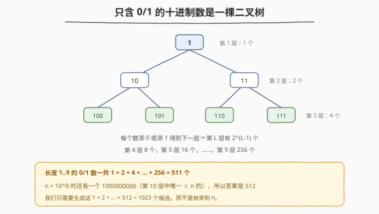
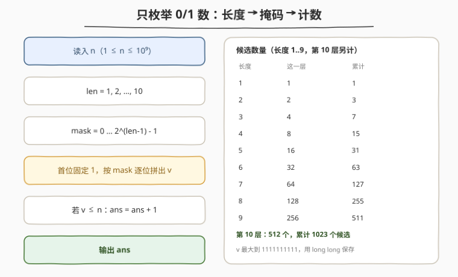
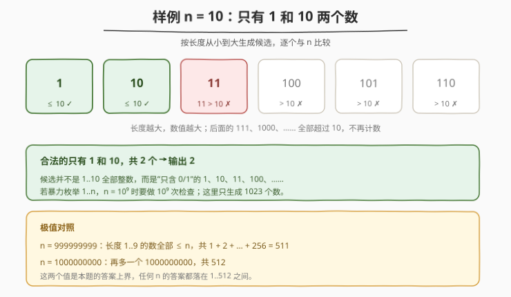

# Codeforces 9C 只含零一的数字 题解

## 1. 题目概述

- **题目链接**：https://codeforces.com/problemset/problem/9/C
- **比赛来源**：Codeforces Beta Round 9 (Div. 2 Only) · Problem C（UTC 2010-04-11）
- **难度**：1200
- **标签**：暴力枚举、实现、数学（brute force, implementation, math）
- **评测类型**：普通
- **限制**：时间 1 s / 内存 64 MB

**题意**：Megabyte 把 $1$ 到 $n$ 的 $n$ 个自然数写进 Hexadecimal 的内存，但 Hexadecimal 只认得十进制表示中**只含字符 0 和 1** 的数。求 $1 \le x \le n$ 中这样的 $x$ 有多少个。

输入一行一个整数 $n$，输出一个整数表示答案。

**约束**：

- $1 \le n \le 10^{9}$：值域很大，逐个检查 $1 \dots n$ 需要 $10^9$ 次（每次还要拆位），在 1 s 内不可行。
- 但“只含 0/1”的数非常稀疏：长度 $L$ 的数只有 $2^{L-1}$ 个（首位必须是 $1$），长度不超过 $9$ 的一共 $1 + 2 + \dots + 256 = 511$ 个；长度 $10$ 的数最小是 $1000000000$，恰好等于 $10^9$。
- 因此 $n \le 10^9$ 时的答案不超过 $512$，候选总数（长度 $1 \dots 10$）也只有 $1023$ 个。
- 输入只有一组，没有测试组数 $t$。

## 2. 示例与观察

官方样例（输入 / 输出原样）：

```text
输入：
10

输出：
2
```

**样例解释**：$1 \dots 10$ 中只含 0/1 的数是 $1$（十进制 `1`）和 $10$（十进制 `10`），共 $2$ 个。注意 $2 \dots 9$ 都含有 $2 \sim 9$ 中的数字，$10$ 恰好只含 $1$ 和 $0$。

自造样例（标注“自造”，覆盖位数分界与上界）：

| 输入 | 输出 | 说明 |
|------|------|------|
| `1` | 1 | 只有 1 |
| `9` | 1 | 1 之后下一个是 10 |
| `10` | 2 | 官方样例：1、10 |
| `11` | 3 | 多一个 11 |
| `99` | 3 | 100 还没到 |
| `100` | 4 | 1、10、11、100 |
| `101` | 5 | 1、10、11、100、101 |
| `111` | 7 | 所有 1、2、3 位的 0/1 数 |
| `999999999` | 511 | 所有不超过 9 位的 0/1 数 |
| `1000000000` | 512 | 再加上 1000000000 本身 |

**观察**：这些数按长度分层，每一层的数量翻倍：

- 长度 1：只有 `1`，$1$ 个；
- 长度 2：`10`、`11`，$2$ 个；
- 长度 3：`100`、`101`、`110`、`111`，$4$ 个；
- 一般地，长度 $L$ 有 $2^{L-1}$ 个（首位固定为 $1$，其余 $L-1$ 位任选 $0/1$）。

所以长度 $1 \dots 9$ 一共 $1 + 2 + 4 + \dots + 256 = 2^9 - 1 = 511$ 个；$n$ 取到 $10^9$ 时，长度 $10$ 的 $0/1$ 数里只有 $1000000000$ 不超过 $n$，答案再加 $1$ 得 $512$。**候选数远小于 $n$**，这是本题的突破口。

## 3. 解题思路

### 3.1 朴素做法与瓶颈

最直接的做法是遍历 $i = 1 \dots n$，把 $i$ 逐位拆开，检查每一位是否为 $0$ 或 $1$：

```text
ans = 0
for i = 1 .. n:
    ok = true
    for each digit d of i:
        if d != 0 and d != 1: ok = false
    if ok: ans = ans + 1
```

每次检查要 $O(\log_{10} n) \le 10$ 步，总复杂度 $O(n \log n)$。$n = 10^9$ 时约 $10^{10}$ 次基本操作，1 s 内绝对跑不完，必须换思路。

换一个方向：不要枚举**值域**，而是枚举**形状**。只含 0/1 的十进制数，其“形状”就是“长度 + 每一位是 0 还是 1”。长度 $L$ 的形状只有 $2^{L-1}$ 种，长度 $1 \dots 10$ 一共 $1023$ 种，比 $10^9$ 小了六个数量级。

### 3.2 核心观察：一棵二叉树，每层翻倍



从 `1` 出发，每次在末尾添 `0` 或添 `1`，就得到下一层的所有数：

- `1` → `10`、`11`；
- `10` → `100`、`101`，`11` → `110`、`111`；
- 以此类推。

这正好是一棵满二叉树：第 $L$ 层（根为第 1 层）有 $2^{L-1}$ 个结点，每个结点是一个长度为 $L$ 的 0/1 十进制数。不同层的数位数不同，数值范围也不重叠（$L$ 位数 $\ge 10^{L-1}$，而 $L-1$ 位数 $< 10^{L-1}$），所以整棵树上的数**互不相同**。

$n \le 10^9$ 时，只需生成到第 $10$ 层：第 $10$ 层最小的数是 $1000000000 = 10^9$，其余第 $10$ 层数都大于 $10^9$，生成出来后用 `v <= n` 过滤即可。总候选数

$$\sum_{L=1}^{10} 2^{L-1} = 2^{10} - 1 = 1023.$$

### 3.3 算法流程



1. 读入 $n$；
2. 令 `ans = 0`；
3. 对长度 `len = 1 … 10`：
   - 令 `suffixBits = len - 1`；
   - 对掩码 `mask = 0 … 2^suffixBits - 1`：
     - 令 `v = 1`（最高位固定为 1）；
     - 从高位到低位，把 `mask` 的第 $b$ 位拼到 `v` 的末尾：`v = v * 10 + bit`；
     - 若 `v <= n`，则 `ans++`；
4. 输出 `ans`。

例如 `len = 3`、`mask` 的两位是 `01`，就得到 `v = 1 → 10 → 101`；`mask = 10` 得到 `110`；`mask = 11` 得到 `111`。每个 `(len, mask)` 唯一确定一个数，不会重复也不会遗漏。

### 3.4 样例走查：$n = 10$



按长度生成候选并与 $10$ 比较：

| 长度 | 生成的候选 | 是否 $\le 10$ | 累计答案 |
|------|-----------|----------------|----------|
| 1 | `1` | 是 | 1 |
| 2 | `10` | 是 | 2 |
| 2 | `11` | 否（$11 > 10$） | 2 |
| 3 | `100`、`101`、`110`、`111` | 否 | 2 |
| 4 及以上 | `1000` 起 | 否 | 2 |

所以答案是 $2$。图中把前几个候选画成卡片，绿色的 $1$ 和 $10$ 计入，红色的 $11$ 和灰色的更长候选都不计入。

再看上界 $n = 10^9$：长度 $1 \dots 9$ 的 $511$ 个全部 $\le 10^9$；长度 $10$ 的候选里，只有 `1000000000` 等于 $10^9$，其余（如 `1000000001`、`1111111111`）都更大。因此答案是 $512$。

## 4. 正确性证明

**引理 1（生成本身是双射）**：固定长度 $L$，算法用 `mask ∈ [0, 2^{L-1})` 生成的数，恰好是全部 $L$ 位、首位为 $1$、其余位为 $0/1$ 的十进制数，且每个数只生成一次。

**证明**：`mask` 的 $L-1$ 个二进制位与“后 $L-1$ 位”一一对应：第 $b$ 位为 $0$ 时该位写 $0$，为 $1$ 时写 $1$。不同的 `mask` 至少有一位不同，生成的数就在对应十进制位上不同，故不同 `mask` 生成的数不同；而任意一个首位为 $1$、其余位为 $0/1$ 的 $L$ 位数，把后 $L-1$ 位读成二进制就是一个合法的 `mask`，故不会遗漏。∎

**引理 2（长度范围足够）**：若 $1 \le n \le 10^9$，则任何满足 $x \le n$ 且只含 0/1 的正整数 $x$ 的十进制长度不超过 $10$，且长度 $10$ 时只能是 $1000000000$。

**证明**：$10$ 位正整数的最小值是 $10^9$，所以 $x \le 10^9$ 的 $x$ 至多 $10$ 位；若 $x$ 恰有 $10$ 位且只含 $0/1$，其首位必须是 $1$，其余位只能是 $0/1$，故 $x \ge 1000000000 = 10^9$；又 $x \le 10^9$，只能 $x = 10^9$。∎

**引理 3（计数正确）**：算法结束时 `ans` 等于满足条件的 $x$ 的个数。

**证明**：由引理 2，所有可能的 $x$ 都出现在长度 $1 \dots 10$ 的生成结果中；由引理 1，生成过程不重不漏。算法对每个生成的 $v$ 恰好在 $v \le n$ 时加一，因此 `ans` 恰好统计了所有 $\le n$ 的 0/1 数。∎

**定理**：算法输出题目所求的答案。

**证明**：引理 1 保证候选集合正确，引理 2 保证长度范围足够，引理 3 保证计数正确；算法输出 `ans`，即为 $1 \le x \le n$ 中只含 0/1 的数的个数。∎

## 5. 复杂度分析

- **时间**：$O(1)$（相对于 $n$ 是常数）。固定生成 $1023$ 个候选，每个候选最多拼 $10$ 位，约 $10^4$ 次乘加与比较；与 $n$ 的大小无关。
- **空间**：$O(1)$。只需要一个 `ans` 与若干临时变量，不需要存储全部候选；递归写法也只会用到深度 $10$ 的栈。
- **数值范围**：最大的候选是 $1111111111 \approx 1.11 \times 10^9$，虽然仍小于 `int` 的上界 $2.147 \times 10^9$，但拼接过程中的中间值也在这个量级；只要题目把上界稍微放大就会溢出，因此统一用 `long long`（Python 无此问题）。
- **与时限的关系**：1 s 的时限对 $10^4$ 次运算极其宽松。实测 $n = 10^9$ 时 C++ 端到端 200 次为 min $2.05$ ms / avg $2.33$ ms / max $3.50$ ms，Python3 为 avg $20.5 \sim 21.5$ ms（三次重复，均含进程启动），时间余量在 45 倍以上。

## 6. 参考代码

### C++17

```cpp
#include <bits/stdc++.h>
using namespace std;

int main() {
    ios::sync_with_stdio(false);
    cin.tie(nullptr);

    long long n;
    if (!(cin >> n)) return 0;

    int ans = 0;
    // 枚举长度 len = 1..10；最高位固定为 1，其余 len-1 位各自可选 0/1。
    // 一共 2^0 + ... + 2^9 = 1023 个候选，远小于 n 的量级。
    for (int len = 1; len <= 10; ++len) {
        int suffixBits = len - 1;
        for (int mask = 0; mask < (1 << suffixBits); ++mask) {
            long long v = 1;
            for (int b = suffixBits - 1; b >= 0; --b) {
                v = v * 10 + ((mask >> b) & 1);
            }
            if (v <= n) ++ans;
        }
    }
    cout << ans << '\n';
    return 0;
}
```

### Python3

```python
import sys


def main() -> None:
    data = sys.stdin.buffer.read().split()
    if not data:
        return
    n = int(data[0])

    ans = 0
    for length in range(1, 11):
        suffix_bits = length - 1
        for mask in range(1 << suffix_bits):
            v = 1
            for b in range(suffix_bits - 1, -1, -1):
                v = v * 10 + ((mask >> b) & 1)
            if v <= n:
                ans += 1
    sys.stdout.write(str(ans) + "\n")


main()
```

两份代码都只依赖标准库，可原样提交。

## 7. 边界情况与易错点

1. **长度必须枚举到 $10$**：$n = 10^9$ 时，$1000000000$ 是第十位的数。若循环只写到 `len <= 9`，答案会少 $1$（输出 $511$ 而不是 $512$）。
2. **`long long` 不能省**：最大的候选 $1111111111$ 虽然小于 `INT_MAX`，但拼接过程中 `v * 10 + 1` 的中间结果也在同一量级；若题目上界再大一点（例如 $10^{10}$），`int` 立刻溢出。统一用 `long long` 最稳。
3. **不要生成 0 和前导零**：题目统计的是 $1 \dots n$ 的自然数，$0$ 不算；长度 $L$ 的首位固定为 $1$，其余位才自由，这样既排除了 $0$，也避免了 `01` 与 `1` 被当成两个数。
4. **候选不重复**：不同长度对应不同位数，数值不会相同；同一长度内不同 `mask` 也唯一。因此直接 `ans++` 即可，不需要 `set` 去重。
5. **$n = 1$ 的答案**：只有 $1$ 合法，答案 $1$。长度 $2$ 起的候选都大于 $1$，会被 `v <= n` 过滤；不要因为“至少有一个数”而写死输出 $1$。
6. **掩码范围**：`mask < (1 << suffixBits)`，当 `suffixBits = 0`（长度 $1$）时 `1 << 0 = 1`，只执行 `mask = 0` 一次，得到 `v = 1`，正确。
7. **位序不要反**：从高位到低位取 `mask` 的位（`b = suffixBits - 1` 递减），这样 `mask` 的二进制写法与生成数的后缀一致；反过来也能生成全部候选，但会打乱“mask 与数一一对应”的直观，调试时容易糊涂。
8. **答案上界**：$n \le 10^9$ 时答案不超过 $512$，用 `int` 存答案足够；不要因为用的是 `long long` 就以为答案可能很大。
9. **只有一组输入**：题面只有一个 $n$，没有 $t$，不要写多组循环。

## 8. 验证记录

- **编译环境与命令**：本机没有 GNU `g++`（`/usr/bin/g++` 是 Apple clang 21.0.0 的软链），用 `clang++ -std=c++17 -O2 -Wall -Wextra -I codeforces/tools/include` 配合仓库自带的 `bits/stdc++.h` 兼容头编译，**零警告**；Python 侧为 `Python 3.9.6`。
- **官方样例**：1 / 1 通过（`10` → `2`）。`verify_solution.py` 的输出为 `CF9C: samples 1`、`C++ 编译 OK, 样例 1/1`、`Python 语法 OK, 样例 1/1` 三行。
- **小值全域穷举**：另写一份真暴力程序，逐个检查 $1 \dots n$ 的十进制位。对 $n = 1 \dots 3000$ **每一组**都运行 C++、Python 与暴力，三方一致，**0 处不符**（共 3000 组）。
- **随机与边界对拍**：
  - 300 组随机小 $n \in [1, 200000]$：与真暴力逐组比较，0 处不符；
  - 300 组随机大 $n \in [1, 10^9]$：与一份**独立的逐位计数**实现（$O(\text{位数})$ 的 digit-DP，不生成候选）比较，0 处不符；
  - 边界组：$1, 2, 9, 10, 11, 12, 99, 100, 101, 110, 111, 112, 999, 1000, 111111111, 111111110, 111111112, 999999999, 1000000000$，全部一致。
  - 累计随机/穷举组数超过 **3600 组**，最大规模 $n = 10^9$ 输出 $512$。
- **最大约束性能**：$n = 10^9$ 时 C++ 200 次 min $2.05$ ms / avg $2.33$ ms / max $3.50$ ms；Python3 50 次 avg $20.5 \sim 21.5$ ms（三次重复，均含进程启动），相对 1 s 时限余量在 45 倍以上。
- **图片校验**：三张 SVG（`cf9c_tree.svg`、`cf9c_flow.svg`、`cf9c_walkthrough.svg`）均通过 `xml.etree.ElementTree.parse`；用 headless Chrome 的 `getBBox()` 测量渲染结果，共 78 个文本块，全部落在 `viewBox` 内，文本两两之间 0 处重叠，表格与公式框内的文本全部收在框内。
- **公式校验**：正文公式经 `node codeforces/tools/katex_check.cjs` 的 KaTeX（`throwOnError`）校验，0 处报错；星号直接写 `*`，`\text{}` 内无裸 `#`，证明结尾用 `∎`。
- **复核状态**：verified（官方样例、3000 组全域穷举 + 600 余组随机/边界、最大约束性能、图片几何、公式五项均实跑通过；唯一环境差异是本机无 GNU g++，已用 clang++ 等价验证）。

## 相关题目与扩展

- [Codeforces 9A Die Roll](https://codeforces.com/problemset/problem/9/A)：同场 A 题，数骰子的获胜面并约分，属于小值域计数。
- [Codeforces 9B Running Student](https://codeforces.com/problemset/problem/9/B)：同场 B 题，枚举站点比较时间，是“候选很少，逐一检查”的另一种形态。
- [Codeforces 1352A Sum of Round Numbers](https://codeforces.com/problemset/problem/1352/A)：把十进制数拆成若干个整十/整百数之和，练十进制位分解。
- [LeetCode 902. 最大为 N 的数字组合](https://leetcode.cn/problems/numbers-at-most-n-given-digit-set/)：给定数字集合，统计 $\le N$ 的可用这些数字拼成的正整数个数，和本题的“只允许 0/1”几乎同构，但数字集合可变，通常需要逐位计数。
- [LeetCode 233. 数字 1 的个数](https://leetcode.cn/problems/number-of-digit-one/)：统计 $1 \dots n$ 中数字 1 出现的次数，是数位统计的经典题。
- [LeetCode 1012. 至少有 1 位重复的数字](https://leetcode.cn/problems/numbers-with-repeated-digits/)：数位 DP + 排列组合，适合在掌握本题后继续练习。

**延伸思考**：

1. **如果允许的数字集合是任意 $S \subseteq \{0,\dots,9\}$**：题目变成“用 $S$ 中的数字拼出 $\le n$ 的正整数”。可以按长度枚举 $|S|$ 的幂次个候选（$|S|$ 小的时候），也可以用数位 DP 在 $O(10 \cdot \text{位数})$ 内统计。本题是 $S = \{0,1\}$ 的特例。
2. **如果 $n$ 放大到 $10^{18}$**：枚举长度 $1 \dots 19$ 的候选共 $2^{19} - 1 = 524287$ 个，仍然可以在 1 s 内跑完；若 $n$ 大到 $10^{100}$，就必须改用逐位计数（digit DP），因为候选数随位数指数增长。
3. **如果要求统计区间 $[a, b]$**：设 $f(n)$ 为 $1 \dots n$ 的答案，则区间答案为 $f(b) - f(a-1)$。本题的生成法对每个 $f$ 都是 $O(1023)$，两次调用即可，不需要另写算法。
4. **如果还要求这些数能被 $k$ 整除**：生成候选后逐个取模即可（候选只有 $1023$ 个）；若 $n$ 极大，则要在 digit DP 中增加“当前余数”一维，状态数变成 $O(\text{位数} \cdot k)$。
5. **十进制与二进制的区别**：本题的“只含 0/1”是**十进制**表示的限制，不是二进制。若误以为统计二进制数，答案会变成 $\lfloor \log_2 n \rfloor + 1$（例如 $n = 10$ 时是 $4$ 而不是 $2$）。读题时“decimal representation”这个限定词很关键。

