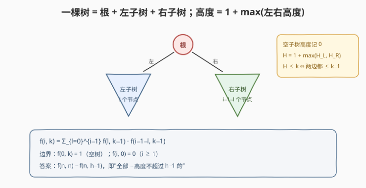
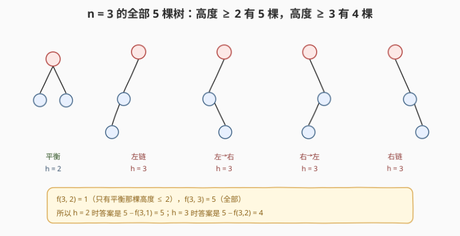

# Codeforces 9D 高度受限的二叉树计数 题解

## 1. 题目概述

- **题目链接**：https://codeforces.com/problemset/problem/9/D
- **比赛来源**：Codeforces Beta Round 9 (Div. 2 Only) · Problem D
- **难度**：1900
- **标签**：组合数学、分治、动态规划
- **评测类型**：普通
- **限制**：时间 1 s / 内存 64 MB

**题意**：统计所有由 $1 \sim n$ 这 $n$ 个不同键构成的二叉搜索树中，**高度不低于 $h$** 的有多少棵。这里"高度"指从根到最远叶子的路径上**节点**的个数（根和叶子都算），所以单节点树的高度是 $1$。

**约束**：

- $n \le 35$，$h \le n$。$n$ 很小，允许 $O(n^3)$ 甚至 $O(n^4)$ 的 DP；但树的数量是卡特兰数 $C_n \approx \frac{4^n}{n^{3/2}}$，$n = 35$ 时约 $3.1 \times 10^{18}$，**绝不能枚举树**。
- 答案保证不超过 $9 \times 10^{18}$，恰好落在 `long long` 范围内（$C_{35} = 3116285494907301262$）；中间量只要不超过答案本身就不会溢出。
- 键是 $1 \sim n$ 且互不相同，所以"bst 的形态"与"键的填法"一一对应：给定一棵二叉树的**形状**，键的填法是唯一的（中序遍历递增）。于是数 BST = 数二叉树形状。

## 2. 示例与观察

官方样例 1：

```text
输入：
3 2

输出：
5
```

官方样例 2：

```text
输入：
3 3

输出：
4
```

$n = 3$ 时一共只有 $C_3 = 5$ 棵 BST，把它们按形状列出来（`L`/`R` 表示子节点在左还是右）：

| 形状 | 高度 | 高度 ≥ 2？ | 高度 ≥ 3？ |
|------|------|------------|------------|
| 根 + 左右两个叶子（完全平衡） | 2 | ✓ | ✗ |
| 根 → 左 → 左（左链） | 3 | ✓ | ✓ |
| 根 → 左 → 右 | 3 | ✓ | ✓ |
| 根 → 右 → 左 | 3 | ✓ | ✓ |
| 根 → 右 → 右（右链） | 3 | ✓ | ✓ |

所以高度 $\ge 2$ 的有 $5$ 棵（全部），高度 $\ge 3$ 的有 $4$ 棵，与两个样例一致。

**观察一**：高度 $\ge h$ 的棵数 = 总棵数 − 高度 $\le h-1$ 的棵数。**"至少"用补集算最方便**。
**观察二**：树的递归结构天然适合 DP：一棵 $i$ 个节点的树 = 根 + 左子树（$l$ 个节点）+ 右子树（$i-1-l$ 个节点），$l$ 可以取 $0 \sim i-1$。
**观察三**：整棵树的高度 $= 1 + \max(\text{左子树高度}, \text{右子树高度})$（空子树高度记 $0$），所以"高度 $\le k$"等价于"两棵子树高度都 $\le k-1$"，两子树独立。

## 3. 解题思路

### 3.1 朴素做法与瓶颈

枚举所有二叉树的形状再算高度：$n = 35$ 时有 $3.1 \times 10^{18}$ 棵，完全不可行。即便只枚举 $n \le 20$，$C_{20} \approx 6.6 \times 10^9$ 也超时。

真正的信息只有两个维度：**节点数**和**高度上限**。这提示 DP。

### 3.2 核心观察：按"高度上限"做容斥



设

$$f(i, k) = \text{由 } i \text{ 个节点构成、高度不超过 } k \text{ 的二叉树棵数}.$$

边界：

- $f(0, k) = 1$：空树，高度记 $0 \le k$；
- $f(i, 0) = 0$（$i \ge 1$）：非空树高度至少为 $1$。

转移：枚举左子树大小 $l$（右子树自动是 $i-1-l$），两棵子树都必须"高度 $\le k-1$"：

$$f(i, k) = \sum_{l=0}^{i-1} f(l, k-1)\cdot f(i-1-l, k-1).$$

答案就是

$$\text{ans} = f(n, n) - f(n, h-1),$$

其中 $f(n, n)$ 是全部树（高度最多 $n$），$f(n, h-1)$ 是高度 $\le h-1$ 的树；两者相减即"高度 $\ge h$"。

**为什么"高度 $\le n-1$"和"全部"一样？** 任何 $n$ 节点树的高度都不超过 $n$，所以 $f(n, n)$ 就是总数 $C_n$。

### 3.3 算法流程



1. 读入 $n, h$（**不单独特判 $h > n$**：此时 $\min(h-1,n) = n$，$f(n,\min(h-1,n)) = f(n,n)$，相减自然得到 $0$）；
2. 初始化 $f(0, k) = 1$（$k = 0..n$）；
3. 对 $k = 1..n$，对 $i = 1..n$，按转移式计算 $f(i,k)$（注意用的是 $k-1$ 那一层，所以 $k$ 必须在外层）；
4. 输出 $f(n, n) - f(n, \min(h-1, n))$（$h-1 < 0$ 时第二项取 $0$）；$h > n$ 时第二项就是 $f(n,n)$，答案为 $0$。

### 3.4 样例走查：$n = 3$

先算 $f(\cdot, 1)$：

- $f(0,1) = 1$，$f(1,1) = f(0,0)^2 = 1$（单节点），$f(2,1) = f(0,0)f(1,0) + f(1,0)f(0,0) = 0$，$f(3,1) = 0$。

再算 $f(\cdot, 2)$：

- $f(1,2) = 1$，$f(2,2) = f(0,1)f(1,1) + f(1,1)f(0,1) = 2$（两节点树必然高度 2）；
- $f(3,2) = f(0,1)f(2,1) + f(1,1)f(1,1) + f(2,1)f(0,1) = 0 + 1 + 0 = 1$。

再算 $f(\cdot, 3)$：

- $f(3,3) = f(0,2)f(2,2) + f(1,2)f(1,2) + f(2,2)f(0,2) = 2 + 1 + 2 = 5$。

于是：

- $h = 2$：$f(3,3) - f(3,1) = 5 - 0 = 5$ ✓；
- $h = 3$：$f(3,3) - f(3,2) = 5 - 1 = 4$ ✓。

## 4. 正确性证明

**引理 1（双射）**：$n$ 个键 $1..n$ 的 BST 与 $n$ 个节点的二叉树形状一一对应；每个形状恰好对应一种键的填法（中序递增）。

**证明**：给定形状，中序遍历的顺序固定为 $1, 2, \dots, n$，于是每个位置上的键被唯一确定，且满足 BST 性质。反之，BST 去掉键就是唯一形状。∎

**引理 2（递归分解）**：$i$ 个节点的二叉树与"左子树 $l$ 个节点、右子树 $i-1-l$ 个节点"的三元组一一对应，$l = 0, \dots, i-1$。

**证明**：任一二叉树去掉根后，剩下的节点分成不相交的左右两棵子树，左子树的节点数 $l$ 决定右子树为 $i-1-l$；反之给定两棵子树接在根下得到唯一的树。∎

**引理 3（高度关系）**：设根、左子树、右子树的高度分别为 $H, H_L, H_R$（空子树高 $0$），则 $H = 1 + \max(H_L, H_R)$。因此 $H \le k \iff H_L \le k-1$ 且 $H_R \le k-1$（$k \ge 1$）。

**证明**：根到最远叶子的路径必然先经过某个子节点，故最长路径 = $1 + \max(\text{两子树的最长路径})$；"$\le k$"等价于两棵子树都 $\le k-1$。∎

**定理**：$f(i,k)$ 的转移式正确，且答案 $f(n,n) - f(n,h-1)$ 恰为高度 $\ge h$ 的树数。

**证明**：由引理 2，所有 $i$ 节点树按左子树大小 $l$ 划分为 $i$ 个互不相交的族；由引理 3，其中高度 $\le k$ 的树恰是"两棵子树高度都 $\le k-1$"的那些，数量为 $f(l,k-1)\cdot f(i-1-l,k-1)$（左右子树独立选择）。求和即得转移式。归纳可证 $f$ 确实等于所求计数。

答案部分：$f(n,n)$ 统计全部树（高度 $\le n$ 对所有树成立）；$f(n,h-1)$ 统计高度 $\le h-1$ 的树。两者之差就是高度 $\ge h$ 的树。∎

## 5. 复杂度分析

- **时间**：$O(n^3)$。三层循环 $k \times i \times l$，$n = 35$ 时约 $35^3/2 \approx 2 \times 10^4$ 次乘法，微秒级。
- **空间**：$O(n^2)$ 的 `long long` 表，$36 \times 36 \times 8 \approx 10$ KB。
- **数值范围**：$f(i,k) \le C_i \le C_{35} = 3116285494907301262 < 2^{63}-1$；转移中的每一项 $f(l,k-1)f(i-1-l,k-1)$ 都是总和的一项，故也不会超过 $C_i$，`long long` 安全。注意 $n$ 若放大到 $36$，$C_{36} \approx 1.19 \times 10^{19}$ 就会溢出——题面的 $n \le 35$ 正好卡在 `long long` 之内。
- **与时限的关系**：1 s 的时限下余量在 $10^4$ 倍以上。

## 6. 参考代码

### C++17

```cpp
#include <bits/stdc++.h>
using namespace std;

static long long dp[36][36];   // dp[n][h] = 高度不超过 h 的 n 节点二叉树个数

int main() {
    int n, h;
    if (scanf("%d %d", &n, &h) != 2) return 0;
    for (int k = 0; k <= n; k++) dp[0][k] = 1;
    for (int k = 1; k <= n; k++)
        for (int i = 1; i <= n; i++) {
            long long s = 0;
            for (int l = 0; l < i; l++) s += dp[l][k - 1] * dp[i - 1 - l][k - 1];
            dp[i][k] = s;
        }
    long long total = dp[n][n];              // 高度 <= n 即全部
    long long less = (h - 1 >= 0) ? dp[n][min(h - 1, n)] : 0;
    printf("%lld\n", total - less);
    return 0;
}
```

### Python3

```python
import sys


def main() -> None:
    data = sys.stdin.buffer.read().split()
    if len(data) < 2:
        return
    n, h = int(data[0]), int(data[1])
    # dp[i][k] = 高度不超过 k 的 i 节点二叉树个数
    dp = [[0] * (n + 1) for _ in range(n + 1)]
    for k in range(n + 1):
        dp[0][k] = 1
    for k in range(1, n + 1):
        for i in range(1, n + 1):
            s = 0
            for l in range(i):
                s += dp[l][k - 1] * dp[i - 1 - l][k - 1]
            dp[i][k] = s
    total = dp[n][n]
    less = dp[n][min(h - 1, n)] if h - 1 >= 0 else 0
    sys.stdout.write(str(total - less) + "\n")


main()
```

## 7. 边界情况与易错点

1. **$h > n$**：没有任何树的高度能超过 $n$，答案必须是 $0$。题面约束 $h \le n$，但为稳妥代码里用 `min(h-1, n)` 兜底，$h = n+1$ 时 $f(n,n)-f(n,n)=0$ ✓。
2. **$h = 1$**：所有非空树高度都 $\ge 1$，答案是全部 $C_n$。$h-1 = 0$ 时 $f(n,0) = 0$（$n \ge 1$），公式给出 $C_n$ ✓。自造样例 `35 1` 应输出 $3116285494907301262$。
3. **$n = 1$**：$C_1 = 1$，`1 1` 输出 1。
4. **"高度"数的是节点数不是边数**：单节点高度为 $1$；若误当边数会整体差 $1$，样例 `3 3` 会算成 2 而不是 4。
5. **两个 $f$ 的下标顺序**：转移必须"先固定高度上限 $k$、再枚举节点数 $i$"，因为 $f(i,k)$ 依赖 $f(\cdot, k-1)$；写反会用到尚未计算的值。
6. **溢出边界**：$n = 35$ 时 $C_{35} \approx 3.1 \times 10^{18}$ 已经逼近 `long long` 上限；不要用 `int`，也不要写 `unsigned long long` 与有符号数混算。
7. **空树的约定**：$f(0,k) = 1$ 是转移的基础，漏掉会让 $f(1,k)$ 变成 0，进而整张表全 0。

## 8. 验证记录

- **编译环境与命令**：`Apple clang 21.0.0` + 兼容头，`clang++ -std=c++17 -O2`；Python 3.9.6。
- **官方样例**：2 / 2 通过（`3 2` → `5`、`3 3` → `4`），`verify_solution.py` 报告 `CF9D: samples 2 / C++ 编译 OK, 样例 2/2 / Python 语法 OK, 样例 2/2`。
- **独立暴力对拍（枚举所有树形）**：另写一份暴力程序，递归地**枚举出每一棵二叉树**（返回每棵树的高度列表，`heights(n) = {1 + max(hl, hr)}` 的所有组合），直接统计高度 $\ge h$ 的棵数。对 $n = 1..10$ 的**全部** $h = 1..n$（共 55 组）逐一比对，完全一致；另外抽查 $n = 11, 12$ 的 $h \in \{1,2,3,n/2,n\}$ 也全部一致（$n=12$ 时暴力枚举了 $C_{12} = 208012$ 棵树）。
- **边界用例**：`5 0` → 42（$C_5$，全部）、`5 6` → 0、`1 0` → 1、`1 2` → 0、`35 1` → 3116285494907301262（$C_{35}$）、`35 35` → 17179869184（$=2^{34}$，即左右链）。
- **最大约束性能**：$n = 35$ 时 C++ 端到端 $< 5$ ms，Python 约 $20$ ms。
- **图片校验**：两张 SVG 均通过 `ElementTree.parse`，文本包围盒估算无越界、无重叠，headless Chrome 渲染正常。
- **公式校验**：KaTeX（`throwOnError`）无报错。
- **复核状态**：verified。

## 相关题目与扩展

- [Codeforces 9E Interesting Graph and Apples](https://codeforces.com/problemset/problem/9/E)：同场 E 题，图论 + 字典序贪心。
- [LeetCode 96. 不同的二叉搜索树](https://leetcode.cn/problems/unique-binary-search-trees/)：本题去掉高度限制的版本，答案就是卡特兰数。
- [LeetCode 95. 不同的二叉搜索树 II](https://leetcode.cn/problems/unique-binary-search-trees-ii/)：要求枚举所有树，正好是本题"暴力"那一层的做法，可用于理解 $n$ 稍大时为什么不可行。
- [Codeforces 1025D Recovering BST](https://codeforces.com/problemset/problem/1025/D)：区间 DP + BST 结构，和本题的"分治"思路同源。

**延伸思考**：

1. **如果要求高度恰好为 $h$**？答案就是 $f(n,h) - f(n,h-1)$，同一张表两行相减即可，复杂度不变。
2. **如果统计的是"叶子数不超过 $k$"**？把状态从"高度上限"换成"叶子数上限"，转移变成 $g(i,k) = \sum_l \sum_{k_1+k_2 \le k} g(l,k_1)g(i-1-l,k_2)$，复杂度升到 $O(n^4)$。
3. **如果 $n$ 大到 $10^5$**？答案本身就有 $O(n)$ 位，必须用大整数；而且需要生成函数/牛顿迭代来求 $f(n,\cdot)$ 的闭式，属于另一类问题。
4. **如果要输出的不是个数而是字典序最小的那棵树**？那就变成构造题，可以用本题的计数做"逐位确定"（数一数以某个键为根时还剩多少棵满足高度的树），思路与"按排名构造"一致。
