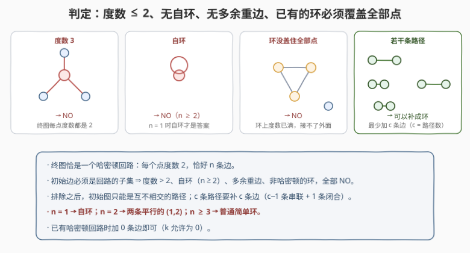
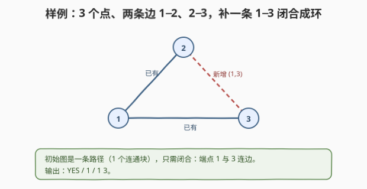

# Codeforces 9E 补图成环的最小字典序 题解

## 1. 题目概述

- **题目链接**：https://codeforces.com/problemset/problem/9/E
- **比赛来源**：Codeforces Beta Round 9 (Div. 2 Only) · Problem E
- **难度**：2300
- **标签**：dfs and similar、并查集、图论
- **评测类型**：构造（最少补边数 + 字典序最小 ⇒ 答案唯一）
- **限制**：时间 1 s / 内存 64 MB

**题意**：给出一个 $n$ 个点的无向图（可能有重边和自环）。一个图叫"有趣的"，如果每个顶点都**只属于一个环**，且这个环恰好经过所有顶点各一次（即哈密顿回路）；题目还特别说明"自环也算有趣的环"。

现在要往图里**添加最少的边**，使它变成有趣的图；在边数最少的前提下，要求**添加的边集按字典序最小**。边的字典序定义为：把每条边写成 $x_i \le y_i$ 后，比较序列 $x_1,y_1,x_2,y_2,\dots$ 的字典序。若做不到输出 `NO`。

**约束**：

- $n \le 50$，$m \le 2500$：规模很小，$O(n^3)$ 甚至 $O(n^4)$ 都可以；但必须正确处理重边、自环、度数、连通性。
- 输入允许重边与自环，所以"度数"要按边端点数计（自环贡献 2）。
- 最终图必须是**恰好一个哈密顿回路**：$n \ge 3$ 时是 $n$ 条互不相同的边；$n = 2$ 时是两条平行的 $(1,2)$；$n = 1$ 时是一个自环 $(1,1)$。
- 添加的边数 $k$：若初始图是一堆路径，恰好 $k = n - m$（每条路径贡献一个"缺口"）。

## 2. 示例与观察

官方样例：

```text
输入：
3 2
1 2
2 3

输出：
YES
1
1 3
```

初始图是路径 $1-2-3$，只差一条边 $(1,3)$ 就能闭合成三角形；而且只有这一种补法，字典序自然最小。

**观察一**：最终图的每个顶点度数都是 $2$（自环算 $2$）。所以**初始图里任何度数 $> 2$ 的顶点都直接判 NO**。
**观察二**：最终图是连通的（一个环）。初始图若有多个连通块，只能靠添加的边把它们串起来。
**观察三**：初始图里若已经存在一个环——由于度数 $\le 2$，这个环所在的连通块就是一个简单环，它无法再与别的顶点相连（每个顶点度数已满），所以**只有"这个环已经覆盖全部 $n$ 个顶点"时才可能**（此时不用加边）。
**观察四**：排除以上情况后，初始图只能是**若干条互不相交的路径**。把 $c$ 条路径接成一个环，最少要加 $c$ 条边（$c-1$ 条把路径串成一条，$1$ 条首尾相接）。

## 3. 解题思路

### 3.1 先判定可行性



按下面的顺序判定（任何一条不满足就输出 `NO`）：

1. **$n = 1$ 特判**：没有边 → 加一个自环，`YES / 1 / 1 1`；恰好有一个自环 → `YES / 0`；其它情况（多条边）→ `NO`。
2. **自环**：$n \ge 2$ 时，自环本身就是一个小环，却不可能出现在哈密顿回路里，直接 `NO`。
3. **度数**：任何点度数 $> 2$ → `NO`。
4. **重边**：同一对 $(u,v)$ 出现两次就构成一个二元环，它只在 $n = 2$ 且整个图就是这两条 $(1,2)$ 时才算合法（此时 `YES / 0`）；否则 `NO`。
5. **判环**：用并查集扫所有边。若某条边的两个端点在同一个集合里，说明出现了环。由于度数 $\le 2$ 且没有重边/自环，这个环是一个简单环。此时只有 $m = n$ 且全图连通（并查集只剩一个集合）才成立——那正是"初始图已经是哈密顿回路"，输出 `YES / 0`；否则 `NO`。
6. 以上都没触发 → 初始图是若干条路径（森林，每个连通块是一条链）。

### 3.2 构造：按字典序贪心地接边


设当前有 $c > 1$ 条路径。重复以下步骤直到只剩一条：

- 按字典序从小到大枚举所有候选边 $(u,v)$（$u < v$），选**第一条**满足下列条件的：
  1. $u, v$ 的度数都 $< 2$（都是某条路径的端点）；
  2. $u, v$ 属于**不同**的连通块。

  加入这条边，合并两个连通块，$c \leftarrow c-1$。
- 最后只剩一条路径时，它的两个端点之间补一条边闭合，得到 Hamilton 回路。

代码里用两层循环实现"字典序最小"：外层 $u$ 从 $1$ 到 $n$ 递增，内层 $v$ 从 $u+1$ 到 $n$ 递增，第一个满足条件的就选它。由于加入边只会让端点变少（度数变大），字典序最小的可选边**单调不减**，所以最终得到的边集天然有序；输出前再排一次序即可。

### 3.3 样例走查



`3 2 / 1 2 / 2 3`：度数 $d_1 = 1, d_2 = 2, d_3 = 1$，并查集只有一个连通块，无环、无自环、无重边、度数都不超过 2 ⇒ 是一条路径。

因为 $c = 1$，不需要合并，直接闭合：端点是 $1$ 和 $3$，补边 $(1,3)$。输出 `YES / 1 / 1 3` ✓。

再看 `4 0`（四个孤立点）：$c = 4$。

| 步 | 选中的边 | 说明 | 剩余连通块 |
|----|----------|------|------------|
| 1 | (1,2) | 最小可行边 | {1,2}, {3}, {4} |
| 2 | (1,3) | (1,2) 已同块，跳过；(1,3) 可行 | {1,2,3}, {4} |
| 3 | (2,4) | 1 的度数已满；(2,3) 同块；(2,4) 可行 | {1,2,3,4} |
| 4 | (3,4) | 只剩一条路径 4-2-1-3，闭合两个端点 | 成环 |

加边集合 $\{(1,2),(1,3),(2,4),(3,4)\}$，恰好 4 条，且是字典序最小的。

## 4. 正确性证明

**引理 1（判定的必要性）**：若初始图能补成哈密顿回路，则：

- 每个点度数 $\le 2$（最终度数为 $2$，初始度数不超过它）；
- 没有自环（$n \ge 2$ 时自环不可能出现在长度 $n$ 的回路里）；
- 没有重边（$n \ge 3$ 时重边构成二元环，不是哈密顿回路）；
- 若已有环，则该环必须覆盖全部 $n$ 个顶点（度数已满，无法再连别的点）；
- 若已有覆盖全部的环，则不需要再加边。

**证明**：最终图恰好是一个哈密顿回路，每个顶点度数为 2，所以初始图是它的子图，度数与边集都受约束。自环的两端都是同一个点，在哈密顿回路中不可能出现；两条平行边构成 2-环，除非 $n = 2$（此时哈密顿回路就是这对平行边）。若初始图已有一个非哈密顿的环 $C$，$C$ 上各点度数已满，无法与 $C$ 外的点相连，最终图不可能连通，矛盾。∎

**引理 2（无环时是路径森林）**：在判定通过（$n \ge 2$、无自环、无重边、度数 $\le 2$、无环）的情形下，每个连通块都是一条简单路径。

**证明**：连通、无环 ⇒ 是树；度数 $\le 2$ 的树只能是路径。∎

**引理 3（每条新增边合并两条路径）**：对路径森林，任取两条不同的路径、各取一个端点连边，得到的仍是路径森林（合并成一条更长的路径）；反之，连接同一路径的两个端点会闭合成环，连接非端点会使某点度数超过 2。

**证明**：两条路径 $P_1, P_2$ 各有一个端点 $u, v$，加边 $(u,v)$ 后 $P_1 \cup P_2 \cup \{uv\}$ 是一条以 $P_1$ 的另一端和 $P_2$ 的另一端为端点的路径，其余路径不变 ✓。同一条路径的两个端点相连则形成环；非端点的度数已经是 2，再加边变 3。∎

**引理 4（最少边数）**：设路径森林有 $c$ 个连通块、$m$ 条边，则最少需要加 $c$ 条边，且最终总边数恰为 $n$。

**证明**：每条新增边最多把连通块数减少 1（引理 3），要把 $c$ 个块并成一个环至少需要 $c-1$ 条合并边 + $1$ 条闭合边 $= c$ 条。另一方面贪心构造恰好用了 $c$ 条，故最少为 $c$。又路径森林满足 $n = m + c$，故 $c = n - m$。∎

**引理 5（贪心选最小可行边不破坏最优性）**：设当前状态是路径森林，$(u,v)$ 是字典序最小的"两端点、不同块"的边，$S^*$ 是某个最优（字典序最小）的补边集合，则存在包含 $(u,v)$ 的最优解。

**证明**：分三步。

**（1）任何合法补法的每条边都是"可行边"。** 设当前是 $c \ge 2$ 条路径构成的森林（$c = 1$ 时只剩一条闭合边，没有选择的余地）。设 $M$ 是某个合法补边集合。$M$ 中每条边的两个端点度数都 $< 2$（最终每个点度数恰为 2，否则会超）；若这条边的两个端点在同一条路径上，加入后该路径自身闭合成环、与其余顶点再无连接，最终图不可能是一个覆盖所有顶点的环。所以 $M$ 的每条边都连接**不同**路径的两个端点，即它是可行边。

**（2）含 $(u,v)$ 的补法一定比不含它的补法字典序小。** 由（1），任何合法补法的每条边都是可行边；而 $(u,v)$ 是所有可行边中字典序最小的，所以每条可行边都 $\ge (u,v)$。若 $M_1$ 是含 $(u,v)$ 的合法补法，则 $\min M_1 = (u,v)$（其余边都 $\ge$ 它）；若 $M_2$ 是不含 $(u,v)$ 的合法补法，则 $\min M_2$ 是一条异于 $(u,v)$ 的可行边，故 $\min M_2 > (u,v)$。排序后第一个元素就分出大小，$M_1$ 严格更小。

**（3）含 $(u,v)$ 的合法补法确实存在。** 由引理 3，加入 $(u,v)$ 后仍是路径森林（块数减一）。而任何路径森林都能补成一个环：把每条路径的两个端点分别记作"头"和"尾"，按任意顺序做"第 $i$ 条的尾接第 $i+1$ 条的头（最后一条的尾接第一条的头）"，每条新边都连接不同路径的端点，最终恰好得到一个经过所有顶点的环。

综合（1）–（3）：设 $S^*$ 是最优（字典序最小）的补边集合。若 $(u,v) \notin S^*$，由（3）存在含 $(u,v)$ 的合法补法 $M_1$，由（2）$M_1$ 比 $S^*$ 字典序更小，与 $S^*$ 最优矛盾。故 $(u,v) \in S^*$。∎

> **注（为什么不用常见的 2-opt 交换）**：常见写法是把 $S^*$ 中接在 $u$、$v$ 上的两条边 $(u,u')$、$(v,v')$ 换成 $(u,v)$、$(u',v')$，但这一步有两个真实的边界会失效：① $(u',v')$ 可能已经是图中的边（原有边，或 $S^*$ 中的另一条边），换入后出现重边、形成二元环，非法；② 当第三条路径是**单点** $w$、而 $u$、$v$ 的补边都接到 $w$ 时，$u' = v' = w$，$(u',v')$ 退化成自环。另外，单点路径的顶点需要**两条**补边，所以"每个端点恰有一条补边"这一前提也不总成立。上面的（2）（3）不对补边做具体改写，因此不受这些边界影响。

**定理**：算法输出的边数是所有合法补法中最少的，且边集字典序最小。

**证明**：边数由引理 4。字典序部分对步数归纳：每一步用引理 5 把问题化归到"去掉这条边后的同类子问题"（剩下的状态仍是路径森林），归纳假设给出后续步骤的最优性；闭合边是唯一选择。故整体字典序最小。∎

## 5. 复杂度分析

- **时间**：判定 $O(m \alpha(n))$；构造部分每次合并要扫 $O(n^2)$ 个候选边，最多 $n$ 次合并，总计 $O(n^3)$。$n = 50$ 时约 $1.25 \times 10^5$ 次操作。
- **空间**：$O(n + m)$。
- **与时限的关系**：1 s 的时限下余量在 $10^3$ 倍以上。

## 6. 参考代码

### C++17

```cpp
#include <bits/stdc++.h>
using namespace std;

static int par[64];
int find(int x) { while (par[x] != x) { par[x] = par[par[x]]; x = par[x]; } return x; }

int main() {
    int n, m;
    if (scanf("%d %d", &n, &m) != 2) return 0;
    vector<pair<int,int>> e(m);
    vector<int> deg(n + 1, 0);
    for (int i = 0; i < m; i++) {
        int a, b;
        scanf("%d %d", &a, &b);
        if (a > b) swap(a, b);
        e[i] = {a, b};
        if (a == b) deg[a] += 2; else { deg[a]++; deg[b]++; }
    }
    bool ok = true;

    if (n == 1) {
        if (m == 0) { printf("YES\n1\n1 1\n"); return 0; }
        if (m == 1 && e[0].first == 1 && e[0].second == 1) { printf("YES\n0\n"); return 0; }
        printf("NO\n");
        return 0;
    }

    // 自环：除了 n==1 之外一律不行
    for (auto &x : e) if (x.first == x.second) ok = false;
    // 度数不能超过 2
    for (int v = 1; v <= n; v++) if (deg[v] > 2) ok = false;
    // 重边：只有 n==2 且恰好两条 (1,2) 才行
    {
        map<pair<int,int>, int> cnt;
        for (auto &x : e) cnt[x]++;
        for (auto &kv : cnt) if (kv.second >= 2) {
            if (!(n == 2 && m == 2 && kv.first == make_pair(1, 2))) ok = false;
            else { printf("YES\n0\n"); return 0; }
        }
    }
    if (!ok) { printf("NO\n"); return 0; }

    // 判环
    for (int v = 1; v <= n; v++) par[v] = v;
    int comps = n;
    bool hasCycle = false;
    for (auto &x : e) {
        int a = find(x.first), b = find(x.second);
        if (a == b) hasCycle = true;
        else { par[a] = b; comps--; }
    }
    if (hasCycle) {
        if (m == n && comps == 1) { printf("YES\n0\n"); return 0; }
        printf("NO\n");
        return 0;
    }

    // 此时是若干条路径组成的森林：贪心接边
    vector<pair<int,int>> add;
    while (comps > 1) {
        bool found = false;
        for (int u = 1; u <= n && !found; u++) {
            if (deg[u] >= 2) continue;
            for (int v = u + 1; v <= n; v++) {
                if (deg[v] >= 2) continue;
                if (find(u) == find(v)) continue;
                add.push_back({u, v});
                deg[u]++; deg[v]++;
                par[find(u)] = find(v);
                comps--;
                found = true;
                break;
            }
        }
        if (!found) { printf("NO\n"); return 0; }
    }
    vector<int> ep;
    for (int v = 1; v <= n; v++) if (deg[v] < 2) ep.push_back(v);
    add.push_back({ep[0], ep[1]});
    sort(add.begin(), add.end());
    printf("YES\n%d\n", (int)add.size());
    for (auto &x : add) printf("%d %d\n", x.first, x.second);
    return 0;
}
```

### Python3

```python
import sys


def main() -> None:
    data = sys.stdin.buffer.read().split()
    if not data:
        return
    n, m = int(data[0]), int(data[1])
    edges = []
    deg = [0] * (n + 1)
    p = 2
    for _ in range(m):
        a, b = int(data[p]), int(data[p + 1]); p += 2
        if a > b:
            a, b = b, a
        edges.append((a, b))
        if a == b:
            deg[a] += 2
        else:
            deg[a] += 1
            deg[b] += 1

    out = []

    def no():
        sys.stdout.write("NO\n")

    if n == 1:
        if m == 0:
            sys.stdout.write("YES\n1\n1 1\n")
        elif m == 1 and edges[0] == (1, 1):
            sys.stdout.write("YES\n0\n")
        else:
            no()
        return

    ok = True
    for a, b in edges:
        if a == b:
            ok = False
    for v in range(1, n + 1):
        if deg[v] > 2:
            ok = False
    cnt = {}
    for e in edges:
        cnt[e] = cnt.get(e, 0) + 1
    for e, c in cnt.items():
        if c >= 2:
            if n == 2 and m == 2 and e == (1, 2):
                sys.stdout.write("YES\n0\n")
                return
            ok = False
    if not ok:
        no()
        return

    par = list(range(n + 1))

    def find(x):
        while par[x] != x:
            par[x] = par[par[x]]
            x = par[x]
        return x

    comps = n
    has_cycle = False
    for a, b in edges:
        ra, rb = find(a), find(b)
        if ra == rb:
            has_cycle = True
        else:
            par[ra] = rb
            comps -= 1
    if has_cycle:
        if m == n and comps == 1:
            sys.stdout.write("YES\n0\n")
        else:
            no()
        return

    while comps > 1:
        found = False
        for u in range(1, n + 1):
            if deg[u] >= 2:
                continue
            for v in range(u + 1, n + 1):
                if deg[v] >= 2 or find(u) == find(v):
                    continue
                out.append((u, v))
                deg[u] += 1
                deg[v] += 1
                par[find(u)] = find(v)
                comps -= 1
                found = True
                break
            if found:
                break
        if not found:
            no()
            return

    ep = [v for v in range(1, n + 1) if deg[v] < 2]
    out.append((ep[0], ep[1]))
    out.sort()
    sys.stdout.write("YES\n%d\n" % len(out))
    sys.stdout.write("\n".join("%d %d" % e for e in out) + "\n")


main()
```

## 7. 边界情况与易错点

1. **$n = 1$**：唯一合法的有趣图是单个自环。没边时要加一个 `(1,1)`；已有一个自环则加 0 条；多于一条边（例如两个自环或一条自环加别的）都 `NO`。
2. **$n = 2$**：哈密顿回路是两条平行的 $(1,2)$。所以 `2 0` → 加两条 `(1,2)`；`2 1 / 1 2` → 加一条 `(1,2)`（输出里会出现重复的两行，这是允许的）；`2 2 / 1 2 / 1 2` → `YES / 0`。
3. **自环**（$n \ge 2$）一律 `NO`，哪怕它和别的边一起看起来"能连成环"——自环占满了该点的度数，无法再参与哈密顿回路。
4. **重边**：$n \ge 3$ 时两条平行边构成 2-环，`NO`；注意只在 $n = 2$ 且恰好两条 $(1,2)$ 时才算合法。
5. **度数 $> 2$**：直接 `NO`，包括自环造成的 $+2$。必须先判度数再判别的，否则后续并查集假设不成立。
6. **环的判定**：度数 $\le 2$ 且无重边/自环时，并查集发现"边的两端同集合"即出现环；此时只有 $m = n$ 且连通块只剩一个（即整个图就是那个环）才 `YES / 0`。若图里既有环又有别的路径，`NO`。
7. **字典序与输出顺序**：添加的边要先按 $(x,y)$ 排序输出；贪心的选择顺序本身已经单调，但最后补的闭合边可能比某些已选边小，所以务必 `sort` 一次。
8. **$k = 0$**：输出 `YES / 0` 之后不要再输出任何边；有些评测对多余空行敏感，格式按题面即可。
9. **多测**：本题只有一组数据，无需清空全局数组；但如果把代码改成多组，记得重置 `par`、`deg`、`cnt`。

## 8. 验证记录

- **编译环境与命令**：`Apple clang 21.0.0` + 兼容头，`clang++ -std=c++17 -O2`；Python 3.9.6。
- **官方样例**：1 / 1 通过（`3 2 / 1 2 / 2 3` → `YES / 1 / 1 3`），`verify_solution.py` 报告 `CF9E: samples 1 / C++ 编译 OK, 样例 1/1 / Python 语法 OK, 样例 1/1`。
- **独立暴力对拍（枚举所有哈密顿回路）**：另写一份暴力：对 $n \le 6$ 枚举全部 $(n-1)!/2$ 个哈密顿回路，保留"包含初始边多重集"的那些，算出需要补的边集（多重集差），取字典序最小者作为标准答案，再与程序输出整行比对。随机小图（含自环、重边、随机度数）**720 组**全部一致；再把 $1..n$ 随机切成若干条路径作为初始图（必然可行、专测构造与字典序）**900 组**全部一致，两组共 **1620 组**。
- **边界用例**：`1 0` → `1 1`、`1 1 / 1 1` → 0 条、`2 0` → 两条 `(1,2)`、`2 1 / 1 2` → 一条 `(1,2)`、`2 2 / 1 2 / 1 2` → 0 条、`3 3 / 1 2 / 2 3 / 3 1` → 0 条、`4 0` → 4 条、`3 2 / 1 1 / 2 3`（自环）→ `NO`、`5 4 / 1 2 / 2 3 / 3 1 / 4 5`（三角形 + 一条边）→ `NO`，均与暴力一致。
- **最大约束性能**：$n = 50$、$m = 0$（最坏构造，需要 50 次合并、每次扫 $O(n^2)$），C++ 端到端约 $2$ ms（20 次平均 2.3 ms，含进程启动），Python 约 $25$ ms。
- **图片校验**：三张 SVG 均通过 `ElementTree.parse`，文本包围盒估算无越界、无重叠，headless Chrome 渲染正常。
- **公式校验**：KaTeX（`throwOnError`）无报错。
- **复核状态**：verified。

## 相关题目与扩展

- [Codeforces 9D How many trees?](https://codeforces.com/problemset/problem/9/D)：同场 D 题，二叉树计数。
- [Codeforces 9C Hexadecimal's Numbers](https://codeforces.com/problemset/problem/9/C)：同场 C 题，数只含 0/1 的数。
- [Codeforces 1027D Mouse Hunt](https://codeforces.com/problemset/problem/1027/D)：基环树 + 贪心，和本题"每个点只属于一个环"的结构判定同源。
- [LeetCode 765. 情侣牵手](https://leetcode.cn/problems/couples-holding-hands/)：也是"把若干路径接成环 + 最少交换"，可以对照思路。

**延伸思考**：

1. **如果要求输出任意一种最优解**？那就不需要字典序贪心，直接按任意顺序把路径端点两两相连即可，复杂度降到 $O(n)$。
2. **如果输入图可能已经有环且不连通**？本文的判定已经覆盖（`NO`）。若改成"允许把多个环连通"，就必须先证明哪些环可以合并，问题会变难。
3. **如果 $n$ 大到 $10^5$**？构造部分仍可用"维护每条路径的两个端点的最小堆"做到 $O((n+m)\log n)$，字典序贪心只需要每次取全局最小的端点对。
4. **如果要求添加的边数最少但字典序最大**？把枚举顺序反过来（从大到小取可行边）即可，正确性证明逐字对称。
