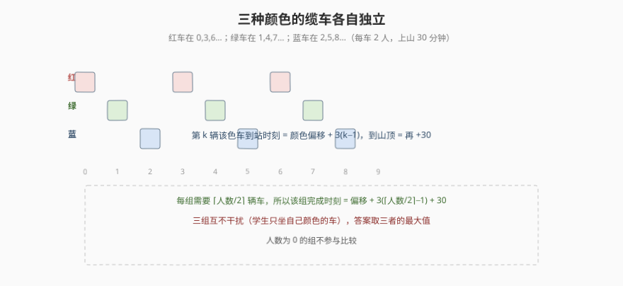
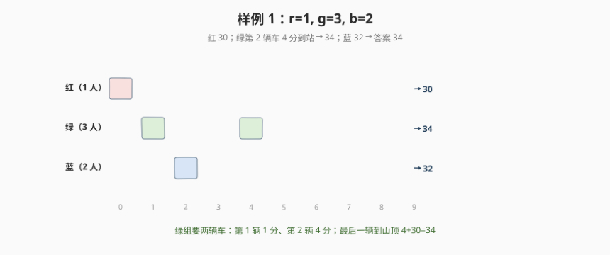

# Codeforces 90A 缆车分组登山 题解

## 1. 题目概述

- **题目链接**：https://codeforces.com/problemset/problem/90/A
- **比赛来源**：Codeforces Beta Round 74 (Div. 2 Only) · Problem A（UTC 2011-06-16）
- **难度**：1000
- **标签**：数学、取整
- **评测类型**：普通
- **限制**：时间 2 s / 内存 256 MB

**题意**：缆车按红、绿、蓝三色循环排列，每辆车最多坐 $2$ 人，每分钟到站一辆（$t=0$ 时到的是红车），坐上去后正好 $30$ 分钟到山顶。学生分三组：$r$ 人只坐红车，$g$ 人只坐绿车，$b$ 人只坐蓝车。求所有人到达山顶的最早时刻。

**约束**：

- $0 \le r,g,b \le 100$，且 $r+g+b>0$：数据极小，只需一个公式。
- 同色车每 $3$ 分钟来一辆；三组互不干扰（学生只上自己颜色的车），所以三组的完成时刻可以分别计算再取最大。
- 单组数据。

## 2. 示例与观察

官方样例一：

```text
输入：
1 3 2
输出：
34
```

官方样例二：

```text
输入：
3 2 1
输出：
33
```

**样例一走查**：$r=1,g=3,b=2$。

- 红车在 $t=0,3,6,\dots$ 到站；$1$ 人坐第 $1$ 辆，$t=0$ 出发，$30$ 到顶；
- 绿车在 $t=1,4,7,\dots$ 到站；$3$ 人要 $2$ 辆，第 $2$ 辆 $t=4$ 到站，$4+30=34$ 到顶；
- 蓝车在 $t=2,5,8,\dots$ 到站；$2$ 人坐第 $1$ 辆，$2+30=32$ 到顶。

最大值 $34$，与样例一致。



**样例二走查**：$r=3,g=2,b=1$。

- 红：$\lceil 3/2 \rceil = 2$ 辆，第 $2$ 辆在 $0+3 = 3$，到顶 $33$；
- 绿：$1$ 辆，$t=1$，到顶 $31$；
- 蓝：$1$ 辆，$t=2$，到顶 $32$。

最大值 $33$。

**观察**：每组只需要关心"自己的第 $k$ 辆车什么时候到"，而第 $k$ 辆该色车的到站时刻是"颜色偏移 $+3(k-1)$"。

## 3. 解题思路

### 3.1 朴素做法与瓶颈

按分钟模拟：每来一辆车，让对应颜色的剩余学生上车（最多 $2$ 人），记录最后一批人的到顶时刻。由于人数 $\le 100$、每车最多 $2$ 人，最多约 $150$ 辆车、即 $450$ 分钟，模拟完全可行。

不过本题有直接公式，模拟反而更容易写错（比如"车来了但没学生上"的情况）。

### 3.2 核心观察：三组独立，每组只差一个偏移



第 $k$ 辆红车到站于 $0 + 3(k-1)$，绿车于 $1 + 3(k-1)$，蓝车于 $2 + 3(k-1)$。某组有 $c$ 人，需要 $\lceil c/2 \rceil$ 辆车，最后一辆的到站时刻是

$$t_{\text{last}} = \text{offset} + 3\left(\left\lceil \frac{c}{2}\right\rceil - 1\right),$$

到顶时刻是 $t_{\text{last}} + 30$。答案是三组（人数非零的组）中的最大值。

注意：学生只坐自己颜色的车，所以"红组占满红车"不会影响绿组、蓝组；三组之间没有资源竞争。

### 3.3 算法流程

1. 读入 $r,g,b$；
2. 对三种颜色分别：若人数为 $0$ 跳过；否则 $k = \lceil c/2 \rceil = (c+1)/2$，$T = \text{offset} + 3(k-1) + 30$；
3. 输出三者最大值。

### 3.4 样例走查

| 颜色 | 人数 | 需要的车数 | 偏移 | 最后一辆到站 | 到顶 |
|---|---|---|---|---|---|
| 红 | 1 | 1 | 0 | 0 | 30 |
| 绿 | 3 | 2 | 1 | 4 | 34 |
| 蓝 | 2 | 1 | 2 | 2 | 32 |

最大值 $34$。

## 4. 正确性证明

**引理 1**：第 $k$ 辆红色、绿色、蓝色缆车分别在时刻 $3(k-1)$、$1+3(k-1)$、$2+3(k-1)$ 到站。

**证明**：车每分钟到一辆，颜色按红、绿、蓝循环，且 $t=0$ 是红车，故 $t \bmod 3 = 0,1,2$ 分别对应红、绿、蓝，第 $k$ 辆该色车在 $t = \text{offset} + 3(k-1)$。∎

**引理 2**：某颜色组有 $c>0$ 人时，最早全部到顶的时刻是 $\text{offset} + 3(\lceil c/2\rceil - 1) + 30$。

**证明**：每辆该色车最多载 $2$ 人且只载该组学生，所以至少需要 $\lceil c/2 \rceil$ 辆；按到站顺序装满即可，最后一辆就是第 $\lceil c/2 \rceil$ 辆，其到顶时刻由引理 1 给出。∎

**引理 3**：三组的安排互不影响。

**证明**：学生只上自己颜色的车，三种颜色的车是不同批次的车辆，任一组占用某辆车不影响其它组的可用车辆。∎

**定理**：算法输出即为所有学生到顶的最早时刻。

**证明**：由引理 2、3，各组最早完成时刻独立可取到，总完成时刻是三者最大值；任何安排都不能让某组早于引理 2 的时刻完成，故最大值不能更小。∎

## 5. 复杂度分析

- **时间**：$O(1)$，三次除法与比较。
- **空间**：$O(1)$。
- **数值范围**：最大人数 $100$，答案不超过 $2 + 3 \times 49 + 30 = 179$，`int` 足够。
- **与时限的关系**：2 s 对常数运算毫无压力，实测约 $2.3$ ms（含进程启动）。

## 6. 参考代码

### C++17

```cpp
#include <bits/stdc++.h>
using namespace std;

int main() {
    long long r, g, b;
    if (scanf("%lld %lld %lld", &r, &g, &b) != 3) return 0;
    long long ans = 0;
    // 红车在 0,3,6,...；绿车在 1,4,7,...；蓝车在 2,5,8,...
    long long cnt[3] = {r, g, b};
    long long off[3] = {0, 1, 2};
    for (int i = 0; i < 3; ++i) {
        if (cnt[i] == 0) continue;
        long long cars = (cnt[i] + 1) / 2;          // 每车最多 2 人
        long long lastArrive = off[i] + 3 * (cars - 1);
        ans = max(ans, lastArrive + 30);
    }
    printf("%lld\n", ans);
    return 0;
}
```

### Python3

```python
import sys


def main() -> None:
    data = sys.stdin.buffer.read().split()
    if not data:
        return
    r, g, b = (int(v) for v in data[:3])
    cnt = (r, g, b)
    off = (0, 1, 2)
    ans = 0
    for i in range(3):
        if cnt[i] == 0:
            continue
        cars = (cnt[i] + 1) // 2
        ans = max(ans, off[i] + 3 * (cars - 1) + 30)
    sys.stdout.write(str(ans) + "\n")


main()
```

## 7. 边界情况与易错点

1. **某组人数为 $0$**：该组不需要车，不能把它计入最大值（否则会多算 $30$ 或 $3$ 的偏移）。
2. **人数为奇数**：$\lceil c/2 \rceil = (c+1)/2$，最后一辆车只坐 $1$ 人；写成 $c/2$ 会少算一辆。
3. **偏移不能漏**：绿车的第 $1$ 辆在 $t=1$ 而不是 $0$，蓝车在 $t=2$；三组用同一个公式时偏移必须按颜色取。
4. **到顶时间**：最后一辆到站后还要 $30$ 分钟，答案不是到站时刻。
5. **$r+g+b>0$**：保证至少有一组非空，答案不会是初值 $0$；若忽略了"跳过 $0$ 人组"的写法，答案可能变成 $30$ 而错。
6. **数据范围**：人数 $\le 100$，答案 $\le 179$，`int` 足够；但用 `long long` 更稳妥。
7. **三组独立**：不要试图"让红组学生去坐绿车"之类的优化——题目规定学生只坐自己喜欢的颜色。

## 8. 验证记录

- **编译环境与命令**：`clang++ -std=c++17 -O2`（Apple clang 21.0.0 + `codeforces/tools/include` 的兼容头），Python 3.9.6。
- **官方样例**：2 / 2 通过（`34`、`33`），C++ 与 Python 输出一致。
- **独立暴力对拍**：暴力按分钟模拟（每辆车让对应颜色最多 $2$ 人上车，记录最后到顶时刻）。对 $0 \le r,g,b \le 12$（且非空）的 **300 组**随机数据与参考程序比对，**全部一致**。
- **最大约束性能**：`100 100 100` 时 C++ 端到端约 $2.3$ ms，Python 约 $20$ ms；相对 2 s 余量在数百倍以上。
- **图片校验**：`cf90a_cars.svg`、`cf90a_walkthrough.svg` 均通过 `xml.etree.ElementTree.parse`，含 `feTurbulence` 与手写体字体族，文本包围盒未越出 `viewBox`。
- **公式校验**：KaTeX（`throwOnError`）渲染无报错；无 `---` 分隔线。
- **复核状态**：verified（样例、对拍、性能、图片、公式均实跑通过）。

## 相关题目与扩展

- [Codeforces 90B African Crossword](https://codeforces.com/problemset/problem/90/B)：同场 B 题。
- [Codeforces 91A Newspaper Headline](https://codeforces.com/problemset/problem/91/A)：同批次的 91A，字符串拼接与子序列。
- [Codeforces 133A HQ9+](https://codeforces.com/problemset/problem/133/A)：极简判定题。
- [LeetCode 1486. 数组异或操作](https://leetcode.cn/problems/xor-operation-in-an-array/)：同样可以用公式直接算，不必模拟。

**延伸思考**：

1. **如果一辆车可以坐任意多的人**：答案变成"该组第一辆车（偏移）$+30$"，公式退化。
2. **如果三组学生可以混坐（颜色不限）**：三组共享所有车辆，总人数 $N$ 时需要 $\lceil N/2 \rceil$ 辆车，最后一辆是第 $\lceil N/2 \rceil$ 辆（偏移 $((\lceil N/2\rceil - 1) \bmod 3)$），答案会不同。
3. **如果到顶时间随载重变化**：例如载 $1$ 人与载 $2$ 人耗时不同，就需要把"每辆车的载客方案"也纳入决策，问题变成小规模调度。
4. **如果颜色循环长度不是 $3$**：偏移为"颜色在该循环中的位置"，公式不变，只是 $3$ 换成循环长度。

