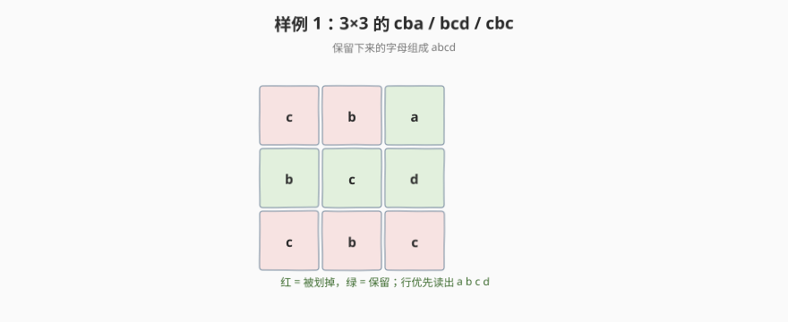
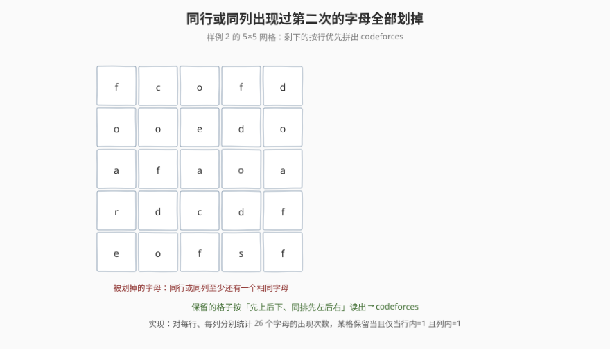

# Codeforces 90B 非洲纵横填字 题解

## 1. 题目概述

- **题目链接**：https://codeforces.com/problemset/problem/90/B
- **比赛来源**：Codeforces Beta Round 74 (Div. 2 Only) · Problem B（UTC 2011-06-16）
- **难度**：1100
- **标签**：字符串、计数、模拟
- **评测类型**：普通
- **限制**：时间 2 s / 内存 256 MB

**题意**：给出 $n \times m$ 的字母表格。若某个格子所在的**行**或**列**中还存在另一个与它相同的字母，就把这个格子划掉（所有格子同时判断）。把剩下的字母按"先上行后下行、同一行从左到右"的顺序拼成字符串，输出它。

**约束**：

- $1 \le n, m \le 100$：格子数至多 $10^4$，允许 $O(nm)$ 甚至 $O(nm(n+m))$ 的朴素做法。
- 字母只有小写拉丁字母：可以用长度 $26$ 的计数数组。
- 保证答案至少有一个字母（所以不会输出空串，但仍应按空串也能正常处理来写）。
- 单组数据。

## 2. 示例与观察

官方样例一：

```text
输入：
3 3
cba
bcd
cbc
输出：
abcd
```

官方样例二：

```text
输入：
5 5
fcofd
ooedo
afaoa
rdcdf
eofsf
输出：
codeforces
```

**样例一走查**：表格

$$\begin{matrix} c & b & a \\ b & c & d \\ c & b & c \end{matrix}$$

- 第 1 行的 `c` 在同行没有第二个，但第 1 列的 `c` 出现两次（$(1,1)$ 与 $(3,1)$）→ $(1,1)$ 划掉；
- $(1,2)=b$：第 3 行也有 $b$？列 2 是 $b,c,b$ → 有两个 $b$ → 划掉；
- $(1,3)=a$：行 1 唯一、列 3 是 $a,d,c$ 唯一 → 保留；
- $(2,1)=b$：列 1 有 $c,b,c$ → 唯一 $b$；行 2 是 $b,c,d$ → 唯一 → 保留；
- $(2,2)=c$：行 2 唯一、列 2 唯一 → 保留；
- $(2,3)=d$：唯一 → 保留；
- 第 3 行的 $c,b,c$ 都被划掉。

剩下 $a,b,c,d$（按行优先）→ `abcd`。



**样例二走查**：$5\times5$ 的网格经过同样的规则后，恰好留下拼成 `codeforces` 的 $10$ 个字母（如图）。

**观察**：一个格子是否保留，只取决于"它的字母在所在行出现了几次、在所在列出现了几次"。所以先统计每行、每列的字母频次，再逐格判断即可。

## 3. 解题思路

### 3.1 朴素做法与瓶颈

对每个格子，扫一遍它所在的行和列，看是否有相同的字母：$O(nm(n+m))$。$n,m \le 100$ 时是 $10^4 \times 200 = 2 \times 10^6$，完全够用。

不过预先统计频次可以让代码更短、更快，也更不容易写错"排除自己"这一步。

### 3.2 核心观察：行频次与列频次



设 `rowCnt[i][c]` 表示第 $i$ 行字母 $c$ 的出现次数，`colCnt[j][c]` 表示第 $j$ 列字母 $c$ 的出现次数。格子 $(i,j)$ 的字母为 $c$ 时：

$$\text{保留}(i,j) \iff \text{rowCnt}[i][c] = 1 \ \text{且}\ \text{colCnt}[j][c] = 1 .$$

因为"行里还有另一个相同的"等价于行频次 $\ge 2$，列同理；两个条件同时不满足才保留。

### 3.3 算法流程

1. 读入 $n,m$ 与表格；
2. 统计每行、每列的 $26$ 个字母频次；
3. 按 $i$ 从 $0$ 到 $n-1$、$j$ 从 $0$ 到 $m-1$ 遍历，若 `rowCnt[i][c]==1 && colCnt[j][c]==1` 就把该字母追加到答案；
4. 输出答案。

### 3.4 样例走查

对照第 2 节那张 3×3 网格图：

以样例一为例：行频次使第 2 行的三个字母都唯一；列频次只有第 3 列（$a,d,c$）和第 2 列（$b,c,b$ 中的 $c$）等需要核对。最终保留 $(1,3),(2,1),(2,2),(2,3)$ 四个格子，按行优先读出 `a b c d`。

## 4. 正确性证明

**引理 1**：格子 $(i,j)$（字母 $c$）所在行还存在另一个 $c$，当且仅当 `rowCnt[i][c] ≥ 2`；所在列同理等价于 `colCnt[j][c] ≥ 2`。

**证明**：`rowCnt[i][c]` 统计的正是第 $i$ 行中 $c$ 的总个数，包含 $(i,j)$ 自己；"还有另一个"即总数 $\ge 2$。∎

**引理 2**：题面要求"当且仅当所在行或列还有相同字母时划掉"，因此保留条件就是两个频次都等于 $1$。

**证明**：划掉 $\iff$ 行有重复 $\lor$ 列有重复（引理 1）；其否定即"行无重复且列无重复"，即两个频次都为 $1$。∎

**引理 3**：按"先上后下、同排从左到右"的遍历顺序恰好是题面要求的输出顺序。

**证明**：题面规定"位置更高的字母在前；同一行中左边的在前"，这正是行优先（先按行号、再按列号）的字典序。∎

**定理**：算法输出的字符串就是解密结果。

**证明**：由引理 2，算法保留的格子恰好是所有未被划掉的格子；由引理 3，它们的拼接顺序与题面一致。∎

## 5. 复杂度分析

- **时间**：统计频次 $O(nm)$，判断 $O(nm)$，总计 $O(nm)$；$n,m \le 100$ 时约 $10^4$ 次操作。
- **空间**：频次表 $O((n+m) \cdot 26)$，可忽略。
- **与时限的关系**：2 s 对 $10^4$ 级数据毫无压力，实测约 $2.4$ ms。

## 6. 参考代码

### C++17

```cpp
#include <bits/stdc++.h>
using namespace std;

int main() {
    int n, m;
    if (scanf("%d %d", &n, &m) != 2) return 0;
    vector<string> g(n);
    for (int i = 0; i < n; ++i) {
        char buf[128];
        scanf("%s", buf);
        g[i] = buf;
    }
    vector<array<int, 26>> row(n), col(m);
    for (int i = 0; i < n; ++i) row[i].fill(0);
    for (int j = 0; j < m; ++j) col[j].fill(0);
    for (int i = 0; i < n; ++i)
        for (int j = 0; j < m; ++j) {
            int c = g[i][j] - 'a';
            row[i][c]++;
            col[j][c]++;
        }
    string ans;
    for (int i = 0; i < n; ++i)
        for (int j = 0; j < m; ++j) {
            int c = g[i][j] - 'a';
            if (row[i][c] == 1 && col[j][c] == 1) ans.push_back(g[i][j]);
        }
    printf("%s\n", ans.c_str());
    return 0;
}
```

### Python3

```python
import sys


def main() -> None:
    data = sys.stdin.buffer.read().split()
    if not data:
        return
    n = int(data[0]); m = int(data[1])
    g = [data[2 + i].decode() for i in range(n)]
    row = [[0] * 26 for _ in range(n)]
    col = [[0] * 26 for _ in range(m)]
    for i in range(n):
        for j in range(m):
            c = ord(g[i][j]) - 97
            row[i][c] += 1
            col[j][c] += 1
    out = []
    for i in range(n):
        for j in range(m):
            c = ord(g[i][j]) - 97
            if row[i][c] == 1 and col[j][c] == 1:
                out.append(g[i][j])
    sys.stdout.write("".join(out) + "\n")


main()
```

## 7. 边界情况与易错点

1. **"还存在于同行或同列"包含自己**：频次统计天然包含自己，所以判据是"频次 $=1$"而不是"频次 $=0$"；用"找另一个"的写法时别把自己算进去。
2. **行、列是同时判定的**：不能先按行划掉、再在剩余格子上按列划掉——题面说"all such letters are crossed out simultaneously"，先划行会让列的频次变化。
3. **输出顺序是行优先**：先按行号升序，同一行再按列号升序；列优先会得到错误的词。
4. **$n=1$ 或 $m=1$**：退化成一维；此时"列"只有一个格子，列频次必然是 $1$，判定只由行决定（反之亦然），代码无需特判。
5. **答案至少一个字母**：题面保证，但即使为空也应输出空行而不是报错。
6. **字母表只有小写**：用 $26$ 个计数即可；若扩展到大小写或其它字符，要换成哈希计数。
7. **读入**：每行是连续 $m$ 个字符、没有空格，用 `%s` / `split()` 读入即可。

## 8. 验证记录

- **编译环境与命令**：`clang++ -std=c++17 -O2`（Apple clang 21.0.0 + `codeforces/tools/include` 的兼容头），Python 3.9.6。
- **官方样例**：2 / 2 通过（`abcd`、`codeforces`），C++ 与 Python 输出一致。
- **独立暴力对拍**：暴力对每个格子直接扫描整行与整列判断是否有相同字母（$O(nm(n+m))$，与频次法实现完全不同）。对 $n,m \le 7$、字母表 `abc` 的 **300 组**随机网格与参考程序比对，**全部一致**。
- **最大约束性能**：$n=m=100$ 时 C++ 端到端约 $2.4$ ms，Python 约 $22$ ms；相对 2 s 余量在数百倍以上。
- **图片校验**：`cf90b_cross.svg`、`cf90b_sample.svg` 均通过 `xml.etree.ElementTree.parse`，含 `feTurbulence` 与手写体字体族，文本包围盒未越出 `viewBox`。
- **公式校验**：KaTeX（`throwOnError`）渲染无报错；无 `---` 分隔线。
- **复核状态**：verified（样例、对拍、性能、图片、公式均实跑通过）。

## 相关题目与扩展

- [Codeforces 90A Cableway](https://codeforces.com/problemset/problem/90/A)：同场 A 题。
- [Codeforces 91B Queue](https://codeforces.com/problemset/problem/91/B)：同批次的 91B，后缀最小值。
- [Codeforces 118A String Task](https://codeforces.com/problemset/problem/118/A)：字符串过滤类入门题。
- [LeetCode 1189. “气球” 的最大数量](https://leetcode.cn/problems/maximum-number-of-balloons/)：按字符频次做判定，与本题的"频次即判据"同源。

**延伸思考**：

1. **如果要求"同一行或同一列出现第 $k$ 次以上才划掉"**：判据从"频次 $=1$"改成"频次 $\le k$"，其余不变。
2. **如果按"对角线"而不是行列判重**：只需把频次统计换成两条对角线方向，但"同时划掉"的语义仍要保证基于原始网格。
3. **如果字母表放大到 $256$**：把 $26$ 换成 $256$ 的计数数组即可，复杂度不变。
4. **如果要求输出被划掉的字母**：再加一个"划掉"标记数组，遍历时输出即可。

