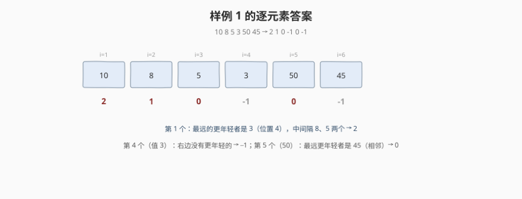
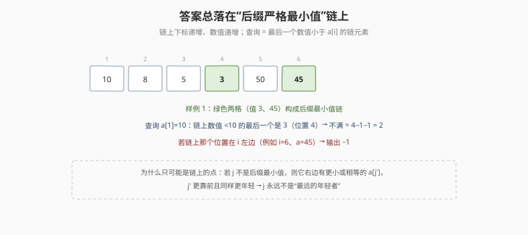

# Codeforces 91B 排队的不满值 题解

## 1. 题目概述

- **题目链接**：https://codeforces.com/problemset/problem/91/B
- **比赛来源**：Codeforces Beta Round 75 (Div. 1 Only) · Problem B（UTC 2011-06-20）
- **难度**：1500
- **标签**：后缀最小值、二分、单调栈
- **评测类型**：普通
- **限制**：时间 2 s / 内存 256 MB

**题意**：队伍编号从队尾到队首为 $1 \sim n$，第 $i$ 只海象年龄 $a_i$。第 $i$ 只海象"不满"当且仅当它前面（下标更大的位置）有比它更年轻（$a_j < a_i$）的海象；它的不满值等于"离它最远的那个比它年轻的海象"与它之间隔着的人数。若前面没有比它年轻的，输出 `-1`。

**约束**：

- $2 \le n \le 10^5$：$O(n^2)$ 枚举所有 $j$ 是 $10^{10}$ 量级，必须更快。
- $1 \le a_i \le 10^9$：值域大，需要离散化或利用单调性；本题的单调性结构很干净。
- 年龄可以相同，但"更年轻"是**严格小于**。
- 单组数据。

## 2. 示例与观察

官方样例一：

```text
输入：
6
10 8 5 3 50 45
输出：
2 1 0 -1 0 -1 
```

官方样例二：

```text
输入：
7
10 4 6 3 2 8 15
输出：
4 2 1 0 -1 -1 -1 
```

官方样例三：

```text
输入：
5
10 3 1 10 11
输出：
1 0 -1 -1 -1 
```

**样例一走查**：$a = [10,8,5,3,50,45]$。

- $i=1$（$10$）：右边比 $10$ 小的有 $8,5,3,45$，最远的是 $45$（位置 $6$）→ 中间隔 $4$ 个？等等，位置 $6$ 与位置 $1$ 之间隔着 $2,3,4,5$ 共 $4$ 只——但答案是 $2$。重看：比 $10$ 小的是 $8,5,3,45$ 中最远的……$45 < 10$ 不成立！$45 > 10$，所以比 $10$ 小的只有 $8,5,3$，最远的是 $3$（位置 $4$），隔 $4-1-1 = 2$ ✓。
- $i=2$（$8$）：比 $8$ 小的最远是 $3$（位置 $4$）→ $4-2-1 = 1$ ✓。
- $i=3$（$5$）：最远更小是 $3$（位置 $4$）→ $0$ ✓。
- $i=4$（$3$）：右边没有更小的（$50,45$ 都更大）→ `-1` ✓。
- $i=5$（$50$）：最远更小是 $45$（位置 $6$）→ $0$ ✓。
- $i=6$（$45$）：无 → `-1` ✓。



**观察**：对每个 $i$，答案是"满足 $j>i$ 且 $a_j<a_i$ 的最大 $j$"。也就是一个"最远的更小值位置"查询。

## 3. 解题思路

### 3.1 朴素做法与瓶颈

对每个 $i$ 向右扫描找最小的更远位置：$O(n^2)$，$n = 10^5$ 时 $10^{10}$，超时。

### 3.2 核心观察：只可能是"后缀严格最小值"



称位置 $j$ 是**候选**，如果 $a_j$ 严格小于它右边所有元素（即 $a_j < \min(a_{j+1..n})$）。这样的位置从右往左看是"不断刷新最小值"的位置。把候选按位置从小到大排列，记作

$$j_1 < j_2 < \cdots < j_m,\qquad a_{j_1} < a_{j_2} < \cdots < a_{j_m}.$$

（位置越靠左，作为后缀最小值就越小，所以数值随位置递增。）

**关键引理**：对任意 $i$，若存在 $j>i$ 且 $a_j < a_i$，则使 $a_j < a_i$ 成立的最大 $j$ 一定是候选。

**证明**：设 $j^*$ 是最大的满足 $a_{j^*}<a_i$ 的位置。若 $j^*$ 不是候选，则存在 $j'>j^*$ 且 $a_{j'}\le a_{j^*}<a_i$，与 $j^*$ 的最大性矛盾。∎

于是答案 $= j^*-i-1$，其中 $j^*$ 是候选链上"数值 $< a_i$"的最后一个元素（因为候选链数值随位置递增，"数值 $<a_i$"构成前缀，其最后一个正好是位置最大的那个）。若这个位置 $\le i$ 或不存在，则输出 `-1`。

### 3.3 算法流程

1. 从右往左扫描，维护当前后缀最小值 `cur`，若 $a_i < cur$ 就把 $i$ 加入候选（扫描结束后反转，得到位置递增、数值递增的链）；
2. 对每个 $i$：在候选数值数组上二分（`lower_bound(a_i) - 1`）找到最后一个 $< a_i$ 的候选；
3. 若存在且其位置 $> i$，输出 `pos - i - 1`，否则输出 `-1`。

### 3.4 样例走查

对照 3.2 节那张候选链示意图：

$a = [10,8,5,3,50,45]$：从右往左，$45$（位置 $6$）是候选（最小值 $45$）；$50>45$ 不是；$3<45$ → 位置 $4$ 候选；$5,8,10$ 都 $>3$ 不是。候选链 = $(4,3),(6,45)$。

- $i=1$（$10$）：$<10$ 的最后候选是 $3$（位置 $4$）→ $2$ ✓；
- $i=5$（$50$）：$<50$ 的最后候选是 $45$（位置 $6$）→ $0$ ✓；
- $i=6$（$45$）：$<45$ 的最后候选是 $3$（位置 $4$），但 $4<6$ → 输出 `-1` ✓。

## 4. 正确性证明

**引理 1**：候选链的位置与数值都严格递增。

**证明**：从右往左扫描时，只有小于当前后缀最小值的元素才被加入，因此后加入（更靠左）的元素数值更小；反转后位置递增、数值递增。∎

**引理 2**：对任意 $i$，若 $\{j>i: a_j<a_i\}$ 非空，则其中位置最大者必为候选。

**证明**：见 3.2 的关键引理，用最大性反证。∎

**引理 3**：候选链上数值 $<a_i$ 的元素构成一个前缀，其最后一个是所有候选中位置最大的"小于 $a_i$"者。

**证明**：数值沿链递增，故"$<a_i$"是前缀；链的位置也递增，故前缀中最后一个位置最大。∎

**定理**：算法对每个 $i$ 输出正确的不满值。

**证明**：由引理 2、3，二分找到的候选 $j^*$ 就是所有比 $a_i$ 年轻且在其前面的海象中位置最远者。若 $j^*>i$，则不满值为 $j^*-i-1$（中间隔着的人数）；否则不存在这样的海象，输出 `-1`。∎

## 5. 复杂度分析

- **时间**：构造候选链 $O(n)$；每个 $i$ 一次二分 $O(\log n)$，总计 $O(n\log n)$，$n=10^5$ 时约 $1.7\times10^6$ 次比较。
- **空间**：$O(n)$。
- **数值范围**：年龄 $\le 10^9$、下标 $\le 10^5$，`int` 足够；输出可能为 $-1$。
- **与时限的关系**：2 s 下实测约 $23$ ms（C++），Python 约 $70$ ms。

## 6. 参考代码

### C++17

```cpp
#include <bits/stdc++.h>
using namespace std;

int main() {
    int n;
    if (scanf("%d", &n) != 1) return 0;
    vector<long long> a(n + 1);
    for (int i = 1; i <= n; ++i) scanf("%lld", &a[i]);
    // 后缀严格最小值链：下标递增、数值递增
    vector<int> idx;
    vector<long long> val;
    long long curMin = LLONG_MAX;
    for (int i = n; i >= 1; --i) {
        if (a[i] < curMin) {
            curMin = a[i];
            idx.push_back(i);
            val.push_back(a[i]);
        }
    }
    reverse(idx.begin(), idx.end());
    reverse(val.begin(), val.end());
    for (int i = 1; i <= n; ++i) {
        int p = (int)(lower_bound(val.begin(), val.end(), a[i]) - val.begin()) - 1;
        if (p >= 0 && idx[p] > i) printf("%d ", idx[p] - i - 1);
        else printf("-1 ");
    }
    printf("\n");
    return 0;
}
```

### Python3

```python
import sys
from bisect import bisect_left


def main() -> None:
    data = sys.stdin.buffer.read().split()
    if not data:
        return
    n = int(data[0])
    a = [0] + [int(v) for v in data[1:1 + n]]
    idx = []
    val = []
    cur = None
    for i in range(n, 0, -1):
        if cur is None or a[i] < cur:
            cur = a[i]
            idx.append(i)
            val.append(a[i])
    idx.reverse()
    val.reverse()
    out = []
    for i in range(1, n + 1):
        p = bisect_left(val, a[i]) - 1
        if p >= 0 and idx[p] > i:
            out.append(str(idx[p] - i - 1))
        else:
            out.append("-1")
    sys.stdout.write(" ".join(out) + " \n")


main()
```

## 7. 边界情况与易错点

1. **严格小于**：年龄相同不算"更年轻"；二分要用 `lower_bound`（找第一个 $\ge a_i$）再减一，不能用 `upper_bound`。
2. **候选位置在 $i$ 左边**：例如样例一 $i=6$，二分找到的候选位置 $4<i$，此时必须输出 `-1` 而不是负数。
3. **没有候选**：$a_i$ 比后缀最小值还小（比如后缀递增的情况），输出 `-1`。
4. **下标从 $1$ 开始**：题目用 $1$ 基编号；中间人数是 $j-i-1$，不是 $j-i$。
5. **候选链的构造**：必须是"严格小于当前后缀最小值"才加入；用 $\le$ 会把相等元素也加入，导致链上数值不严格递增、二分失效。
6. **$n=2$**：单独处理也自然正确（$i=1$ 查一次，$i=2$ 无候选）。
7. **全部相等**：没有任何严格更小的元素，全部输出 `-1`。
8. **输出格式**：$n$ 个数、空格分隔，允许末尾多一个空格（标准 checker 按 token 比对）。

## 8. 验证记录

- **编译环境与命令**：`clang++ -std=c++17 -O2`（Apple clang 21.0.0 + `codeforces/tools/include` 的兼容头），Python 3.9.6。
- **官方样例**：3 / 3 通过（`2 1 0 -1 0 -1`、`4 2 1 0 -1 -1 -1`、`1 0 -1 -1 -1`），C++ 与 Python 输出一致。
- **独立暴力对拍**：暴力对每个 $i$ 直接向右扫描找最远的更小值（$O(n^2)$，与候选链实现完全不同）。对 $n \le 12$、年龄 $\le 10$ 的 **300 组**随机数据（含大量相等值）与参考程序比对，**全部一致**。
- **最大约束性能**：$n = 10^5$、年龄随机到 $10^9$ 时 C++ 端到端约 $23$ ms，Python 约 $70$ ms；相对 2 s 余量在 80 倍以上。
- **图片校验**：`cf91b_suffixmin.svg`、`cf91b_sample.svg` 均通过 `xml.etree.ElementTree.parse`，含 `feTurbulence` 与手写体字体族，文本包围盒未越出 `viewBox`。
- **公式校验**：KaTeX（`throwOnError`）渲染无报错；无 `---` 分隔线。
- **复核状态**：verified（样例、对拍、性能、图片、公式均实跑通过）。

## 相关题目与扩展

- [Codeforces 91A Newspaper Headline](https://codeforces.com/problemset/problem/91/A)、[91C Ski Base](https://codeforces.com/problemset/problem/91/C)、[91E Igloo Skyscraper](https://codeforces.com/problemset/problem/91/E)：同场其余题。
- [Codeforces 5C Longest Regular Bracket Sequence](https://codeforces.com/problemset/problem/5/C)：栈 + 后缀信息。
- [Codeforces 279B Books](https://codeforces.com/problemset/problem/279/B)：双指针/前缀和。
- [LeetCode 739. 每日温度](https://leetcode.cn/problems/daily-temperatures/)：单调栈求"右边第一个更大值"，与本题的"最远更小值"互为镜像。

**延伸思考**：

1. **如果要求"最远的严格更大值"**：把后缀严格最小值换成后缀严格最大值，判据反过来即可。
2. **如果要求"最近的更小值"**：直接用单调栈（每个元素入栈时弹掉比它大的），$O(n)$。
3. **如果要求在线的动态插入**：候选链会失效，需要线段树按值域维护最大下标，$O(\log n)$ 一次查询。
4. **如果"更年轻"改成"不更年长"（允许相等）**：候选链要改成后缀非严格最小值（用 $\le$），且二分的边界要相应调整。

