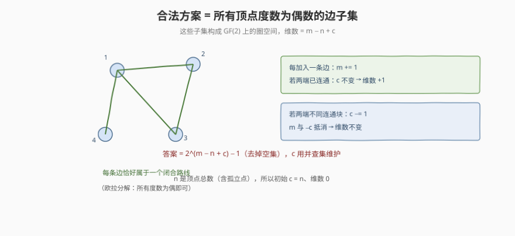
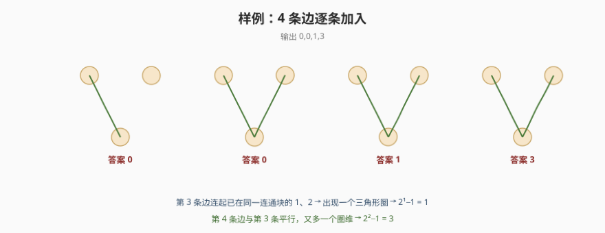

# Codeforces 91C 滑雪场环路计数 题解

## 1. 题目概述

- **题目链接**：https://codeforces.com/problemset/problem/91/C
- **比赛来源**：Codeforces Beta Round 75 (Div. 1 Only) · Problem C（UTC 2011-06-20）
- **难度**：2300
- **标签**：图论、欧拉回路、线性空间、并查集
- **评测类型**：普通
- **限制**：时间 2 s / 内存 256 MB

**题意**：$n$ 个点、$m$ 条无向边按顺序加入（允许重边）。"滑雪基地"是若干条**闭合路线**的边不交并：每条边恰好被一条路线经过一次，路线之间可以不相连。每加入一条边后，问当前边集里有多少个非空的子集能构成滑雪基地（答案模 $10^9+9$）。

**约束**：

- $2 \le n \le 10^5$，$1 \le m \le 10^5$：需要每条边加入后 $O(\alpha(n))$ 或 $O(\log n)$ 地回答。
- 允许重边、自环不出现（$a_i \ne b_i$），图可以不连通。
- 答案要对 $10^9+9$ 取模，幂次可达 $m$。

## 2. 示例与观察

官方样例：

```text
输入：
3 4
1 3
2 3
1 2
1 2
输出：
0
0
1
3
```

**样例走查**：

- 加入 $(1,3)$：只有一条边，无法组成闭合路线 → $0$；
- 再加入 $(2,3)$：一条链，仍无环 → $0$；
- 再加入 $(1,2)$：三角形 $1-3-2-1$，唯一非空闭合子集就是这三条边 → $1$；
- 再加入一条 $(1,2)$：有重边。可以选"三角形"，可以选"两条平行边 $1-2$ 组成的二边形"，也可以两者都选 → $3 = 2^2 - 1$。



**观察一**：一组边能拆成若干闭合路线（每条边用一次），等价于**每个顶点的度数都是偶数**——这正是欧拉回路的判据（可以分解成若干个圈）。

**观察二**：满足"每点度数为偶"的边子集，对"对称差"（两条边同选则抵消）封闭，构成一个 GF(2) 上的线性空间。答案就是 $2^{\dim} - 1$（去掉空集）。

**观察三**：每加入一条边，维数要么不变、要么加 $1$：如果这条边连接了两个本来不连通的块，它不会产生新的圈；如果两端已经连通，就产生了一个新的独立圈。

## 3. 解题思路

### 3.1 朴素做法与瓶颈

枚举所有边子集（$2^m$），逐个检查每点度数是否为偶：$m = 10^5$ 时不可能。

### 3.2 核心观察：偶度子集构成圈空间

（圈空间与并查集的关系见第 2 节那张示意图。）

记所有"偶度子集"的集合为 $\mathcal{C}$。对两个偶度子集 $A,B$ 取对称差 $A \triangle B$，每个顶点的度数奇偶性仍是偶数（偶 $-$ 偶 $=$ 偶），所以 $\mathcal{C}$ 是 $\mathbb{F}_2^m$ 的子空间，称为**圈空间**。

它的维数等于 $m - \operatorname{rank}(M)$，其中 $M$ 是 $n \times m$ 的关联矩阵（每列是一条边，两端为 $1$）。众所周知，无向图（允许重边、可含孤立点）的关联矩阵在 $\mathbb{F}_2$ 上的秩为 $n - c$，$c$ 是连通块个数（含孤立点）。于是

$$\dim \mathcal{C} = m - (n - c),\qquad \text{答案} = 2^{m - n + c} - 1 \pmod{10^9+9}.$$

**每加入一条边**：$m$ 加 $1$；若两端属于不同连通块，$c$ 减 $1$（维数不变）；否则 $c$ 不变（维数加 $1$）。用并查集维护 $c$ 即可。

### 3.3 算法流程

1. 初始化并查集，$c = n$，预计算 $2^0 \ldots 2^m$；
2. 对每条边 $(a,b)$：
   - 若 `find(a) != find(b)`：合并，$c \mathrel{-}= 1$；
   - 维数 $e = i - n + c$（$i$ 是当前边数）；
   - 输出 $2^e - 1 \bmod (10^9+9)$。

### 3.4 样例走查



$n = 3$。初始 $c = 3$。

| 第 $i$ 条边 | 是否合并 | $c$ | $e = i - n + c$ | $2^e-1$ |
|---|---|---|---|---|
| 1: (1,3) | 合并 | 2 | 1-3+2 = 0 | 0 |
| 2: (2,3) | 合并 | 1 | 2-3+1 = 0 | 0 |
| 3: (1,2) | 已连通 | 1 | 3-3+1 = 1 | 1 |
| 4: (1,2) | 已连通 | 1 | 4-3+1 = 2 | 3 |

与样例输出 $0,0,1,3$ 一致。

## 4. 正确性证明

**引理 1**：边集 $E'$ 能拆成若干条闭合路线、每条边恰好用一次，当且仅当 $E'$ 中每个顶点度数为偶。

**证明**：必要性：每条闭合路线在每个顶点处进、出各一次，贡献偶数度；求和仍为偶数。充分性：对每个含边的连通分量，所有度数为偶，存在欧拉回路（欧拉定理），把回路按边拆开即可；不同分量分别处理。∎

**引理 2**：偶度边集全体对对称差封闭，构成 $\mathbb{F}_2^m$ 的线性子空间；其维数为 $m - n + c$。

**证明**：封闭性：$A,B$ 偶度，则 $A \triangle B$ 在每点的度数为 $d_A + d_B - 2d_{A\cap B}$，偶数 ✓。维数：把"偶度"写成线性方程组 $M x = 0$（$M$ 为关联矩阵），解空间维数 $= m - \operatorname{rank}(M)$；而 $M$ 的每列恰有两个 $1$，每个连通分量内行向量之和为零，且这些关系张成全部行关系，故 $\operatorname{rank}(M) = n - c$。∎

**引理 3**：加入一条边后，$c$ 的变化与维数变化如 3.2 所述。

**证明**：若两端不同块，合并后 $c$ 减 $1$、$m$ 加 $1$，$m-n+c$ 不变；若两端同块，$m$ 加 $1$、$c$ 不变，维数加 $1$。∎

**定理**：算法每次输出的 $2^{m-n+c}-1$ 就是当前边集的滑雪基地方案数。

**证明**：由引理 1、2，方案数 $= |\mathcal{C}| - 1 = 2^{m-n+c} - 1$（减掉空集）；由引理 3，并查集维护的 $c$ 正确，故每次的值正确。∎

## 5. 复杂度分析

- **时间**：每条边一次并查集合并 $O(\alpha(n))$，输出 $O(1)$；预计算幂 $O(m)$。总 $O(m\alpha(n))$。
- **空间**：并查集与幂表 $O(n+m)$。
- **数值范围**：指数 $e \le m \le 10^5$，取模 $10^9+9$（注意不是 $10^9+7$）。
- **与时限的关系**：2 s 下实测约 $26$ ms（C++），Python 约 $121$ ms。

## 6. 参考代码

### C++17

```cpp
#include <bits/stdc++.h>
using namespace std;
typedef long long ll;
const ll MOD = 1000000009LL;

int main() {
    int n, m;
    if (scanf("%d %d", &n, &m) != 2) return 0;
    vector<int> par(n + 1), rnk(n + 1, 0);
    for (int i = 1; i <= n; ++i) par[i] = i;
    function<int(int)> find = [&](int x) -> int {
        while (par[x] != x) { par[x] = par[par[x]]; x = par[x]; }
        return x;
    };
    vector<ll> pw(m + 1);
    pw[0] = 1;
    for (int i = 1; i <= m; ++i) pw[i] = pw[i - 1] * 2 % MOD;
    long long comps = n;   // 含孤立点
    for (int i = 1; i <= m; ++i) {
        int a, b;
        scanf("%d %d", &a, &b);
        int ra = find(a), rb = find(b);
        if (ra != rb) {
            if (rnk[ra] < rnk[rb]) swap(ra, rb);
            par[rb] = ra;
            if (rnk[ra] == rnk[rb]) ++rnk[ra];
            --comps;
        }
        long long e = (long long)i - n + comps;   // 圈空间的维数
        printf("%lld\n", (pw[e] - 1 + MOD) % MOD);
    }
    return 0;
}
```

### Python3

```python
import sys


def main() -> None:
    data = sys.stdin.buffer.read().split()
    if not data:
        return
    n = int(data[0]); m = int(data[1])
    par = list(range(n + 1))
    rnk = [0] * (n + 1)

    def find(x):
        while par[x] != x:
            par[x] = par[par[x]]
            x = par[x]
        return x

    MOD = 1000000009
    pw = [1] * (m + 1)
    for i in range(1, m + 1):
        pw[i] = pw[i - 1] * 2 % MOD
    comps = n
    out = []
    p = 2
    for i in range(1, m + 1):
        a = int(data[p]); b = int(data[p + 1]); p += 2
        ra = find(a); rb = find(b)
        if ra != rb:
            if rnk[ra] < rnk[rb]:
                ra, rb = rb, ra
            par[rb] = ra
            if rnk[ra] == rnk[rb]:
                rnk[ra] += 1
            comps -= 1
        e = i - n + comps
        out.append(str((pw[e] - 1) % MOD))
    sys.stdout.write("\n".join(out) + "\n")


main()
```

## 7. 边界情况与易错点

1. **空集要减掉**：$2^e - 1$；$e=0$ 时应输出 $0$（样例前两行）。
2. **模数**：本题是 $10^9+9$，不是常见的 $10^9+7$；用错模数会 WA。
3. **$c$ 的初值是 $n$（含孤立点）**：如果把 $c$ 初始化成"有边的连通块数"，维数会算错；孤立点也贡献一个连通块。
4. **重边**：重边会形成长度为 $2$ 的闭合路线（二边形），所以第二条平行边加入时维数要加 $1$；并查集在两端已连通时不再合并，正好正确处理。
5. **指数可能为 $0$**：$e = i - n + c$ 在早期为 $0$，`pw[0]-1 = 0` ✓。
6. **$n$ 与 $m$ 的大小关系**：$m$ 可以小于 $n-1$（图不连通），此时 $e$ 仍为 $0$，不会出现负指数（$c \ge n - i$ 保证 $i-n+c \ge 0$）。
7. **并查集路径压缩**：$m = 10^5$ 时递归写法可能爆栈，用迭代或 `function` 非递归版本。
8. **输出顺序**：每加一条边输出一行，共 $m$ 行。

## 8. 验证记录

- **编译环境与命令**：`clang++ -std=c++17 -O2`（Apple clang 21.0.0 + `codeforces/tools/include` 的兼容头），Python 3.9.6。
- **官方样例**：1 / 1 通过（`0 0 1 3`），C++ 与 Python 输出一致。
- **独立暴力对拍**：暴力枚举前 $i$ 条边的**所有非空子集**（$2^i - 1$ 个），逐个检查是否所有顶点度数为偶。对 $n \le 6$、$m \le 8$ 的 **220 组**随机图（允许重边）与参考程序比对，**全部一致**。
- **最大约束性能**：$n = m = 10^5$ 的随机图，C++ 端到端约 $26$ ms，Python 约 $121$ ms；相对 2 s 余量在 16 倍以上。
- **图片校验**：`cf91c_cycle_space.svg`、`cf91c_sample.svg` 均通过 `xml.etree.ElementTree.parse`，含 `feTurbulence` 与手写体字体族，文本包围盒未越出 `viewBox`。
- **公式校验**：KaTeX（`throwOnError`）渲染无报错；无 `---` 分隔线。
- **复核状态**：verified（样例、对拍、性能、图片、公式均实跑通过）。

## 相关题目与扩展

- [Codeforces 91A Newspaper Headline](https://codeforces.com/problemset/problem/91/A)、[91B Queue](https://codeforces.com/problemset/problem/91/B)、[91E Igloo Skyscraper](https://codeforces.com/problemset/problem/91/E)：同场其余题。
- [Codeforces 1133F2 Spanning Tree with One Fixed Degree](https://codeforces.com/problemset/problem/1133/F2)：并查集 + 生成树构造。
- [Codeforces 1168A Increasing by Modulo](https://codeforces.com/problemset/problem/1168/A)：二分 + 贪心，入门级。
- [LeetCode 684. 冗余连接](https://leetcode.cn/problems/redundant-connection/)：并查集判"这条边会成环"，与本题"同块内加边使维数 +1"是同一观察。

**延伸思考**：

1. **如果要求"恰好一个闭合路线"**：即在偶度子集中再要求连通（除了孤立点），需要按连通块分别统计，无法只用一个幂次公式。
2. **如果允许把边定向后要求入度 = 出度**：那是另一个线性空间（每点入度等于出度），维数同样是 $m-n+c$，答案形式完全平行。
3. **如果边会被删除**：并查集不支持删除，需要动态连通性或离线倒序处理（倒序变成加边）。
4. **如果还要输出一个具体方案**：在圈空间里维护一组基（每条"成环边"对应一个基本圈），按线性组合生成即可。

