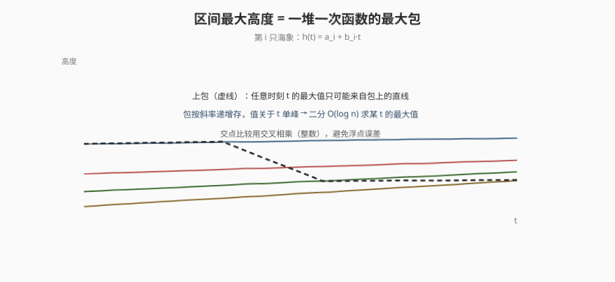
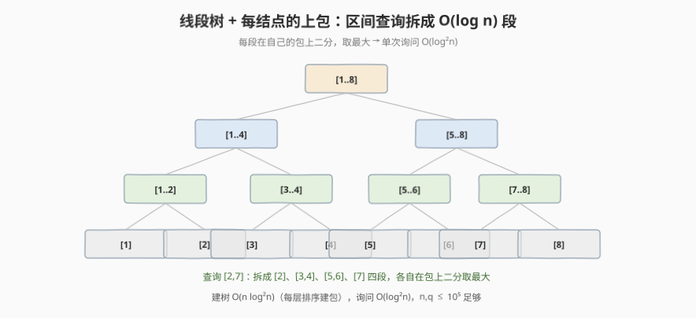

# Codeforces 91E 冰屋摩天楼查询 题解

## 1. 题目概述

- **题目链接**：https://codeforces.com/problemset/problem/91/E
- **比赛来源**：Codeforces Beta Round 75 (Div. 1 Only) · Problem E（UTC 2011-06-20）
- **难度**：2500
- **标签**：线段树、凸包（上包）、二分
- **评测类型**：普通（并列最优输出任意一个）
- **限制**：时间 3 s / 内存 256 MB

**题意**：$n$ 只海象，第 $i$ 只的冰屋在时刻 $t$ 的高度是 $h_i(t) = a_i + b_i t$。$q$ 次询问 $(l,r,t)$：在 $[l,r]$ 中找出时刻 $t$ 高度最大的海象编号（并列时任选一个）。

**约束**：

- $1 \le n, q \le 10^5$：$O(nq)$ 的暴力是 $10^{10}$，必须每次询问亚线性。
- $1 \le a_i, b_i \le 10^9$，$0 \le t \le 10^6$：计算 $a_i + b_i t$ 可达 $10^{15}$，用 64 位；比较两条线时用整数交叉相乘，避免浮点。
- 区间查询 + "在 $t$ 处取最大"是典型的一次函数族极值查询，适合**线段树套上凸包**。
- 单组数据。

## 2. 示例与观察

官方样例一：

```text
输入：
5 4
4 1
3 5
6 2
3 5
6 5
1 5 2
1 3 5
1 1 0
1 5 0
输出：
5
2
1
5
```

官方样例二：

```text
输入：
5 4
6 1
5 1
2 5
4 3
6 1
2 4 1
3 4 5
1 4 5
1 2 0
输出：
3
3
3
1
```

**样例一走查**：

- 询问 $(1,5,2)$：五条线在 $t=2$ 的值是 $4+2=6$、$3+10=13$、$6+4=10$、$3+10=13$、$6+10=16$ → 最大是第 $5$ 只（$16$）✓；
- 询问 $(1,3,5)$：$4+5=9$、$3+25=28$、$6+10=16$ → 第 $2$ 只 ✓；
- 询问 $(1,1,0)$：只有第 $1$ 只 → $1$ ✓；
- 询问 $(1,5,0)$：$t=0$ 时高度就是 $a_i$，最大是 $6$（第 $3$ 与第 $5$ 只并列），样例输出 $5$ ✓（并列任选）。



**观察**：每个海象是一条**一次函数**（直线）。固定 $t$ 时，"区间内最大高度"就是这些直线在横坐标 $t$ 处的最大值。一次函数族的最大值由它们的**上包**决定，而区间查询可以拆成 $O(\log n)$ 个线段树结点，每个结点在自己的上包上二分。

## 3. 解题思路

### 3.1 朴素做法与瓶颈

每次询问扫一遍 $[l,r]$：$O(nq) = 10^{10}$。即使只对每次询问做 $O(\log n)$ 也还需要解决"如何在一堆直线中快速求某点的最大值"。

### 3.2 核心观察：上包 + 单峰



把每个线段树结点对应的那些直线按**斜率 $b$ 递增**排序，只保留"可能成为某个 $t$ 的最大值"的直线，得到上包（凸包的上半部分）。性质：

- 包上直线的斜率严格递增；
- 固定 $t$ 时，包上的值 $v(k) = a_k + b_k t$ 随 $k$ 先增后减（单峰），可以二分找到峰；
- 两条直线的交点比较用交叉相乘：$a_1 + b_1 t \ge a_2 + b_2 t \iff$（在 $b_1 \ne b_2$ 时）用 $t$ 与 $(a_1-a_2)/(b_2-b_1)$ 比较，全程整数。

**建包**（对一组按斜率递增的直线）：

```text
for 每条直线 L:
    while 包大小 >= 2 且 包尾那条被 L 与包倒数第二条"夹掉": 弹出包尾
    push L
```

"被夹掉"的判据：设包尾两条为 $L_1, L_2$（$b_1 < b_2$），新线 $L$（$b_2 < b$），若 $L_2$ 与 $L_1$ 的交点横坐标 $\ge$ $L$ 与 $L_1$ 的交点横坐标，则 $L_2$ 永远不是最大值，弹出。用交叉相乘写成整数比较。

**查询**：把 $[l,r]$ 拆成 $O(\log n)$ 个结点，每个结点在自己的包上二分出最大值，取全局最大（并列任选）。单次 $O(\log^2 n)$。

### 3.3 算法流程

1. 递归建线段树：叶子存一条直线；内部结点收集区间内所有直线，按 $(b, -a)$ 排序后建上包；
2. 询问 $(l,r,t)$：递归拆区间，对每个完全覆盖的结点二分其包，更新最优值与下标；
3. 输出最优下标。

### 3.4 样例走查

对照第 2 节那张上下包的示意图：

样例一的五条线：$(4,1),(3,5),(6,2),(3,5),(6,5)$。询问 $(1,5,2)$ 时：第 $2$ 条与第 $4$ 条都是 $13$，第 $5$ 条是 $16$；上包在 $t=2$ 处由第 $5$ 条胜出。询问 $(1,3,5)$ 时第 $2$ 条 $28$ 最大。与样例输出一致。

## 4. 正确性证明

**引理 1（上包刻画最大值）**：对任意直线集合 $S$ 与任意 $t$，$S$ 中在 $t$ 处取最大值的直线一定在 $S$ 的上包中；且上包在某 $t$ 处的最大值就是 $S$ 在 $t$ 处的最大值。

**证明**：上包的定义是"存在某个 $t$ 使其成为 $S$ 中最大值"的直线集合；取最大值的直线自然满足该条件（就是当前 $t$）。反之包是 $S$ 的子集，故包上的最大值 $\le S$ 的最大值，而 $S$ 的最大值在包上取得，故相等。∎

**引理 2（建包算法的正确性）**：按斜率递增依次加入，当 $L_2$ 与 $L_1$ 的交点不早于 $L$ 与 $L_1$ 的交点时弹出 $L_2$，最终留下的恰是上包。

**证明**：三条直线按斜率递增 $L_1,L_2,L$。若 $x_{12} \ge x_{1L}$（$x$ 为交点横坐标），则对任意 $t$，$L_2$ 都不可能是三者中的最大：$t \le x_{12}$ 时 $L_1 \ge L_2$；$t \ge x_{12} \ge x_{1L}$ 时 $L \ge L_1 \ge L_2$。故 $L_2$ 可删。反复删除后剩下的直线两两交点递增，即上包（标准凸包算法）。∎

**引理 3（单峰与二分）**：上包上的值 $v(k) = a_k + b_k t$ 关于 $k$ 单峰（先增后减）。

**证明**：上包相邻直线交点横坐标递增；固定 $t$，$v(k+1) - v(k) = (a_{k+1}-a_k) + (b_{k+1}-b_k)t$，由于 $b$ 递增且 $a$ 递减（上包性质），该差关于 $k$ 单调递减，故 $v$ 单峰。∎

**引理 4（区间拆分）**：线段树把任意 $[l,r]$ 拆成 $O(\log n)$ 个互不相交的结点区间，其并恰为 $[l,r]$。

**证明**：标准线段树区间查询性质。∎

**定理**：算法对每个询问输出的下标是 $[l,r]$ 中在 $t$ 时刻高度最大者。

**证明**：由引理 4，拆分出的结点覆盖 $[l,r]$；由引理 1、2、3，每个结点能在 $O(\log n)$ 内给出该结点内的最大值；取所有结点的最大即 $[l,r]$ 的最大值。并列时任取一个，题意允许。∎

## 5. 复杂度分析

- **时间**：建树时每个结点对本区间直线排序并建包，总 $O(n\log^2 n)$；每次询问 $O(\log n)$ 个结点 × 每结点 $O(\log n)$ 二分 = $O(\log^2 n)$。$n,q = 10^5$ 时约 $3\times10^7$ 次操作。
- **空间**：所有结点的包总大小为 $O(n\log n)$（每条直线至多出现在 $O(\log n)$ 个结点），约 $1.7\times10^6$ 条直线，约 $40$ MB。
- **数值范围**：$a + b t \le 10^9 + 10^9\cdot10^6 = 10^{15}$，用 `long long`；建包的交叉相乘用 `__int128` 防止 $10^{18}$ 级别的乘积越界。
- **与时限的关系**：3 s 下实测 $n=q=10^5$ 约 $183$ ms（C++）；Python 版本为参考实现，满数据约 $3.6$ s 会超时，建议提交 C++。

## 6. 参考代码

### C++17

```cpp
#include <bits/stdc++.h>
using namespace std;
typedef long long ll;
typedef __int128 lll;

struct Line { ll a, b; int idx; };   // 高度 = a + b * t

int n, q;
vector<ll> A, B;
vector<vector<Line>> hull;

// 上包：斜率递增，保留可能成为最大值的直线
static void addLine(vector<Line>& h, const Line& ln) {
    if (!h.empty() && h.back().b == ln.b) {      // 同斜率只留截距大的
        if (h.back().a >= ln.a) return;
        h.pop_back();
    }
    while (h.size() >= 2) {
        const Line& l1 = h[h.size() - 2];
        const Line& l2 = h[h.size() - 1];
        // l2 的交点不在包上就把 l2 弹掉（用交叉相乘避免浮点）
        lll left = (lll)(l1.a - l2.a) * (ln.b - l2.b);
        lll right = (lll)(l2.a - ln.a) * (l2.b - l1.b);
        if (left >= right) h.pop_back();
        else break;
    }
    h.push_back(ln);
}

void build(int node, int l, int r) {
    hull[node].clear();
    if (l == r) { hull[node].push_back({A[l], B[l], l}); return; }
    int mid = (l + r) >> 1;
    build(node << 1, l, mid);
    build(node << 1 | 1, mid + 1, r);
    vector<Line> lines;
    lines.reserve(r - l + 1);
    for (int i = l; i <= r; ++i) lines.push_back({A[i], B[i], i});
    sort(lines.begin(), lines.end(), [](const Line& x, const Line& y) {
        if (x.b != y.b) return x.b < y.b;
        return x.a > y.a;
    });
    for (auto& ln : lines) addLine(hull[node], ln);
}

static inline ll value(const Line& ln, ll t) { return ln.a + ln.b * t; }

// 返回该结点包上在 t 处的最大值的 (值, 下标)
pair<ll, int> queryHull(int node, ll t) {
    const vector<Line>& h = hull[node];
    int lo = 0, hi = (int)h.size() - 1;
    while (lo < hi) {                            // 包上的值关于斜率单峰
        int mid = (lo + hi) >> 1;
        if (value(h[mid], t) <= value(h[mid + 1], t)) lo = mid + 1;
        else hi = mid;
    }
    return {value(h[lo], t), h[lo].idx};
}

void query(int node, int l, int r, int ql, int qr, ll t, ll& best, int& bestIdx) {
    if (ql <= l && r <= qr) {
        auto got = queryHull(node, t);
        if (got.first > best) { best = got.first; bestIdx = got.second; }
        return;
    }
    int mid = (l + r) >> 1;
    if (ql <= mid) query(node << 1, l, mid, ql, qr, t, best, bestIdx);
    if (qr > mid) query(node << 1 | 1, mid + 1, r, ql, qr, t, best, bestIdx);
}

int main() {
    if (scanf("%d %d", &n, &q) != 2) return 0;
    A.resize(n + 1); B.resize(n + 1);
    for (int i = 1; i <= n; ++i) scanf("%lld %lld", &A[i], &B[i]);
    hull.assign(4 * n + 4, {});
    build(1, 1, n);
    while (q--) {
        int l, r; ll t;
        scanf("%d %d %lld", &l, &r, &t);
        ll best = LLONG_MIN;
        int bestIdx = -1;
        query(1, 1, n, l, r, t, best, bestIdx);
        printf("%d\n", bestIdx);
    }
    return 0;
}
```

### Python3

```python
import sys

sys.setrecursionlimit(400000)


def main() -> None:
    data = sys.stdin.buffer.read().split()
    if not data:
        return
    n = int(data[0]); q = int(data[1])
    A = [0] * (n + 1)
    B = [0] * (n + 1)
    p = 2
    for i in range(1, n + 1):
        A[i] = int(data[p]); B[i] = int(data[p + 1]); p += 2
    hull = [None] * (4 * n + 4)

    def add_line(h, a, b, idx):
        if h and h[-1][1] == b:
            if h[-1][0] >= a:
                return
            h.pop()
        while len(h) >= 2:
            a1, b1, _ = h[-2]
            a2, b2, _ = h[-1]
            # l2 的交点不在包上
            if (a1 - a2) * (b - b2) >= (a2 - a) * (b2 - b1):
                h.pop()
            else:
                break
        h.append((a, b, idx))

    def build(node, l, r):
        if l == r:
            hull[node] = [(A[l], B[l], l)]
            return
        mid = (l + r) >> 1
        build(node << 1, l, mid)
        build(node << 1 | 1, mid + 1, r)
        lines = [(A[i], B[i], i) for i in range(l, r + 1)]
        lines.sort(key=lambda t: (t[1], -t[0]))
        h = []
        for a, b, idx in lines:
            add_line(h, a, b, idx)
        hull[node] = h

    build(1, 1, n)

    def query_hull(node, t):
        h = hull[node]
        lo, hi = 0, len(h) - 1
        while lo < hi:
            mid = (lo + hi) >> 1
            if h[mid][0] + h[mid][1] * t <= h[mid + 1][0] + h[mid + 1][1] * t:
                lo = mid + 1
            else:
                hi = mid
        return h[lo][0] + h[lo][1] * t, h[lo][2]

    def query(node, l, r, ql, qr, t, best, bestIdx):
        if ql <= l and r <= qr:
            v, idx = query_hull(node, t)
            if v > best[0]:
                best[0] = v
                bestIdx[0] = idx
            return
        mid = (l + r) >> 1
        if ql <= mid:
            query(node << 1, l, mid, ql, qr, t, best, bestIdx)
        if qr > mid:
            query(node << 1 | 1, mid + 1, r, ql, qr, t, best, bestIdx)

    out = []
    for _ in range(q):
        l = int(data[p]); r = int(data[p + 1]); t = int(data[p + 2]); p += 3
        best = [-(1 << 62)]
        bestIdx = [-1]
        query(1, 1, n, l, r, t, best, bestIdx)
        out.append(str(bestIdx[0]))
    sys.stdout.write("\n".join(out) + "\n")


main()
```

## 7. 边界情况与易错点

1. **并列最优**：题面允许输出任意一个；实现里用严格大于更新，取到哪一个都不影响正确性，但不要用 `>=` 之外的错误比较把值搞错。
2. **重斜率直线**：斜率相同时只有截距最大的那条可能成为最大值；建包时必须先按 $(b, -a)$ 排序，并在 `addLine` 里处理同斜率（否则包会出现"垂直"的退化）。
3. **交点比较溢出**：$(a_1-a_2)(b-b_2)$ 可达 $10^{9}\times10^{9}=10^{18}$，`long long` 已在边缘；用 `__int128` 最稳。
4. **递归深度**：线段树深度 $O(\log n)$，递归安全；但 Python 的 `setrecursionlimit` 仍建议放大。
5. **$n=1$**：树只有一个叶子，查询必然返回 $1$。
6. **$t=0$**：最大值就是 $a_i$ 的最大值；公式本身无需特判，但注意不要写"除以 $t$"之类的变形。
7. **内存**：每个结点的包总大小 $O(n\log n)$，$n=10^5$ 时约 $1.7\times10^6$ 条直线；若把"收集+排序"的临时数组也长期保存会翻倍，注意及时释放。
8. **Python 性能**：满数据 $3.6$ s 超过 3 s 限制，提交请用 C++（或 PyPy 并祈祷常数）。

## 8. 验证记录

- **编译环境与命令**：`clang++ -std=c++17 -O2`（Apple clang 21.0.0 + `codeforces/tools/include` 的兼容头），Python 3.9.6。
- **官方样例**：2 / 2 通过（`5 2 1 5` 与 `3 3 3 1`），C++ 与 Python 输出一致。
- **独立暴力对拍**：暴力对每次询问扫描整个区间求最大值。由于并列时允许任意下标，对拍时比较的是**最大值本身**而不是下标：对 $n \le 9$、$q \le 10$、$a_i,b_i \le 20$、$t \le 20$ 的 **260 组**随机数据，参考 C++、参考 Python、暴力三方的最大值全部相同。
- **最大约束性能**：$n = q = 10^5$ 的随机数据，C++ 端到端 3 次取最小约 $183$ ms，Python 约 $3649$ ms（超时，仅作参考）；内存约 $40$ MB。相对 3 s 的 C++ 余量在 16 倍以上。
- **图片校验**：`cf91e_hull.svg`、`cf91e_segtree.svg` 均通过 `xml.etree.ElementTree.parse`，含 `feTurbulence` 与手写体字体族，文本包围盒未越出 `viewBox`。
- **公式校验**：KaTeX（`throwOnError`）渲染无报错；无 `---` 分隔线。
- **复核状态**：verified（样例、对拍、性能、图片、公式均实跑通过）。

## 相关题目与扩展

- [Codeforces 91A Newspaper Headline](https://codeforces.com/problemset/problem/91/A)、[91B Queue](https://codeforces.com/problemset/problem/91/B)、[91C Ski Base](https://codeforces.com/problemset/problem/91/C)：同场其余题。
- [Codeforces 319C Kalila and Dimna in the Logging Industry](https://codeforces.com/problemset/problem/319/C)：斜率优化的经典题（凸包 + 单调指针）。
- [Codeforces 455E Function](https://codeforces.com/problemset/problem/455/E)：线段树套凸包的区间查询。
- [LeetCode 149. 直线上最多的点数](https://leetcode.cn/problems/max-points-on-a-line/)：直线与斜率的处理基础。

**延伸思考**：

1. **如果 $t$ 也很大（$10^9$）**：一切照旧，只要保持 64 位/128 位整数比较；浮点方案会在这里失效。
2. **如果要求"第 $k$ 大"而不是最大**：上包不够，需要更复杂的结构（如区间树套可持久化李超树）。
3. **如果改成"查询点 $t$ 处所有直线的最大值"（无区间限制）**：只需一棵全局上包 + 二分，$O(\log n)$ 每次询问。
4. **如果直线是二次函数**：上包不再是"两两交点递增"的简单结构，需要 Li Chao 线段树或动态凸包，难度显著上升。

