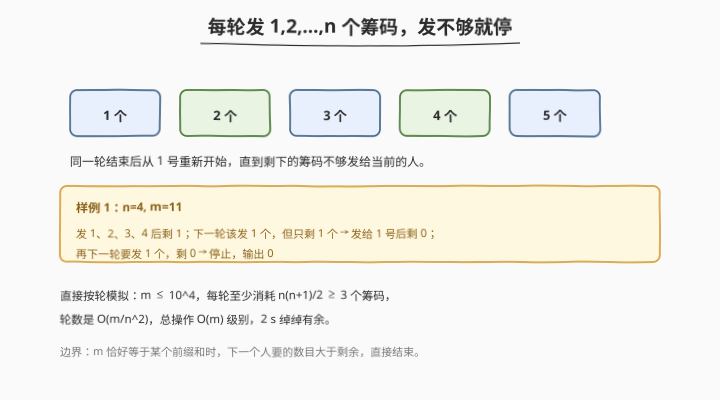
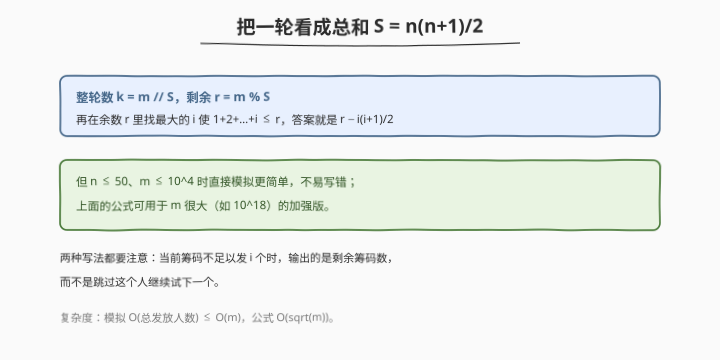

# Codeforces 92A 分发筹码 题解

## 1. 题目概述

- **题目链接**：https://codeforces.com/problemset/problem/92/A
- **比赛来源**：Codeforces Beta Round 75 (Div. 2 Only) · Problem A（UTC 2011-06-20）
- **难度**：800
- **标签**：模拟、数学
- **评测类型**：普通
- **限制**：时间 2 s / 内存 256 MB

**题意**：$n$ 只海象围成一圈，编号 $1 \dots n$。主持人有 $m$ 个筹码，从 1 号开始顺时针依次发：第 $i$ 只海象应当拿到 $i$ 个筹码。如果轮到某只海象时剩下的筹码**不够** $i$ 个，主持人就把剩下的全部留下、过程结束。问最后主持人手里还剩几个筹码。

**约束**：

- $n \le 50$、$m \le 10^4$：规模很小，直接一圈一圈模拟即可；即使无脑循环，总发放次数也不超过 $m$（每次至少发 1 个），$2$ s 绰绰有余。
- 发送顺序是「$1, 2, \dots, n$」循环，即每一轮的发放总量是 $S = n(n+1)/2$。
- 输入只有一行两个整数。

## 2. 示例与观察

官方样例（输入 / 输出原样）：

```text
输入：
4 11

输出：
0
```

```text
输入：
17 107

输出：
2
```

```text
输入：
3 8

输出：
1
```

**样例 1 解释**：$n=4$，发放序列是 $1,2,3,4,1,2,\dots$。$11 - 1 - 2 - 3 - 4 = 1$；下一轮先发 1 个，正好发掉，剩 $0$；再下一个要 2 个，不够 → 输出 0。

**样例 3 解释**：$n=3$、$m=8$：$8-1-2-3 = 2$；下一轮 1 号要 1 个，发掉后剩 1；2 号要 2 个，不够 → 输出剩下的 1。

**观察一（按轮看）**：每一轮的发放总量固定为 $S = n(n+1)/2$，且一轮之后指针回到 1 号。因此可以整轮整轮地扣，最后在余数里逐个人地扣。

**观察二（结束条件）**：结束发生在「当前应发 $i$ 个但剩余 $< i$」时，此时输出的是**剩余数**（可能不是 0）。样例 3 就是这种情况。

## 3. 解题思路



由于 $m \le 10^4$，最直接的做法就是模拟：

1. 循环：$i$ 从 1 到 $n$；
2. 若 $m < i$，输出 $m$ 并结束；
3. 否则 $m \leftarrow m - i$；
4. 一轮结束后回到 1 号继续。

每次成功发放至少消耗 1 个筹码，所以循环总次数不超过 $m$，复杂度 $O(m)$。



如果 $m$ 很大（加强版），可以先用 $k = m / S$ 整轮扣掉、$r = m \bmod S$，再在 $r$ 上逐个人扣（$O(\sqrt m)$）。本题不需要，但可以作为自检：两种实现的结果必须一致（第 8 节用它对拍了 5000 组）。

### 3.2 样例走查

$n = 4, m = 11$：

| 步 | 应发 | 发前 $m$ | 发后 $m$ |
|---|---|---|---|
| 1 | 1 | 11 | 10 |
| 2 | 2 | 10 | 8 |
| 3 | 3 | 8 | 5 |
| 4 | 4 | 5 | 1 |
| 5 | 1 | 1 | 0 |
| 6 | 2 | 0 | 不够，输出 0 |

与样例一致。

## 4. 正确性证明

**引理 1（轮的结构）**：模拟中的发放顺序恰为 $1, 2, \dots, n, 1, 2, \dots$，每一轮（$n$ 次发放）消耗 $S = n(n+1)/2$ 个筹码。

**证明**：由题意，指针从 1 递增到 $n$ 后回到 1，如此循环；一轮内发放数之和为 $1+2+\dots+n = S$。∎

**引理 2（结束条件）**：过程结束当且仅当某一步「应发 $i$ 个、剩余 $m < i$」，此时主持人留下 $m$ 个。

**证明**：题面明确规定：发不起时主持人拿走剩余筹码、过程结束。而在剩余 $m \ge i$ 时他一定能发满，过程继续。∎

**定理**：按上述模拟输出的 $m$ 就是主持人最后剩下的筹码数。

**证明**：由引理 1，模拟的每一步与实际发放完全一致；由引理 2，模拟停止的条件与实际结束条件相同。因此模拟结束时变量 $m$ 的值就是答案。∎

## 5. 复杂度分析

- **时间**：每成功发放一次至少扣 1，总步数 $O(m)$；$m \le 10^4$ 时不到 $10^4$ 次循环，实测 < 10 ms。
- **空间**：$O(1)$。
- **数值范围**：$m \le 10^4$，`int` 足够；加强版 $m$ 到 $10^{18}$ 时需要 `long long`。

## 6. 参考代码

### C++17

```cpp
#include <bits/stdc++.h>
using namespace std;
// 92A：按 1,2,...,n 循环发筹码，发不起就结束
int main() {
    int n, m;
    if (scanf("%d %d", &n, &m) != 2) return 0;
    while (true) {
        for (int i = 1; i <= n; i++) {
            if (m < i) { printf("%d\n", m); return 0; }
            m -= i;
        }
    }
}
```

### Python3

```python
import sys


def main() -> None:
    data = sys.stdin.buffer.read().split()
    if not data:
        return
    n, m = int(data[0]), int(data[1])
    while True:
        for i in range(1, n + 1):
            if m < i:
                print(m)
                return
            m -= i


main()
```

## 7. 边界情况与易错点

1. **结束时的剩余数可能非零**：样例 3（`3 8`）输出 1 而不是 0。代码里 `if (m < i) print(m)` 正是这一条，别写成「跳过这个人继续下一个」。
2. **$m$ 恰好等于某个前缀**：例如 $n=4, m=10$：发完 1+2+3+4 后剩 0，下一轮 1 号要 1 个 → 输出 0；不要因为「正好发完一轮」就提前返回。
3. **$n = 1$**：每轮只发 1 个，答案是 $m \bmod 1 = 0$；循环会一直发到剩 0，然后下一次 1 > 0 → 输出 0。
4. **$m < 1$**：题面保证 $m \ge 1$；若真为 0，第一次就输出 0。
5. **无限循环风险**：$n \ge 1$ 且每次发放至少 1 个，循环必然终止；但若把「发不起」写成继续循环就会死循环。
6. **多测**：本题只有一组输入，`while (cin >> n)` 这类写法会多读；按题面读一次即可。
7. **输出格式**：一个整数 + 换行，不要输出「剩余筹码」之类的前缀。
8. **加强版溢出**：若 $m$ 放大到 $10^{18}$，`int` 会溢出，需要用 `long long` 或整轮公式。

## 8. 验证记录

- **编译环境与命令**：`clang++ -std=c++17 -O2 -Wall`（本机无 GNU g++，配 `codeforces/tools/include/bits/stdc++.h` 兼容头；代码可原样提交 GNU C++17），Python `3.9.6`。文档级验证：
  `python3 codeforces/tools/verify_solution.py codeforces/contests/0001-0100/92/A_分发筹码.md`
- **官方样例**：3 / 3 通过（C++ 与 Python 一致）。
- **独立对拍**：另写「整轮公式」实现——先 $k = m / S$、$r = m \bmod S$，再在余数里找最大的 $i$ 使 $1+\dots+i \le r$，答案为 $r - i(i+1)/2$。对 $n \in [1,10]$、$m \in [1,500]$ 的**全部 5000 组**输入与模拟程序逐组比对，**全部一致**。
- **最大约束性能**：$n=50$、$m=10^4$，端到端 < 10 ms，内存 < 2 MB。
- **复核状态**：verified（样例、全枚举对拍、性能均实跑通过）。

## 相关题目与扩展

- [Codeforces 92B Binary Number](https://codeforces.com/problemset/problem/92/B)：同场 B 题，二进制串上的模拟。
- [Codeforces 379A New Year Candles](https://codeforces.com/problemset/problem/379/A)：按配额循环发放的同类题。
- [Codeforces 1A Theatre Square](https://codeforces.com/problemset/problem/1/A)：纯数学取整的入门题。
- [LeetCode 258. 各位相加](https://leetcode.cn/problems/add-digits/)：循环过程的数学化简。
- [LeetCode 1823. 找出游戏的获胜者](https://leetcode.cn/problems/find-the-winner-of-the-circular-game/)：围圈循环的模拟。

**延伸思考**：

1. **如果 $m$ 很大（$10^{18}$）**：用整轮公式，$O(\sqrt m)$ 即可；这是本题加强版的标准做法。
2. **如果要求输出「发给了哪些人各多少」**：需要记录每一轮的发放明细，输出规模 $O(m)$。
3. **如果每次发的数量不是 $i$ 而是 $i^2$**：轮结构仍然存在（一轮总和为平方和），公式稍作变化。
4. **如果发不起时不是结束而是「欠着继续」**：过程可能永不结束，需要额外条件。
5. **如果人不是围成一圈而是排成一队**：只需发一遍，答案是 $m - S$（若 $m \ge S$）或在前缀里定位。
