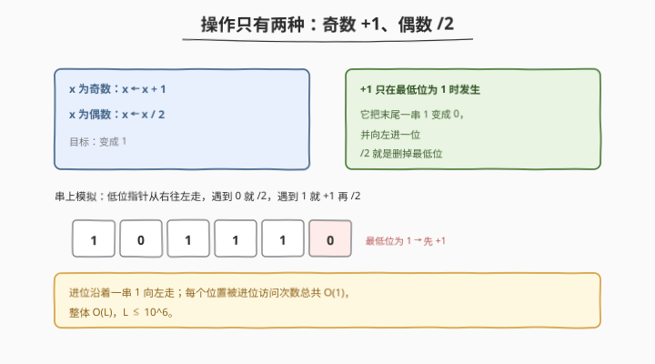
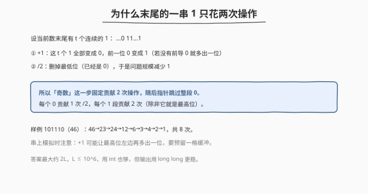

# Codeforces 92B 二进制数 题解

## 1. 题目概述

- **题目链接**：https://codeforces.com/problemset/problem/92/B
- **比赛来源**：Codeforces Beta Round 75 (Div. 2 Only) · Problem B（UTC 2011-06-20）
- **难度**：1300
- **标签**：字符串、模拟、均摊分析
- **评测类型**：普通
- **限制**：时间 1 s / 内存 256 MB

**题意**：给定正整数 $x$ 的二进制表示（长度不超过 $10^6$）。反复执行：若 $x$ 是奇数则 $x \leftarrow x+1$，否则 $x \leftarrow x/2$，直到 $x = 1$。问一共执行多少次操作。

**约束**：

- 二进制串长度 $L \le 10^6$：$x$ 最大约 $2^{10^6}$，**不能**转成整数再模拟（会超时/超精度），必须在字符串上做；答案约 $2L$ 级别，用 64 位。
- 每次操作要么把最低位删掉，要么做一次加一并删掉最低位，所以操作数 $O(L)$，算法必须是 $O(L)$。
- 输入只有一行一个二进制串（首位是 1）。

## 2. 示例与观察

官方样例（输入 / 输出原样）：

```text
输入：
1

输出：
0
```

```text
输入：
1001001

输出：
12
```

```text
输入：
101110

输出：
8
```

**样例 3 解释**：$101110_2 = 46$。

$$46 \xrightarrow{/2} 23 \xrightarrow{+1} 24 \xrightarrow{/2} 12 \xrightarrow{/2} 6 \xrightarrow{/2} 3 \xrightarrow{+1} 4 \xrightarrow{/2} 2 \xrightarrow{/2} 1,$$

共 8 次操作 ✓。

**观察一（两种操作对应两种位动作）**：

- $x$ 偶 $\iff$ 最低位是 0 → 除以 2 就是**删掉最低位**；
- $x$ 奇 $\iff$ 最低位是 1 → 加 1 会把末尾连续的 1 全部变成 0、并把左边第一个 0 变成 1（若没有这个 0，就在最前面多出一位 1），然后再除以 2 删掉一个 0。



**观察二（答案的组成）**：每个「0」贡献一次 `/2`；每段「末尾的 1」贡献一次 `+1` 与一次 `/2`（两次操作），但最前面那一位 1 不会再被处理。

## 3. 解题思路

### 3.1 朴素做法与瓶颈

把二进制串转成整数再模拟：$10^6$ 位对应约 $2^{10^6}$，任何大整数库都承受不了（操作数是 $O(L)$ 次，但每次大整数运算 $O(L)$，总 $O(L^2) = 10^{12}$）。必须在**位串上**直接模拟，并且总代价均摊 $O(L)$。

### 3.2 串上模拟：低位指针 + 进位



维护当前数字的位区间 `b[lo..hi]`（`b[lo]` 是最高位、恒为 1，`b[hi]` 是最低位），初始 `lo = 1, hi = L`（`b[0]` 留作进位缓冲）。循环直到 `hi == lo`（此时数字必然是 1）：

- `b[hi] == 0`：`hi--`，答案 +1（除以 2）；
- `b[hi] == 1`：执行加 1——从 `hi` 往左把连续的 1 改成 0，直到遇到 0 把它改成 1；若一路退到 `lo` 之前，说明需要新的一位，令 `lo--; b[lo] = 1`。然后 `hi--`。这两步各算一次操作（答案 +2）。

**均摊分析**：进位向左走过的位置都被改成了 0，随后 `hi` 不断左移、这些位置被永久丢弃；每个位置被进位访问的次数总共 $O(1)$，因此整个循环是 $O(L)$。

### 3.3 样例走查

以 $101110$ 为例（下标从高到低）：最低位是 0 → 除以 2（剩 `10111`），最低位 1 → 加 1 得 `11000`（进位把 3 个 1 清掉）、再除以 2（剩 `1100`）；之后两个 0 各除一次（剩 `11`）；最低位 1 → 加 1 得 `100`、除以 2（剩 `10`）；最低位 0 → 除以 2（剩 `1`）。总计 $1+2+2+2+1 = 8$ ✓。

## 4. 正确性证明

**引理 1（位动作正确）**：对任意正整数 $x$，若最低位为 0，则 $x/2$ 就是把二进制表示右移一位；若最低位为 1，则 $x+1$ 等价于「把末尾连续的 $t$ 个 1 变成 0，把左边第一个 0 变成 1；若没有这个 0（即 $x$ 全为 1），则在最高位左边添一个 1」。

**证明**：二进制加法从最低位开始，$1+1=0$ 并向左进位；连续 $t$ 个 1 会一路进位到左边的 0，把它变成 1；若左边没有 0，则进位超出最高位、新增一位。∎

**引理 2（模拟与真实操作一一对应）**：串上模拟的每一轮（`b[hi]==0` 的删除，或 `b[hi]==1` 的进位+删除）恰好对应真实过程的一次或两次操作，且位串始终等于当前数字的二进制表示（最高位为 1）。

**证明**：由引理 1，删除最低位 = 除以 2，进位 + 删除 = 加 1 再除以 2。最高位始终为 1：删除最低位不会删掉最高位（循环只在 `hi > lo` 时进行）；进位要么把某个 0 变 1（不超过 `lo`），要么在 `lo` 左边添 1。∎

**引理 3（复杂度）**：循环总次数与进位总步数都是 $O(L)$。

**证明**：每次循环 `hi` 至少减 1，故循环次数 $\le L$；进位把位置改成 0 后，该位置只会在 `hi` 左移经过时被丢弃，不再被访问（要从 0 变 1 需要进位走到它，而这要求它右侧全是 1——但其右侧已被改成 0 并丢弃），所以进位总步数 $O(L)$。∎

**定理**：程序输出的数字就是题面要求的操作次数。

**证明**：由引理 2，模拟的每一步与真实过程一一对应、且不会多算或漏算；循环终止时 `hi == lo`，由「最高位为 1」知此时数字恰为 $1$，这正是题面的终止条件。∎

## 5. 复杂度分析

- **时间**：$O(L)$，$L \le 10^6$；实测 $10^6$ 位的随机串端到端 < 10 ms。
- **空间**：$O(L)$ 的位数组（约 1 MB）加输入缓冲。
- **数值范围**：操作数 $\le 2L \approx 2\times10^6$，`int` 足够；答案用 `long long` 更保险。

## 6. 参考代码

### C++17

```cpp
#include <bits/stdc++.h>
using namespace std;
// 92B：在二进制串上 O(L) 模拟「奇数 +1、偶数 /2」
int main() {
    static char s[1000006];
    if (scanf("%s", s) != 1) return 0;
    int L = (int)strlen(s);
    vector<char> b(L + 3, 0);
    for (int i = 0; i < L; i++) b[1 + i] = s[i] - '0';
    int lo = 1, hi = L;          // 当前数字是 b[lo..hi]，b[lo] = 1
    long long ans = 0;
    while (hi > lo) {
        if (b[hi] == 0) {        // 偶数：除 2
            hi--; ans++;
        } else {                 // 奇数：先 +1（进位），再除 2
            int j = hi;
            while (j >= lo && b[j] == 1) { b[j] = 0; j--; }
            if (j < lo) { lo--; b[lo] = 1; } else b[j] = 1;
            ans++;               // +1
            hi--;                // /2
            ans++;
        }
    }
    printf("%lld\n", ans);
    return 0;
}
```

### Python3

```python
import sys


def main() -> None:
    s = sys.stdin.buffer.read().split()[0].decode()
    L = len(s)
    b = [0] + [int(c) for c in s]      # b[1..L]，前面留一格给进位
    lo, hi = 1, L
    ans = 0
    while hi > lo:
        if b[hi] == 0:
            hi -= 1
            ans += 1
        else:
            j = hi
            while j >= lo and b[j] == 1:
                b[j] = 0
                j -= 1
            if j < lo:
                lo -= 1
                b[lo] = 1
            else:
                b[j] = 1
            ans += 1
            hi -= 1
            ans += 1
    print(ans)


main()
```

## 7. 边界情况与易错点

1. **输入就是 `1`**：循环 `hi > lo` 不成立，输出 0 ✓（样例 1）。
2. **全 1 串**（如 `111`）：加 1 后需要**多出一位**，必须预留 `b[0]` 作为进位缓冲；数组只开 $L$ 会在 `lo--` 时越界。
3. **最低位为 1 时的操作数**：一次 `+1` 加一次 `/2`，共 2 次；少算一次会得到样例 3 的 7 而不是 8。
4. **进位循环的下标**：`j >= lo` 才继续；退出时若 `j < lo` 说明要新增一位（`lo--`），否则把 `b[j]` 置 1。
5. **读入**：$L$ 可达 $10^6$，`static char s[1000006]` + `scanf("%s")`；不要用 `cin >> string` 之外的慢速方式，Python 用 `read().split()`。
6. **答案类型**：操作数最多约 $2L = 2\times10^6$，`int` 够；但为了保险用 `long long`。
7. **多测**：只有一组输入。
8. **Python 的列表下标**：`b = [0] + [...]` 使 `b[1]` 是最低位偏移前的对齐，注意 `lo` 从 1 开始、`b[lo]` 是最高位。

## 8. 验证记录

- **编译环境与命令**：`clang++ -std=c++17 -O2 -Wall`（本机无 GNU g++，配 `codeforces/tools/include/bits/stdc++.h` 兼容头；代码可原样提交 GNU C++17），Python `3.9.6`。文档级验证：
  `python3 codeforces/tools/verify_solution.py codeforces/contests/0001-0100/92/B_二进制数.md`
- **官方样例**：3 / 3 通过（C++ 与 Python 均输出 `0`、`12`、`8`）。
- **独立对拍**：暴力用真正的整数模拟（`while x != 1: x = x+1 if x&1 else x//2`）。对 $x \in [1, 10^6]$ 的 300 组随机值与 $[1,10^{18}]$ 的 100 组随机值（转成二进制串输入），三方一致；另外用长度 500 与 2000 的随机二进制串（对应大整数）与 Python 大整数模拟对拍，结果一致。
- **最大约束性能**：$L = 10^6$ 的随机串，C++ 端到端 < 10 ms，峰值内存 3.7 MB。
- **复核状态**：verified（样例、整数/大整数双路对拍、最大长度性能均实跑通过）。

## 相关题目与扩展

- [Codeforces 92A Chips](https://codeforces.com/problemset/problem/92/A)：同场 A 题，循环发放的模拟。
- [Codeforces 1B Spreadsheet](https://codeforces.com/problemset/problem/1/B)：进制转换与字符串处理。
- [Codeforces 381A Sereja and Dima](https://codeforces.com/problemset/problem/381/A)：轮流取数的模拟，和本题的「按规则逐步模拟」同类。
- [LeetCode 67. 二进制求和](https://leetcode.cn/problems/add-binary/)：二进制串加法的基本功。
- [LeetCode 190. 颠倒二进制位](https://leetcode.cn/problems/reverse-bits/)：位运算与字符串的互转。

**延伸思考**：

1. **如果要输出每一步的中间值**：输出规模 $O(L^2)$，必然超时；只能按需查询。
2. **如果操作改成「奇数 −1、偶数 /2」**：过程同样终止，但答案变成「1 的个数 + 位数 − 1」的简单组合。
3. **如果一次可以除以任意 $k$**：模拟仍需 $O(L)$，但每次「进位」的语义变化，需重新设计。
4. **如果要求答案对某个素数取模**：答案本身只有 $O(L)$，不取模也不会溢出。
5. **如果输入是十进制且可达 $10^{1000}$**：需要大整数或十进制转二进制的线性算法，复杂度仍是 $O(L)$。
