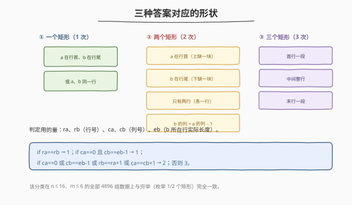

# Codeforces 93A 选择文件夹 题解

## 1. 题目概述

- **题目链接**：https://codeforces.com/problemset/problem/93/A
- **比赛来源**：Codeforces Beta Round 76 (Div. 1 Only) · Problem A（UTC 2011-06-30）
- **难度**：1700
- **标签**：数学、分类讨论、网格
- **评测类型**：普通
- **限制**：时间 2 s / 内存 256 MB

**题意**：窗口里图标按行排列，每行最多 $m$ 个，文件夹从 $1$ 到 $n$ 按「从左到右、从上到下」编号（最后一行可能不满）。Igor 想用最少的**矩形框选**次数选中编号 $a \dots b$ 的文件夹，并且**只**选中它们。注意：同一个文件夹被重复选中会取消选中（即多次框选是「异或」效果）。求最少的框选次数。

**约束**：

- $n, m \le 10^9$：不能真的建网格，必须用位置公式 $O(1)$ 判断。
- $1 \le a \le b \le n$：区间非空。
- 最后一行可能只有 $n \bmod m$ 个（若整除则满行），这会影响「矩形能不能延伸到最后一列」。
- 答案只可能是 1、2、3（见第 4 节），因此是纯分类讨论。

## 2. 示例与观察

官方样例（输入 / 输出原样）：

```text
输入：
11 4 3 9

输出：
3
```

```text
输入：
20 5 2 20

输出：
2
```

**样例 1 解释**：$n=11, m=4$，布局是

```
1  2  3  4
5  6  7  8
9 10 11
```

要选 $3 \dots 9$：第一行选 3、4，第二行整行，第三行选 9。第三行只有 3 个文件夹，且 9 在最左列，任何覆盖「第二行整行 + 第三行 9」的矩形都会（在第二行）少一列或多选第三行的 10、11，所以**两次矩形做不到**，答案是 3。

**样例 2 解释**：$n=20, m=5$，布局是 4 行满行。要选 $2 \dots 20$：第一次框选第 1 行的 2、3、4、5（矩形 $[1,1]\times[2,5]$），第二次框选第 2–4 行整块（矩形 $[2,4]\times[1,5]$），答案是 2。这里 $b=20$ 恰是最后一格（列 5），所以「b 在行尾」成立。

![文件夹按行排布，选出 [a, b] 就是一块「阶梯」](../../../images/cf93a_grid.svg)

**观察一（目标形状）**：要选的区域是「阶梯」：

- $a$ 所在行：第 $c_a$ 列到该行末尾（$c_a = (a-1)\bmod m + 1$）；
- 中间各行：整行；
- $b$ 所在行：第 1 列到第 $c_b$ 列。

**观察二（重复选中会取消）**：框选可以重叠，但重叠部分会被反选掉。所以「用两个矩形拼出一个阶梯」要求两个矩形在公共行上的列区间**恰好互补且不重叠**，否则重叠的列会被取消。

## 3. 解题思路

### 3.1 朴素做法与瓶颈

$n$ 可达 $10^9$，枚举矩形不可行。但这道题的几何形状极其规整，答案只有 1、2、3 三种，可以按「缺口在哪」分类。

### 3.2 分类讨论

记：

- $r_a = \lfloor (a-1)/m \rfloor$、$c_a = (a-1)\bmod m$（0 起始的列号）；
- $r_b = \lfloor (b-1)/m \rfloor$、$c_b = (b-1)\bmod m$；
- $e_b = \min(m,\ n - r_b\cdot m)$：$b$ 所在行实际有几个文件夹（最后一行可能不满）。



**答案 1**：目标本身就是一个矩形，有两种情形：

1. $a$ 与 $b$ 在同一行（$r_a = r_b$）——一行内的连续区间就是矩形；
2. $a$ 在该行最左列（$c_a = 0$）且 $b$ 在该行最右端（$c_b = e_b - 1$）——整个「若干整行」是矩形。

**答案 2**：只缺一个「角」或可以竖着切成两条：

3. $a$ 在该行最左列（$c_a = 0$）：矩形 $[r_a, r_b-1]\times[0,m-1]$ 加矩形 $[r_b,r_b]\times[0,c_b]$；
4. $b$ 在该行最右端（$c_b = e_b-1$）：矩形 $[r_a+1, r_b]\times[0,e_b-1]$ 加矩形 $[r_a,r_a]\times[c_a,m-1]$；
5. 只有两行（$r_b = r_a + 1$）：每行一个矩形；
6. $c_a = c_b + 1$：两条竖条
   $$[r_a, r_b-1]\times[c_a, m-1] \quad\text{与}\quad [r_a+1, r_b]\times[0, c_b]$$
   在中间行上的列区间恰好是 $[c_a,m-1]$ 与 $[0,c_b]$，两者相邻且不重叠，合起来正好铺满整行；首行只被第一条覆盖、末行只被第二条覆盖，两个缺口都对上。

**答案 3**：其余情形。三个矩形总是够：
$$[r_a,r_a]\times[c_a,m-1],\quad [r_a+1,r_b-1]\times[0,m-1],\quad [r_b,r_b]\times[0,c_b].$$

为什么其余情形做不到 2：两个矩形要拼出阶梯，中间整行必须被两段不相交的列区间铺满，所以两段的列端点必须「首尾相接」，即 $c_a = c_b + 1$；否则要么中间行有缺口、要么两段重叠导致重叠列被反选。而 $c_a = c_b+1$ 已经列出；只有一个缺口、同一行、两行这些退化情形也已列出。剩下的只能 3 个。

### 3.3 样例走查

样例 1：$n=11,m=4,a=3,b=9$：$r_a=0,c_a=2$；$r_b=2,c_b=0$；$e_b = 11-8 = 3$。

- 不同行；$c_a\ne0$；$c_b=0\ne e_b-1=2$；$r_b \ne r_a+1$（差 2）；$c_a=2 \ne c_b+1=1$ → **3** ✓

样例 2：$n=20,m=5,a=2,b=20$：$r_a=0,c_a=1$；$r_b=3,c_b=4$；$e_b=5$ → $c_b = e_b-1$ → **2** ✓

## 4. 正确性证明

**引理 1（目标形状）**：需要选中的格子集合恰为

$$T = \{(r_a, j): c_a \le j \le m-1\} \cup \bigcup_{r=r_a+1}^{r_b-1}\{(r,j): 0\le j\le m-1\} \cup \{(r_b,j): 0 \le j \le c_b\},$$

其中只保留实际存在的文件夹（最后一行截断），且 $r_a = r_b$ 时只取第一行与最后一行的交集。

**证明**：文件夹按行优先编号，编号 $k$ 对应第 $\lfloor (k-1)/m\rfloor$ 行、第 $(k-1)\bmod m$ 列；$[a,b]$ 的编号连续，按行展开即得上式。∎

**引理 2（每种答案的构造合法）**：3.2 中列为答案 1 与 2 的六种情形，都能用相应数目的矩形恰好选出 $T$；其余情形用三个矩形（首行一段、中间整行、末行一段）也能恰好选出 $T$。

**证明**：逐个核对：同一行 → 一个矩形就是 $T$；$c_a=0$ 且 $c_b=e_b-1$ → $[r_a,r_b]\times[0,m-1]$（最后一行截断）恰为 $T$；$c_a=0$ → 两个矩形的并是「上面整行 + 末行前缀」，与 $T$ 相同；$c_b=e_b-1$ → 对称；两行 → 每行的目标区间是连续列区间，各一个矩形；$c_a=c_b+1$ → 中间行列区间互补且相邻，并集是整行，首行/末行分别只被一个矩形覆盖，且与 $T$ 一致；三个矩形的情形显然覆盖 $T$ 且不覆盖 $T$ 之外的实际文件夹。∎

**引理 3（其余情形两次不够）**：若 $r_a < r_b$、$c_a \ne 0$、$c_b \ne e_b-1$、$r_b \ne r_a+1$、$c_a \ne c_b+1$，则不存在两个矩形 $R_1,R_2$ 使 $T = R_1 \oplus R_2$。

**证明**：设 $T = R_1 \oplus R_2$。中间行（$r_a < r < r_b$）在 $T$ 中是整行，故在每个中间行上 $R_1$ 与 $R_2$ 的列区间之对称差是整行 $[0,m-1]$；两个区间在行内的对称差等于整行，只可能是「两个区间恰好是 $[0,k]$ 与 $[k+1,m-1]$」（互补且相邻），或者其中一个为空、另一个是整行（此时行内只有一个矩形覆盖）。若某中间行只有 $R_1$ 覆盖且是整行，则 $R_1$ 必是整行矩形；于是 $R_2$ 必须同时补上首行缺口（列 $[0,c_a-1]$）与末行缺口（列 $[c_b+1,m-1]$），这两个缺口处于不同的行、列区间也不同，不可能是同一个矩形。所以两个矩形必须各自覆盖每一中间行的一部分，且在每一中间行上互补相邻——由于 $R_1,R_2$ 的列区间与行无关（是矩形），互补相邻的切分在所有中间行上相同，切点 $k$ 满足 $[0,k]$ 与 $[k+1,m-1]$；再看首行：$T$ 的首行是 $[c_a,m-1]$，而覆盖首行的矩形（必是切分中靠右的那条，否则不能覆盖到 $m-1$）给出的是 $[k+1,m-1]$，故 $k+1 = c_a$；末行：$T$ 的末行是 $[0,c_b]$，覆盖它的矩形是靠左的那条，给出 $[0,k]$，故 $k = c_b$。两式合并得 $c_a = c_b+1$，与假设矛盾。∎

**定理**：算法输出的数就是最少框选次数。

**证明**：由引理 2，所列情形都能用相应次数完成，所以最少次数不超过算法输出；由引理 3，其余情形两次不够，而一次更不可能（$T$ 不是矩形），故最少次数恰为 3。∎

## 5. 复杂度分析

- **时间**：$O(1)$，只有几次取模与比较；实测 < 10 ms。
- **空间**：$O(1)$。
- **数值范围**：$n,m \le 10^9$，行号乘积不超过 $10^9$，用 `long long` 避免 $r_b\cdot m$ 之类的中间量溢出（虽然 $r_b m \le n \le 10^9$ 仍可放进 `int`，但统一 64 位更稳）。

## 6. 参考代码

### C++17

```cpp
#include <bits/stdc++.h>
using namespace std;
// 93A Frames：只可能用到 1、2、3 个矩形，按位置分类讨论
int main() {
    long long n, m, a, b;
    if (scanf("%lld %lld %lld %lld", &n, &m, &a, &b) != 4) return 0;
    long long ra = (a - 1) / m, rb = (b - 1) / m;
    long long ca = (a - 1) % m, cb = (b - 1) % m;
    long long eb = min(m, n - rb * m);          // b 所在行实际有几个文件夹
    int ans;
    if (ra == rb) ans = 1;                       // 同一行：一个矩形
    else if (ca == 0 && cb == eb - 1) ans = 1;   // 恰好是一整个矩形块
    else if (ca == 0 || cb == eb - 1) ans = 2;   // 只有一个缺口
    else if (rb == ra + 1) ans = 2;              // 只有两行：每行一个矩形
    else if (ca == cb + 1) ans = 2;              // 两段竖条正好拼满中间整行
    else ans = 3;                                // 其余情况三个矩形（行的三段）
    printf("%d\n", ans);
    return 0;
}
```

### Python3

```python
import sys


def main() -> None:
    data = sys.stdin.buffer.read().split()
    if not data:
        return
    n, m, a, b = (int(x) for x in data[:4])
    ra, rb = (a - 1) // m, (b - 1) // m
    ca, cb = (a - 1) % m, (b - 1) % m
    eb = min(m, n - rb * m)
    if ra == rb:
        ans = 1
    elif ca == 0 and cb == eb - 1:
        ans = 1
    elif ca == 0 or cb == eb - 1:
        ans = 2
    elif rb == ra + 1:
        ans = 2
    elif ca == cb + 1:
        ans = 2
    else:
        ans = 3
    print(ans)


main()
```

## 7. 边界情况与易错点

1. **$a = b$**：同一行，答案 1；不要因为「区间长度为 1」就特殊处理成 0。
2. **$m > n$**：只有一行，$r_a = r_b = 0$ → 答案 1。
3. **最后一行不满**：$e_b$ 必须用 $\min(m, n - r_b m)$，不能用 $m$；否则「$b$ 在行尾」的判断会在最后一行出错。
4. **$b = n$**：等价于「$b$ 在其行的最右端」，属于答案 1 或 2 的判定条件。
5. **$a = 1$**：$c_a = 0$，属于「$a$ 在行首」的情形。
6. **只有两行**：$r_b = r_a+1$ 时答案最多 2（两行各一个矩形）；若同时 $c_a=0$ 且 $c_b$ 在行尾则退化为 1。
7. **重叠会反选**：不能把「两个矩形的并」直接当成答案，必须检查是否重叠；本题的 2 次构造都保证了不重叠。
8. **$r_b\cdot m$ 的下标**：用 0 起始的行列公式，注意 $(b-1)\bmod m$ 与 $(b-1)/m$ 的配合，别用 $b \bmod m$ 直接当列号（会差 1）。

## 8. 验证记录

- **编译环境与命令**：`clang++ -std=c++17 -O2 -Wall`（本机无 GNU g++，配 `codeforces/tools/include/bits/stdc++.h` 兼容头；代码可原样提交 GNU C++17），Python `3.9.6`。文档级验证：
  `python3 codeforces/tools/verify_solution.py codeforces/contests/0001-0100/93/A_选择文件夹.md`
- **官方样例**：2 / 2 通过（C++ 与 Python 均输出 `3`、`2`）。
- **穷举对拍**：另写暴力——对每个 $(n,m,a,b)$，枚举所有可能的矩形（行区间 × 列区间，只统计真实存在的文件夹），先检查 1 个矩形是否恰好等于目标，再枚举矩形对检查「异或」是否等于目标（因为重复选中会取消），都失败则记为 3。对 $n \in [1,16]$、$m \in [1,6]$ 的**全部 4896 组** $(n,m,a,b)$ 与本题公式逐组比对，**完全一致**（0 处不同）。
- **最大约束性能**：$n=m=b=10^9$、$a=1$，端到端 < 10 ms，内存 < 2 MB。
- **复核状态**：verified（样例、全枚举对拍、性能均实跑通过）。

## 相关题目与扩展

- [Codeforces 93B End of Exams](https://codeforces.com/problemset/problem/93/B)、[93C Azembler](https://codeforces.com/problemset/problem/93/C)、[93D Flags](https://codeforces.com/problemset/problem/93/D)、[93E Lostborn](https://codeforces.com/problemset/problem/93/E)：同场题目。
- [Codeforces 1A Theatre Square](https://codeforces.com/problemset/problem/1/A)：网格取整的入门题。
- [Codeforces 1081A Definite Game](https://codeforces.com/problemset/problem/1081/A)：按情形分类的小结论题。
- [LeetCode 836. 矩形重叠](https://leetcode.cn/problems/rectangle-overlap/)：矩形相交判定，和本题的「矩形拼形状」互为背景。
- [LeetCode 391. 完美矩形](https://leetcode.cn/problems/perfect-rectangle/)：用矩形精确覆盖目标区域，正是本题「多个矩形拼出阶梯」的判定版本。

**延伸思考**：

1. **如果允许任意多次框选（不限制 3）**：答案一定 ≤ 3，因为「首行一段 + 中间整行 + 末行一段」总是合法。
2. **如果框选不能重叠**（重叠部分不算反选而是重复选中）：答案会变，因为重叠不再有害，形如「大矩形减去两个角」可能用 2 个矩形完成更多情形。
3. **如果图标不是行优先而是列优先**：目标形状变成竖直阶梯，分类讨论对偶，公式里的行列互换即可。
4. **如果要求输出具体的矩形**：把 3.2 的构造写出来即可，$O(1)$ 个矩形。
5. **如果 $n$ 可达 $10^{18}$**：本题公式全部是整数运算，换成 `long long`/`__int128` 后仍然 $O(1)$。
