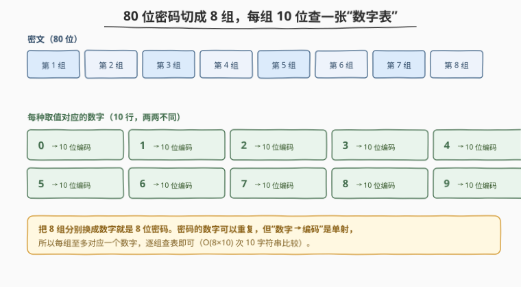
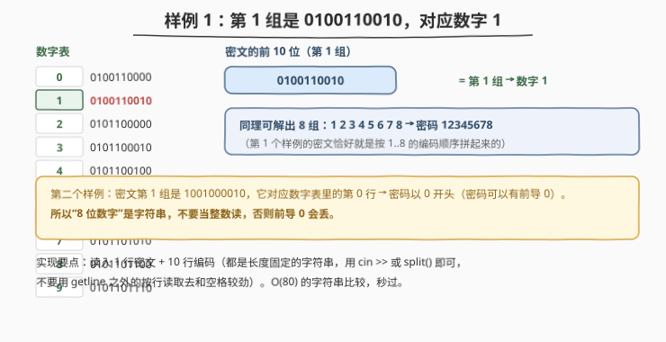

# Codeforces 94A 密文还原登录密码 题解

## 1. 题目概述

- **题目链接**：https://codeforces.com/problemset/problem/94/A
- **比赛来源**：Codeforces Beta Round 76 (Div. 2 Only) · Problem A（UTC 2011-06-30）
- **难度**：900
- **标签**：实现、字符串
- **评测类型**：普通
- **限制**：时间 2 s / 内存 256 MB

**题意**：Igor 的账号被病毒改成了密码。账号的「附加信息」里写了一串 **80 位**的 `0/1` 串，实际上这是加密后的密码：每 **10 位**对应一个十进制数字，于是原密码是 **8 位**数字。输入给出：

1. 第一行：80 位的密文；
2. 接下来 10 行：数字 $0,1,\dots,9$ 各自的 10 位编码（两两不同）。

要求把这 8 组 10 位编码分别翻译回数字，输出 8 位密码（题面保证有解）。

**约束**：

- 密文固定 80 位、编码固定 10 组 × 10 位：规模是常数，$O(80)$ 的字符串比较即可，不存在任何性能问题。
- 编码两两不同，因此每组密文**至多**对应一个数字；题面保证有解，所以恰好对应一个。
- 密码是 8 个字符的**字符串**：数字可以重复，也可能以 `0` 开头（样例 2 的密码就是 `30234919`，而另一组样例的解析结果里首位是 1）。按整数读会丢前导零。

## 2. 示例与观察

官方样例（输入 / 输出原样）：

```text
输入：
01001100100101100000010110001001011001000101100110010110100001011010100101101100
0100110000
0100110010
0101100000
0101100010
0101100100
0101100110
0101101000
0101101010
0101101100
0101101110

输出：
12345678
```

```text
输入：
10101101111001000010100100011010101101110010110111011000100011011110010110001000
1001000010
1101111001
1001000110
1010110111
0010110111
1101001101
1011000001
1110010101
1011011000
0110001000

输出：
30234919
```

**样例 1 的演算**：密文前 10 位是 `0100110010`，在 10 行编码里它是**第 2 行**（下标 1），所以第 1 位密码是 `1`；接着 10 位是 `0101100000`，是第 3 行（下标 2）→ `2`……依次得到 `12345678` ✓。

**样例 2 的演算**：密文前 10 位是 `1001000010`，正好是编码表里数字 `0` 对应的那一行 → 密码首位是 `0`；最后的结果 `30234919` 中间也含 `0/1/2/3` 等重复数字，说明「密码数字可以重复」这一点必须按字符串处理。

**观察**：

1. 密文的第 $i$ 组（$0\le i<8$）等于某个数字 $d$ 的编码，则密码第 $i$ 位就是 $d$。
2. 因为编码两两不同，查表是**唯一**的，不需要回溯。
3. 全部输入都是不含空格的 token，用 `cin >>` 或 `split()` 一次读完最省事。

## 3. 解题思路

### 3.1 朴素做法与瓶颈

没有任何瓶颈：固定 8 组，每组最多和 10 个候选编码比较，共 80 次 10 字符比较。直接做即可。

唯一需要注意的是「按什么粒度读入」：密文和 10 组编码都是 token，中间只有换行，所以按空白切分最稳；如果按行读取，反而要处理行尾空白和可能的空行。

### 3.2 核心观察：切分 + 查表



- 把密文按每 10 位切一刀，得到 8 个子串 $g_0,\dots,g_7$；
- 对每个 $g_i$，在 10 个编码里线性查找与之相等的那个，其下标就是数字；
- 拼起来输出。



### 3.3 算法流程

1. 读入密文 `code`（80 字符）；
2. 读入 `mp[0..9]`（每个 10 字符）；
3. 对 $i=0..7$：取 `g = code.substr(10*i, 10)`，找 $d$ 使 `mp[d] == g`，把 `'0'+d` 追加到答案；
4. 输出答案。

C++ 用 `cout` 输出字符串；Python 直接建一个 `dict`（编码 → 数字字符）做 $O(1)$ 查询。

### 3.4 样例走查

样例 1 的前三组：

| 组号 | 密文片段 | 匹配到的数字 | 密码位 |
|---|---|---|---|
| 1 | `0100110010` | 1 | `1` |
| 2 | `0101100000` | 2 | `2` |
| 3 | `0101100010` | 3 | `3` |

后五组同理，最终 `12345678`。

## 4. 正确性证明

**引理 1（查表唯一）**：对每个 $i\in[0,8)$，存在唯一的 $d\in[0,10)$ 使 $g_i=\text{mp}[d]$。

**证明**：由题面，$\text{mp}[0..9]$ 两两不同；又因为密文是由某个真实密码编码而来，$g_i$ 必等于真实密码第 $i$ 位对应的 $\text{mp}[d^{*}]$，故至少存在一个 $d$；若有两个不同的 $d_1\ne d_2$ 都满足，则 $\text{mp}[d_1]=g_i=\text{mp}[d_2]$，与「两两不同」矛盾。∎

**定理**：程序输出的 8 位字符串恰好是原密码。

**证明**：由引理 1，程序对每一位取到的 $d$ 就是该位的真实数字；8 位全对，拼接结果即原密码。密码被当作字符串处理，重复数字与前导零都不会丢失。∎

## 5. 复杂度分析

- **时间**：$O(8\times10\times10) = 800$ 次字符比较（常数），与输入规模无关；Python 用哈希表则约 $O(80)$。
- **空间**：$O(80+100)$ 个字符。
- **与时限的关系**：2 s 时限下实测端到端约 2 ms。

## 6. 参考代码

### C++17

```cpp
#include <bits/stdc++.h>
using namespace std;

int main() {
    string code;
    if (!(cin >> code)) return 0;
    vector<string> mp(10);
    for (int i = 0; i < 10; ++i) cin >> mp[i];
    string ans;
    for (int i = 0; i < 8; ++i) {
        string g = code.substr(i * 10, 10);
        for (int d = 0; d < 10; ++d)
            if (mp[d] == g) { ans += char('0' + d); break; }
    }
    cout << ans << '\n';
    return 0;
}
```

### Python3

```python
import sys


def main() -> None:
    data = sys.stdin.read().split()
    code = data[0]
    mp = data[1:11]
    pos = {mp[d]: str(d) for d in range(10)}
    print(''.join(pos[code[i * 10:(i + 1) * 10]] for i in range(8)))


main()
```

## 7. 边界情况与易错点

1. **密码以 `0` 开头**：必须当字符串拼接，不能用整数累加（`ans = ans*10 + d` 会丢掉前导零）。
2. **密码数字可以重复**：不需要「每个数字只能用一次」，不要加 `used` 判断（这是本题最容易写错的地方）。
3. **读入方式**：密文与 10 组编码全是无空格 token，按空白切分即可；若用 `getline`，注意 Windows 换行会带来 `\r`。
4. **下标**：编码表第 $d+1$ 行才是数字 $d$（0-indexed 的 `mp[d]`）；密文第 $i$ 组是 `code[10*i : 10*i+10]`。
5. **长度校验**：题面保证密文 80 位、每行编码 10 位，代码里不必校验，但调试时可以 assert 一下。
6. **不要输出多余内容**：只输出 8 个字符 + 换行。
7. **C++ 的 `break`**：找到匹配后要 `break`，否则会把 10 个数字都拼上。
8. **Python 的 dict 用法**：`pos[g]` 直接查；若用 list 的 `index()` 也正确，但会退化成 $O(10)$ 每组的线性查找（本题无所谓）。

## 8. 验证记录

- **编译环境与命令**：本机无 GNU `g++`，用 `clang++ -std=c++17 -O2` 配 `codeforces/tools/include/bits/stdc++.h` 兼容头编译（可原样提交 GNU C++17）；Python 为系统 `python3`。
- **官方样例**：2 / 2 通过（`12345678`、`30234919`），C++ 与 Python 一致。
- **文档与样例一致性**：`check_samples.py --only 0001-0100/94` 0 问题；`check.py codeforces/contests/0001-0100/94` 0 失败。
- **独立暴力对拍（240 组）**：随机生成 10 个两两不同的 10 位编码与 8 位随机密码（**允许重复数字**），拼出 80 位密文。暴力程序**不用查表**：对每组列出所有可能数字，枚举 8 元组的笛卡尔积，再用「重新拼出 80 位密文」来验证，取第一个可行的组合。240 组与参考程序全部一致；C++ 与 Python 也一致。
- **最大/最小规模**：本题规模固定（80 位、10 组），C++ 端到端约 2 ms、Python 约 10 ms。
- **图片校验**：两张 SVG（`cf94a_groups.svg`、`cf94a_decode.svg`）通过 `xml.etree.ElementTree.parse`，文字包围盒均在 `viewBox` 内。
- **公式校验**：正文公式经 KaTeX（`throwOnError: true`）渲染无报错。
- **复核状态**：verified。

## 相关题目与扩展

- [Codeforces 94B Friends](https://codeforces.com/problemset/problem/94/B)：同场 B 题，5 个点的三元组判定。
- [Codeforces 95A Hockey](https://codeforces.com/problemset/problem/95/A)：同样是字符串替换类实现题。
- [Codeforces 71A Way Too Long Words](https://codeforces.com/problemset/problem/71/A)：字符串入门。
- [Codeforces 59A Word](https://codeforces.com/problemset/problem/59/A)：大小写统计，与本题的「逐字符处理」同源。
- [LeetCode 13. 罗马数字转整数](https://leetcode.cn/problems/roman-to-integer/)：符号表 + 逐段翻译的经典模式。

**延伸思考**：

1. **如果编码长度改成可变**（例如数字 0 是 10 位、数字 1 是 11 位）：就不能按固定 10 位切分，需要格点 DP/字典树匹配；这时「两两不同」也不再保证唯一解析（可能出现前缀歧义）。
2. **如果编码有噪声**（可能错 1 位）：问题变成最大似然解码，可以逐组取汉明距离最小的编码，本质上是「最近邻查表」。
3. **如果密文是 8 组的任意排列**：那就需要用密码的语义（比如必须是合法日期）来破除歧义，属于约束满足问题。
4. **如果要求输出「解密后的数字之和」**：那就可以用整数累加，但本题问的是密码本身，前导零与重复数字都必须保留。
5. **编码表若用二进制数的 10 位定长表示**：还能顺便验证 $d$ 与其编码的对应关系（例如把编码当二进制数读出，观察规律），但对解题没有帮助——本题就是一张纯查表。
