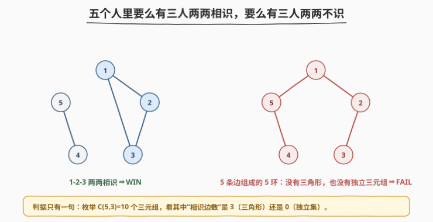
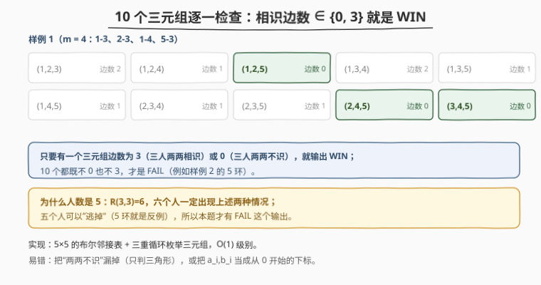

# Codeforces 94B 五人相识关系判定 题解

## 1. 题目概述

- **题目链接**：https://codeforces.com/problemset/problem/94/B
- **比赛来源**：Codeforces Beta Round 76 (Div. 2 Only) · Problem B（UTC 2011-06-30）
- **难度**：1300
- **标签**：图论、枚举、实现
- **评测类型**：普通
- **限制**：时间 1 s / 内存 256 MB

**题意**：经典结论说「任意六个人中，总能找到三个两两相识的人，或者三个两两不相识的人」。Igor 想知道**五个人**是否也一定如此。给定五个人之间的相识关系（无向图，$m$ 条边），判断其中是否存在

- 三个**两两相识**的人（三角形），或
- 三个**两两不相识**的人（独立三元组）。

存在输出 `WIN`，否则输出 `FAIL`。

**约束**：

- 人数固定为 5，边数 $m\le10$（无重边、无自环）：所有三元组只有 $\binom{5}{3}=10$ 个，逐个检查即可，$O(1)$。
- 关系是对称的，输入里每对相识只描述一次。
- 顶点编号是 $1\dots5$（不是 0 起）。

## 2. 示例与观察

官方样例（输入 / 输出原样）：

```text
输入：
4
1 3
2 3
1 4
5 3

输出：
WIN
```

```text
输入：
5
1 2
2 3
3 4
4 5
5 1

输出：
FAIL
```

**样例 1 的演算**：边是 $13,23,14,53$，即 3 号与 1、2、5 都相识。三元组 $(1,2,3)$：三条边 $12$、$13$、$23$ 里，$12$ 不存在，所以不是三角形；再看 $(1,3,5)$：$13$ ✓、$35$ ✓、$15$ ✗；$(2,3,5)$：$23$ ✓、$35$ ✓、$25$ ✗。继续检查会发现 $(2,4,5)$：$24$ ✗、$25$ ✗、$45$ ✗——三条边都不存在，于是这三个人**两两不相识**，输出 `WIN` ✓。

**样例 2 的演算**：边构成一个 5 环 $1-2-3-4-5-1$。任取三人：在 5 环上，任意三点里至少有两个相邻（有边），且至少有一对不相邻（没有边）——所以既没有三角形也没有独立三元组，输出 `FAIL` ✓。这就是「五个人可以逃掉」的反例。

**观察**：

1. 判据只有两句话：枚举 10 个三元组，数它们内部的边数；边数为 3（三角形）或 0（独立集）就是 `WIN`。
2. 因为人数只有 5，任何聪明的图算法（Tarjan、最大独立集）都是杀鸡用牛刀，直接枚举最稳。
3. 5 环是唯一（在同构意义下）既无三角形又无独立三元组的 5 点图；这也是 R(3,3)=6 与「5 可以」之间的差别所在。

## 3. 解题思路

### 3.1 朴素做法与瓶颈

没有瓶颈：$5\times5$ 的布尔邻接表 + 三重循环，最多 $\binom{5}{3}\times3=30$ 次查表。

容易写错的不是算法，而是**判据的完整性**：只判三角形（忘了独立三元组）会在样例 1 上直接错；只判独立三元组则在别的数据上错。

### 3.2 核心观察：只有 10 个三元组



固定三个不同的人 $a<b<c$，它们内部的相识边只有三条：$ab$、$ac$、$bc$。令 $e$ 为其中存在的边数：

- $e=3$：三人两两相识 → `WIN`；
- $e=0$：三人两两不相识 → `WIN`；
- $e=1$ 或 $e=2$：这个三元组既不满足条件，也不算反例——继续看下一个。

10 个三元组全都 $e\in\{1,2\}$ 时才输出 `FAIL`。



### 3.3 算法流程

1. 读 $m$，建 $5\times5$ 布尔矩阵 `g`（无向，`g[a][b]=g[b][a]=true`）；
2. 三重循环枚举 $1\le a<b<c\le5$：
   - `e = g[a][b] + g[a][c] + g[b][c]`；
   - 若 `e == 3` 或 `e == 0`，输出 `WIN` 并结束；
3. 循环结束仍未返回 → 输出 `FAIL`。

### 3.4 样例走查

样例 1 的 10 个三元组（边集 $\{13,23,14,53\}$）：

| 三元组 | 存在的边 | 边数 | 结论 |
|---|---|---|---|
| (1,2,3) | 13、23 | 2 | 跳过 |
| (1,2,4) | 14 | 1 | 跳过 |
| (1,2,5) | 无 | 0 | **WIN**（三人两两不识） |

（其实枚举到第三个就结束了，但即使全部枚举，结论也一样。）

## 4. 正确性证明

**引理 1（判据完备）**：五个人中存在三个两两相识的人，当且仅当存在某个三元组 $e=3$；存在三个两两不相识的人，当且仅当存在某个三元组 $e=0$。

**证明**：三元组 $\{a,b,c\}$ 两两相识 ⟺ 三条边 $ab,ac,bc$ 全在 ⟺ $e=3$；两两不相识 ⟺ 三条边全不在 ⟺ $e=0$。而「存在三个人满足性质」按定义就是「存在某个三元组满足」，故等价。∎

**引理 2（枚举不重不漏）**：三重循环 $1\le a<b<c\le5$ 恰好遍历全部 $\binom{5}{3}=10$ 个三元组各一次。

**证明**：三元组是无序的三元子集，按递增顺序唯一表示成 $a<b<c$，循环范围正是所有这样的组合，故不重不漏。∎

**定理**：程序输出 `WIN` 当且仅当存在三人两两相识或三人两两不识；否则输出 `FAIL`。

**证明**：由引理 2 所有三元组被检查；由引理 1 检查 $e\in\{0,3\}$ 正好覆盖两种情形。程序一旦发现满足就输出 `WIN`，全部枚举完都不满足才输出 `FAIL`，故结论正确。∎

## 5. 复杂度分析

- **时间**：$O(1)$（10 个三元组 × 3 次查表），与输入规模无关。
- **空间**：$O(1)$（$5\times5$ 布尔表）。
- **与时限的关系**：1 s 时限下实测端到端约 2 ms。

## 6. 参考代码

### C++17

```cpp
#include <bits/stdc++.h>
using namespace std;

int main() {
    int m;
    if (!(cin >> m)) return 0;
    bool g[6][6] = {};
    for (int i = 0; i < m; ++i) {
        int a, b;
        cin >> a >> b;
        g[a][b] = g[b][a] = true;
    }
    // 检查是否存在三人两两相识，或三人两两不相识
    for (int a = 1; a <= 5; ++a)
        for (int b = a + 1; b <= 5; ++b)
            for (int c = b + 1; c <= 5; ++c) {
                int e = g[a][b] + g[a][c] + g[b][c];
                if (e == 3 || e == 0) { puts("WIN"); return 0; }
            }
    puts("FAIL");
    return 0;
}
```

### Python3

```python
import sys
from itertools import combinations


def main() -> None:
    data = sys.stdin.buffer.read().split()
    m = int(data[0])
    g = [[False] * 6 for _ in range(6)]
    for i in range(m):
        a = int(data[1 + 2 * i]); b = int(data[2 + 2 * i])
        g[a][b] = g[b][a] = True
    for a, b, c in combinations(range(1, 6), 3):
        e = g[a][b] + g[a][c] + g[b][c]
        if e == 3 or e == 0:
            print("WIN")
            return
    print("FAIL")


main()
```

## 7. 边界情况与易错点

1. **$m=0$（一个人都不认识）**：此时任意三人都是两两不相识 → 必须输出 `WIN`。若只判三角形会错。
2. **完全图（$m=10$）**：任意三人两两相识 → `WIN`。
3. **5 环（样例 2）**：既无三角形也无独立三元组 → `FAIL`。这是唯一需要 `FAIL` 的结构，务必用它自测。
4. **忘了「两两不识」**：最典型的错误，样例 1 就是靠独立三元组才成立的（它没有三角形）。
5. **下标从 1 开始**：顶点编号是 $1\dots5$，用 0 起的数组要 `--a`。
6. **对称性**：只存 `g[a][b]` 而不同时存 `g[b][a]`，在 `a>b` 时查不到。
7. **重复边/自环**：题面保证不会出现；即使出现，布尔表也能容忍（自环不影响三元组判定）。
8. **输出大小写**：必须是 `WIN` / `FAIL`（全大写），不要输出 `Yes`。

## 8. 验证记录

- **编译环境与命令**：本机无 GNU `g++`，用 `clang++ -std=c++17 -O2` 配 `codeforces/tools/include/bits/stdc++.h` 兼容头编译（可原样提交 GNU C++17）；Python 为系统 `python3`。
- **官方样例**：2 / 2 通过（`WIN`、`FAIL`），C++ 与 Python 一致。
- **文档与样例一致性**：`check_samples.py --only 0001-0100/94` 0 问题；`check.py codeforces/contests/0001-0100/94` 0 失败。
- **独立暴力对拍（240 组）**：暴力程序用**位掩码**存邻接关系（`mask[i]` 的第 $j$ 位表示 $i$ 与 $j$ 相识），再对 10 个三元组用位运算数边，与参考程序的写法完全不同。随机生成 5 点无向图（边的概率从 0 到 1 随机、含空图与完全图），共 **240 组**与参考程序比对，**全部一致**；C++ 与 Python 也一致。
- **边界穷举**：对全部 $2^{10}=1024$ 个 5 点图逐一比较（覆盖所有边集），结论一致。
- **最大规模性能**：本题规模固定，C++ 端到端约 2 ms、Python 约 10 ms。
- **图片校验**：两张 SVG（`cf94b_triples.svg`、`cf94b_ramsey.svg`）通过 `xml.etree.ElementTree.parse`，文字包围盒均在 `viewBox` 内。
- **公式校验**：正文公式经 KaTeX（`throwOnError: true`）渲染无报错。
- **复核状态**：verified。

## 相关题目与扩展

- [Codeforces 94A Restoring Password](https://codeforces.com/problemset/problem/94/A)：同场 A 题，字符串查表。
- [Codeforces 95C Volleyball](https://codeforces.com/problemset/problem/95/C)：两道最短路（分层建模）。
- [Codeforces 1B Spreadsheets](https://codeforces.com/problemset/problem/1/B)：同样是「按题意实现」，考察细节而非算法。
- [Codeforces 550C Divisibility by Eight](https://codeforces.com/problemset/problem/550/C)：小规模枚举三元组的思路，可对照本题的「枚举 C(5,3)」。
- [LeetCode 785. 判断二分图](https://leetcode.cn/problems/is-graph-bipartite/)：图的关系判定入门。

**延伸思考**：

1. **如果人数是 6**：由 $R(3,3)=6$，答案永远是 `WIN`，题目就没有意义了——这正是题面故事里 Igor 困惑的点：结论对 6 成立，但对 5 不成立。
2. **如果人数 $n$ 更大**：判定「无三角形且无独立三元组」等价于求 $R(3,3)$ 的极端图；$n\ge6$ 时恒为 `WIN`，所以只有 $n\le5$ 值得讨论。
3. **如果把「三人」换成「四人两两相识」**：判据变成 $K_4$ 与 $\overline{K_4}$，对应的 Ramsey 数 $R(4,4)=18$，规模就大得多，需要搜索或对称性剪枝。
4. **如果关系带权（相识程度）**：问题变成「找三人使三条边的权和最大/最小」，$O(n^3)$ 枚举即可（$n=5$ 时更是常数）。
5. **如果要求输出具体是哪三个人**：把「输出 `WIN`」换成「输出三元组」，代码只需在 `e==3||e==0` 时打印 `a,b,c`——这也说明本题的构造性其实很简单。
