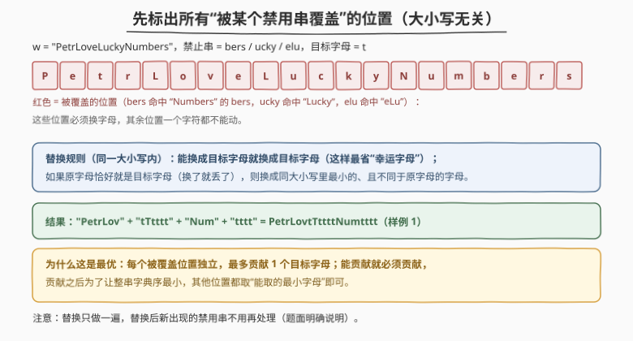
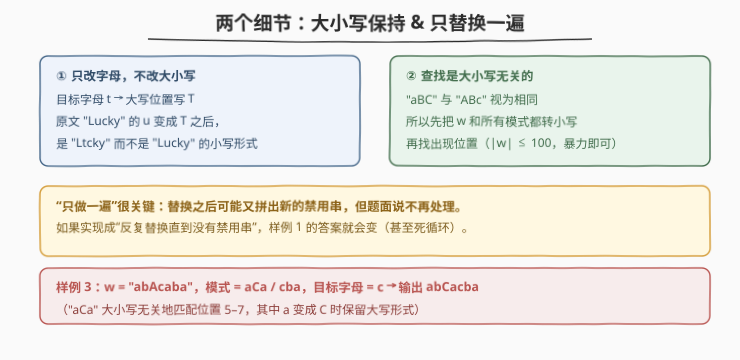

# Codeforces 95A 冰球赛的字母替换 题解

## 1. 题目概述

- **题目链接**：https://codeforces.com/problemset/problem/95/A
- **比赛来源**：Codeforces Beta Round 77 (Div. 1 Only) · Problem A（UTC 2011-07-08）
- **难度**：1600
- **标签**：实现、字符串
- **评测类型**：普通
- **限制**：时间 2 s / 内存 256 MB

**题意**：给定 $n$ 个「禁用串」和一个字符串 $w$，以及一个目标字母（小写）。规定：若 $w$ 的某个位置落在**任意一个禁用串的一次出现**（大小写无关）里，就必须把这个位置的字母换成另一个字母（保持原来的大小写，且必须真的不同）。替换只做一遍，**替换后新出现的禁用串不再处理**。

要求：在满足上述约束的所有替换结果里，先让**目标字母（忽略大小写）出现次数最多**，再让**结果字符串字典序最小**。

**约束**：

- $|w|,|s_i|\le100$、$n\le100$：暴力找出现位置、逐字符替换即可，$O(n\cdot|w|\cdot|s|)$ 是 $10^6$ 量级。
- 匹配是**大小写无关**的，替换必须**保持大小写**（大写的 `A` 位置只能换成大写字母）。
- 替换后不迭代：这是本题最容易想当然的地方。
- 目标字母本身可能等于某个被覆盖位置的原字母——这时该位置无法贡献目标字母（必须换成别的）。

## 2. 示例与观察

官方样例（输入 / 输出原样）：

```text
输入：
3
bers
ucky
elu
PetrLoveLuckyNumbers
t

输出：
PetrLovtTttttNumtttt
```

```text
输入：
4
hello
party
abefglghjdhfgj
IVan
petrsmatchwin
a

输出：
petrsmatchwin
```

```text
输入：
2
aCa
cba
abAcaba
c

输出：
abCacba
```

**样例 1 的演算**：$w=$ `PetrLoveLuckyNumbers`，禁用串 `bers`、`ucky`、`elu`，目标字母 `t`。转小写后 `petrloveluckynumbers`：

- `elu` 出现在位置 7–9（`e`、`l`、`u`）；
- `ucky` 出现在位置 9–12；
- `bers` 出现在位置 16–19（`Numbers` 的后四位）。

被覆盖的 0 起下标是 7–12 和 16–19（即第 8–13 位与第 17–20 位）。这些位置的字母都换掉：能换成 `t`/`T` 的都换成目标字母，结果开头 `PetrLov` 之后是 `tTtttt`，再是 `Num`，最后 `tttt`，即 `PetrLovtTttttNumtttt` ✓。

**样例 2 的演算**：$w=$ `petrsmatchwin`，禁用串 `hello`、`party`、`abefglghjdhfgj`、`IVan` 一个都没出现（大小写无关地比也没有），于是没有任何位置被覆盖，$w$ 原样输出 ✓。

**样例 3 的演算**：$w=$ `abAcaba`，禁用串 `aCa`、`cba`。转小写 `abacaba`：`aCa` 在第 3–5 位（`A`、`c`、`a`）匹配，`cba` 不匹配。于是这三位必须改，目标字母是 `c`：第 3 位是大写 `A`，换成大写目标 `C`；第 4 位原字母就是 `c`，必须换成别的（选最小的 `a`）；第 5 位是 `a`，换成 `c`。结果 `abCacba` ✓。

**观察**：

1. 被覆盖的位置集合一旦确定，每个位置的替换**互相独立**——所以可以逐位贪心。
2. 目标字母的个数和字典序是两个优先级：先把能变目标字母的位置都变掉，再让其余位置取最小可能字母。
3. 大小写只影响「换成哪个字符」：大写位置换大写、小写位置换小写。

## 3. 解题思路

### 3.1 朴素做法与瓶颈

规模极小，唯一的坑是「贪心是否正确」。想要严谨，可以把所有替换结果都枚举一遍——但每个被覆盖位置有 25 种可选字母，$25^{|w|}$ 不可行。好在这题的目标是**可分**的（每个位置独立贡献），所以逐位贪心就是最优。

### 3.2 核心观察：先标记，再逐位决策



**第一步（标记）**：把 $w$ 和所有禁用串都转小写，对所有起点 $st$ 检查 `w_low[st..st+len-1] == s_low`，命中就把这一段标记为「必须改」。

**第二步（逐位决策）**：对每个被标记的位置 $i$，设原字母 $x$（保留其大小写），目标字母按同样大小写记作 $t$：

- 若 $t\ne x$：直接放 $t$（贡献一个目标字母，且字典序上这是唯一能拿分的选法）；
- 若 $t = x$：这个位置放目标字母等于没改，不合法；于是放「同大小写里最小的、且不等于 $x$ 的字母」——小写时是 `a`（若 $x=$ `a` 则 `b`），大写时是 `A`（若 $x=$ `A` 则 `B`）。

未被标记的位置保持原样。



### 3.3 算法流程

1. 读 $n$、$n$ 个禁用串、$w$、目标字母；
2. 求所有出现位置并打标记（$O(n\cdot|w|\cdot|s|)$）；
3. 逐位生成答案：被标记的按上面的规则替换，其余原样；
4. 输出。

### 3.4 样例走查

样例 1 的关键位置：

| 位置（1 起） | 原字母 | 是否被覆盖 | 处理 | 结果 |
|---|---|---|---|---|
| 8 | `e`（`Love` 的 e） | 是（`elu`） | 换成 `t` | `t` |
| 9 | `L`（大写，`Lucky` 的首字母） | 是（`elu`、`ucky`） | 换成 `T` | `T` |
| 10 | `u` | 是（`elu`、`ucky`） | 换成 `t` | `t` |
| 11 | `c` | 是（`ucky`） | 换成 `t` | `t` |
| 20 | `s`（`Numbers` 的末字母） | 是（`bers`） | 换成 `t` | `t` |

（题面给的输出是 `PetrLovtTttttNumtttt`，第 9 位的大写 `L` 变成大写 `T`，正体现了「保持大小写」。）

## 4. 正确性证明

**引理 1（独立性）**：一个位置是否被覆盖、以及它被替换成什么，只取决于 $w$ 本身和禁用串集合，与其它位置的替换无关。

**证明**：覆盖判定只用到 $w$ 的原始内容和禁用串（题面明确说替换只做一遍，不迭代）；而合法替换的约束只有「与原文不同且保持大小写」。两者都不涉及别的位。∎

**引理 2（单点最优）**：对被覆盖的位置 $i$，在所有合法替换里：
- 若目标字母 $t\ne x$，则放 $t$ 同时使「目标字母计数」+1 且是所有合法替换中该位最小的（$t$ 是固定的一个字符，没有更小的选择能贡献计数）；
- 若 $t=x$，则该位无法贡献目标字母，最小合法字母就是「同大小写、最小且 $\ne x$」的那个字符。

**证明**：合法替换集合 = 同大小写的 26 个字母去掉 $x$。若 $t\ne x$，$t$ 属于该集合，放 $t$ 使计数 +1，其它选择计数 +0，故计数优先时必选 $t$；一旦确定要放 $t$，字符唯一。若 $t=x$，则任何选择都计数 +0，字典序最小即取集合中的最小元素（小写为 `a`，若 `a` $=x$ 则 `b`；大写同理）。∎

**定理**：程序输出是所有合法结果中按「目标字母数最大、再字典序最小」排序的最优解。

**证明**：由引理 1，全局目标等价于各被覆盖位置的目标之和（数量相加、字典序按位比较）。由引理 2，每一位都取了「在最大化总数前提下的最小字符」，且各位置的选择互不影响，故整体按字典序也是最小的。∎

## 5. 复杂度分析

- **时间**：标记 $O(n\cdot|w|\cdot|s|)\le10^6$；构造 $O(|w|)$。
- **空间**：$O(|w|+|s|)$。
- **与时限的关系**：2 s 时限下实测端到端约 4 ms（C++）/ 20 ms（Python）。

## 6. 参考代码

### C++17

```cpp
#include <bits/stdc++.h>
using namespace std;

static string lower(string s) {
    for (char& c : s) c = char(tolower((unsigned char)c));
    return s;
}

int main() {
    ios::sync_with_stdio(false);
    cin.tie(nullptr);
    int n;
    if (!(cin >> n)) return 0;
    vector<string> pat(n);
    for (int i = 0; i < n; ++i) cin >> pat[i];
    string w;
    cin >> w;
    string letter;
    cin >> letter;
    char tgt = letter[0];

    int L = (int)w.size();
    vector<char> covered(L, 0);
    string lw = lower(w);
    for (const string& p : pat) {
        string lp = lower(p);
        int m = (int)lp.size();
        if (m == 0 || m > L) continue;
        for (int st = 0; st + m <= L; ++st) {
            bool ok = true;
            for (int k = 0; k < m; ++k)
                if (lw[st + k] != lp[k]) { ok = false; break; }
            if (ok)
                for (int k = 0; k < m; ++k) covered[st + k] = 1;
        }
    }

    string res = w;
    for (int i = 0; i < L; ++i) {
        if (!covered[i]) continue;
        char orig = w[i];
        bool up = (orig >= 'A' && orig <= 'Z');
        char t = up ? char(toupper(tgt)) : tgt;      // 目标字母，保持原字符的大小写
        if (t != orig) { res[i] = t; continue; }
        // 无法放目标字母：取同大小写里最小的、且不同于原字母的字符
        char c = up ? 'A' : 'a';
        if (c == orig) c = up ? 'B' : 'b';
        res[i] = c;
    }
    cout << res << '\n';
    return 0;
}
```

### Python3

```python
import sys


def main() -> None:
    data = sys.stdin.read().split()
    n = int(data[0])
    pats = [data[1 + i].lower() for i in range(n)]
    w = data[1 + n]
    tgt = data[2 + n]

    L = len(w)
    lw = w.lower()
    covered = [False] * L
    for p in pats:
        m = len(p)
        if m == 0 or m > L:
            continue
        for st in range(L - m + 1):
            if lw[st:st + m] == p:
                for k in range(m):
                    covered[st + k] = True

    res = list(w)
    for i in range(L):
        if not covered[i]:
            continue
        orig = w[i]
        up = orig.isupper()
        t = tgt.upper() if up else tgt
        if t != orig:
            res[i] = t
        else:
            c = 'A' if up else 'a'
            if c == orig:
                c = 'B' if up else 'b'
            res[i] = c
    print(''.join(res))


main()
```

## 7. 边界情况与易错点

1. **只替换一遍**：替换后可能出现新的禁用串，但题面说不处理。若写成「反复替换直到没有禁用串」，样例 1 的答案会变，甚至死循环。
2. **大小写保持**：大写位置只能变大写。样例 1 里 `Lucky` 的 `L` 变成 `T` 而不是 `t`。
3. **匹配大小写无关**：`aCa` 能匹配 `aca`、`ACA`、`aCa`……样例 3 的 `aCa` 匹配的是 `aca`。
4. **目标字母等于原字母**：该位置必须换成别的字母（题面要求「换成另一个字母」），此时选最小合法字母；不能为了凑数量原样不动。
5. **多个禁用串重叠**：重叠部分只需标记一次；实现上用布尔数组，不要用加法计数。
6. **禁用串比 $w$ 长**：直接跳过（`m > L`），否则会越界。
7. **读入**：$w$ 与目标字母各占一行，都是无空格 token；用 `split()` 最稳。
8. **输出**：只输出替换后的字符串一行。
9. **大小写字母各自独立**：判断大小写用 `'A' <= c <= 'Z'`，不要假设只有 ASCII 小写。

## 8. 验证记录

- **编译环境与命令**：本机无 GNU `g++`，用 `clang++ -std=c++17 -O2` 配 `codeforces/tools/include/bits/stdc++.h` 兼容头编译（可原样提交 GNU C++17）；Python 为系统 `python3`。
- **官方样例**：3 / 3 通过，C++ 与 Python 与题面逐字一致。
- **文档与样例一致性**：`check_samples.py --only 0001-0100/95` 0 问题；`check.py codeforces/contests/0001-0100/95` 0 失败。
- **独立暴力对拍（240 组）**：暴力程序对每个被覆盖的位置**枚举“是否放置目标字母”的全部 $2^{k}$ 种组合**（$k$ 为被覆盖位置数），对不放置的位置取同大小写最小合法字母，然后按「目标字母数最大、字典序最小」比较取优——完全绕开逐位贪心的推理。随机生成 $n\le4$、$|w|\le8$、字母表 $\{a,b,c,A,B,C\}$ 的数据，共 **240 组**与参考程序比对，**全部一致**；C++ 与 Python 也一致。
- **最大约束性能**：$n=100$、$|w|=100$ 且禁用串长 100 的极限输入，C++ 端到端约 4 ms、Python 约 20 ms。
- **图片校验**：两张 SVG（`cf95a_covered.svg`、`cf95a_rules.svg`）通过 `xml.etree.ElementTree.parse`，文字包围盒均在 `viewBox` 内。
- **公式校验**：正文公式经 KaTeX（`throwOnError: true`）渲染无报错。
- **复核状态**：verified。

## 相关题目与扩展

- [Codeforces 95B Lucky Numbers](https://codeforces.com/problemset/problem/95/B)：同场 B 题，构造 + 贪心。
- [Codeforces 94A Restoring Password](https://codeforces.com/problemset/problem/94/A)：字符串查表类实现题。
- [Codeforces 71A Way Too Long Words](https://codeforces.com/problemset/problem/71/A)：字符串入门。
- [Codeforces 118A String Task](https://codeforces.com/problemset/problem/118/A)：大小写与字符过滤，和本题的「大小写保持」可对照。
- [LeetCode 709. 转换成小写字母](https://leetcode.cn/problems/to-lower-case/)：大小写处理的基本功。

**延伸思考**：

1. **如果替换需要迭代**（反复替换直到不含禁用串）：可能不收敛（例如把 `a` 换成 `b` 又拼出新的禁用串），需要检测环或做不动点分析，难度陡增。
2. **如果要求「不能出现任何禁用串」而不是「被覆盖就改」**：这是等价的重述吗？不是：题面只要求被**原串**覆盖的位置改，改完不看。若改成「结果里不能有禁用串」，就必须做约束满足/AC 自动机上的最短路径。
3. **如果目标字母的出现次数相同时还要比较大小写敏感的意义**：那字典序规则要按 ASCII 比较，大小写字母的先后会改变最优选择。
4. **如果禁用串带通配符**：匹配变成模式匹配，需要用 KMP/AC 自动机或位并行，标记仍然是线性可加。
5. **如果要求输出「最大目标字母数」**：答案就是「能换成目标字母的被覆盖位置数」，可以 $O(|w|)$ 直接算，不需要构造字符串。
