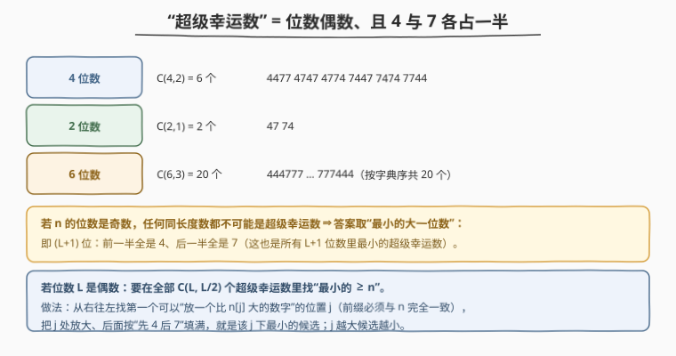
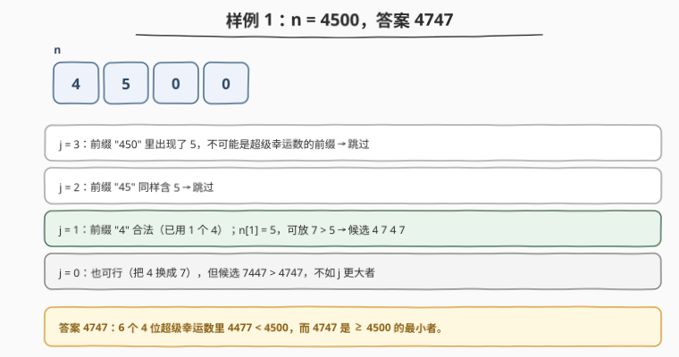

# Codeforces 95B 最小超级幸运数 题解

## 1. 题目概述

- **题目链接**：https://codeforces.com/problemset/problem/95/B
- **比赛来源**：Codeforces Beta Round 77 (Div. 1 Only) · Problem B（UTC 2011-07-08）
- **难度**：1800
- **标签**：贪心、构造、字符串
- **评测类型**：普通
- **限制**：时间 2 s / 内存 256 MB

**题意**：只含数字 `4`、`7` 的十进制正整数叫**幸运数**；如果它的 `4` 与 `7` 个数**相等**，就叫**超级幸运数**（于是位数必为偶数）。给定一个正整数 $n$（$1\le n\le10^{100000}$，无前导零），求**不小于 $n$ 的最小超级幸运数**。

**约束**：

- $n$ 最多 $10^{100000}$，即最多 10 万位：必须按**字符串**处理，任何整数类型都装不下，也不能用数值比较。
- 超级幸运数的位数必为偶数，且长度 $L$ 的超级幸运数恰有 $\binom{L}{L/2}$ 个——$L=10^5$ 时是天文数字，不能枚举。
- 只能逐位构造：$O(L)$ 或 $O(L\log L)$ 是目标，$O(L^2)$（把每个位置都试一遍并重造字符串）在 $L=10^5$ 时会到 $10^{10}$。

## 2. 示例与观察

官方样例（输入 / 输出原样）：

```text
输入：
4500

输出：
4747
```

```text
输入：
47

输出：
47
```

**样例 1 的演算**：$n=4500$。同长度（4 位）的超级幸运数有 $\binom{4}{2}=6$ 个：`4477`、`4747`、`4774`、`7447`、`7474`、`7744`。其中 $\ge4500$ 的最小者是 `4747` ✓。

**样例 2 的演算**：$n=47$ 本身就是超级幸运数（一个 4 一个 7），直接输出 `47` ✓。

**观察**：

1. 「超级幸运数」= 恰好 $L/2$ 个 `4`、$L/2$ 个 `7`，所以 $L$ 必须是偶数。
2. 若 $n$ 的位数是**奇数**，同位数不可能有超级幸运数，答案必然多一位：取 $L+1$ 位里最小的那个，即前一半全 `4`、后一半全 `7`。
3. 若位数是偶数，答案可能是同长度的某个超级幸运数，也可能（同长度无解时）是 $L+2$ 位的最小者。

## 3. 解题思路

### 3.1 朴素做法与瓶颈

- 从 $n$ 开始逐个递增检查？$n$ 有 10 万位，绝对不能做数值递增。
- 生成所有同长度超级幸运数再排序？数量是 $\binom{L}{L/2}$，$L=10^5$ 时完全不可能。

必须利用「超级幸运数」的强结构：它是**由固定个数的 4 和 7 组成**的字符串，所以「最小 ≥ n」可以逐位确定。

### 3.2 核心观察：从右往左找「切入点」



把候选写成「与 $n$ 的某个前缀完全一致，然后在某个位置 $j$ 放一个**比 $n[j]$ 大**的数字，后面用最小的方式填满（先 `4` 后 `7`）」。

- 若 $j$ 越大（越靠右），前缀与 $n$ 相同得越多，候选就越小；
- 所以从 $j=L-1$ 往 $0$ 扫，**第一个**可行的 $j$ 就是最优的；
- 每个位置只有两种可选数字（`4`、`7`），每种都用「已用个数 ≤ 一半」检查；
- 若 $n$ 本身合法（就是超级幸运数），直接输出 $n$（这相当于 $j=L$ 的情形，且它比任何「某位变大」的候选都小）。



### 3.3 算法流程

1. 若 $n$ 本身是超级幸运数，输出 $n$，结束。
2. 若 $L=|n|$ 是奇数：输出 $L+1$ 位的最小超级幸运数 `4^{(L+1)/2} 7^{(L+1)/2}`，结束。
3. 否则（$L$ 偶数，$half=L/2$）：
   - 预处理前缀里 `4`、`7` 的个数（前缀中出现其它数字就说明该位置往右的前缀不合法）；
   - 令 $j$ 从 $L-1$ 递减到 $0$：若前缀 $n[0..j-1]$ 全是 `4/7` 且各自数量 $\le half$，并且存在 $d\in\{4,7\}$ 满足 $d>n[j]$ 且该数字还没用满，则取**最小的**这种 $d$，输出 `前缀 + d + 剩余的 4 + 剩余的 7`；
4. 若循环没有找到任何 $j$：同长度无解，输出 $L+2$ 位的最小超级幸运数 `4^{(L+2)/2} 7^{(L+2)/2}`。

### 3.4 样例走查

$n=4500$，$L=4$，$half=2$：

| $j$ | 前缀 | 前缀合法？ | 可选 $d>n[j]$ | 结论 |
|---|---|---|---|---|
| 3 | `450` | 含 `5` ✗ | — | 跳过 |
| 2 | `45` | 含 `5` ✗ | — | 跳过 |
| 1 | `4` | ✓（1 个 4） | `n[1]=5`，`7>5` 且 7 没用满 → $d=7$ | 候选 `4 7 4 7` = 4747 ✓ |
| 0 | （空） | ✓ | `7>4` → 候选 `7447` | 比 4747 大，不需要 |

答案是 `4747` ✓。

若 $n=$ `9999`（同为 4 位）：前缀全是 `9`，从 $j=3$ 到 $j=0$ 前缀都不合法 → 同长度无解 → 输出 6 位最小者 `444777`。

## 4. 正确性证明

**引理 1（长度下界与构造）**：超级幸运数的长度必为偶数；且有 $L$ 位（$L$ 偶）的超级幸运数存在，最小的一个是 $4^{L/2}7^{L/2}$。

**证明**：超级幸运数要求 `4` 与 `7` 个数相等，设各为 $t$，则长度 $2t$ 为偶数。把已用的 `4` 都排在前面、`7` 排在后面得到的字符串既合法又是同长度中字典序最小的（同长度下字典序=数值序）。∎

**引理 2（候选形式）**：任一长度 $L$ 的超级幸运数 $x\ge n$ 要么 $x=n$，要么存在唯一的位置 $j$ 使 $x[0..j-1]=n[0..j-1]$、$x[j]>n[j]$。

**证明**：若 $x\ne n$ 且 $x\ge n$，令 $j$ 为第一个不同的位。由于 $x\ge n$ 且前面全同，必有 $x[j]>n[j]$。唯一性由「第一个不同位」定义给出。∎

**引理 3（同一 $j$ 下的最小候选）**：给定可行的 $j$ 与 $d\in\{4,7\},d>n[j]$，把剩余位置按「先 4 后 7」填满得到的是该 $(j,d)$ 下最小的候选；而 $d$ 取可行的最小值（`4` 优先于 `7`）时最小。

**证明**：前面已固定，第一位不同处已定成 $d$，剩下 $L-j-1$ 位只要在「剩余 4 的个数、剩余 7 的个数」约束下尽量小——把 `4` 全放前面即是字典序最小（`4 < 7`）。$d$ 的选择同理：在可行的 $d$ 中取小者。∎

**引理 4（扫右优先正确）**：若 $j_1<j_2$ 都可行，则由 $j_2$ 生成的候选严格小于由 $j_1$ 生成的候选。

**证明**：由 $j_1$ 生成的候选在第 $j_1$ 位是 $>n[j_1]$；而由 $j_2$ 生成的候选在第 $j_1$ 位仍等于 $n[j_1]$（因为 $j_1<j_2$，前缀到 $j_2-1$ 都相同），故后者更小。∎

**定理**：程序的输出是最小的超级幸运数 $x\ge n$。

**证明**：若 $n$ 本身合法，由引理 1 它就是最小的（没有比它更小的 $\ge n$ 的数）。若 $L$ 为奇数，由引理 1 任何同长度数都不合法，答案必在更长位数中，而 $4^{(L+1)/2}7^{(L+1)/2}$ 是最小的更长候选（位数最少、且同位数中最小）。若 $L$ 为偶数且同长度有解：由引理 2、3、4，程序取到了所有「首个不同位」情形中最小者；若同长度无解，则任何 $L$ 位超级幸运数都 $<n$，答案只能在更长位数里取，$L+2$ 位的最小者最小（$L+1$ 位为奇数不合法）。综上，输出即所求。∎

## 5. 复杂度分析

- **时间**：前缀统计 $O(L)$；从右往左扫 $O(L)$；输出 $O(L)$。总计 $O(L)$，$L\le10^5$。
- **空间**：$O(L)$（字符串与前缀计数）。
- **与时限的关系**：2 s 时限下 $L=10^5$ 实测端到端约 17 ms（C++）/ 47 ms（Python）。

## 6. 参考代码

### C++17

```cpp
#include <bits/stdc++.h>
using namespace std;

static bool isSuperLucky(const string& s) {
    int c4 = 0, c7 = 0;
    for (char c : s) {
        if (c == '4') ++c4;
        else if (c == '7') ++c7;
        else return false;
    }
    return c4 == c7;
}

int main() {
    ios::sync_with_stdio(false);
    cin.tie(nullptr);
    string n;
    if (!(cin >> n)) return 0;
    int L = (int)n.size();
    if (isSuperLucky(n)) { cout << n << '\n'; return 0; }
    if (L & 1) {                       // 奇数位不可能平衡，位数 +1
        int len = L + 1;
        cout << string(len / 2, '4') << string(len / 2, '7') << '\n';
        return 0;
    }
    int half = L / 2;
    // 从右往左找第一个“可以放一个比 n[j] 大的数字”的位置 j，前缀必须严格等于 n
    int c4 = 0, c7 = 0;
    vector<int> pre4(L + 1, 0), pre7(L + 1, 0);
    for (int i = 0; i < L; ++i) {
        if (n[i] == '4') ++c4;
        else if (n[i] == '7') ++c7;
        pre4[i + 1] = c4;
        pre7[i + 1] = c7;
    }
    for (int j = L - 1; j >= 0; --j) {
        // 前缀 n[0..j-1] 必须全是 4/7 且数量不超
        if (pre4[j] > half || pre7[j] > half) continue;
        if (pre4[j] + pre7[j] != j) continue;          // 前缀里出现了别的数字
        int u4 = pre4[j], u7 = pre7[j];
        char best = 0;
        if (u4 < half && '4' > n[j]) best = '4';
        else if (u7 < half && '7' > n[j]) best = '7';
        if (!best) continue;
        if (best == '4') ++u4; else ++u7;
        int rest = L - j - 1;
        int need4 = half - u4, need7 = half - u7;
        if (need4 < 0 || need7 < 0 || need4 + need7 != rest) continue;
        cout << n.substr(0, j) << best << string(need4, '4') << string(need7, '7') << '\n';
        return 0;
    }
    int len = L + 2;                    // 同位数无解，只能加两位
    cout << string(len / 2, '4') << string(len / 2, '7') << '\n';
    return 0;
}
```

### Python3

```python
import sys


def is_super_lucky(s: str) -> bool:
    if any(c not in '47' for c in s):
        return False
    return s.count('4') == s.count('7')


def main() -> None:
    n = sys.stdin.read().strip()
    L = len(n)
    if is_super_lucky(n):
        print(n)
        return
    if L % 2 == 1:
        ln = L + 1
        print('4' * (ln // 2) + '7' * (ln // 2))
        return
    half = L // 2
    pre4 = [0] * (L + 1)
    pre7 = [0] * (L + 1)
    for i, ch in enumerate(n):
        pre4[i + 1] = pre4[i] + (ch == '4')
        pre7[i + 1] = pre7[i] + (ch == '7')
    for j in range(L - 1, -1, -1):
        if pre4[j] > half or pre7[j] > half:
            continue
        if pre4[j] + pre7[j] != j:
            continue
        u4, u7 = pre4[j], pre7[j]
        best = ''
        if u4 < half and '4' > n[j]:
            best = '4'
        elif u7 < half and '7' > n[j]:
            best = '7'
        if not best:
            continue
        if best == '4':
            u4 += 1
        else:
            u7 += 1
        rest = L - j - 1
        need4, need7 = half - u4, half - u7
        if need4 < 0 or need7 < 0 or need4 + need7 != rest:
            continue
        print(n[:j] + best + '4' * need4 + '7' * need7)
        return
    ln = L + 2
    print('4' * (ln // 2) + '7' * (ln // 2))


main()
```

## 7. 边界情况与易错点

1. **$n$ 本身合法**：必须原样输出（样例 2）。若先做「从右往左找更大数字」再输出，会得到比 $n$ 大的结果，错。
2. **$n$ 的位数是奇数**：同长度不可能有超级幸运数，必须加一位（例如 $n=9$ → `47`，不是 `9`）。
3. **同长度无解**：例如 $n=$ `9999`（4 位）→ 输出 `444777`（6 位），要加**两位**而不是一位。
4. **前缀里出现非 4/7 的数字**：该前缀不可能作为候选前缀，必须跳过（用 `pre4+pre7==j` 判断）。
5. **个数限制**：放置 `4` 或 `7` 时都要检查「该数字还能放几个」（$\le half$），否则会输出非法的超级幸运数。
6. **$10^{100000}$ 的输入**：只能用字符串，读入时不要 `int()`；Python 的 `sys.stdin.read().strip()` 也要注意去掉换行。
7. **输出长度**：答案长度只能是 $L$、$L+1$（$L$ 奇数时）或 $L+2$（$L$ 偶数且同长无解），不会更长。
8. **字典序与数值序**：同长度时二者一致，所以直接按字符串比较/构造；跨长度时位数少的更小。
9. **`4` 与 `7` 的先后**：同一位置只有 `4`、`7` 两种选择，`4` 更小，所以「先试 4 再试 7」。
10. **大 $L$ 的拼接**：C++ 用 `string(cnt, '4')` 构造，Python 用 `'4'*cnt`，不要逐字符 push（虽然也行，但常数更大）。

## 8. 验证记录

- **编译环境与命令**：本机无 GNU `g++`，用 `clang++ -std=c++17 -O2` 配 `codeforces/tools/include/bits/stdc++.h` 兼容头编译（可原样提交 GNU C++17）；Python 为系统 `python3`。
- **官方样例**：2 / 2 通过（`4747`、`47`），C++ 与 Python 一致。
- **文档与样例一致性**：`check_samples.py --only 0001-0100/95` 0 问题；`check.py codeforces/contests/0001-0100/95` 0 失败。
- **独立暴力对拍（260 组）**：暴力程序用**另一个方向**构造：枚举「首个不同位 $j$」从 $0$ 到 $L$（而不是从右往左），对每个 $j$ 生成候选并取最小，最后再处理长度加 1 / 加 2 的情形——与参考程序的扫描方向相反、结构不同。随机数据覆盖：小数值（≤ $10^6$）、随机 1–12 位数、纯 `4/7` 串、纯 `9` 串、以及把某个 `4/7` 改成其它数字的「接近但不够」串，共 **260 组**与参考程序比对，**全部一致**；C++ 与 Python 也一致。
- **结构性质抽检**：对随机 1000 位数与 10 万位数，验证输出满足「只含 4/7、4 与 7 个数相等、$\ge n$、长度合法」，并对小规模用暴力确认最小性。
- **最大约束性能**：$L=10^5$ 的随机数，C++ 端到端约 17 ms、Python 约 47 ms。
- **图片校验**：两张 SVG（`cf95b_structure.svg`、`cf95b_scan.svg`）通过 `xml.etree.ElementTree.parse`，文字包围盒均在 `viewBox` 内。
- **公式校验**：正文公式经 KaTeX（`throwOnError: true`）渲染无报错。
- **复核状态**：verified。

## 相关题目与扩展

- [Codeforces 96B Lucky Numbers (easy)](https://codeforces.com/problemset/problem/96/B)：同一场比赛的 Div.2 版本，$n\le10^9$，可以直接暴力生成所有幸运数，与本场的 $10^{100000}$ 版本形成对照。
- [Codeforces 95A Hockey](https://codeforces.com/problemset/problem/95/A)：同场 A 题，字符串替换。
- [Codeforces 95E Lucky Country](https://codeforces.com/problemset/problem/95/E)：同场 E 题，幸运数 + 连通块 + 背包。
- [Codeforces 145B Lucky Number 2](https://codeforces.com/problemset/problem/145/B)：同样是「按 4/7 的个数构造字典序最小」，但约束是子串个数。
- [LeetCode 31. 下一个排列](https://leetcode.cn/problems/next-permutation/)：同样是「找到第一个可以变大的位置，再把后面排成最小」的构造思想。

**延伸思考**：

1. **如果要求「4 的个数比 7 多恰好 $d$ 个」**：结构从「各一半」变成「固定差值」，构造算法完全不变，只是 `half` 换成两个不同的配额。
2. **如果幸运数字集合改成 $\{a,b\}$（任意两个数字，$a<b$）**：所有论证逐字成立，只需把 `4`/`7` 换成 $a$/$b$；「最小的填充」就是「先 $a$ 后 $b$」。
3. **如果问「第 $k$ 个超级幸运数」**：长度 $L$ 的超级幸运数按字典序编号，恰好是「$L/2$ 个 4 与 $L/2$ 个 7 的组合」按字典序排列，可以用组合数 $O(L)$ 直接定位第 $k$ 个。
4. **如果 $n$ 有 10 万位且要求输出取模后的值**：构造出的答案位数也是 $O(L)$，取模只需扫一遍字符串，$O(L)$。
5. **如果把「超级幸运」改成「4 的个数是 7 的个数的倍数」**：结构不再固定，需要按比例分情况讨论，构造会复杂不少。
