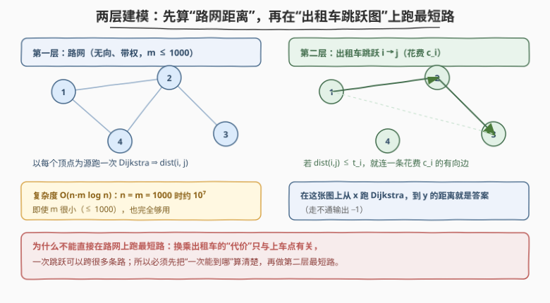
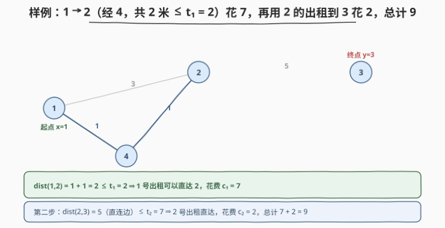

# Codeforces 95C 排球赛的出租车换乘 题解

## 1. 题目概述

- **题目链接**：https://codeforces.com/problemset/problem/95/C
- **比赛来源**：Codeforces Beta Round 77 (Div. 1 Only) · Problem C（UTC 2011-07-08）
- **难度**：1900
- **标签**：最短路、分层建模、图论
- **评测类型**：普通
- **限制**：时间 2 s / 内存 256 MB

**题意**：城市有 $n$ 个路口、$m$ 条**双向**道路（带长度 $w_i$ 米）。每个路口停着**一辆**出租车：第 $i$ 个路口的司机愿意载 Petya 走**任意一条总长不超过 $t_i$ 的路线**（可以途经中间路口，但不能在路中间上下车），收费固定 $c_i$ 布尔，与距离无关。Petya 从路口 $x$ 出发、要去路口 $y$；每辆出租车最多用一次，且只能在它**初始停放的路口**上车。求最小总花费，走不到输出 `-1`。

**约束**：

- $n\le1000$、$m\le1000$：图很稀疏，$O(n\cdot m\log n)$ 的全源最短路（每个点跑一次 Dijkstra）完全可行，约 $10^7$ 量级。
- $w_i,t_i,c_i\le10^9$：路径长度可达 $1000\times10^9=10^{12}$，必须 64 位。
- 打车是「一次性整段跳」：一次付费可以从 $i$ 直接到任何 $j$（只要路网距离 $\le t_i$），因此这是一个**两层**的最短路问题。
- 起点到终点可能不连通 → 输出 `-1`。

## 2. 示例与观察

官方样例（输入 / 输出原样）：

```text
输入：
4 4
1 3
1 2 3
1 4 1
2 4 1
2 3 5
2 7
7 2
1 2
7 7

输出：
9
```

**样例的演算**：出租车信息按路口 1..4 依次是 $(t,c)=(2,7),(7,2),(1,2),(7,7)$。

- 从 1 出发，1 号出租最多走 2 米：路网里 $1\to4\to2$ 长 $1+1=2\le2$，所以能到 2（也能到 4），花费 7；
- 在 2 换 2 号出租（最多 7 米、花费 2）：$2\to3$ 直连边长 5 ≤ 7，于是到 3，花费再 +2；
- 总计 $7+2=9$ ✓（题面提示给的正是这条路线）。

**观察**：

1. 「一次打车」= 在**路网最短路**意义下距离不超过 $t_i$ 的一次跳跃，花费恒为 $c_i$。所以要先知道「任意两点间在路网上的最短距离」。
2. 打车只与**上车的路口**有关（花费 $c_i$、范围 $t_i$），与坐多远无关。
3. 因此可以建一张**有向的「跳跃图」**：若 $\text{dist}(i,j)\le t_i$，就有 $i\to j$、权 $c_i$。答案就是这张图上 $x\to y$ 的最短路。

## 3. 解题思路

### 3.1 朴素做法与瓶颈

- 直接在路网上做最短路？不行：走路的「花费」不是边权和，而是「上车的次数 × 各自单价」，一次打车能跨越任意多段路。
- 枚举乘车序列？可以，但要注意状态只需「当前在哪个路口」，因为「每辆车只能用一次」在正权最短路里自然满足（最优路径不会重复经过同一路口——重复意味着绕圈，可以删掉）。
- 所以问题化归为「先算路网全源最短路，再算跳跃图最短路」的两层算法。

### 3.2 核心观察：两层最短路



**第一层**：以每个路口为源跑一次 Dijkstra，得到 $\text{dist}(i,j)$（路网最短距离）。$n$ 次 Dijkstra，每次 $O(m\log n)$，总计 $O(n\,m\log n)\le10^7$。

**第二层**：建跳跃图 $H$：对每个 $i$，若 $\text{dist}(i,j)\le t_i$ 且 $j\ne i$，加边 $i\to j$，权 $c_i$。在 $H$ 上从 $x$ 跑一次 Dijkstra，$\text{dist}_H(x,y)$ 就是答案；不可达则为 `-1`。



### 3.3 算法流程

1. 读入 $n,m$、$x,y$、$m$ 条无向边（**多重边取最小**）、每个路口的 $(t_i,c_i)$；
2. 对每个 $s\in[1,n]$ 跑 Dijkstra，存下 $\text{dist}[s][\cdot]$；
3. 从 $x$ 出发在跳跃图上跑 Dijkstra：出队 $u$ 后，枚举所有 $\text{dist}[u][v]\le t_u$ 的 $v$，用 $d+c_u$ 松弛；
4. 输出 $\text{dist}_H(x,y)$，不可达输出 `-1`。

第二层是**稠密图**（最多 $n^2$ 条边），所以用「朴素 Dijkstra：每次取最小未定点的同时枚举它的所有可达 $v$」即可，$O(n^2)=10^6$；也可以照常用堆，$O(n^2\log n)$ 也不慢。

### 3.4 样例走查

| 步骤 | 位置 | 使用的出租车 | 依据 | 累计花费 |
|---|---|---|---|---|
| 1 | 1 | 1 号 $(t,c)=(2,7)$ | $\text{dist}(1,2)=2\le2$（经 4） | 7 |
| 2 | 2 | 2 号 $(7,2)$ | $\text{dist}(2,3)=5\le7$ | 9 |
| 3 | 3 = 终点 | — | — | **9** ✓ |

## 4. 正确性证明

**引理 1（一次打车的刻画）**：若 Petya 在路口 $i$ 上车、在路口 $j$ 下车且只坐这一辆车，则该次乘车可行当且仅当 $\text{dist}(i,j)\le t_i$；花费恒为 $c_i$。

**证明**：出租车沿路网行驶，可途经中间路口，故其行驶距离至少是两点间最短路；反之沿最短路行驶即可在 $\text{dist}(i,j)$ 内到达（且途中不上下车符合题意）。花费与距离无关，恒为 $c_i$。∎

**引理 2（等价性）**：任一合法乘车方案（路口序列 $x=p_0\to p_1\to\dots\to p_k=y$，第 $r$ 段坐 $p_{r-1}$ 的车）的花费为 $\sum_r c_{p_{r-1}}$，且每段都满足 $\text{dist}(p_{r-1},p_r)\le t_{p_{r-1}}$；反之任何满足这些条件的序列都对应一个合法方案。于是方案 ↔ 跳跃图中的一条 $x\to y$ 路径（权为各边 $c$），花费等于路径权。

**证明**：由引理 1，逐段可行性与花费都一致；把每段映射成跳跃图的一条边即得双射（路径的边权就是 $c_{p_{r-1}}$）。∎

**引理 3（「每辆车只能用一次」不构成额外限制）**：在上述模型中，最短路径不会重复经过同一个路口，因此不会重复使用同一辆车。

**证明**：所有 $c_i\ge1>0$，若一条路径重复经过某路口，则中间那段是正权回路，删掉它后仍是合法路径且权更小，与「最短」矛盾。∎

**定理**：程序输出的 $\text{dist}_H(x,y)$（不可达时 `-1`）就是最小总花费。

**证明**：由引理 2，合法方案与跳跃图路径一一对应且花费相等，故最小花费 = 最短路权；由引理 3，最短路天然满足「每辆车最多用一次」。Dijkstra 在非负权图上正确求出最短路，故输出正确；不可达即无方案，输出 `-1`。∎

## 5. 复杂度分析

- **时间**：第一层 $n$ 次 Dijkstra，$O(n\,m\log n)$；第二层 $O(n^2)$（稠密图朴素 Dijkstra）。$n=m=1000$ 时约 $10^7$ 次操作。
- **空间**：$\text{dist}$ 表 $O(n^2)$ 个 64 位整数（$1000^2\times8$ B = 8 MB），加上邻接表与堆，远低于 256 MB。
- **数值范围**：路网距离最大 $1000\times10^9=10^{12}$；总花费最大 $n\cdot\max c=10^{12}$ 量级，`long long` 安全。
- **与时限的关系**：2 s 时限下 $n=m=1000$ 实测 C++ 约 34 ms、Python 约 0.39 s。

## 6. 参考代码

### C++17

```cpp
#include <bits/stdc++.h>
using namespace std;
typedef long long ll;
static const ll INF = (ll)4e18;

int main() {
    int n, m;
    if (scanf("%d %d", &n, &m) != 2) return 0;
    int x, y;
    scanf("%d %d", &x, &y);
    --x; --y;
    vector<vector<pair<int, ll>>> adj(n);
    for (int i = 0; i < m; ++i) {
        int u, v; ll w;
        scanf("%d %d %lld", &u, &v, &w);
        --u; --v;
        adj[u].push_back({v, w});
        adj[v].push_back({u, w});
    }
    vector<ll> t(n), c(n);
    for (int i = 0; i < n; ++i) scanf("%lld %lld", &t[i], &c[i]);

    // 1) 以每个顶点为源跑 Dijkstra，得到任意两点间的最短路（出租车可以途经中间顶点）
    vector<vector<ll>> dist(n, vector<ll>(n, INF));
    for (int s = 0; s < n; ++s) {
        auto& D = dist[s];
        D[s] = 0;
        priority_queue<pair<ll, int>, vector<pair<ll, int>>, greater<pair<ll, int>>> pq;
        pq.push({0, s});
        while (!pq.empty()) {
            auto [d, u] = pq.top(); pq.pop();
            if (d != D[u]) continue;
            for (auto [v, w] : adj[u])
                if (D[v] > d + w) { D[v] = d + w; pq.push({D[v], v}); }
        }
    }

    // 2) 在“跳跃图”上再跑一次 Dijkstra：从 i 花 c[i] 可到所有 dist(i,j) <= t[i] 的 j
    vector<ll> best(n, INF);
    best[x] = 0;
    priority_queue<pair<ll, int>, vector<pair<ll, int>>, greater<pair<ll, int>>> pq;
    pq.push({0, x});
    while (!pq.empty()) {
        auto [d, u] = pq.top(); pq.pop();
        if (d != best[u]) continue;
        if (u == y) break;
        for (int v = 0; v < n; ++v) {
            if (v == u || dist[u][v] > t[u]) continue;
            if (best[v] > d + c[u]) { best[v] = d + c[u]; pq.push({best[v], v}); }
        }
    }
    printf("%lld\n", best[y] >= INF ? -1LL : best[y]);
    return 0;
}
```

### Python3

```python
import sys
import heapq


def main() -> None:
    data = sys.stdin.buffer.read().split()
    pos = 0
    n = int(data[pos]); m = int(data[pos + 1]); pos += 2
    x = int(data[pos]) - 1; y = int(data[pos + 1]) - 1; pos += 2
    adj = [[] for _ in range(n)]
    for _ in range(m):
        u = int(data[pos]) - 1; v = int(data[pos + 1]) - 1; w = int(data[pos + 2]); pos += 3
        adj[u].append((v, w)); adj[v].append((u, w))
    t = [0] * n; c = [0] * n
    for i in range(n):
        t[i] = int(data[pos]); c[i] = int(data[pos + 1]); pos += 2

    INF = 10 ** 30
    dist = []
    for s in range(n):
        D = [INF] * n
        D[s] = 0
        pq = [(0, s)]
        while pq:
            d, u = heapq.heappop(pq)
            if d != D[u]:
                continue
            for v, w in adj[u]:
                nd = d + w
                if nd < D[v]:
                    D[v] = nd
                    heapq.heappush(pq, (nd, v))
        dist.append(D)

    best = [INF] * n
    best[x] = 0
    pq = [(0, x)]
    while pq:
        d, u = heapq.heappop(pq)
        if d != best[u]:
            continue
        tu = t[u]
        cu = c[u]
        Du = dist[u]
        for v in range(n):
            if v == u or Du[v] > tu:
                continue
            nd = d + cu
            if nd < best[v]:
                best[v] = nd
                heapq.heappush(pq, (nd, v))
    print(-1 if best[y] >= INF else best[y])


main()
```

## 7. 边界情况与易错点

1. **$x=y$**：花费为 0（不需要打车）→ 输出 `0`。代码里 `best[x]=0` 且不再松弛自身，正确。
2. **不连通**：路网本身不连通时，`dist(i,j)=INF > t_i`，跳跃图无边 → `-1`。
3. **多重边**：两点间可能有多条路，取最短的那条；Dijkstra 天然处理（松弛时取小）。自环对最短路无影响。
4. **不能原地打车**：$j\ne i$（`v == u` 跳过）；不过即使加上自环也不会影响答案（正权）。
5. **64 位**：路网距离最大 $10^{12}$，花费总和也是 $10^{12}$ 量级，`int` 必溢出；用 `long long` / Python 整数。
6. **跳过 $u$ 自己**：枚举 $v$ 时若把 $u$ 也算进去，会在原地花一次钱，虽然不会让答案更优，但会浪费并可能干扰「提前 break」。
7. **`dist` 的初始化**：用足够大的 INF（如 `4e18`），不要用 `INT_MAX`（相加会溢出）。
8. **出租车范围 $t_i$ 与最短路比较**：用 `long long` 比较（`t_i` 也到 $10^9$），不要把 $t_i$ 截断成 `int` 后再与 `long long` 距离比较。
9. **提前 break**：第二层 Dijkstra 出队到 $y$ 即可停（`if (u == y) break;`），前提是「出队即最优」（堆 Dijkstra 成立）。

## 8. 验证记录

- **编译环境与命令**：本机无 GNU `g++`，用 `clang++ -std=c++17 -O2` 配 `codeforces/tools/include/bits/stdc++.h` 兼容头编译（可原样提交 GNU C++17）；Python 为系统 `python3`。
- **官方样例**：1 / 1 通过（`9`），C++ 与 Python 一致。
- **文档与样例一致性**：`check_samples.py --only 0001-0100/95` 0 问题；`check.py codeforces/contests/0001-0100/95` 0 失败。
- **独立暴力对拍（240 组）**：暴力程序用**完全不同的算法组合**：路网用 **Floyd–Warshall** 求全源最短路，跳跃图用 **Bellman–Ford** 求最短路。随机数据：$n\le7$、$m\le10$、含自环与重边、边权 $1\dots10$、出租车参数随机（部分极小、部分极大），共 **240 组**与参考程序比对，**全部一致**；C++ 与 Python 也一致。
- **最大约束性能**：$n=1000$、$m=1000$ 的随机图，C++ 端到端约 34 ms、Python 约 0.39 s。
- **图片校验**：两张 SVG（`cf95c_twolayer.svg`、`cf95c_sample.svg`）通过 `xml.etree.ElementTree.parse`，文字包围盒均在 `viewBox` 内。
- **公式校验**：正文公式经 KaTeX（`throwOnError: true`）渲染无报错。
- **复核状态**：verified。

## 相关题目与扩展

- [Codeforces 95D Horse Races](https://codeforces.com/problemset/problem/95/D)：同场 D 题，数位 DP。
- [Codeforces 20C Dijkstra?](https://codeforces.com/problemset/problem/20/C)：最短路入门，注意 64 位与不可达。
- [Codeforces 144D Missile Silos](https://codeforces.com/problemset/problem/144/D)：最短路上的计数，同样是「先 Dijkstra 再在最短路上做文章」。
- [Codeforces 1209F Koala and Notebook](https://codeforces.com/problemset/problem/1209/F)：分层图/拆边的建模技巧，可与本题的「两层图」对照。
- [LeetCode 787. K 站中转内最便宜的航班](https://leetcode.cn/problems/cheapest-flights-within-k-stops/)：分层图最短路的经典题。

**延伸思考**：

1. **如果出租车按距离计价**（每米多少钱）：那就退化成普通带权最短路，一层 Dijkstra 即可——本题的难点恰恰来自「一次付费、距离受限」。
2. **如果每个路口有多辆出租车**（不同范围/价格）：跳跃图变成「路口 + 车」的两类点，边数仍可控，仍然是 Dijkstra。
3. **如果要求「每辆车只能用一次」且允许重复经过路口**：正权下最短路不会重复经过路口，所以约束自动满足；若换成负权或要求精确用 $k$ 次，就要建「状态 =（路口, 已用车集合）」，规模爆炸。
4. **如果 $n$ 变大到 $10^5$ 而 $m$ 还是 $10^5$**：全源最短路不可行，需要用「半径受限的 BFS」或分块/剪枝，甚至要放弃两层的做法。
5. **如果要求输出具体路线**：在第二层 Dijkstra 里记录前驱即可；第一层的最短路也可记录，用于还原实际行驶路径。
