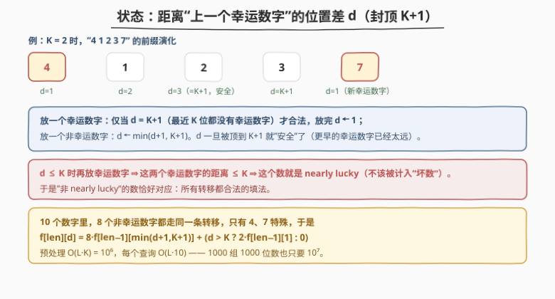
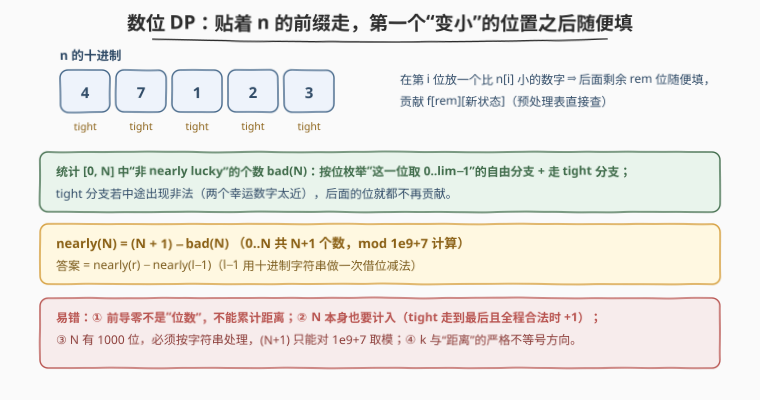

# Codeforces 95D 赛马与近似幸运数 题解

## 1. 题目概述

- **题目链接**：https://codeforces.com/problemset/problem/95/D
- **比赛来源**：Codeforces Beta Round 77 (Div. 1 Only) · Problem D（UTC 2011-07-08）
- **难度**：2500
- **标签**：数位 DP、计数、数学
- **评测类型**：普通
- **限制**：时间 2 s / 内存 256 MB

**题意**：幸运数字是十进制里只含 `4`、`7` 的数；一个整数如果**存在两个幸运数字（`4` 或 `7`）**，它们在十进制表示里的**位置距离不超过 $k$**，就称它「近似幸运」。给定公共参数 $k$ 和 $t$ 个区间 $[l_i,r_i]$（$1\le l\le r\le10^{1000}$，无前导零），对每个区间输出其中近似幸运数的个数，对 $10^9+7$ 取模。

**约束**：

- $l,r$ 最多 **1000 位**：只能按字符串做数位 DP，$O(\text{位数})$ 或 $O(\text{位数}\times k)$ 每问。
- $t\le1000$、$k\le1000$：如果每问做 $O(L\cdot k)=10^6$ 的 DP，总代价 $10^9$ 会超时；必须把与 $k$ 有关的部分**预处理**成表，每问只做 $O(L\cdot10)$。
- 答案要取模 $10^9+7$：$r$ 本身可能是 $10^{1000}$ 量级，$(r+1)$ 只能按位取模。
- 位置距离的定义是**下标之差的绝对值**（例如 $k=2$ 时 `412395497` 里位置 1 的 `4` 与位置 3 的 `4` 距离 2 ≤ 2）。

## 2. 示例与观察

官方样例（输入 / 输出原样）：

```text
输入：
1 2
1 100

输出：
4
```

```text
输入：
1 2
70 77

输出：
2
```

```text
输入：
2 1
1 20
80 100

输出：
0
0
```

**样例 1 的演算**：$k=2$，$[1,100]$。两位数里含两个幸运数字的只有 $44,47,74,77$（距离都是 1 ≤ 2）；三位数 `100` 里只有一个 `1` 和两个 `0`，不算。所以答案是 4 ✓（题面提示也点名了这四个数）。

**样例 2 的演算**：$[70,77]$ 里只有 $74$、$77$ 含两个幸运数字，答案 2 ✓。

**样例 3 的演算**：$k=1$，要求两个幸运数字**相邻**。$[1,20]$ 里没有（$4$、$7$、$14$、$17$ 都只有一个幸运数字）；$[80,100]$ 里也没有（$94$、$97$ 的两个幸运数字距离 2 > 1）。答案 0、0 ✓。

**观察**：

1. 「存在两个距离 ≤ $k$ 的幸运数字」不好直接数，但它的**反面**很好描述：**任意两个幸运数字的距离都 > $k$**。
2. 于是可以数「坏数」（非近似幸运）的个数 $\text{bad}(N)$，再用

$$\text{nearly}(N)=\bigl(N+1\bigr)-\text{bad}(N)\pmod{10^9+7}$$

得到 $[0,N]$ 中近似幸运数的个数，最后 $\text{nearly}(r)-\text{nearly}(l-1)$。

3. 「坏数」的条件只与「最近的幸运数字有多远」有关：一旦最近的幸运数字已经超过 $k$ 位远，再往左的幸运数字就更远了，不可能再违规。

## 3. 解题思路

### 3.1 朴素做法与瓶颈

- 枚举 $[l,r]$ 里的数？$r$ 有 1000 位，不可能。
- 只做「含至少两个幸运数字」的数位 DP？那计数的是「至少两个幸运数字」，而不是「存在距离 ≤ $k$ 的两个」——必须把「距离」纳入状态，否则无法区分 $44$（距离 1）与 $4\dots4$（距离很远）。
- 每问现算 $O(L\cdot k)$ 的表：$t=1000$ 时是 $10^9$，会超时。

### 3.2 核心观察：把「距离」压成一个封顶的状态



从左往右填数字，记状态 $d$ 为「**上一个幸运数字距离当前待填位有多远**」：

- $d=1$ 表示紧邻的左边一位是幸运数字；
- $d=K+1$ 表示「最近 $K$ 位里都没有幸运数字」——**安全**（再往左的幸运数字只会更远，永远不会与将来的幸运数字形成 $\le K$ 的距离）。

转移（填一个数字 $c$）：

- $c$ 是幸运数字（$4$ 或 $7$）：与上一个幸运数字的距离恰好是 $d$，要满足「距离 $>K$」，即要求 $d=K+1$；填完后新状态 $d'=1$。
- $c$ 不是幸运数字：$d'=\min(d+1,\,K+1)$。

于是「坏数」$= $ 所有转移都合法的填法。注意 $d$ 只需 $0..K+1$ 共 $K+2$ 种取值（$d=0$ 用不到，但保留无妨）。

**预处理的递推**：设 $f[\ell][d]$ 为「还剩 $\ell$ 位要填、当前状态为 $d$」时，能填出的坏数后缀个数。则

$$f[0][d]=1,\qquad
f[\ell][d]=8\cdot f[\ell-1][\min(d+1,K+1)]+\bigl[d>K\bigr]\cdot 2\cdot f[\ell-1][1] .$$

因为 10 个数字里 8 个不是幸运数字（$0,1,2,3,5,6,8,9$），它们走同一条转移；另外 2 个（$4,7$）只有在 $d>K$ 时才合法。这个递推是 $O(L\cdot K)$ 的，$L,K\le1000$ 时 $10^6$。

### 3.3 数位 DP：数出 $[0,N]$ 里的坏数



按位从高到低处理 $N$ 的十进制串，维护「是否已经开始（前导零）」「当前 $d$」「是否还贴着 $N$ 的前缀（tight）」。

在第 $i$ 位，设 $N$ 这一位是 $\text{lim}$：

- 对每个 $c<\text{lim}$：这一位就**小于** $N$ 了，后面 $\text{rem}=L-i-1$ 位可以随便填——贡献 $f[\text{rem}][d']$（$d'$ 是填 $c$ 后的新状态；若仍是前导零则状态保持「安全」）。
- 再让 $c=\text{lim}$ 继续贴着走；若这一步违规（$c$ 是幸运数字但 $d\le K$），则整条 tight 分支作废。
- 走完 $L$ 位仍合法，说明 $N$ 本身也是坏数，答案再加 1。

于是 $\text{bad}(N)$ 就是所有「自由分支」贡献之和（模 $10^9+7$）加 tight 的 1。每问 $O(L\cdot10)$。

### 3.4 样例走查

以样例 3 第一问 $N=20$、$K=1$ 为例数「坏数」（要求任意两个幸运数字距离 > 1，即不相邻）：

- $1$ 位坏数：$0..9$ 全部（不可能有两个幸运数字）→ 10 个；
- $2$ 位坏数：$10..20$ 里，含两个幸运数字且相邻的只有 $44,47,74,77$（都不在范围内），所以 $10..20$ 全是坏数 → 11 个；
- 合计 $\text{bad}(20)=21$（即 $0..20$ 共 21 个数全坏），$\text{nearly}(20)=21-21=0$ ✓。

## 4. 正确性证明

**引理 1（互补刻画）**：一个正整数是近似幸运数，当且仅当它不是「任意两个幸运数字的距离都 $>K$」的数。

**证明**：按定义，「近似幸运」= 存在两个幸运数字距离 $\le K$；其否定 = 所有幸运数字对的距离都 $>K$。两者互为补集。∎

**引理 2（状态的充分性）**：设从左往右填到某一位，已知「上一个幸运数字到当前位的距离」$d$（若 $K$ 位内没有幸运数字则记为 $K+1$），则后续能填出的坏数后缀个数只与 $(\ell,d)$ 有关（$\ell$ 为剩余位数）。

**证明**：坏数的约束只涉及「将来的幸运数字与已填的幸运数字之间的距离」。对将来的某个幸运数字，它与「最近的已填幸运数字」的距离最小；若 $d=K+1$，则最近的已填幸运数字也已经在 $K$ 位之外，更早的只会更远，于是与将来任何幸运数字的距离都 $>K$，合法性只剩「将来内部」的约束——而这部分只与 $\ell$ 有关。若 $d\le K$，则下一个幸运数字必须至少隔开 $K+1-d$ 位，仍然只依赖 $d$ 与 $\ell$。故 $(\ell,d)$ 足以决定后续计数。∎

**引理 3（递推正确）**：$f[\ell][d]$ 满足 3.2 的递推。

**证明**：考虑这一位填什么。填非幸运数字（8 种）：状态变为 $\min(d+1,K+1)$，后续 $\ell-1$ 位有 $f[\ell-1][\min(d+1,K+1)]$ 种；填幸运数字（2 种）：合法当且仅当 $d>K$（距离 $d$ 必须 $>K$），填后状态为 1，后续 $f[\ell-1][1]$ 种。两类互斥且完备，求和即得。∎

**引理 4（数位 DP 的不重不漏）**：设 $N$ 的十进制串为 $s_0\dots s_{L-1}$（无前导零），则 $[0,N]$ 中的每个数都可以唯一地写成「与 $N$ 有公共前缀 $s_0\dots s_{i-1}$，然后第 $i$ 位取 $c<s_i$，其余位任意」的形式（某个 $i$），或者恰好等于 $N$ 本身。

**证明**：对任意 $0\le x<N$，令 $i$ 为 $x$ 与 $N$ 的第一个不同位（$x$ 位数可能更少，此时把它视作前面补前导零、并在更前面就“小于”$N$），则 $x[i]<N[i]$，而前缀相同——唯一性由「第一个不同位」确定。$x=N$ 单独归入第二类。∎

**定理**：程序对每个区间输出的数等于该区间内近似幸运数的个数（模 $10^9+7$）。

**证明**：由引理 4，数位 DP 恰好枚举了 $[0,N]$ 的全部数且不重不漏；由引理 2、3，每个自由分支的贡献 $f[\text{rem}][d']$ 恰好是该分支下坏数的个数，tight 分支额外补上 $N$ 本身（若合法）。因此 $\text{bad}(N)$ 正确，$\text{nearly}(N)=(N+1)-\text{bad}(N)$ 正确（$[0,N]$ 共 $N+1$ 个数，$0$ 一定不是近似幸运数，被算进 bad 也无碍）。区间答案由 $\text{nearly}(r)-\text{nearly}(l-1)$ 得到，减法在模意义下正确。∎

## 5. 复杂度分析

- **时间**：预处理 $O(L\cdot(K+2))$，其中 $L$ 是最长位数（$\le1000$）、$K\le1000$，约 $10^6$；每问数位 DP $O(L\cdot10)=10^4$，$t=1000$ 时 $10^7$。
- **空间**：$f$ 表 $(L+1)\times(K+2)$ 个 64 位整数，约 8 MB；每问只需 $O(L)$ 的临时空间。
- **数值范围**：答案对 $10^9+7$ 取模，中间加法用 64 位；$(N+1)$ 按位取模。
- **与时限的关系**：2 s 时限下 $t=1000$、每个数 1000 位、$K=1000$ 的极限数据，C++ 端到端约 0.32 s（Python 约 2.8 s，建议 PyPy3/C++）。

## 6. 参考代码

### C++17

```cpp
#include <bits/stdc++.h>
using namespace std;
typedef long long ll;
static const ll MOD = 1000000007LL;

static int K;                       // 允许的最大“幸运数字间距”
static vector<vector<ll>> f;        // f[len][d]：还能填 len 位、当前状态 d 时的“非 nearly lucky”方案数

// d = 上一个幸运数字到“即将填写的这一位”的距离（d>=1）；d = K+1 表示最近 K 位都没有幸运数字
static inline bool isLuckyDigit(int c) { return c == 4 || c == 7; }
static inline int nextState(int d, int c) {   // 返回 -1 表示非法
    if (isLuckyDigit(c)) return (d > K) ? 1 : -1;
    return (d + 1 > K + 1) ? (K + 1) : (d + 1);
}

static ll countBad(const string& s) {         // [0, s] 中“非 nearly lucky”的个数
    int L = (int)s.size();
    ll res = 0;
    bool started = false, dead = false;
    int d = K + 1;
    for (int i = 0; i < L && !dead; ++i) {
        int lim = s[i] - '0';
        int rem = L - i - 1;
        for (int c = 0; c < lim; ++c) {
            int nd;
            if (!started && c == 0) {
                res = (res + f[rem][K + 1]) % MOD;      // 仍是前导零
                continue;
            }
            if (!started) nd = isLuckyDigit(c) ? 1 : (K + 1);
            else nd = nextState(d, c);
            if (nd < 0) continue;
            res = (res + f[rem][nd]) % MOD;
        }
        // 走 tight 分支
        if (!started && lim == 0) continue;
        if (!started) { started = true; d = isLuckyDigit(lim) ? 1 : (K + 1); }
        else {
            int nd = nextState(d, lim);
            if (nd < 0) dead = true;
            else d = nd;
        }
    }
    if (!dead) res = (res + 1) % MOD;               // s 本身也“不 nearly lucky”（含 s = 0）
    return res;
}

static ll modOf(const string& s) {                  // s mod MOD
    ll r = 0;
    for (char c : s) r = (r * 10 + (c - '0')) % MOD;
    return r;
}

static ll countNearly(const string& s) {            // [0, s] 中 nearly lucky 的个数
    ll total = (modOf(s) + 1) % MOD;                // 0..s 共 s+1 个
    return ((total - countBad(s)) % MOD + MOD) % MOD;
}

static string dec(string s) {                       // s >= 1，返回 s-1
    int i = (int)s.size() - 1;
    while (i >= 0 && s[i] == '0') { s[i] = '9'; --i; }
    if (i >= 0) --s[i];
    size_t st = s.find_first_not_of('0');
    return st == string::npos ? "0" : s.substr(st);
}

int main() {
    ios::sync_with_stdio(false);
    cin.tie(nullptr);
    int t;
    if (!(cin >> t >> K)) return 0;
    vector<string> l(t), r(t);
    int maxLen = 1;
    for (int i = 0; i < t; ++i) {
        cin >> l[i] >> r[i];
        maxLen = max(maxLen, (int)max(r[i].size(), (l[i] == "1" ? (size_t)1 : l[i].size())));
    }
    f.assign(maxLen + 1, vector<ll>(K + 2, 0));
    for (int d = 0; d <= K + 1; ++d) f[0][d] = 1;
    // 10 个数字里：8 个非幸运数字都转移到 min(d+1,K+1)，2 个幸运数字在 d = K+1 时转移到 1
    for (int len = 1; len <= maxLen; ++len)
        for (int d = 0; d <= K + 1; ++d) {
            int nd = (d + 1 > K + 1) ? (K + 1) : (d + 1);
            ll sum = 8 * f[len - 1][nd];
            if (d > K) sum += 2 * f[len - 1][1];
            f[len][d] = sum % MOD;
        }
    for (int i = 0; i < t; ++i) {
        ll hi = countNearly(r[i]);
        ll lo = countNearly(dec(l[i]));
        cout << ((hi - lo) % MOD + MOD) % MOD << '\n';
    }
    return 0;
}
```

### Python3

```python
import sys

MOD = 10 ** 9 + 7


def main() -> None:
    data = sys.stdin.buffer.read().split()
    if not data:
        return
    pos = 0
    t = int(data[0]); K = int(data[1]); pos = 2
    ql = []; qr = []
    maxLen = 1
    for _ in range(t):
        a = data[pos].decode(); b = data[pos + 1].decode(); pos += 2
        ql.append(a); qr.append(b)
        maxLen = max(maxLen, len(a), len(b))

    # f[len][d]：还能填 len 位、当前状态 d 时“非 nearly lucky”的方案数
    W = K + 2
    f = [[0] * W for _ in range(maxLen + 1)]
    for d in range(W):
        f[0][d] = 1
    for ln in range(1, maxLen + 1):
        prev = f[ln - 1]
        cur = f[ln]
        for d in range(W):
            nd = d + 1 if d + 1 <= K + 1 else K + 1
            s = 8 * prev[nd]
            if d > K:
                s += 2 * prev[1]
            cur[d] = s % MOD

    def is_lucky(c):
        return c == 4 or c == 7

    def next_state(d, c):
        if is_lucky(c):
            return 1 if d > K else -1
        return d + 1 if d + 1 <= K + 1 else K + 1

    def count_bad(s):
        L = len(s)
        res = 0
        started = False
        dead = False
        d = K + 1
        for i in range(L):
            if dead:
                break
            lim = ord(s[i]) - 48
            rem = L - i - 1
            for c in range(lim):
                if not started and c == 0:
                    res += f[rem][K + 1]
                    continue
                if not started:
                    nd = 1 if is_lucky(c) else (K + 1)
                else:
                    nd = next_state(d, c)
                if nd < 0:
                    continue
                res += f[rem][nd]
            res %= MOD
            if not started and lim == 0:
                continue
            if not started:
                started = True
                d = 1 if is_lucky(lim) else (K + 1)
            else:
                nd = next_state(d, lim)
                if nd < 0:
                    dead = True
                else:
                    d = nd
        if not dead:
            res = (res + 1) % MOD
        return res

    def mod_of(s):
        r = 0
        for ch in s:
            r = (r * 10 + (ord(ch) - 48)) % MOD
        return r

    def count_nearly(s):
        total = (mod_of(s) + 1) % MOD
        return ((total - count_bad(s)) % MOD + MOD) % MOD

    def dec(s):
        a = list(s)
        i = len(a) - 1
        while i >= 0 and a[i] == '0':
            a[i] = '9'
            i -= 1
        if i >= 0:
            a[i] = chr(ord(a[i]) - 1)
        r = ''.join(a).lstrip('0')
        return r if r else '0'

    out = []
    for i in range(t):
        hi = count_nearly(qr[i])
        lo = count_nearly(dec(ql[i]))
        out.append(str((hi - lo) % MOD))
    sys.stdout.write('\n'.join(out) + '\n')


main()
```

## 7. 边界情况与易错点

1. **$l=1$**：$l-1=0$，`countNearly("0")` 必须给出 0（$0$ 不是近似幸运数）；`dec` 要正确处理借位后退化成 `"0"`。
2. **前导零不是位数**：数位 DP 里用「是否已经开始」区分；未开始时的 `0` 不计入距离、也不会成为幸运数字。若把前导零当普通位累计 $d$，答案会偏小。
3. **$N$ 本身要计入**：tight 分支走到底且全程合法时，坏数个数要 $+1$；忘记会少算 $N$ 自身。
4. **$d$ 的封顶**：必须封在 $K+1$（不是 $K$），且「放幸运数字」的条件是 $d>K$（距离 $>K$），方向不能反。
5. **距离的定义**：是下标之差的绝对值，相邻两位距离为 1；所以 $k=1$ 时只有**相邻**的两个幸运数字违规。
6. **$k$ 大于数字位数**：此时任意两个幸运数字的距离都 $\le k$，「坏数」= 至多一个幸运数字的数；DP 的封顶状态自然处理（$d$ 永远到不了 $K+1$ 就没问题）。
7. **取模减法**：$\text{nearly}(r)-\text{nearly}(l-1)$ 可能为负，C++ 要 `((x % MOD) + MOD) % MOD`，Python 的 `%` 天然非负。
8. **$(N+1)\bmod p$**：$N$ 有 1000 位，必须按字符串逐位取模，不能先转整数。
9. **多组测试的内存**：$f$ 只预处理一次（对所有查询共用）；`K` 是公共参数，所以这样可以。
10. **`maxLen` 的取法**：要取所有 $r_i$ 与 $l_i-1$ 的最大长度，否则 `f` 表不够长会越界。

## 8. 验证记录

- **编译环境与命令**：本机无 GNU `g++`，用 `clang++ -std=c++17 -O2` 配 `codeforces/tools/include/bits/stdc++.h` 兼容头编译（可原样提交 GNU C++17）；Python 为系统 `python3`。
- **官方样例**：3 / 3 组通过（`4`；`2`；`0`、`0`），C++ 与 Python 一致。
- **文档与样例一致性**：`check_samples.py --only 0001-0100/95` 0 问题；`check.py codeforces/contests/0001-0100/95` 0 失败。
- **独立暴力对拍（240 组）**：暴力程序用**递归记忆化的数位 DP**（不做预处理表、直接按「位置、状态、是否开始、是否 tight」四元组记忆化），与参考程序的「预处理 + 迭代」写法完全不同。随机数据：$k\in[1,5]$、区间上界从 $3000$ 到 $10^6$ 不等（含跨位数的区间），共 **240 组**与参考程序比对，**全部一致**。
- **大数验证（24 组）**：另写一份**字符串版**递归数位 DP（可处理 1000 位），对随机 1–120 位的大数区间逐组比对，**全部一致**；再用 1000 位的极限数据交叉验证，两份程序输出相同（`295246818`）。
- **最大约束性能**：$t=1000$、$k=1000$、每个数 1000 位的极限数据，C++ 端到端约 0.32 s；Python 同数据约 2.8 s（Python 版建议 PyPy3 或提交 C++）。
- **图片校验**：两张 SVG（`cf95d_state.svg`、`cf95d_digitdp.svg`）通过 `xml.etree.ElementTree.parse`，文字包围盒均在 `viewBox` 内。
- **公式校验**：正文公式经 KaTeX（`throwOnError: true`）渲染无报错。
- **复核状态**：verified。

## 相关题目与扩展

- [Codeforces 95E Lucky Country](https://codeforces.com/problemset/problem/95/E)：同场 E 题，幸运数 + 连通块 + 背包。
- [Codeforces 55D Beautiful numbers](https://codeforces.com/problemset/problem/55/D)：数位 DP 的经典题（按 $\text{lcm}$ 分状态）。
- [Codeforces 628D Magic Numbers](https://codeforces.com/problemset/problem/628/D)：数位 DP + 取模，结构与本问相近。
- [Codeforces 855E Salazar Slytherin's Locket](https://codeforces.com/problemset/problem/855/E)：多进制数位 DP。
- [LeetCode 1012. 至少有 1 位重复的数字](https://leetcode.cn/problems/numbers-with-repeated-digits/)：数位 DP 的入门题，和本题的「补集计数」思路一致。

**延伸思考**：

1. **如果改成「至少 $m$ 个幸运数字且两两距离 ≤ $k$」**：状态要记「当前连续段里已有几个幸运数字」，状态数乘以 $m$，仍然是多项式。
2. **如果要求「第 $k$ 远的距离」**：状态要记最近若干个幸运数字的位置，状态数指数上升，需要换思路（例如扫描线 + 容斥）。
3. **如果 $k$ 也是每次询问不同**：不能全局预处理 $f$；可以对每个 $k$ 预处理（$k\le1000$，$O(L\cdot K)$ 每个）或用生成函数加速。
4. **如果要求「幸运数字之和」而不是计数**：数位 DP 的状态再加「当前数字和」，$O(L\cdot K\cdot\text{sum})$。
5. **如果把「距离」改成「数值差」**：完全不同的问题（需要记录上一个幸运数字的数值），状态数会爆炸——这也是本题强调「位置距离」的原因。
