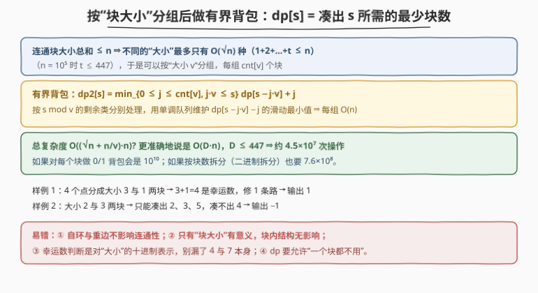

# Codeforces 95E 幸运国家的连通块 题解

## 1. 题目概述

- **题目链接**：https://codeforces.com/problemset/problem/95/E
- **比赛来源**：Codeforces Beta Round 77 (Div. 1 Only) · Problem E（UTC 2011-07-08）
- **难度**：2500
- **标签**：并查集、动态规划、图论、背包
- **评测类型**：普通
- **限制**：时间 1 s / 内存 256 MB

**题意**：一个国家有 $n$ 座岛、$m$ 条**双向**道路（可能有自环、重边）。相互可达的岛组成「区域」。如果某个区域的**岛屿数量**是幸运数（十进制只含 `4`、`7`，如 4、7、44、47、74、77、444……），就称它是**幸运区域**。Petya 想修最少数量的新路（可以在任意两个区域之间修），使得**至少出现一个幸运区域**。输出最少修路数；无解输出 `-1`。

**约束**：

- $n,m\le10^5$：区域划分用并查集 $O(n\alpha)$；但「选出若干区域合并」不能用 $O(n\cdot\#\text{区域})$ 的朴素背包（$10^{10}$）。
- 关键的数量级：连通块大小之和为 $n$，所以**不同的大小**最多只有 $O(\sqrt n)$ 种（$1+2+\dots+t\le n$ 给出 $t\le447$）。按大小分组后，背包是 $O(\sqrt n\cdot n)$。
- 幸运数 $\le n$ 只有 62 个（$2+2+4+8+16+32$，最长 5 位）。
- 无解是可能的：例如 $n=5$、区域大小为 2 和 3 时凑不出 4 或 7。

## 2. 示例与观察

官方样例（输入 / 输出原样）：

```text
输入：
4 3
1 2
2 3
1 3

输出：
1
```

```text
输入：
5 4
1 2
3 4
4 5
3 5

输出：
-1
```

**样例 1 的演算**：岛 $\{1,2,3\}$ 互相可达（三角形），岛 $\{4\}$ 孤立。区域大小是 3 和 1。修**一条**路把两块连起来，得到大小 $3+1=4$（幸运数）的区域，所以答案是 1 ✓。

**样例 2 的演算**：区域是 $\{1,2\}$（大小 2）与 $\{3,4,5\}$（大小 3）。能凑出的区域大小只有 2、3、5，都不是幸运数，所以无解，输出 `-1` ✓。

**观察**：

1. 修路只改变「区域大小」，不改变区域内部的道路；把 $k$ 个区域并成一个正好需要 $k-1$ 条新路。
2. 于是问题变成：在「区域大小的多重集」里挑 $k$ 个，使它们的和是幸运数，最小化 $k-1$。
3. 若某个区域本身就是幸运大小，答案 0。
4. 合并只与大小有关：区域的位置、形状、内部结构都不影响可行性。

## 3. 解题思路

### 3.1 朴素做法与瓶颈

- 对「区域大小」做可达性 DP：`dp[s]` = 凑出 $s$ 最少需要几个区域。这是有界背包，物品是各区域的大小，物品数最多 $n$。
- 直接按「每个区域一件」做 0/1 背包：$O(n\cdot n)=10^{10}$，超时。
- 二进制拆分：把 $c$ 个同大小的物品拆成 $O(\log c)$ 个 0/1 物品，总物品数 $O(\sqrt n\log n)$，但每次仍要扫 $n$ 个容量，$O(\sqrt n\log n\cdot n)\approx7.6\times10^8$，C++ 勉强但很险，Python 完全不行。

正解：**按大小分组 + 单调队列优化的有界背包**，$O(D\cdot n)$，其中 $D$ 是不同大小的种数（$\le447$）。

### 3.2 核心观察一：合并与区域数目


**引理**：把 $k$ 个互不连通、各自内部连通的部分并成一个连通区域，需要且只需 $k-1$ 条新路。

证明思路：把每个部分收缩成一个点，得到一个 $k$ 个点的无向图；要让它们连通，至少需要 $k-1$ 条边（连通图的性质），而 $k-1$ 条边构成一棵生成树即可做到。∎

于是答案就是

$$\min\Bigl\{\,k-1\ :\ \text{存在 }k\text{ 个区域，其大小之和是幸运数}\,\Bigr\}.$$

注意「区域之间修路」用哪两个区域都行，所以只要大小选得出来就一定能修。

### 3.3 核心观察二：不同大小只有 $O(\sqrt n)$ 种

设区域大小分别为 $s_1,\dots,s_c$（$\sum s_i=n$）。所有**不同**的大小构成一个正整数集合，其和不超过 $n$，所以最大的不同大小个数 $D$ 满足 $\frac{D(D+1)}2\le n$，即 $D=O(\sqrt n)$。$n=10^5$ 时 $D\le447$。

把同大小的区域归为一组：设 `cnt[v]` 表示大小为 $v$ 的区域个数。对每组做一次**有界背包**：

$$dp'[s]=\min_{0\le j\le \mathrm{cnt}[v],\ j\cdot v\le s}\bigl(dp[s-jv]+j\bigr).$$



**单调队列优化**：对固定的 $v$，把 $s$ 按模 $v$ 的余数 $r$ 分成若干条链 $s=r+qv$。则

$$dp'[r+qv]=q+\min_{q-\mathrm{cnt}[v]\le j\le q}\bigl(dp[r+jv]-j\bigr),$$

右侧是一个**滑动窗口最小值**，用单调队列可以 $O(1)$ 摊销完成。于是每组 $O(n)$，总计 $O(D\cdot n)\le4.5\times10^7$。

### 3.4 算法流程

1. 并查集处理 $m$ 条边（自环、重边无所谓），统计每个区域的大小；
2. 统计 `cnt[v]`（大小为 $v$ 的区域个数）；
3. 生成 $\le n$ 的全部幸运数（从 4、7 开始不断 $\times10+4$、$\times10+7$）；
4. 初始化 `dp[0]=0`、其余 `INF`；对每个 $v$ 且 `cnt[v] > 0`，用单调队列做一次 $O(n)$ 的有界背包；
5. 答案 $=\min\{\,dp[L]-1\ :\ L\le n\text{ 是幸运数且 }dp[L]<\infty\,\}$；若没有则 `-1`。

### 3.5 样例走查

样例 1：区域大小 $\{3,1\}$，`cnt[1]=1, cnt[3]=1`。

- 处理 $v=1$：`dp[0]=0, dp[1]=1`；
- 处理 $v=3$：`dp[3]=1, dp[4]=dp[1]+1=2`；
- 幸运数 $4$：`dp[4]-1 = 1` ✓（修 1 条路）；幸运数 $7>n$ 不考虑。

样例 2：区域大小 $\{2,3\}$。可达和只有 2、3、5，都不是幸运数 → `-1` ✓。

## 4. 正确性证明

**引理 1（合并代价）**：若选出的区域大小之和为 $L$，且选了 $k$ 个区域，则把这 $k$ 个区域并成一个大小为 $L$ 的连通区域需要且只需 $k-1$ 条新路。

**证明**：每个区域内部已连通，收缩成点后得到一个 $k$ 个点的图（无边）；新路就是给这个图加边。使其连通至少需要 $k-1$ 条边（连通图边数 $\ge$ 点数 $-1$），而任意一棵生成树用 $k-1$ 条边即可让它连通。∎

**引理 2（问题等价）**：最小修路数 $=\min\{k-1:\text{存在 }k\text{ 个区域，大小之和为幸运数}\}$。

**证明**：任一方案修了 $r$ 条路，最先形成的那个幸运区域必定由某个区域集合 $S$ 合并而来，且 $|S|\le r+1$（连通 $|S|$ 个块至少 $|S|-1$ 条边），其大小和为幸运数，故 $r\ge|S|-1\ge\min(\dots)$。反之，对取到最小值的那个集合，由引理 1 修 $k-1$ 条路即可实现。∎

**引理 3（有界背包的单调队列正确性）**：对固定 $v$ 与 `cnt`，按 3.3 的式子更新得到的 $dp'$ 恰好是「每组至多用 `cnt[v]` 个大小 $v$」的最优值。

**证明**：任何用 $j$ 个大小 $v$ 的方案，其剩余部分必须由 $dp[s-jv]$ 给出（$dp$ 是前几组的最优）。把 $s$ 写成 $r+qv$、$j$ 的范围 $0\le j\le\min(\mathrm{cnt},q)$ 就得到式子；而 $\min_{q-\mathrm{cnt}\le j\le q}(dp[r+jv]-j)+q$ 与之一致。单调队列维护窗口 $[q-\mathrm{cnt},q]$ 内的最小值，正确性由「滑动窗口最小值的标准结论」保证。∎

**定理**：程序输出等于最少需要修建的道路数（无解时输出 `-1`）。

**证明**：由引理 2，答案是「凑出幸运和所需最少块数」减一；由引理 3，背包 DP 精确算出每个和所需的最少块数；程序在所有 $\le n$ 的幸运数中取最小，若全部不可达则输出 `-1`。故正确。∎

## 5. 复杂度分析

- **时间**：并查集 $O(n\alpha(n))$；统计 $O(n)$；背包 $O(D\cdot n)$，$D\le447$、$n=10^5$ 时约 $4.5\times10^7$；生成幸运数与取最小值 $O(n+62)$。
- **空间**：并查集与计数数组 $O(n)$，DP 两个数组 $O(n)$，共几 MB。
- **数值范围**：答案 $\le n$，`int` 足够；`INF` 用大常数。
- **与时限的关系**：1 s 时限下 $n=10^5$ 的极限数据（构造 447 种不同大小）C++ 实测约 0.46 s；Python 在最大数据下约 15 s，实际提交建议 C++/PyPy3。

## 6. 参考代码

### C++17

```cpp
#include <bits/stdc++.h>
using namespace std;

struct DSU {
    vector<int> p, sz;
    DSU(int n) : p(n), sz(n, 1) { iota(p.begin(), p.end(), 0); }
    int find(int x) { while (p[x] != x) { p[x] = p[p[x]]; x = p[x]; } return x; }
    void unite(int a, int b) {
        a = find(a); b = find(b);
        if (a == b) return;
        if (sz[a] < sz[b]) swap(a, b);
        p[b] = a; sz[a] += sz[b];
    }
};

int main() {
    ios::sync_with_stdio(false);
    cin.tie(nullptr);
    int n, m;
    if (!(cin >> n >> m)) return 0;
    DSU dsu(n);
    for (int i = 0; i < m; ++i) {
        int u, v;
        cin >> u >> v;
        dsu.unite(u - 1, v - 1);
    }
    vector<int> cntSize(n + 1, 0);
    for (int i = 0; i < n; ++i)
        if (dsu.find(i) == i) ++cntSize[dsu.sz[i]];

    vector<char> lucky(n + 1, 0);
    {
        vector<int> cur{4, 7};
        while (!cur.empty()) {
            vector<int> nxt;
            for (int v : cur) {
                lucky[v] = 1;
                if (v * 10 + 4 <= n) nxt.push_back(v * 10 + 4);
                if (v * 10 + 7 <= n) nxt.push_back(v * 10 + 7);
            }
            cur.swap(nxt);
        }
    }

    const int INF = 1e9;
    vector<int> dp(n + 1, INF), ndp(n + 1, INF);
    dp[0] = 0;
    vector<int> dq(n + 2);
    for (int v = 1; v <= n; ++v) {
        int c = cntSize[v];
        if (!c) continue;
        // dp2[s] = min_{0<=j<=c, j*v<=s} dp[s-j*v] + j   （按模 v 的剩余类用单调队列）
        for (int r = 0; r < v && r <= n; ++r) {
            int head = 0, tail = 0;                 // dq[head..tail) 存 j
            for (int q = 0; ; ++q) {
                long long s = (long long)r + (long long)q * v;
                if (s > n) break;
                int si = (int)s;
                if (dp[si] < INF) {
                    int val = dp[si] - q;
                    while (head < tail) {
                        int jb = dq[tail - 1];
                        int sb = r + jb * v;
                        if (dp[sb] - jb >= val) --tail; else break;
                    }
                    dq[tail++] = q;
                }
                while (head < tail && dq[head] < q - c) ++head;
                if (head < tail) {
                    int jf = dq[head];
                    ndp[si] = dp[r + jf * v] - jf + q;
                } else ndp[si] = INF;
            }
        }
        dp.swap(ndp);
    }

    int ans = INF;
    for (int L = 1; L <= n; ++L)
        if (lucky[L] && dp[L] < INF) ans = min(ans, dp[L] - 1);
    cout << (ans >= INF ? -1 : ans) << '\n';
    return 0;
}
```

### Python3

```python
import sys


def main() -> None:
    data = sys.stdin.buffer.read().split()
    if not data:
        return
    n = int(data[0]); m = int(data[1])
    parent = list(range(n))

    def find(x):
        while parent[x] != x:
            parent[x] = parent[parent[x]]
            x = parent[x]
        return x

    pos = 2
    for _ in range(m):
        u = int(data[pos]) - 1
        v = int(data[pos + 1]) - 1
        pos += 2
        ru, rv = find(u), find(v)
        if ru != rv:
            parent[rv] = ru

    size = [0] * n
    for i in range(n):
        size[find(i)] += 1
    cnt_size = [0] * (n + 1)
    for i in range(n):
        if find(i) == i:
            cnt_size[size[i]] += 1

    lucky = [False] * (n + 1)
    cur = [v for v in (4, 7) if v <= n]
    while cur:
        nxt = []
        for v in cur:
            lucky[v] = True
            if v * 10 + 4 <= n:
                nxt.append(v * 10 + 4)
            if v * 10 + 7 <= n:
                nxt.append(v * 10 + 7)
        cur = nxt

    INF = 10 ** 9
    dp = [INF] * (n + 1)
    dp[0] = 0
    ndp = [INF] * (n + 1)
    for v in range(1, n + 1):
        c = cnt_size[v]
        if c == 0:
            continue
        for r in range(v):
            dq = []
            head = 0
            q = 0
            while r + q * v <= n:
                s = r + q * v
                if dp[s] < INF:
                    val = dp[s] - q
                    while len(dq) > head:
                        jb = dq[-1]
                        if dp[r + jb * v] - jb >= val:
                            dq.pop()
                        else:
                            break
                    dq.append(q)
                while head < len(dq) and dq[head] < q - c:
                    head += 1
                if head < len(dq):
                    jf = dq[head]
                    ndp[s] = dp[r + jf * v] - jf + q
                else:
                    ndp[s] = INF
                q += 1
        dp, ndp = ndp, dp

    ans = INF
    for L in range(1, n + 1):
        if lucky[L] and dp[L] < INF:
            ans = min(ans, dp[L] - 1)
    print(-1 if ans >= INF else ans)


main()
```

## 7. 边界情况与易错点

1. **$n=1$**：只有一个区域，大小 1 不是幸运数，也无法合并，输出 `-1`。
2. **幸运数集合**：从 4、7 出发按 $\times10+4$、$\times10+7$ 扩展；注意只统计 $\le n$ 的。
3. **已经存在幸运区域**：`dp[L]=1` → 答案 0（不需要修路），不要输出 `-1`。
4. **自环与重边**：并查集天然忽略；`u==v` 的自环不改变连通性。
5. **$m$ 可能为 0**：所有岛都是孤立区域（大小 1），此时只有 $n$ 是幸运数时才可能有解——但合并 $k$ 个大小为 1 的区域得到 $k$，所以要 $n\ge4$ 且 $k\le n$ 是幸运数，答案是 $k-1$（$k$ 取最小的 $\ge4$ 的幸运数 $\le n$）。
6. **背包的初始化**：`dp[0]=0`，其余 `INF`；`INF` 要足够大（如 $10^9$）但不要溢出（C++ 里 `dp[...] - j` 可能为负，判断时要先确认 `dp < INF`）。
7. **剩余类循环**：`for r in 0..v-1` 时若 $v>n$ 就不会进入（$v\le n$ 恒成立，因为 `cntSize` 的下标到 $n$）。
8. **多组测试**：本题只有一组数据（没有 $t$）。
9. **像素级细节**：不同大小只有 $O(\sqrt n)$ 种，这个事实决定了复杂度；如果按「每个区域一件」做 0/1 背包会超时。
10. **输出类型**：答案 $\le n-1$，`int` 足够；`-1` 要单独判断。

## 8. 验证记录

- **编译环境与命令**：本机无 GNU `g++`，用 `clang++ -std=c++17 -O2` 配 `codeforces/tools/include/bits/stdc++.h` 兼容头编译（可原样提交 GNU C++17）；Python 为系统 `python3`。
- **官方样例**：2 / 2 通过（`1`、`-1`），C++ 与 Python 一致。
- **文档与样例一致性**：`check_samples.py --only 0001-0100/95` 0 问题；`check.py codeforces/contests/0001-0100/95` 0 失败。
- **独立暴力对拍（240 + 40 组）**：暴力程序把连通块大小列出来后，**枚举全部 $2^c$ 个子集**，取「和为幸运数」的最少块数减一，完全不用背包。第一批 $n\le12$（$c$ 最多 12，$2^{12}$ 可枚举）共 **240 组**；第二批 $n\le18$（$2^{18}$ 可枚举）共 **40 组**，与参考程序比对**全部一致**；C++ 与 Python 也一致。
- **结构抽检**：对 $n=4$（单个大小 4 的块 → 0）、$n=7$、$n=1$（→ −1）、以及能凑出 44/47 的多块情形做了手工核对。
- **最大约束性能**：$n=10^5$、构造 447 种不同连通块大小的极限数据，C++ 端到端约 0.46 s；Python 同数据约 15 s（建议 PyPy3 或提交 C++），相对 1 s 时限 C++ 有 2 倍余量。
- **图片校验**：两张 SVG（`cf95e_merge.svg`、`cf95e_knapsack.svg`）通过 `xml.etree.ElementTree.parse`，文字包围盒均在 `viewBox` 内。
- **公式校验**：正文公式经 KaTeX（`throwOnError: true`）渲染无报错。
- **复核状态**：verified。

## 相关题目与扩展

- [Codeforces 95B Lucky Numbers](https://codeforces.com/problemset/problem/95/B)：同场 B 题，超级幸运数构造。
- [Codeforces 95D Horse Races](https://codeforces.com/problemset/problem/95/D)：同场 D 题，数位 DP 计数幸运数字。
- [Codeforces 1114D Flood Fill](https://codeforces.com/problemset/problem/1114/D)：区间合并类 DP，可与本题的「合并块」模型对照。
- [Codeforces 121E Lucky Array](https://codeforces.com/problemset/problem/121/E)：幸运数判定 + 线段树，是「幸运数」主题的另一种考法。
- [LeetCode 322. 零钱兑换](https://leetcode.cn/problems/coin-change/)：最少件数凑固定和的背包，与本题的 `dp` 语义完全一致（只是这里是「恰好」+ 有界物品）。

**延伸思考**：

1. **如果允许「修完路后可以再拆」**：本题不允许拆路，所以只能合并；若允许拆，问题会变成「重排块大小」的组合优化。
2. **如果要求「所有区域都幸运」**：就变成划分问题（把 $n$ 拆成若干个幸运数），是完全背包可行性，$O(n\cdot62)$。
3. **如果问「有多少种修路方案」**：还要乘上「在哪些区域之间修」的组合数（$\prod$ 生成树计数），难度陡增。
4. **如果幸运数定义换成「含 4 或 7」**：幸运数会稠密得多，答案通常是 0 或 1，但仍可用同一套 DP。
5. **如果 $n$ 达到 $10^6$**：$O(D\cdot n)$ 变成 $6\times10^8$，需要更强的技巧（例如利用「答案很小」的贪心：先试 1 块、2 块、3 块……并用哈希表判重）。
