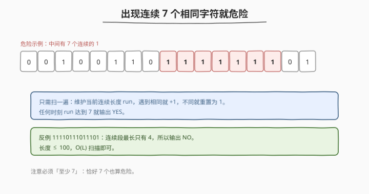
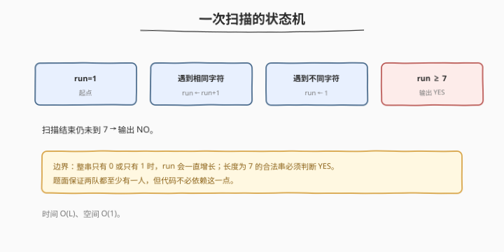

# Codeforces 96A 足球 题解

## 1. 题目概述

- **题目链接**：https://codeforces.com/problemset/problem/96/A
- **比赛来源**：Codeforces Beta Round 77 (Div. 2 Only) · Problem A（UTC 2011-07-08）
- **难度**：900
- **标签**：字符串、模拟
- **评测类型**：普通
- **限制**：时间 2 s / 内存 256 MB

**题意**：用只含 `0` 和 `1` 的字符串描述场上两队球员的位置（`0` 和 `1` 各表示一队）。如果存在**至少 7 个同队球员连续站在一起**，局势就算危险，输出 `YES`，否则输出 `NO`。

**约束**：

- 字符串长度不超过 $100$，非空，且两队都至少有一人：$O(L^2)$ 的暴力都能过，但 $O(L)$ 的一次扫描更自然。
- 只有一组输入。

## 2. 示例与观察

官方样例（输入 / 输出原样）：

```text
输入：
001001

输出：
NO
```

```text
输入：
1000000001

输出：
YES
```

**样例 2 解释**：字符串是 `1 00000000 1`，中间有 8 个连续的 `0`（≥ 7），所以危险。样例 1 里最长连续段是 `00`、`11` 交替出现，最长只有 2，所以安全。

**观察（只需最长连续段）**：局势危险当且仅当「最长的一段连续相同字符」长度 ≥ 7。这与具体是 0 还是 1 无关，所以扫一遍统计当前连续长度即可。



## 3. 解题思路

主流程只有一行：

1. `run = 1`（当前连续段长度）；
2. 从第二个字符开始遍历，若与前一字符相同则 `run++`，否则 `run = 1`；
3. 任何时刻 `run >= 7` 就输出 `YES` 并结束；扫完仍没有则输出 `NO`。



**样例走查**：`1000000001`：字符依次是 1、0、0、…（8 个 0）、1。第 2 个字符起 `run` 从 1 涨到 8，在第 8 个 0 处 `run = 7` → 输出 `YES` ✓。

## 4. 正确性证明

**引理 1**：字符串中存在长度 ≥ 7 的连续相同字符段，当且仅当算法在扫描某处时 `run ≥ 7`。

**证明**：`run` 的定义就是「以当前字符结尾的最长连续相同段长度」。若存在长度 $k \ge 7$ 的连续段，扫描到它的第 7 个字符时 `run = 7`；反之 `run` 达到 7 说明存在长度 7 的连续段。∎

**定理**：算法输出的 `YES/NO` 与危险判定一致。

**证明**：由引理 1，算法输出 `YES` 当且仅当存在长度 ≥ 7 的连续同队段，正是题面的危险定义。∎

## 5. 复杂度分析

- **时间**：$O(L)$，$L \le 100$。
- **空间**：$O(1)$（只存输入串）。
- **数值范围**：无溢出问题。

## 6. 参考代码

### C++17

```cpp
#include <bits/stdc++.h>
using namespace std;
// 96A：是否出现连续 7 个相同字符
int main() {
    static char s[105];
    if (scanf("%s", s) != 1) return 0;
    int n = strlen(s), run = 1;
    for (int i = 1; i < n; i++) {
        if (s[i] == s[i - 1]) run++;
        else run = 1;
        if (run >= 7) { puts("YES"); return 0; }
    }
    puts("NO");
    return 0;
}
```

### Python3

```python
import sys


def main() -> None:
    s = sys.stdin.buffer.read().strip().decode()
    run = 1
    for i in range(1, len(s)):
        if s[i] == s[i - 1]:
            run += 1
        else:
            run = 1
        if run >= 7:
            print("YES")
            return
    print("NO")


main()
```

## 7. 边界情况与易错点

1. **恰好 7 个**：题意是「至少 7 个」，`run >= 7` 而不是 `> 7`。
2. **长度不足 7**：循环不会触发，输出 `NO`；不要因为数组越界去读 `s[i+6]`（那样会越界或读脏数据）。
3. **全是同一种字符**：例如 7 个 `1`，`run` 一路涨到 7 → `YES`。
4. **连续段出现在开头或结尾**：正反扫描都一样，`run` 从 1 开始即可覆盖。
5. **换行符**：Python 用 `strip()` 去掉行尾换行，否则最后一个字符可能带 `\n` 而影响比较。
6. **输出大写**：题目要求 `YES` / `NO`，不是 `Yes`。
7. **多测**：只有一组输入。

## 8. 验证记录

- **编译环境与命令**：`clang++ -std=c++17 -O2 -Wall`（本机无 GNU g++，配 `codeforces/tools/include/bits/stdc++.h` 兼容头；代码可原样提交 GNU C++17），Python `3.9.6`。文档级验证：
  `python3 codeforces/tools/verify_solution.py codeforces/contests/0001-0100/96/A_足球.md`
- **官方样例**：2 / 2 通过（C++ 与 Python 一致）。
- **独立对拍**：暴力直接检查所有长度为 7 的窗口是否全相同。对 300 组随机 0/1 串（长度 2–100，且保证两队都出现），C++、Python、暴力三方一致。
- **最大约束性能**：长度 100 的串，端到端 < 10 ms，内存 < 2 MB。
- **复核状态**：verified（样例、对拍、性能均实跑通过）。

## 相关题目与扩展

- [Codeforces 96B Lucky Numbers (easy)](https://codeforces.com/problemset/problem/96/B)：同场 B 题，枚举 + 找最小。
- [Codeforces 110A Nearly Lucky Number](https://codeforces.com/problemset/problem/110/A)：幸运数字的计数入门。
- [Codeforces 118A String Task](https://codeforces.com/problemset/problem/118/A)：字符串过滤。
- [Codeforces 1A Theatre Square](https://codeforces.com/problemset/problem/1/A)：纯取整的入门题。
- [LeetCode 485. 最大连续 1 的个数](https://leetcode.cn/problems/max-consecutive-ones/)：连续段统计的模板。

**延伸思考**：

1. **如果阈值随队不同**（例如 0 队 7 个、1 队 8 个才算危险）：分别维护两队的 `run`。
2. **如果要求输出最长连续段的位置**：在 `run` 更新时记录起点即可。
3. **如果字符串是环形的**（首尾相接）：需要把串复制一遍再扫描，或特殊处理首尾拼接。
4. **如果允许最多 1 次修改**：问题变成「是否存在一个长度 7 的窗口，修改至多 1 个字符后全相同」，可以滑动窗口统计窗口内 0/1 的个数。
5. **如果要求统计所有危险段的数量**：对每个右端点统计以它结尾的长度 ≥ 7 的段数，即 `max(0, run-6)`。
