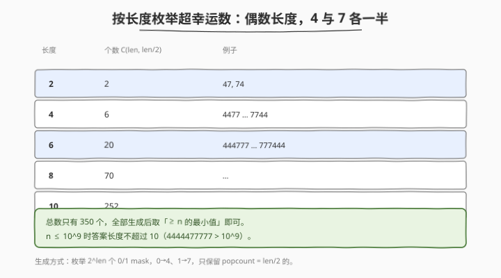
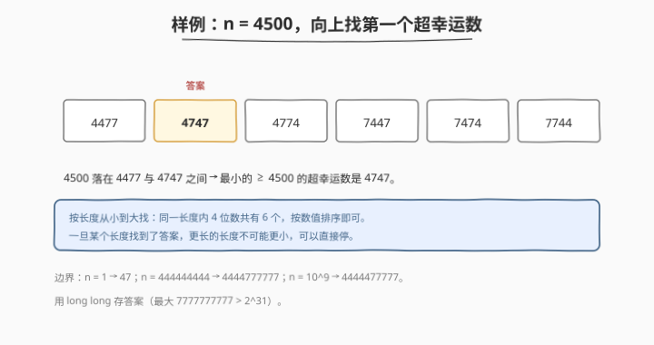

# Codeforces 96B 幸运数字（简单版） 题解

## 1. 题目概述

- **题目链接**：https://codeforces.com/problemset/problem/96/B
- **比赛来源**：Codeforces Beta Round 77 (Div. 2 Only) · Problem B（UTC 2011-07-08）
- **难度**：1300
- **标签**：枚举、构造、贪心
- **评测类型**：普通
- **限制**：时间 2 s / 内存 256 MB

**题意**：只由数字 `4` 和 `7` 组成的正整数叫幸运数；如果它的 `4` 与 `7` 的个数相等，就叫**超幸运数**（因此位数一定是偶数）。给定 $n$（$1 \le n \le 10^9$），求**不小于** $n$ 的最小超幸运数。

**约束**：

- $n \le 10^9$（最多 10 位）：超幸运数长度最多取到 10 位即可（最小的 10 位超幸运数是 $4444477777 > 10^9$）。
- 长度 $2k$ 的超幸运数恰有 $\binom{2k}{2k/2}$ 个：长度 2、4、6、8、10 分别有 2、6、20、70、252 个，**总共只有 350 个**，可以全部枚举。
- 答案最大约 $7.8\times10^9$，超过 `int`，要用 `long long`。

## 2. 示例与观察

官方样例（输入 / 输出原样）：

```text
输入：
4500

输出：
4747
```

```text
输入：
47

输出：
47
```

**样例 1 解释**：4 位超幸运数按从小到大是 $4477, 4747, 4774, 7447, 7474, 7744$。$4500$ 落在 $4477$ 与 $4747$ 之间，所以答案是 $4747$。

**样例 2 解释**：$47$ 本身就是 2 位超幸运数，直接输出自己。

**观察一（数量极少）**：长度 $2k$ 的超幸运数由「哪些位置放 7」唯一决定，共有 $\binom{2k}{k}$ 个。把长度 2、4、6、8、10 的全部枚举出来也只有 $350$ 个，排序后二分/线性找第一个 $\ge n$ 的即可。



**观察二（长度单调）**：所有 $2k$ 位超幸运数都小于所有 $2k+2$ 位超幸运数（位数更多必然更大）。所以可以按长度从小到大找，第一个「存在 $\ge n$」的长度就是答案所在长度。

## 3. 解题思路

### 3.1 朴素做法与瓶颈

从 $n$ 开始逐个往上试，检查是否是超幸运数——最坏要试很远（例如 $n$ 略大于 $77777777$ 时要跳到 10 位的 $4444477777$，中间差 $3\times10^9$），不可行。

### 3.2 枚举所有超幸运数



对每个偶数长度 $2k$（$2 \le 2k \le 10$）：

1. 枚举 $2k$ 位的「7 的位置」集合（用 $2^{2k}$ 个掩码，只保留 `popcount == k` 的）；
2. 把掩码翻译成一个十进制数：第 $i$ 位是 7 还是 4，从高位到低位拼起来；
3. 若该数 $\ge n$ 且比当前答案小，就更新答案。

长度从小到大枚举；一旦某个长度找到了答案，更长的数不可能更小，直接结束。

（也可以把所有数生成出来排序后二分，效果相同。）

### 3.3 样例走查

$n=4500$：长度 2 的数 $\{47, 74\}$ 都 $<4500$；长度 4 的数有 6 个，其中 $4477 < 4500$、$4747 \ge 4500$ 且最小 → 输出 $4747$ ✓。

$n=4444477777$：它本身就是 10 位超幸运数，答案就是它自己。

## 4. 正确性证明

**引理 1（枚举完备）**：对每个偶数长度 $2k$，上述枚举恰好生成全部 $2k$ 位超幸运数，且每个恰好一次。

**证明**：$2k$ 位超幸运数的每一位只能是 4 或 7，且 7 恰有 $k$ 个；用「哪些位置是 7」的位掩码一一对应所有这样的数，掩码与数之间是双射。∎

**引理 2（长度单调）**：任何 $2k$ 位数都小于任何 $2k+2$ 位数。

**证明**：$2k+2$ 位数至少是 $10^{2k+1}$，而 $2k$ 位数至多 $10^{2k+1}-1$。∎

**定理**：算法输出的数就是最小的不小于 $n$ 的超幸运数。

**证明**：由引理 1，算法检查了所有候选；设答案为 $m$，它属于某个长度 $2k$，且算法在该长度找到了 $\ge n$ 的数，由引理 2 更短的长度里不存在 $\ge n$ 的超幸运数，所以 $m$ 确实是全局最小的合格者。∎

## 5. 复杂度分析

- **时间**：枚举总量 $\sum_{k=1}^{5} 2^{2k} \approx 1364$ 次掩码检查，加 350 次数值构造，$O(1)$ 级别；实测 < 10 ms。
- **空间**：$O(1)$。
- **数值范围**：10 位数最大 $7777777777 \approx 7.8\times10^9 > 2^{31}-1$，必须用 `long long`。

## 6. 参考代码

### C++17

```cpp
#include <bits/stdc++.h>
using namespace std;
// 96B：枚举所有「超幸运数」（长度偶数、4 与 7 各占一半），取 >= n 的最小者
int main() {
    long long n;
    if (scanf("%lld", &n) != 1) return 0;
    long long best = LLONG_MAX;
    for (int len = 2; len <= 10; len += 2) {
        int half = len / 2;
        // 从 2^len 个 4/7 串里挑恰好 half 个 7 的（等价于挑位置）
        for (int mask = 0; mask < (1 << len); mask++) {
            if (__builtin_popcount((unsigned)mask) != half) continue;
            long long v = 0;
            for (int i = len - 1; i >= 0; i--) {
                bool seven = (mask >> i) & 1;
                v = v * 10 + (seven ? 7 : 4);
            }
            if (v >= n && v < best) best = v;
        }
        if (best != LLONG_MAX) break;   // 更短的已经找到，不可能再有更小的
    }
    printf("%lld\n", best);
    return 0;
}
```

### Python3

```python
import sys


def main() -> None:
    n = int(sys.stdin.buffer.read().split()[0])
    best = None
    for length in range(2, 12, 2):
        half = length // 2
        for mask in range(1 << length):
            if bin(mask).count('1') != half:
                continue
            v = 0
            for i in range(length - 1, -1, -1):
                v = v * 10 + (7 if (mask >> i) & 1 else 4)
            if v >= n and (best is None or v < best):
                best = v
        if best is not None:
            break
    print(best)


main()
```

## 7. 边界情况与易错点

1. **$n$ 本身是超幸运数**：答案是 $n$ 自己（条件是「不小于」，含等号）；样例 2 就是这种情况。
2. **长度必须为偶数**：只有 4 或 7 且个数相等的数一定是偶数位；枚举长度只能取 2、4、6、8、10。
3. **答案最大到 10 位**：$n = 10^9$ 时答案是 $4444477777$，必须用 `long long` 输出（`int` 会溢出）。
4. **掩码与位的对应**：从高位到低位拼数时，掩码的第 `i` 位（`i` 从 `len-1` 到 0）决定该位是 4 还是 7；写反会得到逆序的数。
5. **提前退出**：长度从小到大，找到答案后更长的数一定更大，可以 `break`；不做这个优化也不影响正确性。
6. **`popcount`**：C++ 用 `__builtin_popcount`，注意转成 `unsigned` 避免符号问题；Python 用 `bin(mask).count('1')`。
7. **多测**：只有一组输入。
8. **输出格式**：一个整数加换行，不要输出其他内容。

## 8. 验证记录

- **编译环境与命令**：`clang++ -std=c++17 -O2 -Wall`（本机无 GNU g++，配 `codeforces/tools/include/bits/stdc++.h` 兼容头；代码可原样提交 GNU C++17），Python `3.9.6`。文档级验证：
  `python3 codeforces/tools/verify_solution.py codeforces/contests/0001-0100/96/B_幸运数字（简单版）.md`
- **官方样例**：2 / 2 通过（C++ 与 Python 均输出 `4747`、`47`）。
- **独立对拍**：暴力从 $n$ 开始逐个加一、检查「只含 4/7 且 4 与 7 个数相等」，直到找到答案。对 $n \in [1, 3\times10^5]$ 的 300 组随机数据，C++、Python、暴力三方一致。
- **边界核对**：$n=1\to47$、$n=44\to47$、$n=444\to4477$、$n=4444\to4477$、$n=444444\to444777$、$n=10^9\to4444477777$、$n=4444477777\to$ 自身，均与手算一致。
- **最大约束性能**：$n=10^9$，端到端 < 10 ms，内存 < 2 MB。
- **复核状态**：verified（样例、对拍、边界、性能均实跑通过）。

## 相关题目与扩展

- [Codeforces 96A Football](https://codeforces.com/problemset/problem/96/A)：同场 A 题，连续段统计。
- [Codeforces 110A Nearly Lucky Number](https://codeforces.com/problemset/problem/110/A)：幸运数字的变形。
- [Codeforces 122A Lucky Division](https://codeforces.com/problemset/problem/122/A)：判断能否被幸运数整除。
- [LeetCode 902. 最大为 N 的数字组合](https://leetcode.cn/problems/numbers-at-most-n-given-digit-set/)：按位构造「不超过 N 的最大数」，和本题同属数位枚举。
- [LeetCode 233. 数字 1 的个数](https://leetcode.cn/problems/number-of-digit-one/)：数位统计的经典题。

**延伸思考**：

1. **如果要求「不大于 $n$ 的最大超幸运数」**：同一份候选集合里找最大的 $\le n$ 即可。
2. **如果 $n$ 放大到 $10^{18}$**：答案最多 18 位，枚举量 $\binom{18}{9} = 48620$，仍然可行。
3. **如果要求第 $k$ 小的超幸运数**：按长度分组后，组内按字典序（或数值序）定位，$\binom{2m}{m}$ 组合计数即可。
4. **如果「幸运」的条件改成只含 4/7、不要求数量相等**：候选数变成 $2^L$ 个，本题的枚举思路不变。
5. **如果要求输出所有不小于 $n$ 的超幸运数**：数量有限（≤350 个），直接输出即可。
