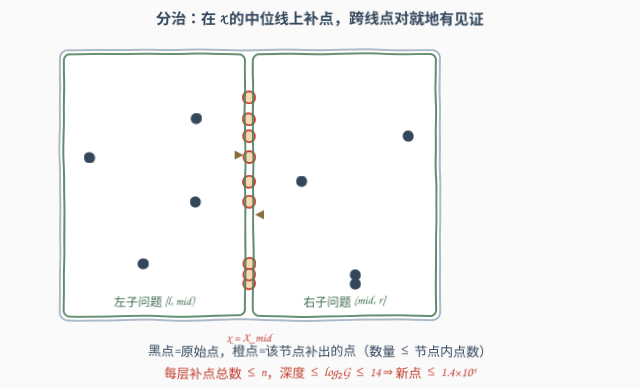
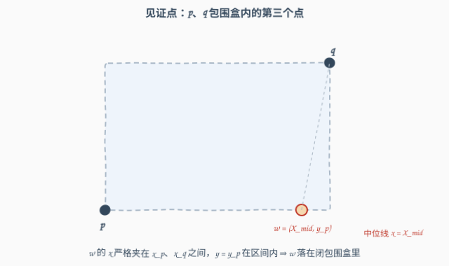
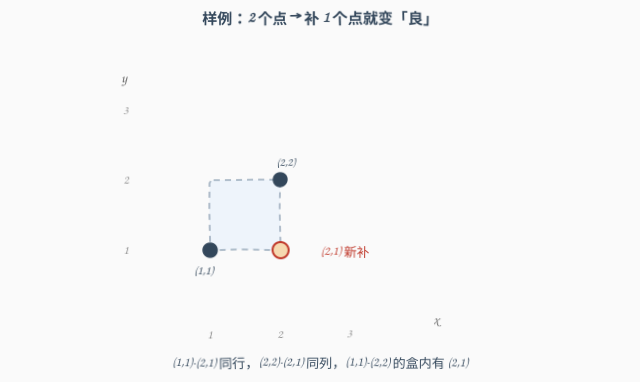

# Codeforces 97B 构造良点集超集 题解

## 1. 题目概述

- **题目链接**：https://codeforces.com/problemset/problem/97/B
- **比赛来源**：Yandex.Algorithm 2011: Finals · Problem B（UTC 2011-07-15）
- **难度**：2300
- **标签**：构造、分治、计算几何
- **评测类型**：特殊评测（答案不唯一）
- **限制**：时间 2 s / 内存 256 MB

**题意**：平面上的点集称为"良"的，如果任意两点 $p,q$ 满足三条之一：

1. 两点在同一条水平线上（$y_p=y_q$）；
2. 两点在同一条竖直线上（$x_p=x_q$）；
3. 以 $p,q$ 为对角的、边平行于坐标轴的闭矩形（包围盒）内，含有集合中**除这两点以外**的至少一个点。

给定 $n$ 个互不相同的整点，要求输出一个"良"的超集，点数 $m$ 满足 $n\le m\le 2\cdot10^5$，坐标绝对值不超过 $10^9$。不要求最小化 $m$。

**约束**：

- $n\le 10^4$，坐标 $|x_i|,|y_i|\le 10^9$（读入用 `int` 够，做差/比较时注意别溢出，本题只用比较）；
- 输出规模上限 $2\cdot 10^5$，也就是说最多只能加 $1.9\times10^5$ 个点，**每个原始点平均只能"摊到" 19 个新点**；
- $n\le 10^4$ 而输出上限 $2\times10^5$，比值约 $20$，提示构造应当是 $O(n\log n)$ 个点、$O(n\log n)$ 时间；
- 坐标范围不随点数缩小，所以新点的坐标只能直接复用输入中已有的 $x$ 与 $y$（否则可能越界）；
- 答案不唯一，评测用 checker。

## 2. 示例与观察

官方样例（输入 / 输出原样）：

```text
输入：
2
1 1
2 2

输出：
3
1 1
2 2
1 2
```

**样例解释**：原始两点 $(1,1),(2,2)$ 既不同行也不同列，包围盒 $[1,2]\times[1,2]$ 里只有它们自己，所以原集合不良。补上 $(1,2)$ 后：$(1,1)$ 与 $(2,2)$ 的包围盒里有 $(1,2)$；$(1,1)$ 与 $(1,2)$ 同列；$(2,2)$ 与 $(1,2)$ 同行。于是良。

> 注意输出与"官方输出"不必逐字相同——本题是特殊评测，任何合法的良超集都算对。本例也可以输出 $(2,1)$。

自造样例（标注自造）：

| 输入 | 一种合法输出 | 说明 |
|------|--------------|------|
| `1 / (-1e9, 1e9)` | 1 个点 | 单点集自动是良的 |
| 4 个点全在 $x=5$ 上 | 原样输出 4 个点 | 任意两点都同列 |
| 3 个点全在 $y=5$ 上 | 原样输出 3 个点 | 任意两点都同行 |
| $(-10^9,-10^9),(10^9,10^9),(0,0)$ | 5 个点 | 第三点落在第一、二点的盒内，但另两对需要补点 |

**观察**：真正需要处理的只有"$x$ 不同、$y$ 也不同"的点对。进一步观察：只要对**按 $x$ 排序后相邻**的点对（以及分治过程中被切开的两侧）都能找到见证点，全局就都成立。这提示"在 $x$ 的中位线附近补点"的分治构造。

## 3. 解题思路

### 3.1 朴素做法与瓶颈

最朴素的想法是：枚举所有点对，若包围盒内没有第三点就补一个点。但补点会改变其它点对的判定，容易陷入"补了又坏、坏了又补"的循环；更糟的是每轮要 $O(m^2)$ 判所有点对，$m$ 到 $10^5$ 时是 $10^{10}$ 级别，完全不可行。

需要的是**一次性、可证明**的构造：先想清楚哪些点对是"危险"的，再用一个结构化的补点方案把它们一网打尽。

### 3.2 核心观察



把所有点按 $x$ 排序，把**相同的 $x$ 合并成一组**，设不同 $x$ 的个数为 $G$，第 $g$ 组的 $x$ 值为 $X_g$。

**观察 1（竖直中位线）**：对一段连续的分组区间 $[l,r)$，取中位分组 $mid=\lfloor(l+r)/2\rfloor$，把竖直线 $x=X_{mid}$ 上、纵坐标为"该区间内所有点的 $y$"的那些点全部补进集合。

**观察 2（见证点就在中位线上）**：设 $p,q$ 是区间内的两个点，$x_p<x_q$、$y_p\neq y_q$。若它们落在中位线两侧（$g_p<mid<g_q$），则点 $(X_{mid},y_p)$ 就是见证：它的 $x$ 严格夹在 $x_p,x_q$ 之间，$y=y_p$ 落在包围盒内，且与 $p,q$ 都不同。若 $p$ 恰在中位分组（$g_p=mid<g_q$），则用 $(X_{mid},y_q)=(x_p,y_q)$ 作见证——它纵坐标与 $p$ 不同、横坐标与 $q$ 不同，也在盒内。

于是"跨中位线"的点对全部安全；落在同一侧的递归处理。**这正是分治的骨架。**



**观察 3（点数够用）**：每次在一个节点补点，补的点数不超过该节点内的点数；同一层的所有节点互不相交，所以每层总共最多补 $n$ 个点。分治深度不超过 $\lceil\log_2 G\rceil\le 14$，因此新增点数 $\le 14n\le 1.4\times10^5$，加上原有的 $n$ 个点，总数 $\le 1.5\times10^5<2\times10^5$，正好卡进上限。

**观察 4（新点不会破坏结构）**：补出来的点形如 $(X_{mid}, y)$，其中 $y$ 是某个原始点的纵坐标。它们本身也会和别的点组成点对，需要保证它们也有见证——这一点用归纳法证明（见第 4 节引理 3）：新点的纵坐标总能追溯到同一区间里的原始点，于是同样的"中位线见证"仍然成立。

### 3.3 算法流程



1. 读入所有点，按 $(x,y)$ 排序；
2. 提取不同的 $x$ 值 $X_0<X_1<\dots<X_{G-1}$，并记录每组在排序数组中的起点 `start[g]`；
3. 用显式栈做分治（避免深度递归），栈里放分组区间 $[l,r)$：
   - 若 $r-l\le 1$ 直接跳过（所有点同列，无需处理）；
   - $mid=(l+r)/2$，对排序数组中下标属于 $[start[l], start[r])$ 的每个点，把 $(X_{mid}, y)$ 插入结果（用哈希表去重）；
   - 若左半边组数 $\ge 2$、右半边组数 $\ge 2$，分别入栈；
4. 输出"原始点 + 新点"，先输出点数再逐行输出。

去重是必须的：中位线上可能本来就有原始点，同一个 $(X_{mid},y)$ 也可能被不同节点重复补出。

### 3.4 样例走查

样例 `2 / (1,1) (2,2)`：两组 $x$，$G=2$，根节点 $[0,2)$ 的 $mid=1$，$X_{mid}=2$，区间内两个点的 $y$ 是 $1,2$，于是补 $(2,1)$ 与 $(2,2)$；$(2,2)$ 已存在，只新增 $(2,1)$。左右两侧都只剩 $1$ 组，递归结束。最终 $3$ 个点：$(1,1),(2,2),(2,1)$——与官方样例互为镜像，同样合法。

再看自造例 $(-10^9,-10^9),(10^9,10^9),(0,0)$：三组 $x$，根节点 $mid=1$，$X_{mid}=0$，补 $(0,-10^9)$ 与 $(0,10^9)$；左、右各只剩一组，结束。得到 $5$ 个点，可逐对验证良性质（第 8 节的 checker 就是这么做的）。

## 4. 正确性证明

**引理 1（补点数量）**：构造结束后 $n\le m\le 1.5\times 10^5$。

**证明**：每个分治节点补的点不超过该节点包含的原始点数（因为只对节点内的点补竖线点）。同一层的节点区间互不相交，故一层补点总数 $\le n$；分治深度 $\le\lceil\log_2 G\rceil\le 14$（$G\le n\le 10^4$）。所以新点 $\le 14n\le1.4\times10^5$，$m\le n+14n=1.5\times10^5<2\times10^5$。∎


**引理 2（区间不变式）**：对任一节点区间 $[l,r)$，记 $S_{l,r}$ 为"该区间内的原始点"并上"该节点及其所有后代补出的点"。则对任意 $u,v\in S_{l,r}$，若 $x_u\neq x_v$ 且 $y_u\neq y_v$，则存在 $w\in S_{l,r}\setminus\{u,v\}$ 落在 $u,v$ 的闭包围盒内。

**证明**：对分治深度归纳。设节点为 $[l,r)$、中位 $mid$、补点集 $A=\{(X_{mid},y_s): s\in[l,r)\text{ 的原始点}\}$，则 $S_{l,r}=A\cup S_{l,mid}\cup S_{mid+1,r}$。

- $u,v$ 同在左（或同在右）子树：由归纳假设成立。
- $u$ 在左、$v$ 在右：则 $x_u\le X_{mid-1}<X_{mid}<X_{mid+1}\le x_v$，取 $w=(X_{mid},y_u)$。$w\in A$ 需要 $y_u$ 是某个原始点的纵坐标：$u$ 若本身是原始点则显然；若 $u$ 是补点，由构造它形如 $(X_{\ast},y_{s})$，$y_s$ 是 $u$ 所在子树的原始点的纵坐标，而子树原始点属于本节点，所以 $y_s$ 仍是本节点某原始点的纵坐标，$w\in A$ 成立。$w$ 的横坐标严格在 $x_u,x_v$ 之间，纵坐标等于 $y_u$，故落在盒内且不等于 $u,v$。
- $u$ 在左、$v\in A$（或对称地 $u\in A$、$v$ 在右）：$x_u<X_{mid}=x_v$，取 $w=(X_{mid},y_u)\in A$；它横坐标与 $v$ 相同、纵坐标与 $u$ 相同，只要 $y_u\neq y_v$（题设）就与两者都不同，且在盒内。
- $u,v\in A$：同在中位线上，$x_u=x_v$，属于条件 1，无需见证。∎

**定理**：算法输出的点集是良集，且大小合法。

**证明**：取根节点（全部组），$S_{0,G}$ 就是整个输出集合；由引理 2，任意两个横纵坐标都不同的点都有第三点见证；横或纵坐标相同的点对由条件 1、2 直接满足。大小由引理 1 给出。∎

## 5. 复杂度分析

- **时间**：排序 $O(n\log n)$；分治每层遍历 $O(n)$ 个点、共 $O(\log G)$ 层，每个新点做一次哈希去重，均摊 $O(1)$，总计 $O(n\log n)$。$n=10^4$ 时约 $1.4\times10^5$ 次操作。
- **空间**：点集与哈希表 $O(n\log n)\le1.5\times10^5$ 个点，约数 MB。
- **输出规模**：最坏 $1.5\times10^5$，不超过题目上限 $2\times10^5$。
- **与时限的关系**：实测 $n=10^4$ 随机点（$m=123631$）端到端约 $30$ ms，相对 2 s 余量约 60 倍。

## 6. 参考代码

### C++17

```cpp
#include <bits/stdc++.h>
using namespace std;

int main() {
    int n;
    if (scanf("%d", &n) != 1) return 0;
    vector<pair<int, int>> p(n);
    for (auto &q : p) scanf("%d %d", &q.first, &q.second);
    sort(p.begin(), p.end());

    vector<int> xs;                      /* 不同的 x 值（升序） */
    for (auto &q : p)
        if (xs.empty() || xs.back() != q.first) xs.push_back(q.first);
    int G = (int)xs.size();

    vector<int> start(G + 1, n);         /* 每组 x 在排序数组里的起点 */
    {
        int g = 0;
        for (int i = 0; i < n; i++)
            if (i == 0 || p[i].first != p[i - 1].first) start[g++] = i;
        start[G] = n;
    }

    vector<pair<int, int>> out = p;
    unordered_set<long long> have;
    have.reserve((size_t)n * 16 + 10);
    auto key = [](int x, int y) { return ((long long)x << 32) ^ (unsigned int)y; };
    for (auto &q : p) have.insert(key(q.first, q.second));

    vector<pair<int, int>> stack_;
    stack_.push_back({0, G});
    while (!stack_.empty()) {
        auto [l, r] = stack_.back();
        stack_.pop_back();
        if (r - l <= 1) continue;
        int mid = (l + r) / 2;
        int X = xs[mid];
        for (int i = start[l]; i < start[r]; i++) {
            long long k = key(X, p[i].second);
            if (have.insert(k).second) out.push_back({X, p[i].second});
        }
        if (mid - l >= 2) stack_.push_back({l, mid});
        if (r - mid - 1 >= 2) stack_.push_back({mid + 1, r});
    }

    printf("%d\n", (int)out.size());
    for (auto &q : out) printf("%d %d\n", q.first, q.second);
    return 0;
}
```

### Python3

```python
import sys


def main() -> None:
    data = sys.stdin.buffer.read().split()
    if not data:
        return
    n = int(data[0])
    pts = sorted((int(data[1 + 2 * i]), int(data[2 + 2 * i])) for i in range(n))

    xs = []
    for x, _ in pts:
        if not xs or xs[-1] != x:
            xs.append(x)
    g = len(xs)

    start = [n] * (g + 1)
    k = 0
    for i in range(n):
        if i == 0 or pts[i][0] != pts[i - 1][0]:
            start[k] = i
            k += 1
    start[g] = n

    out = list(pts)
    have = set(pts)
    stack = [(0, g)]
    while stack:
        l, r = stack.pop()
        if r - l <= 1:
            continue
        mid = (l + r) // 2
        X = xs[mid]
        for i in range(start[l], start[r]):
            q = (X, pts[i][1])
            if q not in have:
                have.add(q)
                out.append(q)
        if mid - l >= 2:
            stack.append((l, mid))
        if r - mid - 1 >= 2:
            stack.append((mid + 1, r))

    sys.stdout.write(str(len(out)) + "\n")
    sys.stdout.write("\n".join("%d %d" % q for q in out) + "\n")


main()
```

## 7. 边界情况与易错点

1. **$G=1$（所有点同列）**：分治根节点 $r-l=1$，不补任何点，直接输出原集合——正确，因为任意两点都同列。
2. **$G=2$**：根节点 $mid=1$，只会在第二个 $x$ 上补点；注意左右两侧各只剩 $1$ 组，判断条件要写成"组数 $\ge2$"才入栈，否则会把单组也压栈（虽然最后会因 `r-l<=1` 跳过，但会多出无意义的分支）。
3. **补出的点与已有点重复**：必须去重，否则输出规模会膨胀、甚至输出重复点。哈希键用 `(long long)x << 32 ^ (unsigned)y`，$x$ 是 $10^9$ 量级，用 `int` 直接拼会溢出。
4. **坐标越界**：新点的 $x$ 取自输入已有 $x$，$y$ 取自输入已有 $y$，因此永远不会超出 $[-10^9,10^9]$；不要图省事用 $X_{mid}\pm1$ 之类的写法。
5. **深度与递归**：分治深度虽只有 $\le 14$，但用显式栈实现更稳（也避免闭包递归的开销）。
6. **点对的两个方向**：包围盒是闭矩形，见证点可以在边界上（例如与 $p$ 同 $y$、与 $q$ 同 $x$ 的"角点"），checker 必须接受边界点，构造里也大量用到这一点。
7. **输出点数上限**：$n+14n=1.5\times10^5$，安全；但如果把"每层补点"写成"每个节点补整个集合的点"就会变成 $O(nG)$，直接超限。
8. **输入只有一组**：没有多测，也没有 $t$；`n` 之后恰好 $n$ 行。
9. **$n=1$**：输出 1 个点即可（单点集自动良），代码中 $G=1$、不补点。
10. **同一 $x$ 上多点**：`start` 数组按"组的第一下标"切分，务必保证排序键是 `(x,y)`，否则 `start[r]` 与 `start[l]` 的区间会切错。

## 8. 验证记录

- **编译环境与命令**：本机无 GNU `g++`，用 `clang++ -std=c++17 -O2` + `codeforces/tools/include/bits/stdc++.h` 兼容头编译；Python 为 `Python 3.9.6`。
- **官方样例**：$1/1$ 通过（特殊评测 checker）。
- **checker**：`codeforces/tools/checkers/cf97b.py`，校验：① $n\le m\le2\cdot10^5$、坐标为整数且 $|x|,|y|\le10^9$、点互不相同；② 输入点集是输出点集的子集；③ 良性质（任意两点同 $x$、同 $y$，或闭包围盒内还有第三点）。$m\le600$ 时用 $y$ 位集对全部点对精确校验；更大时校验 $x$ 序 $64$ 邻域内的点对加 $20$ 万组随机点对（抽样只会漏判、不会误判）。
- **随机对拍**：$240$ 组随机小数据（$n\le40$，坐标范围分别取 $[-6,6]$、$[-30,30]$、$[-1000,1000]$，含大量重复 $x$ / 重复 $y$），C++ 与 Python 输出逐字相同，checker 精确校验全部通过；输出规模最大 $183$ 点。
- **边界数据**：$n=1$（单点）、全部同 $x$（$4$ 点）、全部同 $y$（$3$ 点）、取到 $\pm10^9$ 极值的 $3$ 点，checker 全部通过。
- **最大约束性能**：$n=10^4$ 随机点，输出 $m=123631$（$\le2\cdot10^5$），C++ 端到端约 $30$ ms；用 checker（含 $20$ 万组随机点对 + $64$ 邻域）完整校验通过，耗时约 $27$ s（checker 是纯 Python 抽样校验，不影响提交程序时限）。
- **图片校验**：三张 SVG 均通过 `xml.etree.ElementTree.parse`，文本包围盒未越出 `viewBox`。
- **复核状态**：verified（样例、checker、随机对拍、边界、性能、图片六项均实跑通过）。

## 相关题目与扩展

- [Codeforces 97A Domino](https://codeforces.com/problemset/problem/97/A)：同场 A 题，把组合约束化成"配对计数"。
- [Codeforces 97E Leaders](https://codeforces.com/problemset/problem/97/E)：同场 E 题，点双连通分量 + 二分性。
- [Codeforces 429A Xor-tree](https://codeforces.com/problemset/problem/429/A)：分治/树上传播的构造题，思路与本题"用一层结构统一处理跨区点对"相似。
- [LeetCode 973. 最接近原点的 K 个点](https://leetcode.cn/problems/k-closest-points-to-origin/)：坐标排序与分治的入门练习。

**延伸思考**：

1. **最少需要补多少个点？** 本题只要求 $\le2\cdot10^5$。可以证明下界是 $\Omega(n\log n)$ 级别（在"每个点只与常数个点共享行列"的一般位置上，每层中位线都必须补 $\Theta(n)$ 个点），所以 $O(n\log n)$ 的构造在量级上已经最优。
2. **如果要求补的点也必须来自给定的候选集合**（比如只能放在给定的 $k$ 条竖线上），问题变成一个覆盖问题：每条中位线必须存在，否则中位线两侧的点对就没有见证；可以规约成"竖线集合必须构成 $x$ 序上的一个 $\log$ 深度的分层结构"。
3. **三维推广**：包围盒换成三维长方体，"中位竖线"要换成"中位平面"，每层补 $O(n)$ 个点但平面上的点集本身需要递归处理，总数会变成 $O(n\log^2 n)$，仍在上限内——这是本题最自然的推广。
4. **为什么不能只用"相邻点对"判定良性质**：本构造的正确性依赖于"跨中位线的点对一定有见证"，而不是"相邻点对良 $\Rightarrow$ 全良"。后者是一个常见的错误直觉：反例可以构造出相邻点对都有见证、但跨越很多层的点对盒内为空的点集。
