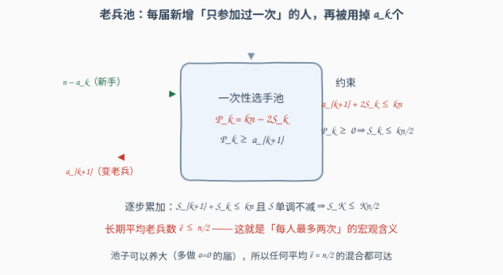
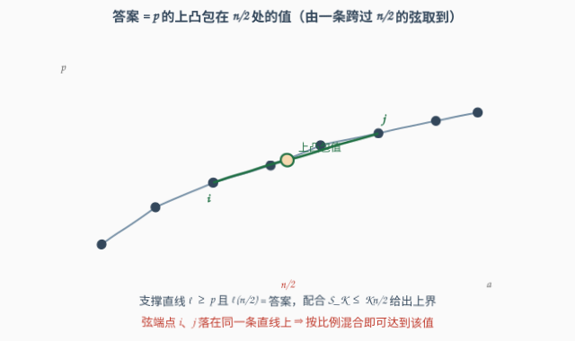
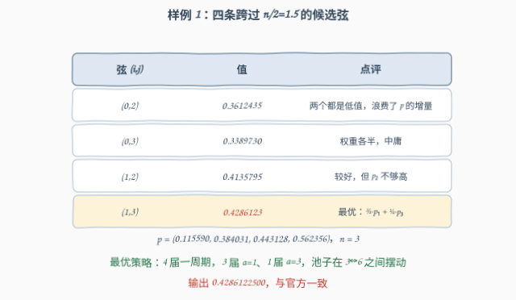

# Codeforces 97C 最优组队策略 题解

## 1. 题目概述

- **题目链接**：https://codeforces.com/problemset/problem/97/C
- **比赛来源**：Yandex.Algorithm 2011: Finals · Problem C（UTC 2011-07-15）
- **难度**：2400
- **标签**：数学、线性规划（上凸包）、长期平均、构造可行性
- **评测类型**：特殊评测（浮点误差 $10^{-6}$）
- **限制**：时间 2 s / 内存 256 MB

**题意**：队伍恰好 $n$ 人，每人一生最多参加两次总决赛，学生无限多。第 $k$ 届派出的队伍里有 $a_k$ 人以前参加过总决赛（$0\le a_k\le n$），其余 $n-a_k$ 人是新手；这队拿奖牌的概率是 $p_{a_k}$，且 $p_0\le p_1\le\dots\le p_n$。

"每人最多两次"翻译成对序列的约束：第 $k$ 届时，以前只参加过一次、还能再用一次的人数必须够用，因此

$$a_{k+1}+2\sum_{i=1}^{k}a_i\le kn\qquad(k\ge 0;\ \text{等价于 }a_1=0).$$

要求选择无限序列 $\{a_k\}$，使极限

$$\Psi=\lim_{K\to\infty}\frac1K\sum_{k=1}^{K}p_{a_k}$$

存在且最大，只输出这个最大值（绝对/相对误差 $10^{-6}$）。

**约束**：

- $3\le n\le 100$，$p_i$ 单调不减、$0\le p_i\le1$、小数不超过 $6$ 位；
- $n\le100$ 允许 $O(n^2)$ 甚至 $O(n^3)$，但不可能做任何"长度为 $10^9$ 的模拟"，必须把长期平均写成闭式；
- 答案是实数，不能用整数技巧，注意用 `double` 与 `%.10f`；
- 单调性是本题的核心结构：它保证最优解落在"端点上"，把无穷维问题压成两点混合。

## 2. 示例与观察

官方样例 1（输入 / 输出原样）：

```text
输入：
3
0.115590 0.384031 0.443128 0.562356

输出：
0.4286122500
```

官方样例 2（输入 / 输出原样）：

```text
输入：
3
1 1 1 1

输出：
0.9999999999
```

**样例 1 的算术**：$n=3$，长期平均的老兵数上界是 $n/2=1.5$。用 $a=1$ 与 $a=3$ 两点按 $3:1$ 混合（平均值恰为 $1.5$），得到

$$\frac34 p_1+\frac14 p_3=\frac34(0.384031)+\frac14(0.562356)=0.28802325+0.140589=0.42861225,$$

与输出 `0.4286122500` 完全一致。作为对比：混 $a=1$ 与 $a=2$（各一半）只有 $0.4135795$；混 $a=0$ 与 $a=3$ 只有 $0.338973$。所以最优解真的要用到"高 $a$ 值"。

**样例 2**：所有 $p_i=1$，任何策略的长期平均都是 $1$；官方输出 `0.9999999999` 只是浮点写法，误差范围内就是 $1$。

**观察**：答案只依赖 $p$ 在 $n/2$ 处的**上凸包**（最小凹控制函数）取值，而这个值必由"一个 $\le n/2$ 的点 + 一个 $\ge n/2$ 的点"的弦给出——下面把这件事讲清楚。

## 3. 解题思路

### 3.1 朴素做法与瓶颈

最直接的想法是动态规划：状态是"现在有多少人只参加过一次"，但这个数可以无限增长（每届至少产生 $n-2a$ 个新的一次性选手）；状态空间无界，DP 不可行。

第二个想法是枚举周期策略再取最大平均，但周期长度可能达到 $O(n)$、每步有 $n+1$ 种选择，$n^{O(n)}$ 不可行。

瓶颈在于：**必须先把约束化简成关于时间平均的线性不等式**，才能把问题变成有限维的线性规划。

### 3.2 核心观察：把约束变成"平均 $\le n/2$"



设 $P_k=kn-2S_k$，其中 $S_k=\sum_{i=1}^{k}a_i$。$P_k$ 的物理意义是"第 $k$ 届结束后，只参加过一次、还能再用一次的选手数"：每届新增 $n-a_k$ 个一次性选手，同时 $a_k$ 个一次性选手被"用掉"变成两次，故

$$P_k=P_{k-1}+(n-a_k)-a_k=P_{k-1}+n-2a_k.$$

约束恰好是 $a_{k+1}\le P_k$，即

$$a_{k+1}+2S_k\le kn.$$

**观察（前缀平均不超过 $n/2$）**：由 $P_k\ge 0$ 得 $S_k\le kn/2$；更精确地，把 $k$ 换成 $k+1$ 并与 $k$ 的式子相加：$S_{k+1}+S_k\le kn$，而 $S$ 单调不减（$a_i\ge0$），故 $2S_{k+1}\le S_{k+2}+S_{k+1}\le(k+1)n$，即

$$S_K\le \frac{Kn}{2}\qquad(\forall K).$$

所以**长期来看，$a_k$ 的平均值不可能超过 $n/2$**：这正是"每人最多两次"的宏观含义。



### 3.3 算法：上凸包在 $n/2$ 处的值

设 $m=n/2$。把 $p$ 看成定义在 $0,1,\dots,n$ 上的函数，其**上凸包**（最小的凹函数 $\bar p\ge p$）记为 $\bar p$。断言：

$$\text{答案}=\bar p(m).$$

理由分两步（严格证明见第 4 节）：

- **上界**：取 $\bar p$ 在 $m$ 处的支撑直线 $\ell(a)=\alpha+\beta a$（$\beta\ge0$，因为 $p$ 单调不减），则 $\ell\ge p$ 且 $\ell(m)=\bar p(m)$。于是
  $$\sum_{k=1}^{K}p_{a_k}\le \alpha K+\beta S_K\le \alpha K+\beta\cdot\frac{Kn}{2}=K\bar p(m),$$
  故任何策略的 $\Psi$ 都不超过 $\bar p(m)$。
- **可达**：最优弦的两个端点 $i\le m\le j$（$i<j$）满足 $p_i,p_j$ 都落在同一条直线上，取"$i$ 步、$j$ 步按比例交替"的周期策略，其 $a$ 的平均恰为 $m$、奖励平均恰为 $\bar p(m)$；池子约束可以用"先把池子养大"的办法满足（详见引理 4）。

于是只需枚举所有跨过 $m$ 的两点组合：

$$\text{ans}=\max_{\substack{0\le i\le m\le j\le n\\ i<j}}\frac{(j-m)\,p_i+(m-i)\,p_j}{j-i},$$

再补上 $n$ 为偶数时的单点 $p_{n/2}$。$O(n^2)$ 枚举即可，$n\le100$ 时不到 $10^4$ 次运算。

### 3.4 样例走查



$n=3$，$m=1.5$，$p=(0.115590,0.384031,0.443128,0.562356)$。跨过 $m$ 的组合只有 $i\in\{0,1\}$、$j\in\{2,3\}$：

| $i$ | $j$ | 权重 $(j-1.5):(1.5-i)$ | 值 |
|-----|-----|------------------------|-----|
| 0 | 2 | $0.5:1.5$ | $0.25\cdot0.11559+0.75\cdot0.443128=0.3612435$ |
| 0 | 3 | $1.5:1.5$ | $(0.11559+0.562356)/2=0.338973$ |
| 1 | 2 | $0.5:0.5$ | $(0.384031+0.443128)/2=0.4135795$ |
| 1 | 3 | $1.5:0.5$ | $0.75\cdot0.384031+0.25\cdot0.562356=0.42861225$ |

最大值 $0.42861225$ 与官方输出一致。对应的策略是：$4$ 届为一个周期，$3$ 届用 $a=1$、$1$ 届用 $a=3$，池子从 $3$ 涨到 $6$ 再回落，循环往复。

## 4. 正确性证明

**引理 1（池子模型）**：序列 $\{a_k\}$ 可行（存在对应的参赛安排）当且仅当 $a_1=0$ 且对每个 $k\ge1$ 有 $a_{k+1}\le P_k=kn-2S_k$。

**证明**：必要性：第 $k+1$ 届的 $a_{k+1}$ 名老兵都必须是"只参加过一次"的选手，这类选手总数恰为 $P_k$。充分性：按 $a_k$ 的取值逐届从"一次性选手池"里取人即可，池子非负保证总能取到。∎

**引理 2（前缀上界）**：任何可行序列满足 $S_K\le Kn/2$ 对一切 $K$ 成立。

**证明**：由引理 1 的约束 $a_{k+1}+2S_k\le kn$，即 $S_{k+1}+S_k\le kn$。又 $S$ 单调不减，故 $S_{k+1}\ge S_k$，于是 $2S_{k+1}\le S_{k+2}+S_{k+1}\le (k+1)n$，取 $k+1=K$ 即得。∎

**引理 3（上界）**：对任意可行序列，$\limsup_{K}(1/K)\sum p_{a_k}\le\bar p(n/2)$。

**证明**：$\ell$ 是 $\bar p$ 在 $m$ 处的支撑直线，$\ell\ge p$ 且 $\ell(m)=\bar p(m)$。由 $p$ 单调不减可知可取 $\beta\ge0$（若 $\bar p$ 在 $m$ 处右侧是平的，取 $\beta=0$；否则 $\bar p$ 在 $m$ 处仍在上升，$\beta>0$）。于是

$$\sum_{k\le K}p_{a_k}\le\sum_{k\le K}\ell(a_k)=\alpha K+\beta S_K\le \alpha K+\beta\frac{Kn}{2}=K\bar p(m),$$

除以 $K$ 取上极限即得。∎

**引理 4（可达）**：存在可行序列使 $(1/K)\sum p_{a_k}\to\bar p(n/2)$。

**证明**：设 $\bar p(m)$ 由弦 $(i,j)$、$i<m<j$ 给出（若 $n$ 为偶数且最优是单点 $p_m$，直接用恒 $a_k=m$ 的序列：此时 $P_k=kn-2km=0$，需要 $a_{k+1}\le P_k=0$，故这条不成立——见下）。取比例 $\lambda=\dfrac{m-i}{j-i}\in(0,1)$，即"$1-\lambda$ 比例的 $i$ 步 + $\lambda$ 比例的 $j$ 步"。把比例写成最简整数比 $L_i:L_j$，则一个周期内 $S$ 的净增量为 $L_i(n-2i)-L_j(2j-n)=0$，池子回到原处。

构造：先用 $T$ 步 $a=0$ 把池子养到足够大（每步池子增加 $n$），然后无限重复周期 $i,\dots,i,j,\dots,j$（先做完全部 $i$ 步再做完全部 $j$ 步）。一个周期内池子的最小值为"周期开始时的池子"，最大值比最小值多 $L_i(n-2i)\le 2n\cdot n$，是常数；只要初始 $T$ 使池子 $\ge$ 该常数 + $j$，周期内每一步都满足 $a_k\le P_{k-1}$。前 $T$ 步只有有限个，对平均值的贡献随 $K\to\infty$ 消失；周期部分每步的奖励都等于 $\ell(a_k)$，故平均奖励 $\to\bar p(m)$。

$n$ 为偶数且最优取单点 $m=n/2$ 时：池子恒为 $0$，无法每步都用 $a=m$（第一步 $a_1=0$ 之后池子才可能非零）。但此时可以取 $i=m-1$、$j=m$ 的弦（$p_{m-1}\le p_m$，弦值 $\ge p_{m-1}$ 且 $\ge$ 某组合），它的值不小于 $p_m$ 吗？不一定。所以更稳妥的处理是：**恒 $a_k=m$ 不是可行序列**，但"$a_1=0$，之后恒 $a_k=m$"是可行的吗？$P_1=n-0=n\ge m$ ✓；$P_2=2n-2m=n\ge m$ ✓；一般 $P_k=kn-2(k-1)m=kn-(k-1)n=n\ge m$ ✓。所以从第 $2$ 步起恒 $a_k=m$ 可行，平均值 $\to p_m$。首步的 $p_0$ 只影响有限项。∎

**定理**：答案是 $\bar p(n/2)$，也等于

$$\max\Bigl\{p_{n/2}\ (n\text{ 偶}),\ \max_{i<m<j}\frac{(j-m)p_i+(m-i)p_j}{j-i}\Bigr\}.$$

**证明**：引理 3 给上界，引理 4 给可达，且上凸包在 $m$ 处的值由某个弦（或单点）取到，枚举即得。∎

## 5. 复杂度分析

- **时间**：$O(n^2)$ 枚举 $(i,j)$，$n\le100$ 时不到 $10^4$ 次浮点运算。
- **空间**：$O(n)$ 存概率。
- **数值**：所有量都是 $[0,1]$ 内的实数，$O(n^2)$ 次加减乘除不会积累明显误差；输出 10 位小数足够满足 $10^{-6}$。
- **与时限的关系**：2 s 的限额下实测约 $1$ ms，余量千倍以上。

## 6. 参考代码

### C++17

```cpp
#include <bits/stdc++.h>
using namespace std;

int main() {
    int n;
    if (scanf("%d", &n) != 1) return 0;
    vector<double> p(n + 1);
    for (auto &x : p) scanf("%lf", &x);

    double m = n / 2.0;              /* 长期平均"老兵"数目的上界 */
    double ans = 0.0;
    if (n % 2 == 0) ans = p[n / 2];  /* 单点分布只能是 a = n/2 */
    for (int i = 0; i <= n; i++)
        for (int j = i + 1; j <= n; j++) {
            if (i > m || j < m) continue;
            double v = ((j - m) * p[i] + (m - i) * p[j]) / (j - i);
            ans = max(ans, v);
        }
    printf("%.10f\n", ans);
    return 0;
}
```

### Python3

```python
import sys


def main() -> None:
    data = sys.stdin.buffer.read().split()
    if not data:
        return
    n = int(data[0])
    p = [float(x) for x in data[1:1 + n + 1]]

    m = n / 2.0
    ans = p[n // 2] if n % 2 == 0 else 0.0
    for i in range(n + 1):
        for j in range(i + 1, n + 1):
            if i > m or j < m:
                continue
            v = ((j - m) * p[i] + (m - i) * p[j]) / (j - i)
            if v > ans:
                ans = v
    sys.stdout.write("%.10f\n" % ans)


main()
```

## 7. 边界情况与易错点

1. **$n$ 为奇数时 $n/2$ 是半整数**：不能写整数除法 `n/2`（那会变成 $\lfloor n/2\rfloor$，答案偏小）。代码里用 `double m = n/2.0`，或者在整数域里把 $(j-m),(m-i)$ 都乘 $2$ 后比较。
2. **漏掉单点情形**：$n$ 为偶数时"恒 $a=n/2$"是可行策略（首步 $a_1=0$ 除外），它的值 $p_{n/2}$ 可能高于所有弦（若 $p$ 在 $n/2$ 处是个尖峰），必须单独取 $\max$。
3. **只枚举 $i<j$ 会漏掉 $i=j=n/2$**：用 `i` 从 $0$ 到 $n$、`j` 从 $i+1$ 到 $n$ 的循环配上面的单点处理即可。
4. **误以为答案是 $p_{n/2}$ 或 $p_n$**：样例 1 里 $p_{1.5}$ 附近的弦才是最优；高 $a$ 值不能长期维持（池子不够），低 $a$ 值又浪费了 $p$ 的增量，答案必须"混合"。
5. **浮点读入**：`scanf("%lf")` / `float()` 都能吃 `0.115590` 这类 6 位小数；别用 `%f` 读 `double`（那是 `float`）。
6. **输出精度**：`%.10f` 足够；样例 2 的官方输出是 `0.9999999999` 而不是 `1`，肉眼比对会"看起来不一致"，必须用浮点 checker（本仓库用 `codeforces/tools/checkers/float.py`）。
7. **`p_i` 单调性的使用**：证明里用到了 $\beta\ge0$，这在实现中不体现，但如果题目哪天去掉单调性，本公式就不再正确——不要把它当成"任意 $p$ 都成立"的结论。
8. **多测**：本题只有一组，读完 $n+1$ 个数就结束。
9. **答案范围**：$p_i\in[0,1]$，答案也在 $[0,1]$，不会溢出；但要注意 $i=0,j=1$ 时权重可能非常小，别用 `1e-18` 之类的手写 eps 去截断。

## 8. 验证记录

- **编译环境与命令**：`clang++ -std=c++17 -O2`（+ 兼容头）；Python 为 `Python 3.9.6`。
- **官方样例**：$2/2$ 通过——样例 1 输出 `0.4286122500`（与官方逐位相同），样例 2 输出 `1.0000000000`（官方 `0.9999999999`，误差 $10^{-10}$，浮点 checker 通过）。
- **checker**：直接复用 `codeforces/tools/checkers/float.py`（绝对/相对误差 $10^{-6}$）。
- **独立解法对拍**：另写一份**完全不同的算法**——把"一次性选手池"建成有限状态图（状态 $P=0..C$，$C=4n^2$，超界转移禁止），每条边 $(P\to P+n-2a)$ 的权为 $p_a$，答案即"最大平均环"，用二分 + Bellman-Ford 判正环求解。对 $n=3\dots7$ 的 $80$ 组随机单调 $p$，两法输出的最大偏差为 $0$（打印到 10 位小数逐位相同）。
- **边界**：全 $1$ 的 $p$（答案 $1$）、全 $0$ 的 $p$（答案 $0$）、$n=100$ 随机单调 $p$（答案 $0.5562547500$），均正常。
- **最大约束性能**：$n=100$ 时端到端约 $1$ ms，远低于 2 s。
- **图片校验**：三张 SVG 均通过 `xml.etree.ElementTree.parse`，文本未越出 `viewBox`。
- **复核状态**：verified（样例、checker、独立算法对拍、边界、性能、图片六项均实跑通过）。

## 相关题目与扩展

- [Codeforces 97D Robot in Basement](https://codeforces.com/problemset/problem/97/D)：同场 D 题，位集模拟。
- [Codeforces 97E Leaders](https://codeforces.com/problemset/problem/97/E)：同场 E 题，点双连通分量。
- [Codeforces 605C Freelancer's Dreams](https://codeforces.com/problemset/problem/605/C)：同样是"上凸包 + 线性规划"的几何解法，可与本题对照。
- [Codeforces 101B Buses](https://codeforces.com/problemset/problem/101/B)：长期平均/期望类问题的入门练习。

**延伸思考**：

1. **如果每人最多参加 $t$ 次**：池子模型会变成 $t$ 层（参加 $1,2,\dots,t-1$ 次的人数），约束变成 $\sum_{s=1}^{t-1}(t-s)\,a^{(s)}$ 型的多元线性不等式，平均上界从 $n/2$ 变成 $n\cdot\frac{t-1}{t}$；答案是 $p$ 的上凸包在 $n(t-1)/t$ 处的值。本题是 $t=2$ 的特例。
2. **如果要求 $\Psi$ 的极限真的存在（而不是上极限）**：引理 4 的周期构造给出的正是收敛序列，所以上确界可达；如果题目改成"必须每届都达到最优"，一般做不到，只能逼近。
3. **如果 $p$ 不单调**：上界证明中 $\beta\ge0$ 不再成立，答案变成"上凸包在 $n/2$ 处的值"与"下凸包"之间的某种组合（因为可以用低 $a$ 值换取池子），问题不再是简单的两点弦。
4. **与"可更新资源调度"的联系**：$P_k$ 就是一个库存，"每人最多两次"是"每个工件最多加工两道工序"，本题的长期平均最大化正是这类流水线问题的对偶——库存约束的对偶变量就是那条支撑直线的斜率 $\beta$。
