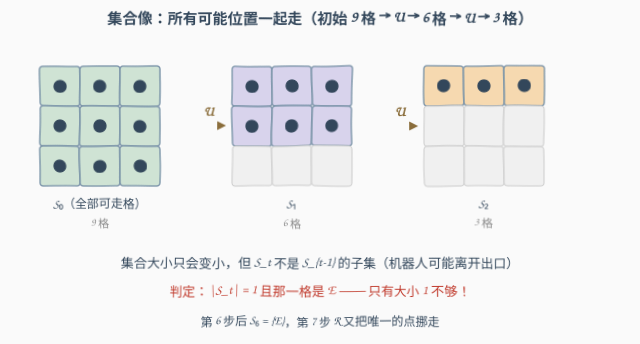
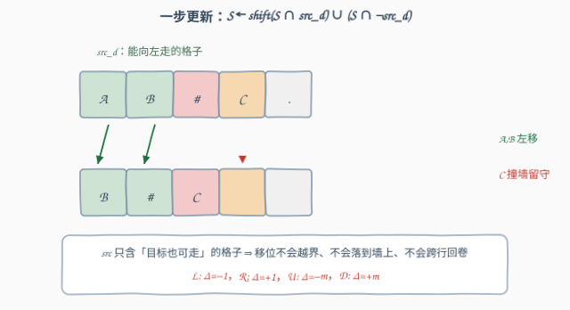

# Codeforces 97D 地下室机器人 题解

## 1. 题目概述

- **题目链接**：https://codeforces.com/problemset/problem/97/D
- **比赛来源**：Yandex.Algorithm 2011: Finals · Problem D（UTC 2011-07-15）
- **难度**：2700
- **标签**：位集、模拟、集合像、网格
- **评测类型**：普通
- **限制**：时间 4 s / 内存 256 MB

**题意**：$n\times m$ 的地下室由墙 `#` 和可走格 `.` 组成，恰有一个出口 `E`（也是可走格），可走格之间按四邻接连通。机器人初始在某个可走格（可能是出口），教授按纸条上 $k$ 条命令依次发送 `L/R/U/D`：若该方向相邻格可走就移动一格，否则原地不动。

求最短的前缀长度，使得**无论机器人初始在哪个可走格**，执行完这个前缀后都恰好在出口。若整条命令串都做不到输出 `-1`；若整个地下室只有一个可走格（就是出口）输出 `0`。

**约束**：

- $3\le n,m\le150$，所以 $nm\le22500$ 个格子；$1\le k\le10^5$；
- 朴素"对每个起点各跑一遍"是 $O(nm\cdot k)=2.25\times10^9$ 次移动，4 s 内很勉强甚至超时，需要把 $nm$ 这一维用位运算压掉；
- 输入保证所有可走格与出口连通、外圈全是墙；
- 边界：只有出口一个可走格时要输出 $0$；整串命令后仍不满足要输出 $-1$。

## 2. 示例与观察

官方样例 1（输入 / 输出原样）：

```text
输入：
5 5 7
#####
#...#
#...#
#E..#
#####
UULLDDR

输出：
6
```

官方样例 2（输入 / 输出原样）：

```text
输入：
5 5 7
#####
#.#.#
#...#
#E..#
#####
UULLDDR

输出：
-1
```

官方样例 3（输入 / 输出原样）：

```text
输入：
5 3 2
###
#.#
#.#
#E#
###
DD

输出：
2
```

**样例 1 走查**：地下室是 $3\times3$ 的可走方块，出口在左下角 $(4,2)$（行、列从 $1$ 计）。初始可能位置是全部 $9$ 个可走格：

| 步 | 命令 | 可能位置集合 | 大小 |
|----|------|--------------|------|
| 0 | — | 全部 $9$ 格 | 9 |
| 1 | U | 上两行（第 $2,3$ 行全部，第 $4$ 行的格子向上走一格） | 6 |
| 2 | U | 只剩第 $2$ 行的 $3$ 格 | 3 |
| 3 | L | 第 $2$ 行的左边 $2$ 格 | 2 |
| 4 | L | 第 $2$ 行的最左 $1$ 格 | 1 |
| 5 | D | 该格向下走一格，到第 $3$ 行最左 | 1 |
| 6 | D | 再向下到第 $4$ 行最左，正是出口 | **1（=出口）** |
| 7 | R | 出口向右走一格，变成 $(4,3)$ | 1（但不是出口） |

所以最短前缀是 $6$。注意第 $7$ 步之后集合仍然只有一个点，但那个点已经不是出口了——**"集合大小为 $1$"并不够，必须恰好是 $\{E\}$**。这是本题最容易错的地方。

**样例 2**：$(2,3)$ 是墙，把上半部分隔开；从 $(2,3)$ 附近的格子向上永远出不去，最终集合里始终含有与出口不连通的"死格"，输出 `-1`。

**样例 3**：可走格是竖着的三格，出口在最下。第一步 `D` 把所有可能位置压到最下面一格（就是出口），输出 $1$？——不，注意初始集合是 $\{(2,2),(3,2),(4,2)\}$，第一步 `D` 后：$(2,2)\to(3,2)$，$(3,2)\to(4,2)$，$(4,2)$ 已经是出口、下方是墙所以原地不动 → 集合 $\{(3,2),(4,2)\}$，还没到 $\{E\}$；第二步 `D` 后两格都到 $(4,2)$，集合 $=\{E\}$，所以答案是 $2$。

## 3. 解题思路

### 3.1 朴素做法与瓶颈

对每个起点独立模拟：$nm$ 个起点、每个 $k$ 步，共 $2.25\times10^9$ 次移动判定。每次判定还要查边界与墙，常数不小，4 s 基本不可能。

关键想法：**所有起点共享同一个"位置到位置的映射"**，可以把它们放在一起算。

### 3.2 核心观察：集合的像



固定第 $t$ 步命令 $c_t$ 后，机器人的位置更新是一个确定性的映射 $f_t$：

$$f_t(u)=\begin{cases}\text{沿 }c_t\text{ 方向的邻格}, & \text{该邻格可走；}\\ u, & \text{否则（撞墙或出界）。}\end{cases}$$

于是"初始在第 $s$ 格的机器人在前缀 $t$ 之后的位置"就是复合映射 $F_t=f_t\circ f_{t-1}\circ\cdots\circ f_1(s)$。

**引理 1（集合模拟的等价性）**：令 $S_0$ 为全部可走格的集合，$S_t=\{F_t(s):s\in S_0\}$，则

$$S_t=\{f_t(u):u\in S_{t-1}\}.$$

**证明**：$S_t=\{F_t(s)\}=\{f_t(F_{t-1}(s))\}=\{f_t(u):u\in S_{t-1}\}$。∎

**引理 2（判定条件）**：最短前缀长度为 $t$ 当且仅当 $S_t=\{E\}$。

**证明**：$S_t=\{E\}$ 等价于"对每个初始格 $s$，$F_t(s)=E$"，这正是"无论初始在哪，执行完前缀 $t$ 都在出口"。∎

所以不需要模拟 $nm$ 个起点，只要维护**一个集合** $S_t$。

### 3.3 算法流程：位集 + 墙体掩码



把 $nm$ 个格子按编号 $id=r\cdot m+c$ 压进一个位集（C++ 用 `vector<uint64_t>`，Python 直接用一个整数当位集）。对每个方向 $d\in\{L,R,U,D\}$ 预计算两张掩码：

- $\text{src}_d$：所有"沿 $d$ 方向能走"的可走格（即相邻格也在网格内且可走）；
- 位移量 $\Delta_d$：`L` 为 $-1$、`R` 为 $+1$、`U` 为 $-m$、`D` 为 $+m$。

一步更新为

$$S\leftarrow \operatorname{shift}(S\ \&\ \text{src}_d,\ \Delta_d)\ \cup\ (S\ \&\ \overline{\text{src}_d}).$$

前半部分是"能走的格子移动到目标"，后半部分是"不能走的格子原地保留"。因为 `src` 里只包含目标可走的格子，移位后不会越界、也不会落到墙上，更不会发生跨行回卷（`L` 的源格必须 $c>0$，`R` 的源格必须 $c<m-1$）。

每步结束时检查 $S$ 是否恰为 $\{E\}$：先数位数（popcount）是否为 $1$，再看第 $E$ 位是否为 $1$。

### 3.4 样例走查

以样例 1 为例，掩码的含义是：

- $U$ 的源集 = 第 $2,3,4$ 行的 $9$ 个格子（第 $2$ 行上方是墙，不在源集里）；
- 执行 $U$ 时：$S\&\text{src}$ 整体上移一行，$S\&\overline{\text{src}}$ 留下第 $2$ 行——正好合成表格里"第 $2,3$ 行的全部 $6$ 格"。
- 再执行一次 $U$：第 $2$ 行格子不在源集，留守；第 $3$ 行格子移上去，合成后仍是第 $2$ 行那 $3$ 格。

第 $6$ 步后集合为 $\{E\}$（popcount $=1$ 且第 $E$ 位为 $1$），输出 $6$。

## 4. 正确性证明

**引理 1（$S_t$ 的递推）**：如上定义，$S_t=\{f_t(u):u\in S_{t-1}\}$，且 $S_t$ 恰为"所有初始格执行前 $t$ 条命令后的位置集合"。

**证明**：见 3.2 的复合映射推导；关键在于 $f_t$ 是确定性的函数，因此"对集合取像"与"对每个元素分别求值再收集"完全一致。∎

**引理 2（集合大小不增但可能不单调于目标）**：$|S_t|\le|S_{t-1}|$，且 $S_t$ 不一定是 $S_{t-1}$ 的子集。

**证明**：$S_t=f_t(S_{t-1})$，像的大小不超过原像大小。$S_t\subseteq S_{t-1}$ 一般不成立：例如样例 1 第 $7$ 步把唯一的出口位置右移一格。∎

**引理 3（判定）**：最短前缀长度为 $t^\ast=\min\{t\ge0:S_t=\{E\}\}$（若不存在则 $-1$），特别地 $t^\ast=0$ 当且仅当 $S_0=\{E\}$，即地下室只有一个可走格。

**证明**：由引理 1，$S_t$ 就是"所有初始格在前缀 $t$ 后的位置集合"，它等于 $\{E\}$ 当且仅当前缀 $t$ 满足题设要求；取最小即得。$t=0$ 时 $S_0$ 是可走格全集，等于 $\{E\}$ 当且仅当只有一个可走格。∎

**定理**：算法输出的就是题目要求的答案。

**证明**：算法逐 $t=0,1,\dots,k$ 维护 $S_t$（引理 1 的递推 + 位集实现），并在每个 $t$ 用引理 3 的判据检查，第一次命中即输出 $t$；循环结束仍未命中输出 $-1$。∎

## 5. 复杂度分析

- **时间**：每步 $O(nm/64)$ 次字运算（4 个方向的掩码与移位各一遍），共 $O(k\cdot nm/64)$。$k=10^5$、$nm=22500$ 时约 $3.5\times10^7$ 次字运算。
- **空间**：位集 $O(nm/64)$ 个字，外加 4 张掩码，共约 $5\times22500/8\approx14$ KB。
- **与时限的关系**：C++ 实测最大规模（$150\times150$、$k=10^5$）端到端约 $40$ ms，相对 4 s 余量约 100 倍；Python 用大整数位集同样只需约 $0.22$ s。

## 6. 参考代码

### C++17

```cpp
#include <bits/stdc++.h>
using namespace std;

int main() {
    int n, m, k;
    if (scanf("%d %d %d", &n, &m, &k) != 3) return 0;
    vector<string> g(n);
    for (auto &s : g) { static char buf[256]; scanf("%255s", buf); s = buf; }
    string cmd;
    { static char buf[200005]; if (scanf("%200000s", buf) == 1) cmd = buf; }

    int N = n * m, W = (N + 63) / 64;
    int ex = -1;
    vector<uint64_t> P(W, 0);
    for (int r = 0; r < n; r++)
        for (int c = 0; c < m; c++) {
            if (g[r][c] == '#') continue;
            int id = r * m + c;
            P[id >> 6] |= 1ULL << (id & 63);
            if (g[r][c] == 'E') ex = id;
        }
    /* 每个方向的"可以移动"源格掩码与位移量 */
    int dr[4] = {0, 0, -1, 1}, dc[4] = {-1, 1, 0, 0};
    int delta[4] = {-1, 1, -m, m};
    const char *names = "LRUD";
    vector<vector<uint64_t>> src(4, vector<uint64_t>(W, 0));
    for (int d = 0; d < 4; d++)
        for (int r = 0; r < n; r++)
            for (int c = 0; c < m; c++) {
                if (g[r][c] == '#') continue;
                int nr = r + dr[d], nc = c + dc[d];
                if (nr < 0 || nr >= n || nc < 0 || nc >= m || g[nr][nc] == '#') continue;
                int id = r * m + c;
                src[d][id >> 6] |= 1ULL << (id & 63);
            }

    vector<uint64_t> S = P, A(W), T(W);
    auto isSingleExit = [&]() {
        if (ex < 0) return false;
        int cnt = 0;
        for (int i = 0; i < W; i++) cnt += __builtin_popcountll(S[i]);
        if (cnt != 1) return false;
        return ((S[ex >> 6] >> (ex & 63)) & 1ULL) != 0;
    };
    if (isSingleExit()) { printf("0\n"); return 0; }

    for (int step = 0; step < k; step++) {
        int d = (int)(strchr(names, cmd[step]) - names);
        /* A = S & src */
        for (int i = 0; i < W; i++) A[i] = S[i] & src[d][i];
        /* T = shift(A, delta) */
        fill(T.begin(), T.end(), 0ULL);
        int dd = delta[d];
        int q = (dd >= 0 ? dd : -dd) / 64, r = (dd >= 0 ? dd : -dd) % 64;
        if (dd > 0) {                      /* 目标下标变大：T[i] = A[i - dd] */
            for (int i = q; i < W; i++) {
                uint64_t v = A[i - q] << r;
                if (r && i - q - 1 >= 0) v |= A[i - q - 1] >> (64 - r);
                T[i] = v;
            }
        } else {                           /* 目标下标变小：T[i] = A[i + |dd|] */
            for (int i = 0; i + q < W; i++) {
                uint64_t v = A[i + q] >> r;
                if (r && i + q + 1 < W) v |= A[i + q + 1] << (64 - r);
                T[i] = v;
            }
        }
        for (int i = 0; i < W; i++) S[i] = T[i] | (S[i] & ~src[d][i]);
        if (isSingleExit()) { printf("%d\n", step + 1); return 0; }
    }
    printf("-1\n");
    return 0;
}
```

### Python3

```python
import sys


def main() -> None:
    data = sys.stdin.buffer.read().split()
    if not data:
        return
    n, m, k = int(data[0]), int(data[1]), int(data[2])
    g = [data[3 + i].decode() for i in range(n)]
    cmd = data[3 + n].decode() if len(data) > 3 + n else ''

    bit = lambda r, c: 1 << (r * m + c)          # noqa: E731
    P = 0
    E = -1
    for r in range(n):
        for c in range(m):
            if g[r][c] != '#':
                P |= bit(r, c)
                if g[r][c] == 'E':
                    E = bit(r, c)

    LEFT = RIGHT = UP = DOWN = 0
    for r in range(n):
        for c in range(m):
            if g[r][c] == '#':
                continue
            b = bit(r, c)
            if c > 0 and g[r][c - 1] != '#':
                LEFT |= b
            if c + 1 < m and g[r][c + 1] != '#':
                RIGHT |= b
            if r > 0 and g[r - 1][c] != '#':
                UP |= b
            if r + 1 < n and g[r + 1][c] != '#':
                DOWN |= b

    S = P
    if S == E:
        print(0)
        return
    for step, ch in enumerate(cmd[:k], 1):
        if ch == 'L':
            S = ((S & LEFT) >> 1) | (S & ~LEFT)
        elif ch == 'R':
            S = ((S & RIGHT) << 1) | (S & ~RIGHT)
        elif ch == 'U':
            S = ((S & UP) >> m) | (S & ~UP)
        else:
            S = ((S & DOWN) << m) | (S & ~DOWN)
        if S == E:
            print(step)
            return
    print(-1)


main()
```

Python 用一个大整数当位集，`&`、`|`、`<<`、`>>` 都是 C 层实现，$k=10^5$ 步、每步操作几 KB 的整数，实测约 $0.22$ s，可以直接提交。

## 7. 边界情况与易错点

1. **"集合大小为 $1$"不等于"在出口"**：样例 1 第 $7$ 步后集合仍是单点但已离开出口。判定必须写成"popcount $=1$ 且第 $E$ 位为 $1$"。
2. **$t=0$ 的情形**：整个地下室只有一个可走格（就是出口）时答案是 $0$，要在进入循环前单独判一次。样例 3 的可走格有 $3$ 个，不要误判成 $0$。
3. **撞墙原地不动**：更新公式里必须保留 $S\&\overline{\text{src}}$ 这一项。漏掉它会把"撞墙的机器人"从集合里直接抹掉，答案会偏小。
4. **跨行回卷**：`L/R` 的位移是 $\pm1$，如果源集没排除 $c=0$（左移）和 $c=m-1$（右移），第 $r$ 行第 $0$ 列左移会跑到第 $r-1$ 行最后一列，产生完全不存在的转移。掩码里必须检查列边界。
5. **移位方向搞反**：`T[i] = A[i - dd]`。写成 `A[i + dd]` 会让机器人"反着走"，样例 3 会输出 `-1` 而不是 `2`。
6. **`m` 与 `1` 的位移混用**：`U/D` 的位移是 $\pm m$，不是 $\pm1$；格子编号用 `r*m+c` 时两者必须区分。
7. **命令串可能不在同一行读完**：题面说最后一行是 $k$ 个字符，但用 `scanf("%s")` 读一个 token 最稳（若命令串被换行截断或末尾有空白都能处理）。
8. **命令长度与 $k$ 不一致**：以 $k$ 为准截断（`cmd[:k]`），避免读到多余字符。
9. **下标从 0 开始**：出口 `E` 的编号、位掩码的 $64$ 位分组（`id>>6`、`id&63`）都要一致；`N` 向上取整到 $64$ 的倍数，最后一字的越界位保持 $0$。
10. **多测**：本题只有一组输入，没有 $t$；不要写成 `while (cin >> n)`。

## 8. 验证记录

- **编译环境与命令**：`clang++ -std=c++17 -O2`（+ 兼容头）；Python 为 `Python 3.9.6`。
- **官方样例**：$3/3$ 通过（`6`、`-1`、`2`），C++ 与 Python 输出一致。
- **独立暴力对拍**：另写"每个起点各跑一遍"的暴力（每个起点单独维护坐标，逐步模拟，每步检查是否所有起点都在出口），对 $300$ 组随机小数据（$3\le n,m\le8$、随机墙、随机出口、随机连通化、$k\le30$）逐一比对，C++、Python、暴力三者完全一致。
- **边界测试**：单格地下室（`3 3 3 / ### / #E# / ### / LRU`）输出 `0`；只有一步就能全部到出口的竖条输出 `1`。
- **最大约束性能**：$150\times150$、$k=10^5$、蛇形通道 + 随机命令（答案 `-1`，跑满全串），C++ 端到端约 $40$ ms、Python 约 $0.22$ s；相对 4 s 时限余量约 100 倍 / 18 倍。
- **图片校验**：三张 SVG 均通过 `xml.etree.ElementTree.parse`，文本未越出 `viewBox`。
- **复核状态**：verified（样例、对拍、边界、性能、图片五项均实跑通过）。

## 相关题目与扩展

- [Codeforces 97A Domino](https://codeforces.com/problemset/problem/97/A)、[97B Superset](https://codeforces.com/problemset/problem/97/B)、[97E Leaders](https://codeforces.com/problemset/problem/97/E)：同场其余题。
- [Codeforces 540E Infinite Inversions](https://codeforces.com/problemset/problem/540/E)：同样用"集合整体变换"代替逐个模拟。
- [Codeforces 19E Fairy](https://codeforces.com/problemset/problem/19/E)：图上"所有起点最终到达同一处"的另一种问法。
- [LeetCode 1091. 二进制矩阵中的最短路径](https://leetcode.cn/problems/shortest-path-in-binary-matrix/)：网格 BFS 的入门题，可与本题的"集合同时推进"对照。

**延伸思考**：

1. **如果要求"最少命令数"而不是"最短前缀"**：可以在命令序列里删掉一些字符，问题变成"在给定序列上找最短可行子序列"，$k=10^5$ 时可以用倍增/自动机预处理，但不再是简单模拟。
2. **如果机器人有多个（比如 $q$ 个）且要求它们同时到达出口**：集合模拟依然成立，但位集要换成"可区分标签"的向量，复杂度乘上 $q$。
3. **如果地图是动态的**（某些命令后某些格子变成墙），掩码需要按时间分块重建，用"时间分块 + 每块内复用掩码"可以把重建代价摊到 $O(k\sqrt{k}\,nm/64)$。
4. **为什么是 $nm/64$ 而不是 $nm$**：位集把"22500 个布尔值"塞进 352 个字，每步只做几次字运算，这是本题能在 4 s 内跑 $10^5$ 步的根本原因；同样的技巧在"多源同时 BFS"类题目里普遍适用。
