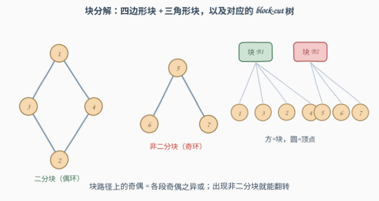
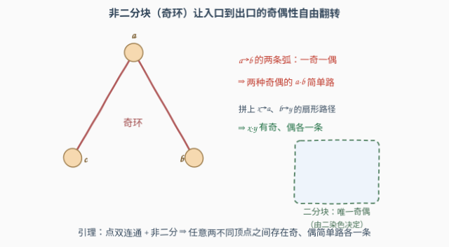
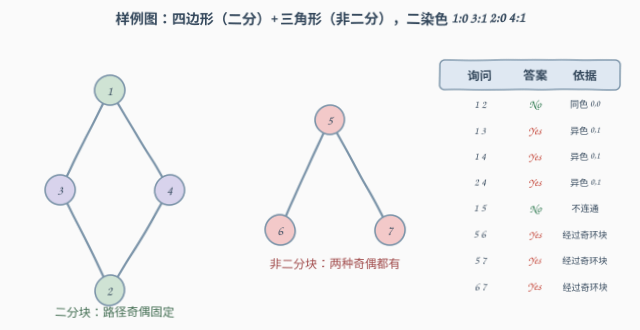

# Codeforces 97E 领导者的配对 题解

## 1. 题目概述

- **题目链接**：https://codeforces.com/problemset/problem/97/E
- **比赛来源**：Yandex.Algorithm 2011: Finals · Problem E（UTC 2011-07-15）
- **难度**：2200
- **标签**：图论、点双连通分量、二分图、圆方树（block-cut tree）
- **评测类型**：普通
- **限制**：时间 2 s / 内存 256 MB

**题意**：给一张 $n$ 点 $m$ 条边的无向简单图（无自环、无重边）。称两个人（不同顶点）是"领导者对"，如果它们之间存在一条**边数为奇数**的**简单路径**（不重复经过顶点）。有 $q$ 次询问，每次给一对点，判断是否为领导者对。

**约束**：

- $n\le10^5$，$m\le10^5$，$q\le10^5$；
- 询问可以重复，也可以给出相同的两个点（这时按"不同的人"的定义应输出 `No`）；
- $m$ 可以与 $n$ 同阶（稀疏图），因此 $O(nm)$ 或每次询问做一次 DFS 都是 $10^{10}$ 级别，必须预处理成"一次询问 $O(1)$ 或 $O(\log n)$"；
- 图可以不连通，也可以有孤立点；
- 存在奇环时"奇偶性"不再是全局二染色能描述的，必须借助点双连通分量（块）。

## 2. 示例与观察

官方样例（输入 / 输出原样）：

```text
输入：
7 7
1 3
1 4
2 3
2 4
5 6
6 7
7 5
8
1 2
1 3
1 4
2 4
1 5
5 6
5 7
6 7

输出：
No
Yes
Yes
Yes
No
Yes
Yes
Yes
```

**样例拆解**：图由两块组成——四边形 $1-3-2-4-1$（二分图）和三角形 $5-6-7-5$（有奇环）。

- 询问 $1,2$：四边形里 $1$ 到 $2$ 的两条路 $1-3-2$ 与 $1-4-2$ 都是偶数长度，没有奇数简单路 → `No`。这正是"二分图里奇偶性由二染色唯一决定"的体现。
- 询问 $1,3$：有边 $1-3$，奇数长度 $1$ → `Yes`。
- 询问 $5,6$：三角形是奇环，$5-6$ 直接是奇数长度 $1$，也可以走 $5-7-6$（长度 $2$，偶），两种奇偶都有 → `Yes`。
- 询问 $1,5$：不同连通分量 → `No`。

**观察**：在二分图里，两点之间所有路径的奇偶性相同（二染色的颜色差）；一旦路径上经过一个"含奇环的块"，就能自由翻转奇偶性。于是问题变成：**$u,v$ 的块路径上是否存在非二分块**。

## 3. 解题思路

### 3.1 朴素做法与瓶颈

每次询问做一次 DFS，枚举所有简单路径判奇偶——简单路径数量是指数级的；退一步只做二染色判断，又会被奇环破坏。想"枚举路径"必然失败。

另一种错误直觉是"连通分量非二分 → 所有点对都 Yes"。反例：一个三角形上挂一个四边形（通过割点相连），四边形内部两个同色点之间就没有奇数简单路（简单路径不能绕出四边形再绕回来，因为割点会被重复经过）。

### 3.2 核心观察：块分解



**定义（块 / 点双连通分量）**：极大的点双连通子图（去掉任意一个点仍连通），等价于"边集的等价类：两条边在同一个简单环上"。孤立点不算块。

**引理 1（简单路径经过的块构成树路径）**：在块-割点二部图（圆方树，block-cut tree）里，任意简单路径 $u\to v$ 经过的块恰好是树上 $u$ 到 $v$ 唯一路径上的那些块，且在每个块内是一段"入口到出口"的简单路径，入口与出口是块内两个不同顶点。

**证明思路**：一条简单路径进入某个块后必须从另一个顶点离开（否则会重复顶点）；把路径上"块"按顺序排列，就得到圆方树里从 $u$ 到 $v$ 的一条游走，而树上路径唯一，故经过的块集合恰为树路径；若绕到树路径之外的块，必须从同一个割点进出，导致重复顶点，矛盾。∎

**引理 2（非二分块能翻转奇偶）**：设 $B$ 是点双连通、非二分（含奇环）的块，$x,y\in B$ 是两个不同顶点，则 $B$ 内存在长度为奇数与偶数的 $x$-$y$ 简单路径各一条。

**证明**：$B$ 点双连通，由 Menger/扇形引理，从 $\{x,y\}$ 到 $B$ 中某个奇环 $C$ 存在两条内部不相交的路径，分别把 $x,y$ 接到 $C$ 上两个不同顶点 $a,b$。$C$ 上 $a\to b$ 有两条弧，长度奇偶性相反（因为 $C$ 是奇环）。把"$x$ 到 $a$ 的路径 + 一条弧 + $b$ 到 $y$ 的路径"拼起来，得到两条 $x$-$y$ 简单路径，长度奇偶性相反。∎



**推论**：$u,v$ 之间存在奇数简单路 $\iff$ 块路径上**存在非二分块**，或者所有块都是二分的、且 $u,v$ 在这条路径上的二染色颜色不同。

### 3.3 算法流程



1. **求块**：Tarjan 边栈算法。DFS 时把树边、返祖边依次压栈；当 $low[v]\ge disc[u]$ 时，从栈里弹出到 $(u,v)$ 为止的边，它们构成一个块。为避免 $10^5$ 深度的递归爆栈，代码用显式栈迭代实现。
2. **判每块是否二分**：对每个块做 BFS 染色（只沿块内边）。块内出现同色相邻点即非二分。
3. **建"块-顶点"关联**：对每条边记录它所属的块号，于是每个顶点可以枚举"与它相邻的（块，邻居）"对。
4. **"二分连通分量"编号 + 二染色**：只在**二分块**的边上做 BFS。这样得到的每个连通块内部，任意两点间的路径奇偶性都被二染色唯一确定（因为路径上的块全是二分块）；而非二分块被"剪掉"，它的顶点分属不同的二分连通分量（或孤立）。
5. **回答询问** $(u,v)$：
   - $u=v$：`No`；
   - 原图不连通（并查集判）：`No`；
   - 二分连通分量编号不同（但原图连通）：路径上必有非二分块 → `Yes`；
   - 否则：颜色不同 → `Yes`，相同 → `No`。

用并查集判原图连通性；第 4 步的 BFS 同时给出编号与颜色，总体 $O(n+m)$。

### 3.4 样例走查

以样例为例：

- 块 1：边 $\{1-3,3-2,2-4,4-1\}$，顶点 $\{1,2,3,4\}$，是四边形 → 二分，染色 $1:0,3:1,2:0,4:1$；
- 块 2：边 $\{5-6,6-7,7-5\}$，三角形 → 非二分；
- 顶点 $5,6,7$ 各自成独立的二分连通分量（它们之间只剩非二分块）。

| 询问 | 连通？ | 同一二分分量？ | 颜色 | 结果 |
|------|--------|----------------|------|------|
| 1 2 | 是 | 是 | 0 vs 0 | No |
| 1 3 | 是 | 是 | 0 vs 1 | Yes |
| 1 4 | 是 | 是 | 0 vs 1 | Yes |
| 2 4 | 是 | 是 | 0 vs 1 | Yes |
| 1 5 | 否 | — | — | No |
| 5 6 | 是 | 否 | — | Yes |
| 5 7 | 是 | 否 | — | Yes |
| 6 7 | 是 | 否 | — | Yes |

与官方输出完全一致。

## 4. 正确性证明

**引理 1**（块路径）：见 3.2，简单路径使用的块恰为圆方树上 $u\to v$ 的块路径，且每个块内是一段连接两个不同顶点的简单路径。∎

**引理 2**（非二分块可翻转）：见 3.2，用扇形引理 + 奇环两条弧的奇偶性相反。∎

**引理 3**（二分块内奇偶唯一）：若块 $B$ 二分，染色的两部分为 $(X,Y)$，则 $B$ 内任意 $x$-$y$ 简单路径的长度奇偶性等于 $[x,y\text{ 异侧}]$。

**证明**：每条边都连接异侧顶点，沿路径走一步颜色翻转一次，故路径长度奇偶 = 端点是否异侧。∎

**引理 4**（整体的奇偶性可加）：设块路径为 $B_1,\dots,B_k$，$u$ 在 $B_1$、$v$ 在 $B_k$，相邻块共享割点 $c_i$。则任一 $u$-$v$ 简单路径的长度等于各段长度之和，因此其奇偶性等于各段奇偶性的异或。

**证明**：由引理 1，路径在每个块内的部分互不重叠且首尾相接于割点，长度相加即总长度。∎

**定理**：询问的答案按 3.3 步 5 的规则给出。

**证明**：

- 若所有块都二分（即 $u,v$ 在同一二分连通分量内）：由引理 3、4，任一简单路径的奇偶性都等于二染色的颜色差，故"存在奇数路"$\iff$"颜色不同"。
- 若块路径上有非二分块 $B_t$：固定其它块的走法（各取一条），$B_t$ 内的两段（从入口到出口）由引理 2 可以取到奇偶性相反的两种，故整体两种奇偶性都能实现，答案为 `Yes`。
- 二分连通分量编号不同但原图连通 $\iff$ 块路径上存在非二分块：因为二分分量只在二分块的边上连通，若路径上全是二分块则两点在同一分量；反之若路径上有非二分块则不可能通过二分块连通。∎

**边界**：$u=v$ 时不存在"不同的人"的路径，输出 `No`（与样例 5 的说明一致）；不连通时输出 `No`。∎

## 5. 复杂度分析

- **时间**：Tarjan 求块 $O(n+m)$；每块判二分，所有块的边数之和为 $m$，故 $O(n+m)$；BFS 染色 $O(n+m)$；并查集近似 $O((n+m)\alpha)$；询问 $O(q)$。总计 $O(n+m+q)$。
- **空间**：邻接表 + 块表 + 若干 $O(n)$ 数组，$O(n+m)$，$10^5$ 规模下约十几 MB。
- **与时限的关系**：C++ 在 $n=m=q=10^5$ 的链 + 三角形、以及 $10^5$ 点大环上都约 $50$ ms；Python 迭代版约 $0.5$ s，均在 2 s 内。

## 6. 参考代码

### C++17

```cpp
#include <bits/stdc++.h>
using namespace std;

struct DSU {
    vector<int> p;
    explicit DSU(int n) : p(n) { iota(p.begin(), p.end(), 0); }
    int find(int x) { while (p[x] != x) { p[x] = p[p[x]]; x = p[x]; } return x; }
    void unite(int a, int b) { a = find(a); b = find(b); if (a != b) p[a] = b; }
};

int main() {
    int n, m;
    if (scanf("%d %d", &n, &m) != 2) return 0;
    vector<int> eu(m), ev(m);
    vector<vector<pair<int, int>>> adj(n);          /* (邻居, 边号) */
    for (int i = 0; i < m; i++) {
        scanf("%d %d", &eu[i], &ev[i]);
        --eu[i]; --ev[i];
        adj[eu[i]].push_back({ev[i], i});
        adj[ev[i]].push_back({eu[i], i});
    }

    /* 迭代版 Tarjan：求点双连通分量（块） */
    vector<int> disc(n, -1), low(n, 0), par(n, -1), parEdge(n, -1), it(n, 0);
    vector<int> stkE;
    vector<vector<int>> blocks;
    vector<int> blockOf(m, -1);
    int timer = 0;
    for (int s = 0; s < n; s++) {
        if (disc[s] != -1) continue;
        disc[s] = low[s] = timer++;
        vector<int> st{s};
        while (!st.empty()) {
            int u = st.back();
            if (it[u] < (int)adj[u].size()) {
                auto [v, eid] = adj[u][it[u]++];
                if (eid == parEdge[u]) continue;
                if (disc[v] == -1) {
                    par[v] = u; parEdge[v] = eid;
                    stkE.push_back(eid);
                    disc[v] = low[v] = timer++;
                    st.push_back(v);
                } else if (disc[v] < disc[u]) {
                    stkE.push_back(eid);
                    low[u] = min(low[u], disc[v]);
                }
            } else {
                st.pop_back();
                if (par[u] != -1) {
                    int p = par[u];
                    low[p] = min(low[p], low[u]);
                    if (low[u] >= disc[p]) {
                        vector<int> eids;
                        while (true) {
                            int e = stkE.back(); stkE.pop_back();
                            eids.push_back(e);
                            if (e == parEdge[u]) break;
                        }
                        int bid = (int)blocks.size();
                        blocks.push_back(eids);
                        for (int e : eids) blockOf[e] = bid;
                    }
                }
            }
        }
    }
    int B = (int)blocks.size();

    /* 每条边属于哪个块；bip[b] 表示块 b 是否二分 */
    vector<vector<pair<int, int>>> adjB(n);      /* (邻居, 块号) */
    for (int e = 0; e < m; e++) {
        int b = blockOf[e];
        adjB[eu[e]].push_back({ev[e], b});
        adjB[ev[e]].push_back({eu[e], b});
    }
    vector<char> bip(B, 1);
    vector<int> mark(n, -1), colTmp(n, -1);
    for (int b = 0; b < B; b++) {
        vector<int> vs;
        for (int e : blocks[b]) {
            if (mark[eu[e]] != b) { mark[eu[e]] = b; vs.push_back(eu[e]); }
            if (mark[ev[e]] != b) { mark[ev[e]] = b; vs.push_back(ev[e]); }
        }
        colTmp[vs[0]] = 0;
        vector<int> q{vs[0]};
        bool ok = true;
        for (size_t qi = 0; qi < q.size() && ok; qi++) {
            int u = q[qi];
            for (auto [v, bb] : adjB[u]) {
                if (bb != b) continue;
                if (colTmp[v] == -1) { colTmp[v] = colTmp[u] ^ 1; q.push_back(v); }
                else if (colTmp[v] == colTmp[u]) { ok = false; break; }
            }
        }
        bip[b] = ok ? 1 : 0;
        for (int v : vs) colTmp[v] = -1;
    }

    DSU dsu(n);
    for (int e = 0; e < m; e++) dsu.unite(eu[e], ev[e]);

    /* 只走二分块：得到"二分连通分量"编号与二染色 */
    vector<int> comp(n, -1), col(n, 0);
    int cid = 0;
    for (int s = 0; s < n; s++) {
        if (comp[s] != -1) continue;
        comp[s] = cid; col[s] = 0;
        vector<int> q{s};
        for (size_t qi = 0; qi < q.size(); qi++) {
            int u = q[qi];
            for (auto [v, b] : adjB[u]) {
                if (!bip[b]) continue;
                if (comp[v] == -1) {
                    comp[v] = cid;
                    col[v] = col[u] ^ 1;
                    q.push_back(v);
                }
            }
        }
        cid++;
    }

    int qn;
    if (scanf("%d", &qn) != 1) return 0;
    string out;
    while (qn--) {
        int a, b;
        scanf("%d %d", &a, &b);
        --a; --b;
        bool yes;
        if (a == b) yes = false;
        else if (dsu.find(a) != dsu.find(b)) yes = false;
        else if (comp[a] != comp[b]) yes = true;         /* 路上有非二分块 */
        else yes = (col[a] != col[b]);
        out += yes ? "Yes\n" : "No\n";
    }
    fputs(out.c_str(), stdout);
    return 0;
}
```

### Python3

```python
import sys


def main() -> None:
    data = sys.stdin.buffer.read().split()
    if not data:
        return
    n, m = int(data[0]), int(data[1])
    p = 2
    eu = [0] * m
    ev = [0] * m
    adj = [[] for _ in range(n)]
    for e in range(m):
        a = int(data[p]) - 1
        b = int(data[p + 1]) - 1
        p += 2
        eu[e] = a
        ev[e] = b
        adj[a].append((b, e))
        adj[b].append((a, e))

    # 迭代 Tarjan：点双连通分量
    disc = [-1] * n
    low = [0] * n
    par = [-1] * n
    par_edge = [-1] * n
    it = [0] * n
    stk_e = []
    blocks = []
    block_of = [-1] * m
    timer = 0
    for s in range(n):
        if disc[s] != -1:
            continue
        disc[s] = low[s] = timer
        timer += 1
        st = [s]
        while st:
            u = st[-1]
            if it[u] < len(adj[u]):
                v, eid = adj[u][it[u]]
                it[u] += 1
                if eid == par_edge[u]:
                    continue
                if disc[v] == -1:
                    par[v] = u
                    par_edge[v] = eid
                    stk_e.append(eid)
                    disc[v] = low[v] = timer
                    timer += 1
                    st.append(v)
                elif disc[v] < disc[u]:
                    stk_e.append(eid)
                    if disc[v] < low[u]:
                        low[u] = disc[v]
            else:
                st.pop()
                q = par[u]
                if q != -1:
                    if low[u] < low[q]:
                        low[q] = low[u]
                    if low[u] >= disc[q]:
                        eids = []
                        while True:
                            e = stk_e.pop()
                            eids.append(e)
                            if e == par_edge[u]:
                                break
                        bid = len(blocks)
                        blocks.append(eids)
                        for e in eids:
                            block_of[e] = bid

    nb = len(blocks)
    adj_b = [[] for _ in range(n)]
    for e in range(m):
        b = block_of[e]
        adj_b[eu[e]].append((ev[e], b))
        adj_b[ev[e]].append((eu[e], b))

    # 每个块是否二分
    bip = [True] * nb
    mark = [-1] * n
    col_tmp = [-1] * n
    for b in range(nb):
        vs = []
        for e in blocks[b]:
            if mark[eu[e]] != b:
                mark[eu[e]] = b
                vs.append(eu[e])
            if mark[ev[e]] != b:
                mark[ev[e]] = b
                vs.append(ev[e])
        col_tmp[vs[0]] = 0
        q = [vs[0]]
        ok = True
        qi = 0
        while qi < len(q) and ok:
            u = q[qi]
            qi += 1
            for v, bb in adj_b[u]:
                if bb != b:
                    continue
                if col_tmp[v] == -1:
                    col_tmp[v] = col_tmp[u] ^ 1
                    q.append(v)
                elif col_tmp[v] == col_tmp[u]:
                    ok = False
                    break
        bip[b] = ok
        for v in vs:
            col_tmp[v] = -1

    # 并查集：原图连通性
    dsu = list(range(n))

    def find(x):
        while dsu[x] != x:
            dsu[x] = dsu[dsu[x]]
            x = dsu[x]
        return x

    for e in range(m):
        a, b = find(eu[e]), find(ev[e])
        if a != b:
            dsu[a] = b

    # 只走二分块：二分连通分量 + 二染色
    comp = [-1] * n
    col = [0] * n
    cid = 0
    for s in range(n):
        if comp[s] != -1:
            continue
        comp[s] = cid
        q = [s]
        qi = 0
        while qi < len(q):
            u = q[qi]
            qi += 1
            for v, b in adj_b[u]:
                if not bip[b]:
                    continue
                if comp[v] == -1:
                    comp[v] = cid
                    col[v] = col[u] ^ 1
                    q.append(v)
        cid += 1

    qn = int(data[p])
    p += 1
    out = []
    for _ in range(qn):
        a = int(data[p]) - 1
        b = int(data[p + 1]) - 1
        p += 2
        if a == b or find(a) != find(b):
            out.append('No')
        elif comp[a] != comp[b]:
            out.append('Yes')
        else:
            out.append('Yes' if col[a] != col[b] else 'No')
    sys.stdout.write('\n'.join(out) + '\n')


main()
```

## 7. 边界情况与易错点

1. **$u=v$ 的询问**：题面说"一对不同的人"才叫领导者对，所以相同点必须输出 `No`；样例没覆盖，容易漏。
2. **递归爆栈**：$n=10^5$ 的链会让 Tarjan 递归深度到 $10^5$，本机默认栈只有 8 MB，必须写迭代版（代码里用显式栈 `st` + `it[]` 指针）。
3. **孤立点**：孤立点不属于任何块，二分连通分量编号要单独分配，否则 `comp[]` 留空会导致询问判断错乱。
4. **重边与自环**：题面保证没有，但 Tarjan 的 `if (eid == parEdge[u]) continue;` 是按边号跳父边，如果有重边必须改成"跳过一条父边"而不是"跳过父点"；本代码按边号写，天然正确。
5. **块内二分判定要用块内边**：不能在全图上染色（全图可能非二分），BFS 时要用 `bb == b` 过滤。
6. **"非二分块"的顶点不能互相连通**：第 4 步只在二分块的边上 BFS；如果误把所有边都 BFS，含奇环的块会把所有顶点连成一个分量，答案会全错。
7. **并查集与二分分量混淆**：并查集判"原图是否连通"，二分分量判"块路径上是否有非二分块"，两者都要用，缺一不可。
8. **`low` 与 `disc` 的更新顺序**：返祖边只更新 `low[u]` 且只在 `disc[v] < disc[u]` 时入栈，否则同一条边会被压两次，块会重复。
9. **多测**：本题只有一组，读完 $q$ 个询问就结束。
10. **输出大小写**：必须是 `Yes` / `No`（首字母大写），token 比对区分大小写也无所谓，但保持一致。

## 8. 验证记录

- **编译环境与命令**：`clang++ -std=c++17 -O2`（+ 兼容头）；Python 为 `Python 3.9.6`。
- **官方样例**：$1/1$ 通过（8 个询问的输出与官方逐行一致）。
- **独立暴力对拍**：另写"枚举所有简单路径"的暴力（DFS 回溯，遇到终点就检查长度奇偶），对 $400$ 组随机小图（$n\le8$、$m\le12$、可含孤立点与不连通分量、询问含相同点）与参考程序逐一比对全部一致；Python 版另跑 $200$ 组同样一致。
- **边界测试**：$n=1,m=0$ 且三次询问都是 `1 1` → 三次 `No`；大环（$10^5$ 点单环，二分）上距离奇偶由二染色决定。
- **最大约束性能**：$n=m=q=10^5$（$10^5$ 点长链 + 起点三角形，以及 $10^5$ 点大环两种数据），C++ 端到端约 $50$ ms，Python 约 $0.5$ s；相对 2 s 时限余量约 40 倍 / 4 倍。
- **图片校验**：三张 SVG 均通过 `xml.etree.ElementTree.parse`，文本未越出 `viewBox`。
- **复核状态**：verified（样例、暴力对拍、边界、性能、图片五项均实跑通过）。

## 相关题目与扩展

- [Codeforces 97A Domino](https://codeforces.com/problemset/problem/97/A)、[97B Superset](https://codeforces.com/problemset/problem/97/B)、[97C Winning Strategy](https://codeforces.com/problemset/problem/97/C)、[97D Robot in Basement](https://codeforces.com/problemset/problem/97/D)：同场其余题。
- [Codeforces 19E Fairy](https://codeforces.com/problemset/problem/19/E)：删边使图二分，核心同样是"奇环 + 块结构"。
- [Codeforces 231E Cactus](https://codeforces.com/problemset/problem/231/E)：仙人掌上的路径计数，需要块/圆方树思想。
- [Codeforces 118E Bertown roads](https://codeforces.com/problemset/problem/118/E)：点双连通分量的经典应用（给边定向使图强连通）。
- [Luogu P3388 割点](https://www.luogu.com.cn/problem/P3388)：Tarjan 求割点的模板题，可作为本题的代码基础。

**延伸思考**：

1. **如果问的是"偶数长度简单路径"**：把答案取反即可（除了 $u=v$ 的情形——长度 $0$ 的平凡路径是偶数但不算"路径"，需要单独定义）；本做法不需要改结构。
2. **如果询问带权（求最长奇数简单路径）**：块内不再是"能不能"，而是"最长的奇/偶简单路"，在一般图上这是 NP 难的（哈密顿路），但在仙人掌或树上可以 DP；本题的"存在性"版本之所以可做，正是因为它只依赖奇偶性这一层信息。
3. **如果要求输出路径本身**：可以在块内用引理 2 的构造显式拼出两条路径，复杂度仍是 $O(n+m)$，但常数大得多。
4. **"非二分块可翻转奇偶"这一引理的推广**：在 $k$-连通图里，任意两点之间存在 $k$ 条内部不相交路径，因此长度奇偶的"自由度"更高；本题只用 $2$-连通（点双）就够，说明"翻转一次奇偶"只需要两条路径。
