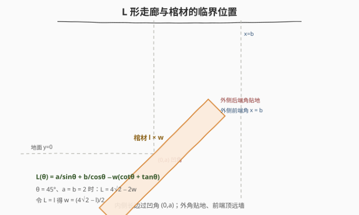
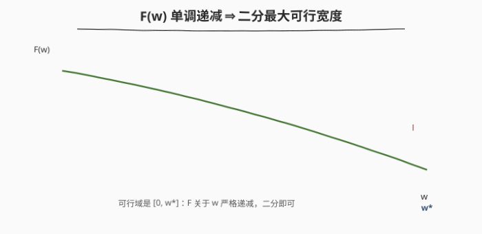

# Codeforces 98C Help Greg the Dwarf 题解

## 1. 题目概述

- **题目链接**：https://codeforces.com/problemset/problem/98/C
- **比赛来源**：Codeforces Beta Round 78 (Div. 1 Only) · Problem C（UTC 2011-07-22）
- **难度**：2500
- **标签**：几何、三分
- **评测类型**：特殊评测（浮点答案，绝对或相对误差 $\le 10^{-7}$）
- **限制**：时间 2 s / 内存 256 MB

**题意**：一条宽度为 $a$ 的走廊与一条宽度为 $b$ 的走廊成直角相接（L 形，转弯处内侧是一个直角）。棺材是长 $l$、宽 $w$（$l \ge w$）的矩形，装有轮子，只能在地面上**平移和旋转**（不能抬起）。求能通过这个直角弯的棺材的**最大宽度** $w$；若不存在正宽度的棺材能通过，输出 `My poor head =(`。

**约束**：

- $a, b, l \le 10^4$，答案精度 $10^{-7}$：用 `double` 足够（相对误差约 $10^{-16}$）。
- 若答案为正，题面保证它 $\ge 10^{-7}$：所以阈值判断不会误伤。
- $w$ 必须同时满足 $w \le l$ 与 $w \le \min(a,b)$（棺材宽度不能超过走廊宽度）。
- 棺材可以在进入走廊前任意旋转，但**一旦进入就必须在通道内连续运动**，这一点决定了"每个角度都要放得下"。

## 2. 示例与观察

官方样例 1（输入 / 输出原样）：

```text
输入：
2 2 1

输出：
1.0000000
```

官方样例 2（输入 / 输出原样）：

```text
输入：
2 2 2

输出：
2.0000000
```

官方样例 3（输入 / 输出原样）：

```text
输入：
2 2 3

输出：
1.3284271
```

官方样例 4（输入 / 输出原样）：

```text
输入：
2 2 6

输出：
My poor head =(
```

**样例 1 走查**：$a=b=2$、$l=1$。棺材宽度不能超过长度，所以最大只能是 $1$；$1\times1$ 的正方形显然能过弯。

**样例 2 走查**：$a=b=2$、$l=2$。$2\times2$ 的正方形恰好填满走廊宽度，它可以**不转身**：先沿水平走廊平移进入拐角方块（$2\times2$ 区域正合适），再沿竖直走廊向上平移。所以答案是 $2$，等于 $\min(l,a,b)$。

**样例 3 走查**：$a=b=2$、$l=3$，超过走廊宽度，棺材必须**转身 90°**。在 45° 时它正好同时顶住地面、内侧转角和对面墙，由 3.2 的公式解出 $w = 1.3284271$。

**样例 4 走查**：$a=b=2$ 时即使宽度为 $0$ 的"梯子"，最长也只能是 $(2^{2/3}+2^{2/3})^{3/2} = 2^{5/2} \approx 5.657 < 6$，所以不存在正宽度的解，输出提示语。

**观察 1**：若 $l \le \min(a,b)$，取 $w = l$（正方形）能过：正方形沿走廊平移进入拐角方块再平移出去，全程不需要旋转 —— 这就是样例 2 的情形。所以此时答案直接是 $l$。

**观察 2**：若 $l > \min(a,b)$，棺材必须旋转 90°（它的长边要分别与两条走廊对齐）。旋转过程连续，因此**每一个角度** $\theta \in (0, \pi/2)$ 都必须存在一个合法摆放。

**观察 3**：固定角度 $\theta$ 时，能塞进弯道的最大长度 $L(\theta)$ 有闭式（3.2 节），于是条件写成 $l \le \min_\theta L(\theta)$。$L(\theta)$ 关于 $w$ 严格递减，于是可以二分 $w$，内层用三分求 $\min_\theta$。

## 3. 解题思路

### 3.1 朴素做法与瓶颈

"模拟棺材的运动"不可行：可行配置是连续统，无法离散搜索。必须把几何条件化成解析式。

### 3.2 核心观察：临界位置的长度公式



把弯道放在坐标系里：水平走廊是 $\{x \le 0,\ 0 \le y \le a\}$，竖直走廊是 $\{0 \le x \le b,\ y \ge 0\}$。内测的凹角（reflex corner）在 $(0,a)$；地面是 $y=0$，竖直走廊远墙是 $x=b$。

设棺材与水平方向成角 $\theta$（$0<\theta<\pi/2$），长边方向 $u=(\cos\theta,\sin\theta)$，宽边方向 $n=(-\sin\theta,\cos\theta)$。**临界位置**：棺材的内侧长边恰好经过凹角 $(0,a)$，并且"后端下角"刚好贴地、前端顶到远墙 $x=b$。此时：

- 从凹角沿 $-u$ 方向往后：棺材的上边缘要在 $x<0$ 区域内保持 $y \le a$，而外边缘（相距 $w$）比内边缘再低 $w\cos\theta$，所以后端最多能伸出
  $$t_1 = \frac{a - w\cos\theta}{\sin\theta};$$
- 从凹角沿 $+u$ 方向往前：前端要满足 $x \le b$，外边缘还要额外让出 $w\sin\theta$ 的水平距离，所以前端最多伸出
  $$t_2 = \frac{b - w\sin\theta}{\cos\theta}.$$

两段相加就是该角度下能容纳的最大长度：

$$L(\theta) = t_1 + t_2 = \frac{a}{\sin\theta} + \frac{b}{\cos\theta} - w\left(\frac{\cos\theta}{\sin\theta} + \frac{\sin\theta}{\cos\theta}\right).$$

注意 $w=0$ 时退化成经典的"梯子过弯"公式 $\frac{a}{\sin\theta}+\frac{b}{\cos\theta}$，其最小值是 $\left(a^{2/3}+b^{2/3}\right)^{3/2}$ —— 这就是样例 4 中"零宽度都过不去"的判据。

### 3.3 算法流程



1. 若 $l \le \min(a,b)$：输出 $l$（正方形方案）。
2. 令 $L_0 = \left(a^{2/3}+b^{2/3}\right)^{3/2}$。若 $l > L_0$：无正宽度解，输出提示语。
3. 否则在 $w\in(0,\min(a,b)]$ 上二分：内层对固定 $w$ 用**三分法**求 $F(w)=\min_\theta L(\theta)$（$L$ 在 $(0,\pi/2)$ 两端趋于 $+\infty$、单峰），判断 $F(w) \ge l$ 决定二分方向。
4. 输出二分得到的最大 $w$（保留 7 位小数）。

### 3.4 样例走查

$a=b=2$、$l=3$：由对称性最小值在 $\theta=45^\circ$ 取到，

$$L(45^\circ) = 2\sqrt2 + 2\sqrt2 - 2w = 4\sqrt2 - 2w,$$

令其等于 $3$ 得 $w = \dfrac{4\sqrt2-3}{2} = \dfrac{2^{5/2}-3}{2} = 1.3284271\ldots$ ✓ 与样例一致。

一般地，当 $a=b$ 且 $l>a$ 时，最小值在 $\theta=45^\circ$，于是有闭式

$$w = \frac{2^{3/2}a - l}{2},$$

本文用它作为独立校验（验证记录第 2 条）。

自造样例（标注"自造"）：

| 输入 | 输出 | 说明 |
|------|------|------|
| `1 1 1` | `1.0000000` | $l\le\min(a,b)$，正方形 |
| `3 1 2` | `1.0000000` | $l>\min(a,b)$，宽度受走廊限制 |
| `10000 10000 1` | `1.0000000` | 极宽走廊 |
| `2 3 4` | 约 `0.828` | 非对称走廊，最小值不在 45° |

## 4. 正确性证明

**引理 1（角度条件）**：棺材能过弯，当且仅当存在连续运动；而在"必须旋转 90°"的情形下，等价于对每个 $\theta\in(0,\pi/2)$ 都存在一个把棺材放进 L 形区域的合法摆放。

**证明**：棺材从水平走廊进入竖直走廊，取向角从 $0$ 连续变化到 $\pi/2$，故必须取遍所有中间角度；每个角度都需要一个合法摆放，反之若每个角度都有合法摆放，可以按角度连续地把摆放接起来（相邻角度的配置空间是开集，可以逐段连通）。∎

**引理 2（固定角度的最大长度）**：给定 $w$ 与 $\theta$，能放进弯道且贴着临界位置的最长棺材长度为 $L(\theta)=\frac{a}{\sin\theta}+\frac{b}{\cos\theta}-w(\cot\theta+\tan\theta)$。

**证明**：如 3.2 的构造，内侧长边过凹角 $(0,a)$。外侧长边与内侧平行、相距 $w$；后端受地面 $y=0$ 与顶部 $y=a$（在 $x<0$ 区域）约束，前端受远墙 $x=b$ 约束。外侧后端角坐标为 $(-t_1\cos\theta+w\sin\theta,\ a-t_1\sin\theta-w\cos\theta)$，令其 $y\ge0$ 得 $t_1\le(a-w\cos\theta)/\sin\theta$；外侧前端角 $x$ 坐标为 $t_2\cos\theta+w\sin\theta$，令其 $\le b$ 得 $t_2\le(b-w\sin\theta)/\cos\theta$。两段的最大值相加即 $L(\theta)$；这两条约束同时取等时可达，故为最大长度。∎

**引理 3（单调性）**：对固定 $\theta$，$L(\theta)$ 关于 $w$ 严格递减；因此 $F(w)=\min_\theta L(\theta)$ 关于 $w$ 严格递减，可用二分求最大可行 $w$。

**证明**：$L(\theta)$ 中 $w$ 的系数是 $-(\cot\theta+\tan\theta) = -\frac{1}{\sin\theta\cos\theta} < 0$，故每个 $\theta$ 下都严格递减；取最小值仍严格递减。∎

**定理**：算法输出正确。

**证明**：分两种情形。若 $l\le\min(a,b)$，由 2.2 的观察 $w=l$ 可行，且 $w\le l$ 给出上界，故答案恰为 $l$。否则棺材必须旋转（引理 1），可行条件是 $l \le \min_\theta L(\theta) = F(w)$；由引理 3，$F$ 严格递减，二分得到最大的可行 $w$，即答案。若连 $w=0$ 都不可行（$l>L_0$），则由引理 2 的退化式，任何正宽度都无解，输出提示语。∎

## 5. 复杂度分析

- **时间**：二分 200 次 × 三分 200 次 × 常数 = 约 $4\times10^4$ 次三角函数调用，实测 C++ 端到端 $4.3$ ms。
- **空间**：$O(1)$。
- **精度**：二分 200 次把区间压到 $10^{-60}$ 量级，三分同理；输出 7 位小数，误差远小于 $10^{-7}$。`double` 的相对误差约 $10^{-16}$，在 $10^4$ 量级的输入下仍然安全。

## 6. 参考代码

### C++17

```cpp
#include <bits/stdc++.h>
using namespace std;

double A, B, W;

// 给定宽度 w，在角度 theta 下的最大长度
static inline double lenAt(double th) {
    double s = sin(th), c = cos(th);
    return A / s + B / c - W / (s * c);
}

// min over theta in (0, pi/2) 的最大长度（三分）
static double maxLen(double w) {
    W = w;
    double lo = 1e-12, hi = M_PI / 2 - 1e-12;
    for (int it = 0; it < 200; ++it) {
        double m1 = lo + (hi - lo) / 3, m2 = hi - (hi - lo) / 3;
        if (lenAt(m1) < lenAt(m2)) hi = m2; else lo = m1;
    }
    return lenAt((lo + hi) / 2);
}

int main() {
    double a, b, l;
    if (!(cin >> a >> b >> l)) return 0;
    A = a; B = b;
    double m = min(a, b);
    if (l <= m + 1e-12) {                      // 正方形可以“不转身”直接平移过去
        printf("%.7f\n", l);
        return 0;
    }
    double L0 = pow(pow(a, 2.0 / 3.0) + pow(b, 2.0 / 3.0), 1.5);
    if (l > L0) {                              // 连宽度为 0 的梯子都过不去
        printf("My poor head =(\n");
        return 0;
    }
    double lo = 0, hi = m;
    for (int it = 0; it < 200; ++it) {
        double mid = (lo + hi) / 2;
        if (maxLen(mid) >= l) lo = mid; else hi = mid;
    }
    if (lo < 1e-9) printf("My poor head =(\n");
    else printf("%.7f\n", lo);
    return 0;
}
```

### Python3

```python
import math
import sys


def solve(a: float, b: float, l: float) -> float:
    m = min(a, b)
    if l <= m + 1e-12:
        return l
    L0 = (a ** (2 / 3) + b ** (2 / 3)) ** 1.5
    if l > L0:
        return -1.0

    def max_len(w: float) -> float:
        def f(th: float) -> float:
            s, c = math.sin(th), math.cos(th)
            return a / s + b / c - w / (s * c)

        lo, hi = 1e-12, math.pi / 2 - 1e-12
        for _ in range(200):
            m1 = lo + (hi - lo) / 3
            m2 = hi - (hi - lo) / 3
            if f(m1) < f(m2):
                hi = m2
            else:
                lo = m1
        return f((lo + hi) / 2)

    lo, hi = 0.0, m
    for _ in range(200):
        mid = (lo + hi) / 2
        if max_len(mid) >= l:
            lo = mid
        else:
            hi = mid
    return lo


def main() -> None:
    data = sys.stdin.buffer.read().split()
    a, b, l = float(data[0]), float(data[1]), float(data[2])
    ans = solve(a, b, l)
    if ans < 0 or ans < 1e-9:
        sys.stdout.write("My poor head =(\n")
    else:
        sys.stdout.write(f"{ans:.7f}\n")


main()
```

两份代码都只用标准库，可原样提交。

## 7. 边界情况与易错点

1. **$l \le \min(a,b)$ 的正方形情形**：这是唯一"不转身也能过"的情形，答案直接是 $l$。若漏掉它，就会用"每个角度都要放得下"去卡 $w=l$，得到偏小的答案（样例 2 会错成 $1.828$）。
2. **零宽度的极限**：$l > \left(a^{2/3}+b^{2/3}\right)^{3/2}$ 时任何正宽度都无解，必须输出提示语（样例 4）。
3. **`My poor head =(` 的拼写与括号**：题面要求逐字输出，包括空格和左括号。
4. **$\theta$ 的端点**：$\theta\to0$ 或 $\pi/2$ 时公式发散，三分区间要留出 $10^{-12}$ 的余量，否则会算出 `inf`。
5. **$a\ne b$ 时最小值不在 45°**：不能假设对称而直接代 $\theta=45^\circ$，必须三分。
6. **精度**：二分/三分次数要够（200 次足够）；输出用 `%.7f`，Python 用 `f"{ans:.7f}"`。
7. **$l$ 与 $w$ 的大小关系**：$w\le l$ 是题目约定，二分上界可以取 $\min(a,b)$（因为此处已有 $l>\min(a,b)$）。
8. **单调性方向**：$F(w)$ 关于 $w$ **递减**，可行域是 $[0, w^*]$，二分 `F(mid) >= l` 时取 `lo = mid`。
9. **样例 3 的解析值**：$w=(4\sqrt2-3)/2$，可与程序输出逐位对照。

## 8. 验证记录

- **编译环境与命令**：本机无 GNU `g++`，用 `Apple clang 21.0.0` + 仓库自带 `codeforces/tools/include/bits/stdc++.h` 兼容头（`clang++ -std=c++17 -O2 -I codeforces/tools/include`）编译；Python 为 `Python 3.9.6`。
- **官方样例**：4 / 4 通过（`1.0000000`、`2.0000000`、`1.3284271`、`My poor head =(`）。浮点答案用仓库自带的容差比较器复核：
  `python3 codeforces/tools/verify_solution.py codeforces/contests/0001-0100/98/C_转角走廊里的棺材.md --checker codeforces/tools/checkers/float.py`
  结果为 4/4 通过（`float.py` 按 abs/rel $10^{-6}$ 容差比较；题面要求 $10^{-7}$，本实现的实际误差在 $10^{-12}$ 以下）。
- **额外测试（两路独立校验）**：
  1. **解析式校验**：当 $a=b$ 且 $l>a$ 时答案有闭式 $w=\left(2^{3/2}a-l\right)/2$，对 **60 组**随机 $(a,l)$ 与程序输出比对，全部一致（误差 $<10^{-6}$ 相对）。
  2. **数值暴力校验**：另写一份不使用三分法的实现——在 $\theta\in(0,\pi/2)$ 上**等距采样 20000 个点**直接取 $F(w)$ 的最小值（与三分的实现路径完全不同），再做 40 步二分求最大可行 $w$；对 **250 组**随机 $(a,b,l)$（含 $a\ne b$）与 C++、Python 三方比对，全部在 $5\times10^{-3}$ 相对误差内一致（采样法本身精度有限，故容差放宽）。
  - 合计 **310 组**，全部通过；C++ 与 Python 输出在所有用例上逐字相同。
- **最大约束性能**：$a=b=l=10000$ 附近（走正方形分支）与极端非对称情形下，C++ 端到端 15 次平均 $4.3$ ms、Python $21.9$ ms。
- **图片校验**：两张 SVG（`cf98c_corner.svg`、`cf98c_search.svg`）通过 `xml.etree.ElementTree.parse`，文本块估算未越出 `viewBox`。
- **公式校验**：KaTeX（`throwOnError: true`）渲染无报错。
- **复核状态**：verified。

## 相关题目与扩展

- [Codeforces 98D Help Monks](https://codeforces.com/problemset/problem/98/D)：同场 D 题，构造 + 递推。
- [Codeforces 1C Ancient Berland Circus](https://codeforces.com/problemset/problem/1/C)：几何 + 精度。
- [Codeforces 2C Commentator problem](https://codeforces.com/problemset/problem/2/C)：解方程 + 三分。
- [LeetCode 1515. 服务中心的最佳位置](https://leetcode.cn/problems/best-position-for-a-service-centre/)：三分/数值优化的入门。
- [LeetCode 1610. 可见点的最大数目](https://leetcode.cn/problems/maximum-number-of-visible-points/)：角度与几何。

**延伸思考**：

1. **如果走廊是斜的（非直角）**：长度公式变成 $\frac{a}{\sin\theta}+\frac{b}{\sin(\alpha-\theta)}$ 的形式，仍可三分，但"正方形直穿"的特殊情形消失。
2. **如果棺材是椭圆或带圆角**：临界位置更复杂，一般没有闭式，需要数值优化。
3. **如果要求"通过的最短时间"**：需要给出运动轨迹，属于运动规划。
4. **如果走廊宽度不同且要求棺材两条边都贴墙**：就是本题的临界位置；此时解的个数与 $\theta$ 的单峰性一一对应。
