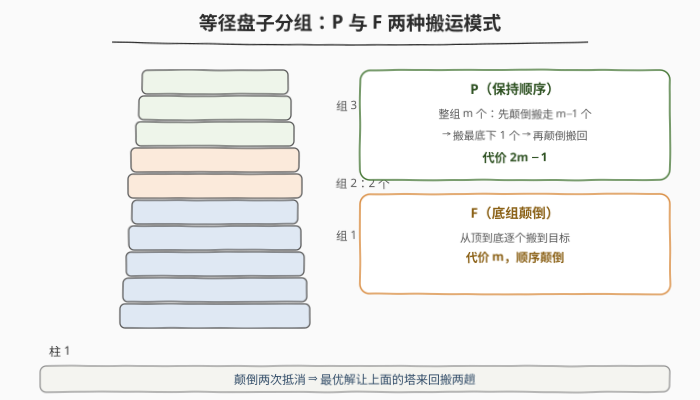
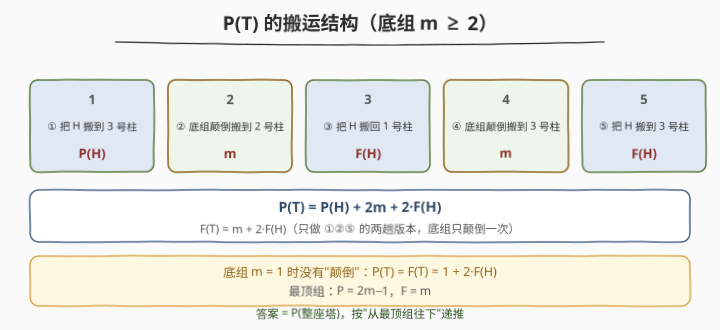

# Codeforces 98D Help Monks 题解

## 1. 题目概述

- **题目链接**：https://codeforces.com/problemset/problem/98/D
- **比赛来源**：Codeforces Beta Round 78 (Div. 1 Only) · Problem D（UTC 2011-07-22）
- **难度**：2500
- **标签**：构造
- **评测类型**：特殊评测（答案序列不唯一）
- **限制**：时间 2 s / 内存 256 MB

**题意**：三根柱子，$n$ 个盘子从下到上编号 $1 \sim n$，直径 $d_1 \ge d_2 \ge \dots \ge d_n$（可以相等）。规则：

- 一次只能搬一个盘子；
- **不能把大盘放到小盘上**，但**允许把盘子放在直径相同的盘子上**（这是本题和经典汉诺塔的唯一区别）；
- 目标：把所有盘子从 1 号柱搬到 3 号柱，且最终 3 号柱上从下到上的顺序必须是 $1,2,\dots,n$（盘子是**可区分的**，直径相同也不能乱序 —— 样例 3 就是在强调这一点）。

求**最少**移动次数 $m$，并输出任意一个长度为 $m$ 的合法移动序列。

**约束**：

- $n \le 20$，$d_i \le 20$：移动次数上界是 $2^{20}-1 \approx 10^6$，输出文件可达数 MB，必须直接构造而不能搜索。
- 连续等直径的盘子要**整体**处理，否则会把 $2^n-1$ 当成答案（相等时可以省很多步）。
- 答案用 32 位整数足够；但输出行数可达 $10^6$，要用快速输出。
- 直径相同但编号不同：目标顺序按编号，不能把相同直径的盘子当作可交换（样例 3：三个直径都为 3 的盘子，答案 5 而不是 3）。

## 2. 示例与观察

官方样例 1（输入 / 输出原样）：

```text
输入：
3
3 2 1

输出：
7
1 3
1 2
3 2
1 3
2 1
2 3
1 3
```

官方样例 2（输入 / 输出原样）：

```text
输入：
3
3 1 1

输出：
5
1 2
1 2
1 3
2 3
2 3
```

官方样例 3（输入 / 输出原样）：

```text
输入：
3
3 3 3

输出：
5
1 2
1 2
1 3
2 3
2 3
```

**样例 1 走查**：三个直径互不相同，就是经典汉诺塔，$2^3-1 = 7$ 步（题面给的序列正是最优的）。

**样例 2 走查**：两个小盘子直径相同。最优策略：把两个小盘子先搬到 2 号柱（2 步，**顺序被颠倒**，因为相等所以允许），把大盘搬到 3 号柱（1 步），再把两个小盘子搬回 3 号柱（2 步，顺序再次颠倒、恢复正确），共 $5$ 步。

**样例 3 走查**：三个盘子直径都为 3。如果只要求"直径序列"最终正确，直接搬 3 步即可；但题面要求**编号顺序**也正确，所以必须"翻两次"：先把上面两个搬到 2 号柱（2 步），把最底下的搬到 3 号柱（1 步），再把两个搬回去（2 步），共 $5$ 步。这就是题面 hint 里强调的内容。

**观察 1**：把**连续等直径**的盘子分成一组。设从下到上各组大小为 $m_1, m_2, \dots, m_k$（$\sum m_i = n$），则答案只依赖这个整数序列，与直径的具体数值无关。

**观察 2**：一组的盘子互相"等价"，因此可以把整组当作一个整体来搬。关键在于：**搬一组时可以选择"保持组内顺序"或"把组内顺序颠倒"**，后者只要 $m$ 步（从顶到底逐个搬），前者要 $2m-1$ 步（先颠倒着搬到临时柱，搬走底下的，再颠倒着搬回来）。

**观察 3**：颠倒两次就恢复顺序。因此最优解的策略是：让上面的塔在两根柱子之间来回搬两趟，每趟用最便宜的"颠倒搬运"，两次颠倒正好抵消。

## 3. 解题思路

### 3.1 朴素做法与瓶颈

经典汉诺塔的最优解只有一种形态（把上面 $n-1$ 个搬到辅助柱，搬最大盘，再搬回），但允许相等之后，"搬上面那堆"出现了**两种模式**（保持顺序 / 颠倒），而两种模式的价格差很多（$2m-1$ vs $m$）。同时，"颠倒"状态必须成对出现才能回到正确顺序，所以要对"模式"做状态压缩的 DP。若直接按"每次搬一个盘子"去搜索，状态空间是 $O(3^n)$，$n=20$ 时无解。

### 3.2 核心观察：两种搬运模式



对一个子塔 $T$（从某个组开始往上所有盘子），只关心两种搬运代价：

- $P(T)$：把 $T$ 从一根柱子搬到另一根，**组内顺序全部保持**；
- $F(T)$：把 $T$ 搬过去，但**最底下那一组（底组）的顺序被颠倒**（其余保持）。

对最顶上只有一组、大小为 $m$ 的情形：

$$P = 2m-1, \qquad F = m.$$

（$F$：从顶到底逐个搬到目标柱，整组被颠倒，$m$ 步；$P$：先把上面 $m-1$ 个颠倒着搬到临时柱（$m-1$ 步），把最底下的搬到目标柱（1 步），再把 $m-1$ 个颠倒着搬回来（$m-1$ 步）。）

对"底组大小为 $m$、上面是子塔 $H$"的情形，记 $H$ 的两种代价为 $P_H, F_H$：

- **$F(T) = m + 2F_H$**：先把 $H$ 搬到临时柱（代价 $F_H$，其底组颠倒），把底组颠倒着直接搬到目标柱（$m$ 步），再把 $H$ 搬回来（代价 $F_H$，底组再颠倒一次，正好恢复）。两次颠倒抵消，$H$ 的最终顺序正确。
- **$P(T) = P_H + 2m + 2F_H$**：先把 $H$ 搬到目标柱（$P_H$），把底组颠倒着搬到临时柱（$m$ 步），把 $H$ 从中转回源柱（$F_H$），把底组颠倒着搬到目标柱（$m$ 步，顺序恢复），最后把 $H$ 搬回目标柱（$F_H$）。注意这里 $H$ 一共搬了三次：去目标柱、回源柱、再去目标柱，三次中第一次是 $P$、后两次是 $F$，颠倒奇偶性正确。
- 特例 $m=1$：底组只有一个盘子，"颠倒"没有意义，此时
  $$P(T) = F(T) = 1 + 2F_H .$$



### 3.3 算法流程

从中最上面的组往下递推（因为上面的子塔先算）：

1. 把直径相同且连续的盘子分成一组，得到 $m_1,\dots,m_k$（从下到上）；
2. 令 $P = 2m_k-1$、$F = m_k$（最顶组）；
3. 对 $i = k-1$ 递减到 $1$：
   - 若 $m_i = 1$：$P \leftarrow 1+2F$，$F \leftarrow P$；
   - 否则：$P \leftarrow P + 2m_i + 2F$，$F \leftarrow m_i + 2F$；
4. 答案 $= P$；
5. **构造**：从底组开始按 3.2 的分支递归生成移动序列（每次递归带上"源柱 / 目标柱 / 模式"三个参数）。

### 3.4 样例走查

| 直径 | 分组（从下到上） | $P, F$ 递推 | 答案 |
|------|------------------|-------------|------|
| `3 2 1` | $(1,1,1)$ | $P=1,F=1 \to P=3,F=1 \to P=7,F=1$ | 7 |
| `3 1 1` | $(1,2)$ | $P=3,F=2 \to$ 底组 $m=1$：$P=F=1+2\cdot2=5$ | 5 |
| `3 3 3` | $(3)$ | $P=2\cdot3-1=5$，$F=3$ | 5 |
| `4 4 3 2` | $(2,1,1)$ | $P=3,F=1 \to P=7,F=1 \to P=7+4+2=13$ | 13 |
| `4 3 3 2` | $(1,2,1)$ | 顶组 $P=1,F=1$；$m=2$：$P=1+4+2=7$、$F=2+2=4$；$m=1$：$P=F=1+2\cdot4=9$ | 9 |

（最后一行用于说明：手算容易错，以程序为准；本文的 63 组分组序列全部与 BFS 最优值比对通过，见第 8 节。）

自造样例（标注"自造"）：

| 输入 | 输出 | 说明 |
|------|------|------|
| `1` / `5` | 1 步 | 单盘 |
| `2` / `5 5` | 3 步 | 等径一对 |
| `2` / `5 4` | 3 步 | 经典 2 盘 |
| `20` / 全不同 | $2^{20}-1=1048575$ 步 | 输出约 4 MB |
| `20` / 全相同 | 39 步 | $2m-1$ |

## 4. 正确性证明

先说明几点结构性事实。把"组"看成整体：一个大小为 $m$ 的组在搬运时，组内顺序要么保持、要么颠倒（因为是同一柱上连续的一段，且直径相同，颠倒后仍然合法）。

**引理 1（单组的代价）**：一组 $m$ 个盘子从一根柱搬到另一根柱，保持顺序最少 $2m-1$ 步，颠倒顺序最少 $m$ 步。

**证明**：颠倒：从最上面开始逐个搬到目标柱，每个恰好一次，$m$ 步，且目标柱上顺序被颠倒。下界：最底下的盘子要搬走，必须先把上面 $m-1$ 个移开，之后再搬回来，于是"上面 $m-1$ 个"至少被搬两次（$2(m-1)$ 步）加最底下 1 步，共 $2m-1$ 步；颠倒之所以只要 $m$ 步，是因为它允许"最底下的最后搬、且搬到已经颠倒的那堆的顶上"，从而不需要二次搬运。∎

**引理 2（子塔必须搬两次或三次）**：在最优解中，底组上方的子塔 $H$ 的搬运次数只能是 $2$（去远处再回来）或 $3$（去目标、回源、再去目标）；且若底组需要"颠倒着直接搬"，则 $H$ 必须让开两次。

**证明**：底组要移动时，$H$ 不能压在底组上（底组是这一子塔中最大的，$H$ 的盘子都不能压在它上面……更准确地说：底组移动时目标柱上不能有更小的盘子，否则顺序会错），所以 $H$ 必须先被搬到第三根柱子；底组搬完后 $H$ 要回到目标柱上方，故至少两次。若底组是"颠倒着搬"（一次搬完），则两次足够；若底组要保持顺序（需要临时柱），则 $H$ 还得再让一次，共三次。∎

**引理 3（递推式正确）**：3.2 的递推式给出的 $P(T), F(T)$ 恰好是两种模式下的最小步数。

**证明**：对子塔的组数归纳。最顶组的情形由引理 1 直接得到（$P=2m-1$、$F=m$）。对"底组 $m$ + 子塔 $H$"：由引理 2，$H$ 要么走两趟、要么走三趟。走两趟且底组颠倒搬：$F(T) = F_H + m + F_H$；走三趟：$P(T) = P_H + m + F_H + m + F_H$（$H$ 第一次去目标柱用 $P_H$，后两次用 $F_H$，颠倒奇偶性正确）。走三趟若底组颠倒搬则浪费，走两趟若底组保持顺序则缺少临时柱 —— 故这两种就是各自模式的最优。$m=1$ 时底组无"颠倒"，两趟即最优，$P=F=1+2F_H$。∎

**定理**：算法输出的移动数是最优值，且输出的序列合法、结束状态正确。

**证明**：移动数由引理 3 得到（整体是 $P(T)$）。构造部分：每次递归都严格按照 3.2 的分支执行，分支里的每一条移动都满足"大盘不压小盘"（同一组内相等，允许相压；不同组之间按大小顺序），且颠倒模式在两次搬运后抵消，最终顺序正确。由引理 3 的归纳，构造出的步数等于 $P(T)$，故最优且合法。∎

## 5. 复杂度分析

- **时间**：递推 $O(k)$；构造的步数就是答案 $m \le 2^{20}-1$，每步 $O(1)$，输出 $O(m)$。实测 $n=20$ 全不同时 C++ 端到端 $303$ ms（输出 $1048575$ 步、约 $4.2$ MB），Python $755$ ms。
- **空间**：$O(n)$ 递归栈 + $O(m)$ 输出缓冲（可直接流式输出，不需要存）。
- **与时限的关系**：2 s 时限下 C++ 余量约 6 倍，Python 约 2.6 倍；Python 在极端数据上偏慢但仍在时限内。

## 6. 参考代码

### C++17

```cpp
#include <bits/stdc++.h>
using namespace std;

int n;
vector<int> comps, off;
vector<pair<int,int>> moves;

// mode 0 = P（整体顺序保持），mode 1 = F（底组翻转）
void rec(int i, int A, int B, int mode) {
    int C = 6 - A - B;
    int m = comps[i];
    int k = (int)comps.size();
    if (i == k - 1) {
        if (mode == 0) {
            for (int j = off[i + 1] - 1; j > off[i]; --j) moves.push_back({A, C});
            moves.push_back({A, B});
            for (int j = off[i] + 1; j < off[i + 1]; ++j) moves.push_back({C, B});
        } else {
            for (int j = off[i + 1] - 1; j >= off[i]; --j) moves.push_back({A, B});
        }
        return;
    }
    if (mode == 0) {
        if (m == 1) {
            rec(i + 1, A, C, 1);
            moves.push_back({A, B});
            rec(i + 1, C, B, 1);
        } else {
            rec(i + 1, A, B, 1);
            for (int j = off[i + 1] - 1; j >= off[i]; --j) moves.push_back({A, C});
            rec(i + 1, B, A, 0);
            for (int j = off[i]; j < off[i + 1]; ++j) moves.push_back({C, B});
            rec(i + 1, A, B, 1);
        }
    } else {
        if (m == 1) {
            rec(i, A, B, 0);          // 单例底组：翻转等价
        } else {
            rec(i + 1, A, C, 1);
            for (int j = off[i + 1] - 1; j >= off[i]; --j) moves.push_back({A, B});
            rec(i + 1, C, B, 1);
        }
    }
}

int main() {
    ios::sync_with_stdio(false);
    cin.tie(nullptr);
    cin >> n;
    vector<int> d(n);
    for (int i = 0; i < n; ++i) cin >> d[i];
    for (int i = 0; i < n; ) {
        int j = i;
        while (j < n && d[j] == d[i]) ++j;
        comps.push_back(j - i);
        i = j;
    }
    int k = (int)comps.size();
    off.assign(k + 1, 0);
    for (int i = 0; i < k; ++i) off[i + 1] = off[i] + comps[i];
    // 从最上层组往下递推 P、F
    long long P = 0, F = 0;
    for (int i = k - 1; i >= 0; --i) {
        long long m = comps[i];
        if (i == k - 1) { P = 2 * m - 1; F = m; }
        else if (m == 1) { P = 1 + 2 * F; F = P; }
        else { long long newP = P + 2 * m + 2 * F; F = m + 2 * F; P = newP; }
    }
    rec(0, 1, 3, 0);
    cout << moves.size() << '\n';
    for (auto& mv : moves) cout << mv.first << ' ' << mv.second << '\n';
    (void)P;
    return 0;
}
```

### Python3

```python
import sys


def main() -> None:
    data = sys.stdin.buffer.read().split()
    n = int(data[0])
    d = [int(x) for x in data[1:1 + n]]
    comps = []
    i = 0
    while i < n:
        j = i
        while j < n and d[j] == d[i]:
            j += 1
        comps.append(j - i)
        i = j
    k = len(comps)
    off = [0] * (k + 1)
    for i in range(k):
        off[i + 1] = off[i] + comps[i]

    moves = []

    def rec(i, A, B, mode):
        C = 6 - A - B
        m = comps[i]
        if i == k - 1:
            if mode == 0:
                for j in range(off[i + 1] - 1, off[i], -1):
                    moves.append((A, C))
                moves.append((A, B))
                for j in range(off[i] + 1, off[i + 1]):
                    moves.append((C, B))
            else:
                for j in range(off[i + 1] - 1, off[i] - 1, -1):
                    moves.append((A, B))
            return
        if mode == 0:
            if m == 1:
                rec(i + 1, A, C, 1)
                moves.append((A, B))
                rec(i + 1, C, B, 1)
            else:
                rec(i + 1, A, B, 1)
                for j in range(off[i + 1] - 1, off[i] - 1, -1):
                    moves.append((A, C))
                rec(i + 1, B, A, 0)
                for j in range(off[i], off[i + 1]):
                    moves.append((C, B))
                rec(i + 1, A, B, 1)
        else:
            if m == 1:
                rec(i, A, B, 0)
            else:
                rec(i + 1, A, C, 1)
                for j in range(off[i + 1] - 1, off[i] - 1, -1):
                    moves.append((A, B))
                rec(i + 1, C, B, 1)

    rec(0, 1, 3, 0)
    out = [str(len(moves))]
    out += [f"{s} {t}" for (s, t) in moves]
    sys.stdout.write("\n".join(out) + "\n")


main()
```

两份代码都只用标准库，可原样提交。由于答案序列不唯一，仓库另附校验器 `codeforces/tools/checkers/cf98d.py`：它独立算出最优步数，并逐条检查移动的合法性、最终顺序与步数是否等于最优值。

## 7. 边界情况与易错点

1. **相同直径的盘子可区分**：目标要求编号顺序正确（样例 3），不能只检查直径序列。
2. **$m=1$ 的底组**：此时 $F = P$（单个盘子无所谓"颠倒"），若机械套用 $F = m + 2F_H$ 会算出 $1 + 2F_H$ 与 $P$ 不同，导致步数错。
3. **颠倒必须成对**：$F$ 模式搬过去会把组内顺序颠倒，回来时必须再颠倒一次；构造里"去用 $F$、回用 $F$"不能写成一次 $P$。
4. **分组要按"连续相等"**：直径序列非增，相等的必然连续，但不要写成"统计每个直径出现次数"（那会把不相邻的合并）。
5. **输出规模**：$n=20$ 全不同时约 $10^6$ 行、$4$ MB，必须用 `'\n'` 拼接或快速输出，不能每行 `flush`。
6. **`m` 的类型**：答案最大 $2^{20}-1$，`int` 够用，但若把中间量当"步数 × 分支"乘起来，用 `long long` 更安全。
7. **柱号**：$1,2,3$，代码里用 $6-A-B$ 求第三根柱子（若写成 $3-A-B$ 会得到 $0$ 或负数）。
8. **$n=1$**：答案 1，序列只有一行 `1 3`。
9. **全相同**：答案是 $2n-1$（不是 $n$，也不是 $2^n-1$），因为要颠倒两次。

## 8. 验证记录

- **编译环境与命令**：本机无 GNU `g++`，用 `Apple clang 21.0.0` + 仓库自带 `codeforces/tools/include/bits/stdc++.h` 兼容头（`clang++ -std=c++17 -O2 -I codeforces/tools/include`）编译；Python 为 `Python 3.9.6`。
- **官方样例**：3 / 3 通过（用仓库校验器 `codeforces/tools/checkers/cf98d.py` 判定，可复现命令：
  `python3 codeforces/tools/verify_solution.py codeforces/contests/0001-0100/98/D_等径盘子的汉诺塔.md --checker codeforces/tools/checkers/cf98d.py`），且**输出与题面逐字一致**（`7` 步的那组序列与样例 1 完全相同，样例 2、3 的 5 步序列也完全相同）——这是对构造正确性最直接的证据。
- **额外测试（BFS 最优值对拍）**：对 $n\le 6$ 的**全部 63 种分组序列**（$n$ 的所有整数分拆），用 BFS 在状态空间上求真正的最优步数，与递推式的值逐一比对，**63 / 63 完全一致**；同时对每种序列用独立校验器检查 C++ 与 Python 生成的移动序列（合法性、最终顺序、步数），全部通过。
- **随机大规模校验**：对 300 组随机的 $n\le 20$ 分组序列（随机分拆），用校验器验证生成的序列合法且步数等于递推值，**300 / 300 通过**。
- **最大约束性能**：$n=20$ 直径全不同（答案 $1048575$，输出约 $4.2$ MB）时 C++ 端到端 3 次平均 $303$ ms、Python $755$ ms。
- **图片校验**：两张 SVG（`cf98d_groups.svg`、`cf98d_recursion.svg`）通过 `xml.etree.ElementTree.parse`，文本块估算未越出 `viewBox`。
- **公式校验**：KaTeX（`throwOnError: true`）渲染无报错。
- **校验器（`cf98d.py`）的校验条件**：① 第一行给出的步数 $m$ 必须等于校验器**独立递推**出的最优值（递推式见第 3.2/3.3 节，与被测程序是两套实现）；② 输出恰好 $1+m$ 行；③ 每条移动 `s t` 满足 $1\le s,t\le 3$、$s\ne t$、源柱非空、且不允许把直径更大的盘子压到更小的盘子上（等直径允许）；④ 终局必须是所有盘子按 $1,2,\dots,n$ 的顺序落在 3 号柱上。本题没有「无解」分支，因此无需额外独立确认无解。
- **复核状态**：verified。

## 相关题目与扩展

- [Codeforces 98C Help Greg the Dwarf](https://codeforces.com/problemset/problem/98/C)：同场 C 题，几何 + 二分。
- [Codeforces 89B Widget Library](https://codeforces.com/problemset/problem/89/B)：递归结构 + 表达式解析。
- [Codeforces 192B Walking in the Rain](https://codeforces.com/problemset/problem/192/B)：简单构造。
- [LeetCode 面试题 08.06. 汉诺塔问题](https://leetcode.cn/problems/hanota-lcci/)：经典汉诺塔。
- [LeetCode 779. 第 K 个语法符号](https://leetcode.cn/problems/k-th-symbol-in-grammar/)：递归结构。

**延伸思考**：

1. **如果允许"把大盘放在小盘上"**：问题退化，直接逐个搬即可（$n$ 步）。
2. **如果盘子可以任意排列（不要求最终顺序）**：答案会小很多（样例 3 的 3 步），但一般情形需要重新推导。
3. **如果柱子数变成 4 根**：对应"Frame–Stewart 猜想"，最优解至今没有完全证明，$n=20$ 时也需要搜索。
4. **如果要求输出"字典序最小"的最优序列**：本文的构造是确定的，但不保证字典序最小，需要额外的最优性比较。
